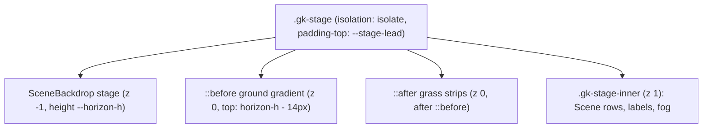

# Design Document: art-polish

## Overview

This design implements `.kiro/specs/art-polish/requirements.md` (Requirements 1 to 11). It is a CSS and SVG pass on top of `graveyard-art`. It adds three small pure modules or constants (fog row offsets, restless geometry, ground stops), changes one component's drawing (the sprite sheet), adds Hero silhouettes to the Backdrop, and replaces the fog, stage and headline rules in `app/globals.css`. It writes no scan or layout code.

Section references such as "R4.9" mean Requirement 4, criterion 9 of this spec. "GA-P4" and "P14" are properties of `graveyard-art` and `graveyard-ui`.

### Research

No web research was needed. Every technique is plain CSS already used in the repository (radial and repeating gradients, `color-mix`, pseudo-elements, `isolation`, `z-index`) or SVG (`<symbol overflow="visible">`, `transform` on `<g>`). The Next.js guide in `node_modules/next/dist/docs/` is not needed because no route, metadata, font or config changes; every touched component stays Server Component-safe (no hook, no browser API).

Facts read from the code that drive the design:

| Fact | Source | Consequence |
|---|---|---|
| `.gk-stage { padding-top: var(--horizon-h) }`, Backdrop `position: absolute; inset: 0 0 auto 0; height: var(--horizon-h)` | `app/globals.css` | The empty band is the padding. Lowering the padding moves the rows up over the Backdrop. |
| Backdrop `stage` viewBox is 1600x240, `preserveAspectRatio="xMidYMax slice"`, ground rect at `y = h - 22u`, fence rect `y = groundTop - 36u`, 40 u high | `scene-backdrop.tsx` | Desktop: ground top at 218 px, fence base at 222 px. Under 640 px the drawing scales by 150/240 = 0.625: ground top 136 px, fence base 139 px. |
| First-row feet (zero jitter) are `SCENE_PADDING_PX + PLOT_JITTER_MAX_PX + PLOT_BOX_HEIGHT_PX` = 16 + 8 + 104 = 128 px below the Scene top | `view-model/scene.ts`, `constants.ts` | Stage_Lead = `--horizon-h` - 136 px puts the feet at `--horizon-h` - 8 px, 8 px below the fence base (desktop 232 vs 222, mobile 142 vs 139). |
| `.gk-fog` is `left/right: -50%`, tile `18% x --cell-h`, repeats in both axes | `globals.css` | The repetition is the stripe source. A one-axis repeat with a two-row tile removes it. |
| `restless` symbols reference `#shape-stone-<variant>` and draw the wisp at `translate(24 -2) scale(0.62)` | `scene-sprite-ghosts.tsx` | The geometry constants move to a tested module so the arrangement can be checked. |
| Tombstone variants `rounded, cross, obelisk, slab`; `slab` path `M5 96 V74 Q5 68 11 68 H44 L48 71 H69 Q75 71 75 77 V96 Z` | `scene-sprite-stones.tsx`, `constants.ts` | `slab` is the only low, wide stone. |
| The "greyscale distinction" guarantee is the markup-distinctness test in `sprites-stones.test.tsx` | tests | A new raster-free silhouette test is added (R6.5). |

### Key design decisions

| ID | Decision | Rationale |
|---|---|---|
| AP-D1 | The Stage keeps the Backdrop at full height and lowers only its own `padding-top` to `--stage-lead = calc(var(--horizon-h) - 136px)`. The Backdrop moves to `z-index: -1` inside an isolated Stage. | R1.1, R1.2. The art is not shrunk and the tested horizon heights (240 and 150) stay. Plot boxes do not move relative to the Scene, so P14 to P16 and GA-P4 hold. The Scene moves up as a whole by 136 px, a constant. |
| AP-D2 | The Ground is two pseudo-elements of the Stage: `::before` holds the mossy gradient, `::after` holds the grass strips. Both are full-bleed and start 14 px above the Backdrop bottom (`top: calc(var(--horizon-h) - 14px)`). | R1.4 to R1.7. Pseudo-elements add no DOM and cost two paint layers. Starting 14 px above the Backdrop bottom covers the Backdrop's ground band, so the join is invisible, and the first Grass_Strip starts exactly there (feet minus 6 px). |
| AP-D3 | The grass strip period is the row period: the `::after` background tiles are `Wpx x var(--cell-h, 156px)` with `repeat` and paint only the top 14 px of each tile. | R1.6. Rows are `PLOT_CELL_HEIGHT_PX` apart, so one strip per row without per-row DOM. Because the strip depends only on `--cell-h`, its geometry is independent of plot layout (jitter, columns, plot count). The simplified form needs no rule (R1.8). |
| AP-D4 | New tokens `--color-ground-moss` (#16241d) and `--color-grass` (#1e3326) are text-bearing: labels sit on them. They are contrast-tested, not "decorative only". | R3. The label band of row N overlaps the grass strip of row N by about 8 px. |
| AP-D5 | Fog bands are radial gradients with a percent ellipse (`ellipse Rx% Ry% at X% Y%`) whose last stop is `transparent 100%`, on a layer that repeats on the Y axis only with a two-row tile. | R4.1 to R4.4. A radial gradient fades to transparent in every direction, so all four sides are soft with gradients only (no mask, no filter, R9.7). A two-row tile holds one band per row parity. |
| AP-D6 | Row_Offset constants live in `view-model/fog.ts` (`FOG_BAND_CENTER_X_PCT = [40, 60]`, `FOG_BAND_CENTER_Y_PCT = [34, 84]`, `FOG_BAND_RX_PCT = 28`, `FOG_BAND_RY_PCT = 14`) with `fogRowOffsetPct(row)`. The CSS test reads `globals.css` and checks it against these constants. | R4.9, R4.10. CSS cannot import a constant, so a test ties the two. This is the same approach as `FOG_OPACITY_LOW` and `FOG_OPACITY_HIGH`. |
| AP-D7 | The Headline clamp at 1280 px and wider is `clamp(1.75rem, 2.2vw + 0.5rem, 2.5rem)`. No other header rule changes unless a measurement shows it is needed (R2.6). | R5. At 1280 px the size is 36.2 px, at 1440 px 39.7 px, and 40 px from 1536 px. The headline has 78 characters and the Headline column is about 946 px wide, so two lines are expected (about 1.6 to 1.7 lines). The e2e test measures it. |
| AP-D8 | The `slab` id stays, only its drawing changes. | R6.2, R6.3. `variantOf` hashes `variant:<key>` modulo the list length, so the same list keeps every key's variant. Symbol ids, `GA-P1` and `GA-P10` need no edit. Only plots that are `slab` change their look. |
| AP-D9 | The restless arrangement is a table of numbers in `view-model/restless-art.ts` (stone scale 0.5, wisp scale 0.85, wisp top -10) and the sprite file imports them. | R7. A pure module can be property-tested (AP-P3), and the sprite file stays free of magic numbers. `view-model` stays pure (no JSX). |
| AP-D10 | The restless symbols set `overflow="visible"` on the `<symbol>`. | R7.4. The wisp's top is 10 px above the 0 0 80 104 box. The plot `<svg>` already has `overflow: visible`. The symbol clips by default, so the attribute is needed. A screenshot check is part of the task (risk R-1). |
| AP-D11 | Hero silhouettes are drawn inside `SceneBackdrop` for the `hero` variant only, between the trees and the fence. The path is drawn after the ground band. | R8. Painting before the fence is only possible inside the same SVG. The `stage` and `scanning` variants get an empty silhouette list. |
| AP-D12 | The Polish_Report_Spec runs with `POLISH_REPORT=1` in the `desktop` project and opens its own contexts for the two viewport sizes. | R10. It copies the pattern of `m3-report.spec.ts`: skip unless gated, mocked API, reduced motion, `document.fonts.ready`. |

### Property namespace and traceability

Properties of this spec are `AP-P1` to `AP-P4` with the tag `// Feature: art-polish, Property AP-P<n>: <title>` and a `// Validates: Requirements <list>` line. Test titles start with `AP-P<n>`. A new `tests/ui/ap-traceability.test.ts` applies the same three checks as `ru-traceability.test.ts`: each of AP-P1 to AP-P4 appears in exactly one tag, every tagged file has a `// Validates:` line, and every `it` or `test` title in a tagged file starts with the property of its tag.

---

## Architecture

### Layers of the results Stage



Paint order bottom to top: Backdrop, ground, grass, the inner column (plots, labels, fog). Plots and labels are therefore in front of the fence, the hill and the grass; the fog stays in front of the plots as before.

### Vertical geometry (desktop, 1440x760, zero jitter)

| What | y (px from Stage top) | Source |
|---|---|---|
| Backdrop top, sky | 0 | |
| Stage_Lead (Scene top) | 104 | 240 - 136 |
| First-row box top | 104 + 24 = 128 | `SCENE_PADDING_PX + PLOT_JITTER_MAX_PX` |
| Backdrop ground top / fence base | 218 / 222 | `h - 22u`, `groundTop - 36u + 40u` |
| First-row feet | 232 | 128 + 104 |
| Ground gradient and first Grass_Strip start | 226 | `--horizon-h - 14px` |
| First-row label band | 232 to 260 | feet + 28 |
| Second-row box top | 104 + 156 + 24 = 284 | |

The first row's art covers hills and the lower sky (y 128 to 232); the moon (y 40 to 80) and the stars stay visible. Under 640 px the lead is 14 px and the feet are at 142 px.

### Grass strip geometry

The strip occupies the top 14 px of each 156 px tile of `::after`, anchored at 226 px (desktop) and 136 px (mobile). The feet of a zero-jitter plot are 6 px below the strip top. The label first line therefore overlaps the strip by about 8 px. Plots with jitter (-8 to +8 px) stand up to 8 px above or below the strip, which reads as natural variation.

### Fog

```
Fog_Layer (200 % of the Scene width, left/right -50 %)
  background-size : 100% calc(var(--cell-h, 156px) * 2)
  background-repeat: repeat-y
  background-position: 0 16px            (SCENE_PADDING_PX: tile 0 starts at row 0)
  tile y 0..50 %   : even row  -> band centre (X_even, 34 %)
  tile y 50..100 % : odd row   -> band centre (X_odd, 84 %)
```

Low layer: even centre 40 %, odd centre 60 %. High layer: swapped (60 %, 40 %) and `Rx` 24 %, so the two layers never line up. The band ellipse is `ellipse 28% 14%`: horizontally it covers 12 % to 68 % (even) or 32 % to 88 % (odd) of the layer, vertically 20 % to 48 % (even) or 70 % to 98 % (odd) of the tile. All four edges are inside the tile, so every side fades to transparent. Because the layer is 200 % wide and the Scene is its middle half (25 % to 75 %), a band covers about half the Scene width, with the visible part of each band fading toward the Scene's edges.

The Hero sets `--cell-h: 120px`, so its tile is 240 px and the same rules apply (R4.5). `top: 0; bottom: 0` of the layer stays.

### Hero landscape

`SceneBackdrop variant="hero"` gains a `silhouettes` list in its config and a `path` flag. The `hero` viewBox is 1600x360 (`u = 1.5`); ground top is y 327, fence y 273 to 333.

| Element | Placement (viewBox units) | Paint order |
|---|---|---|
| 5 headstone silhouettes (rounded, cross-topped, obelisk, two small rounded) | x at 0.16, 0.26, 0.33, 0.66, 0.78 of the width; base y 322; heights 34 to 58 | after trees, before the fence |
| 1 tall cross | x 0.7, base y 322, height 78 | same |
| Path | trapezoid centred at x 0.5, from y 360 (width 150 u) narrowing up to y 318 (width 22 u) | after the ground band |

Fill is `--color-iron` for silhouettes (the same as trees and fence) and `--color-iron` at 0.5 opacity for the path. The cemetery gate (z-index 2) stands over the lower middle and the copy plate (z-index 3) covers y < 150 at the centre, so no silhouette lies under the copy plate (x between 0.3 and 0.7 is covered only below y 150). The silhouettes' tops are at y 264 or lower. Every number above is a starting value that the task adjusts after looking at the screenshot; the constraints (count, paint order, tokens, no text) are fixed.

---

## Components and Interfaces

### View_Model additions (pure, no JSX)

```ts
// view-model/fog.ts
export const FOG_BAND_CENTER_X_PCT: readonly [number, number] = [40, 60];   // Row_Offset, even and odd row (low layer)
export const FOG_BAND_CENTER_Y_PCT: readonly [number, number] = [34, 84];   // % of the two-row tile
export const FOG_BAND_RX_PCT = 28;
export const FOG_BAND_RY_PCT = 14;
export const FOG_HIGH_RX_PCT = 24;
export function fogRowOffsetPct(row: number): number;   // FOG_BAND_CENTER_X_PCT[row % 2]; total over non-negative integers

// view-model/restless-art.ts  (numbers in the 0 0 80 104 symbol space)
export const RESTLESS_STONE_SCALE = 0.5;               // about the stone foot (40, 98)
export const RESTLESS_STONE_FOOT: readonly [number, number] = [40, 98];
export const GHOST_BASE_BOX = { top: 6, bottom: 100, eyeBottom: 31, centreX: 43 };   // of #shape-ghost-wisp
export const RESTLESS_GHOST_SCALE = 0.85;
export const RESTLESS_GHOST_TOP = -10;                 // y of the wisp top in symbol space
export const RESTLESS_MAX_OVERFLOW_PX = 14;
export const RESTLESS_MAX_OVERLAP = 0.4;
export const STONE_TOPS: Readonly<Record<'rounded'|'cross'|'obelisk'|'slab', number>>;   // y of each stone top in its own shape
export function restlessStoneTransform(): string;      // "translate(40 98) scale(0.5) translate(-40 -98)"
export function restlessGhostTransform(): string;      // "translate(tx ty) scale(0.85)" so centreX maps to 40 and top maps to RESTLESS_GHOST_TOP
export function restlessGeometry(variant: string): { stoneTop: number; stoneHeight: number; ghostTop: number; ghostBottom: number; eyeBottom: number; overlapRatio: number };
```

`restlessGeometry` applies the two transforms to the numbers in `STONE_TOPS` and `GHOST_BASE_BOX`:

```
stoneTop    = foot.y - (foot.y - STONE_TOPS[v]) * RESTLESS_STONE_SCALE
stoneHeight = foot.y - stoneTop
ghostTop    = RESTLESS_GHOST_TOP
ghostBottom = ghostTop + (GHOST_BASE_BOX.bottom - GHOST_BASE_BOX.top) * RESTLESS_GHOST_SCALE
eyeBottom   = ghostTop + (GHOST_BASE_BOX.eyeBottom - GHOST_BASE_BOX.top) * RESTLESS_GHOST_SCALE
overlapRatio = max(0, ghostBottom - stoneTop) / stoneHeight
```

With the starting numbers: ghost box -10 to 70, eyes bottom 11.25; stone tops (after the 0.5 scale) are rounded 58.5, cross 61, obelisk 52, slab 84 (the Ledger_Stone top is y 70 in its shape), so the overlap ratios are 0.29, 0.24, 0.39 and 0. All are at most 0.4 and all eyes are above every stone top. A test (AP-P3) recomputes from the rendered markup, so a drift between the constants and the drawing is caught.

Superseded by `.kiro/specs/polish-leftovers/design.md` (full-size stone, smaller ghost).

`view-model/index.ts` exports `fogRowOffsetPct`, the fog constants and `restlessGeometry`.

### Components

| File | Change |
|---|---|
| `components/scene-backdrop.tsx` | Hero config: silhouettes and path (AP-D11). `stage` and `scanning`: no change. |
| `components/scene-sprite-stones.tsx` | Redraw `#shape-stone-slab` (below); update the flat twin `plot-tombstone-slab-flat`. |
| `components/scene-sprite-ghosts.tsx` | Restless symbols use `restlessStoneTransform()` and `restlessGhostTransform()`, `overflow="visible"` on the symbol, stone first then wisp. The flat twins use the same transforms. Remove `RESTLESS_PLACEMENT`. |
| `components/fog-layer.tsx` | No change (classes stay). |
| `components/scene-stage.tsx` | No change (the CSS carries the change). |
| `components/hero.tsx` | No change. |
| `app/globals.css` | Tokens, `.gk-stage` rules, ground pseudo-elements, `.gk-fog` rules, headline clamp at 1280 px. |

#### Ledger_Stone drawing

`#shape-stone-slab` is redrawn on the same 80x104 space, as a slab lying on the ground seen at a slight angle. The outline spans x 6 to 74 and y 70 to 94, and a ground shadow (rx 36) sits beneath it:

- the outline `LEDGER_OUTLINE = "M6 94 V86 L18 70 H62 L74 86 V94 Z"`: the top face runs from the far edge at y 70 (x 18 to 62) to the near edge at y 86 (x 6 to 74), and a thin front edge drops to y 94. It is filled with `--color-stone` and stroked with `--color-bone-muted`, stroke width 2, round joins;
- a near-edge line `M6 86 H74`, stroked with `--color-bone-muted`, width 1.5, round caps;
- an engraved cross `M40 73 V84 M34 78 H46` in `--color-night`, stroke width 2.2, round caps.

The outline is a 68 x 24 unit box (aspect about 2.83), while rounded is 48 x 77 (0.62), cross 44 x 72 (0.61) and obelisk 52 x 90 including its plinth (0.58). The aspect ratio therefore differs from each other variant by more than 0.5 (R6.5). The flat twin `plot-tombstone-slab-flat` is `LEDGER_OUTLINE` alone in `--color-stone`.

`STONE_TOPS.slab` is 70 (far edge of the top face) and the restless slab top becomes `98 - (98 - 70) * 0.5 = 84`. The task writes `STONE_TOPS` from the final drawing and AP-P3 recomputes the tops from the rendered markup.

### CSS changes (summary of `app/globals.css`)

```css
@theme {
  /* ... existing ... */
  --color-ground-moss: #16241d; /* ground below the fence (label text sits on it) */
  --color-grass: #1e3326;       /* grass strips at the row base (label text sits on it) */
}

.gk-stage {
  --horizon-h: 240px;
  --stage-lead: calc(var(--horizon-h) - 136px);
  position: relative;
  isolation: isolate;
  padding-top: var(--stage-lead);
}
@media (max-width: 639px) { .gk-stage { --horizon-h: 150px; } }
.gk-stage > .gk-backdrop { position: absolute; inset: 0 0 auto 0; z-index: -1; width: 100%; height: var(--horizon-h); }
.gk-stage::before, .gk-stage::after {
  content: ""; position: absolute; left: 0; right: 0; bottom: 0; z-index: 0;
  top: calc(var(--horizon-h) - 14px); pointer-events: none;
}
.gk-stage::before { background: linear-gradient(to bottom,
  var(--color-ground) 0, var(--color-ground) 14px, var(--color-ground-moss) 220px,
  color-mix(in srgb, var(--color-ground-moss) 55%, var(--color-night)) calc(100% - 160px),
  var(--color-night) 100%); }
.gk-stage::after { /* grass: radial-gradient blades with px radii, tiles Wpx x var(--cell-h, 156px) */ }
.gk-stage-inner { z-index: 1; }
```

The old `.gk-stage` `background` is removed. The grass layers are two or three `radial-gradient(ellipse Apx Bpx at Cpx Dpx, var(--color-grass) 96%, transparent 100%)` blades with different tile widths (for example 11, 17 and 23 px), each tile `Wpx var(--cell-h, 156px)`, so the blades repeat across the full width and once per row, plus a `repeating-linear-gradient(to bottom, var(--color-grass) 0 5px, transparent 5px var(--cell-h, 156px))` base bar that closes the strip. The exact radii are chosen by the task from a screenshot; the constraints are gradients only, no `url()`, tile height `var(--cell-h, 156px)`, strip height at most 14 px, colour `--color-grass` only.

```css
/* Fog (replaces the background of .gk-fog) */
.gk-fog {
  background-image:
    radial-gradient(ellipse 28% 14% at 40% 34%, var(--color-mist) 0%, color-mix(in srgb, var(--color-mist) 45%, transparent) 55%, transparent 100%),
    radial-gradient(ellipse 28% 14% at 60% 84%, var(--color-mist) 0%, color-mix(in srgb, var(--color-mist) 45%, transparent) 55%, transparent 100%);
  background-size: 100% calc(var(--cell-h, 156px) * 2);
  background-repeat: repeat-y;
  background-position: 0 16px;
}
.gk-fog-high, .gk-fog-b { /* centres swapped (60 %, 40 %), Rx 24 %; opacity 0.35 */ }

@media (min-width: 1280px) {
  .gk-headline { font-size: clamp(1.75rem, 2.2vw + 0.5rem, 2.5rem); }
}
```

`.gk-scene[data-simplified="true"] .gk-fog` rules stay. The reduced-motion block is unchanged (no new animation).

### Header

At 1280 px and wider only the Headline clamp changes (AP-D7). The grid (`1fr auto` below 1024 px, `auto 1fr auto` from 1024 px) and the Plaque position stay. If a measurement at 1440x760 or 1280x720 shows that the second-row target is missed (R2.6), the task applies, in this order and one at a time, each with a before and after measurement: (1) reduce `.gk-results-header` `row-gap` from 0.125 rem to 0; (2) reduce the vertical padding of the results page container (class on `results-page.tsx` is not touched: use a CSS rule on `.gk-results-header` parent via `main > section:first-child` only if a class already exists; otherwise stop and report); (3) reduce `.gk-plaque-letter` from 3.5 rem to 3 rem. Hiding or reordering content is not allowed.

**Mobile steps (under 640 px only; added after the measurement of task 7.4).** On the desktop sizes the ladder met the targets (1440x760 and 1280x720: first-row label bottom 587, second-row art top 602.5, headline 2 lines). At 390x700 it was exhausted after step 1: first-row label bottom 755.25 against a target of at most 700 (55 px short). The cause is the Plaque beside the headline, which squeezes the headline to 6 lines at 27.5 px, plus three rows of status chips. Task 7.5 therefore adds two steps inside the `max-width: 639px` media block of `app/globals.css`, applied one at a time with a measurement before and after each:

- Step 4: place the Plaque in the first grid row beside the repository name (the `h1`) instead of beside the headline, with a compact letter (about 2 rem), so the headline spans the full width. This is CSS grid placement only (`grid-row` and `grid-column` of the Plaque and the headline). DOM order, text, heading levels and accessible names stay unchanged. From 640 px the Plaque stays beside the headline as before.
- Step 5: tighten the status chips (smaller vertical padding and gap). Each chip keeps a touch target of at least 24x24 CSS px (WCAG 2.2 target size, 2.5.8) and the chip text size is unchanged.

If the target is still missed after step 5, the task stops and reports the numbers. The measurements are recorded in the report (R2.6).

### Tests (new and changed)

| File | Change | Covers |
|---|---|---|
| `tests/ui/art-css.test.ts` | keep the horizon test; add stage lead, ground pseudo-elements, grass, fog parsing, headline clamp at 1280 px | R1, R4, R5 |
| `tests/ui/tokens.test.ts` | add `--color-ground-moss` and `--color-grass` to the text-bearing list and the fog composite | R3.1 to R3.3 |
| `tests/ui/fog-offsets.property.test.ts` | AP-P2 | R4.9 |
| `tests/ui/view-model/variant-choice.property.test.ts` | extended or a new `tests/ui/view-model/ledger-variant.property.test.ts` for AP-P1 (see Testing Strategy) | R6.3, R6.4 |
| `tests/ui/view-model/restless-art.property.test.ts` | AP-P3 | R7 |
| `tests/ui/ground-contrast.property.test.ts` | AP-P4 | R3.4 |
| `tests/ui/components/sprites-stones.test.tsx`, `sprites-ghosts.test.tsx` | update for the new drawings | R6, R7 |
| `tests/ui/components/sprites-greyscale.test.tsx` | new silhouette test | R6.5 |
| `tests/ui/components/backdrop-hero.test.tsx` | hero silhouettes, paint order, tokens, no text | R8 |
| `tests/ui/ap-traceability.test.ts` | new | traceability |
| `tests/e2e/above-fold.spec.ts` | new sizes | R2 |
| `tests/e2e/headline-lines.spec.ts` | new | R5.4 |
| `tests/e2e/polish-report.spec.ts` | new, gated | R10 |

## Data Models

There is no persisted data and no API change. The only new data are constants:

```ts
interface FogBandGeometry { cx: number; cy: number; rx: number; ry: number }   // percent of the layer width / the two-row tile
type RestlessGeometry = ReturnType<typeof restlessGeometry>;                      // numbers in symbol space
interface GroundStop { token: string; hex: string; position: number }             // test-side model of the ground gradient (0 to 1)
```

`GroundStop` exists only in `tests/ui/ground-contrast.property.test.ts`. It lists the stops of the `.gk-stage::before` gradient: `--color-ground` at 0, `--color-ground` at 14 px, `--color-ground-moss` at 220 px, the 55 % mix of moss and night near the bottom, and `--color-night` at the end. The test parses the stops from `globals.css` rather than copying them, and linearly interpolates between neighbours in sRGB to obtain a background colour for any position `t` in [0, 1].

## Correctness Properties

*A property is a characteristic or behavior that should hold true across all valid executions of a system-essentially, a formal statement about what the system should do. Properties serve as the bridge between human-readable specifications and machine-verifiable correctness guarantees.*

Reflection on the prework: it found four criteria that vary meaningfully with input (6.4, 4.9, 7.1 to 7.3, 3.4). The checks "the plot layout does not change" (1.3) and "the grass geometry does not depend on the plot layout" (1.6) are already covered by `graveyard-ui` P14 to P16, `graveyard-art` GA-P4 and the CSS test (the grass tile depends only on `--cell-h`), so they add no new property. The Ledger_Stone's greyscale distinctness (6.5) ranges over four fixed variants, so it is an example test. No property is redundant with another.

### Property 1: AP-P1 Variant choice stays deterministic and total over the variant set

*For any* plot kind and any package key, `variantOf(kind, key)` returns the same member of `SPRITE_VARIANTS[kind]` on every call, `SPRITE_VARIANTS.tombstone` and `SPRITE_VARIANTS.restless` equal `['rounded', 'cross', 'obelisk', 'slab']`, and the symbol ids `symbolIdOf(kind, variant, false)` and `symbolIdOf(kind, variant, true)` both name a `<symbol>` of the rendered Sprite_Sheet.

**Validates: Requirements 6.2, 6.3, 6.4**

### Property 2: AP-P2 Fog row offsets alternate deterministically

*For any* non-negative integer row `r`, `fogRowOffsetPct(r)` returns the same value on every call, the value for row `r` differs from the value for row `r + 1` by at least 15 percentage points, and the value for row `r` equals the value for row `r + 2`.

**Validates: Requirements 4.4, 4.9**

### Property 3: AP-P3 The restless ghost rises above its stone

*For any* restless variant, `restlessGeometry` gives eyes whose bottom is above the stone top, a wisp whose scale is at least 0.85 of the plain ghost, a wisp top no more than `RESTLESS_MAX_OVERFLOW_PX` above the symbol box, and a vertical overlap of the wisp box with the stone box of at most `RESTLESS_MAX_OVERLAP` of the stone height; and the transforms in the rendered restless symbols equal `restlessStoneTransform()` and `restlessGhostTransform()`, with the stone drawn before the wisp in the full and the flat twin.

**Validates: Requirements 7.1, 7.2, 7.3, 7.5**

### Property 4: AP-P4 Plot labels stay readable on the whole ground

*For any* position `t` in [0, 1] along the Ground gradient (stops parsed from `app/globals.css`, linear interpolation in sRGB) and *for any* fog opacity `a` in [0, `FOG_OPACITY_HIGH`] composited with `--color-mist`, the contrast ratio of `--color-bone` against the resulting background is at least 4.5; the same holds at the grass colour with the same fog range.

**Validates: Requirements 3.2, 3.3, 3.4**

## Error Handling

This spec has no runtime error paths. The failure modes are build-time and test-time:

| Failure | Handling |
|---|---|
| `globals.css` rule parsing fails in a test (unbalanced braces, an unexpected gradient form) | The test fails with the rule's selector and the offending declaration. The CSS test never skips a rule. |
| A browser does not honour `overflow="visible"` on the restless `<symbol>` | The e2e restless screenshot check (task 5.2) shows the wisp clipped. Fallback: set the wisp top to 0 (`RESTLESS_GHOST_TOP = 0`, `RESTLESS_GHOST_SCALE = 0.8`, `RESTLESS_STONE_SCALE = 0.45`), which keeps AP-P3's constraints, and record the change in the report. |
| The Headline is three lines at 1280x720 or 1440x760 | The e2e test fails. The task reports the measured width and lines and asks the user before changing the bounds (R5 states exact bounds). |
| The Above_Fold_Target is missed | R2.6: apply the spacing ladder of the Header section, each step measured and recorded. If the ladder is exhausted the task stops and reports the numbers. |
| Fonts are not loaded when a screenshot is taken | The report specs wait for `document.fonts.ready` before each shot and measurement. |
| Two screenshot runs differ | The regeneration task reports the differing files and the cause (animation, font, clock) and does not commit them. |
| Deploy verification does not pass | The task retries while Vercel builds; a persistent failure is reported with the command output. |

## Testing Strategy

PBT is appropriate for four pure parts: variant selection, fog row offsets, the restless geometry numbers and the contrast function over the ground gradient. It is not appropriate for the CSS layout, the SVG drawings, the browser measurements and the screenshots: those use example-based unit tests (parsed CSS and rendered markup), end-to-end tests with a real browser, and looked-at screenshots.

**Property-based tests.** The library is `fast-check`, through `cfg()` from `tests/support/fc-config.ts`, minimum 100 runs. Each property is one test in its own file, with the tag `// Feature: art-polish, Property AP-P<n>: <title>` and a `// Validates: Requirements <list>` line, and a title that starts with `AP-P<n>`. Never set `FC_NUM_RUNS` in the shell.

| Property | File | Generators |
|---|---|---|
| AP-P1 | `tests/ui/view-model/ledger-variant.property.test.ts` | `fc.constantFrom(...PLOT_KINDS)`, `fc.string()` and unicode keys; renders `SceneSprites` once with `renderToStaticMarkup` and collects the `id` attributes |
| AP-P2 | `tests/ui/fog-offsets.property.test.ts` | `fc.nat({ max: 100000 })` |
| AP-P3 | `tests/ui/view-model/restless-art.property.test.ts` | `fc.constantFrom(...SPRITE_VARIANTS.restless)`; reads the rendered `GhostSymbols` and the stone tops from `STONE_TOPS` |
| AP-P4 | `tests/ui/ground-contrast.property.test.ts` | `fc.double({ min: 0, max: 1 })` for `t`, `fc.double({ min: 0, max: FOG_OPACITY_HIGH })` for `a`; a local contrast helper in `tests/support/contrast.ts` (new file, same formula as `tests/ui/tokens.test.ts`, which stays unchanged) |

**Unit and example tests.** CSS tests in `tests/ui/art-css.test.ts` (reusing its parser): stage lead formula; `::before` and `::after` exist with `top: calc(var(--horizon-h) - 14px)`, no `url(`, no `mask`; grass tile height `var(--cell-h, 156px)` and strip height at most 14 px; fog rules (below); headline clamp at 1280 px. Token tests in `tests/ui/tokens.test.ts`: the two new tokens exist, are not marked decorative-only, and have contrast of at least 4.5 with bone, including over the mist composite at `FOG_OPACITY_HIGH`. Sprite tests: the Ledger_Stone markup contains a cross carved with `--color-night`; `plot-tombstone-slab` and its flat and restless twins exist; the greyscale test compares outline path data and aspect ratios (a bounding box computed from the outline path numbers). Hero test: at least five silhouette elements and one cross before the fence element in document order, the path after the ground rect, no `<text>`, no `<title>`, tokens only, no `animate`.

**Fog CSS test (R4.10).** The test collects every rule whose selector contains `.gk-fog` and takes `background-image`. It splits the value on top-level commas (tracking parenthesis depth) and requires that every part starts with `radial-gradient(`, contains no `url(` and ends with `transparent 100%)` (comparing the last colour stop inside the function, after normalising spaces). It parses `ellipse A% B% at C% D%` with a regular expression and requires `C - A >= 0`, `C + A <= 100`, and for `D` and `B` that the band lies inside `[0, 50]` or `[50, 100]` (strictly inside, at least 2 points from each border). It requires `background-repeat: repeat-y`, `background-size` starting with `100%` and `calc(var(--cell-h, 156px) * 2)`, and for each layer two bands whose `C` differ by at least 15 and whose `D` are in different halves. It then compares `C`, `D`, `A` and `B` with `FOG_BAND_CENTER_X_PCT`, `FOG_BAND_CENTER_Y_PCT`, `FOG_BAND_RX_PCT`, `FOG_BAND_RY_PCT` and `FOG_HIGH_RX_PCT` from `@/view-model`. A rule that has `background-image` and does not satisfy this fails by selector. This check does not depend on the rendered browser, and it fails if someone replaces the gradients with an image or a mask.

**End-to-end tests** (Playwright, mocked `/api/scan`, reduced motion, fonts ready):

- `tests/e2e/above-fold.spec.ts`: sizes 1440x760 and 1280x720 (desktop project) and 390x700 (mobile project). Desktop: the bottom of the lowest label of the first row is at most the viewport height, the first plot of the second row has at least 40 px of its art box in view, and the Plaque shares a grid row with the Headline. Mobile: the bottom of the lowest label of the first row is at most the viewport height. The first row is the set of plots whose `row` data attribute or whose top lies within one cell height of the first plot's top; the test derives it from the bounding boxes.
- `tests/e2e/headline-lines.spec.ts`: at 1280x720 and 1440x760 (and 1920x1080 for the 40 px upper bound), the number of distinct `top` values in `Range.getClientRects()` over the Headline text is at most two.
- The unchanged specs `art.spec.ts`, `scene-perf.spec.ts`, `js-budget.spec.ts`, `layout-shift.spec.ts`, `reflow.spec.ts`, `reduced-motion*.spec.ts` stay green. `art.spec.ts` gains one assertion that the first row's plots overlap the Backdrop box vertically (R1.2), and the stage width test is unchanged.
- `tests/e2e/polish-report.spec.ts` (`POLISH_REPORT=1`, `desktop` project): four screenshots at 1440x760 and 390x700, axe per screen, JSON of the measurements in `test-results/polish-measurements.json` (not committed).

**Visual review.** Every task that changes how something looks has a sub-agent step that takes screenshots with the Polish_Report_Spec or a one-off Playwright command, opens the images, and writes what it sees (what is in front of what, whether any band edge or stripe is visible, whether the ghost is above its stone, whether the first row stands on the ground) into the task result and later into the report.

**Budgets.** `npm run check:bundle` and `tests/e2e/js-budget.spec.ts` (256,000 bytes gzip), and `tests/e2e/scene-perf.spec.ts` (100 ms budget and 80.4 ms regression limit) run at the end. This spec adds no JavaScript beyond a handful of constants and two small pure functions, and it adds CSS and SVG markup only.
