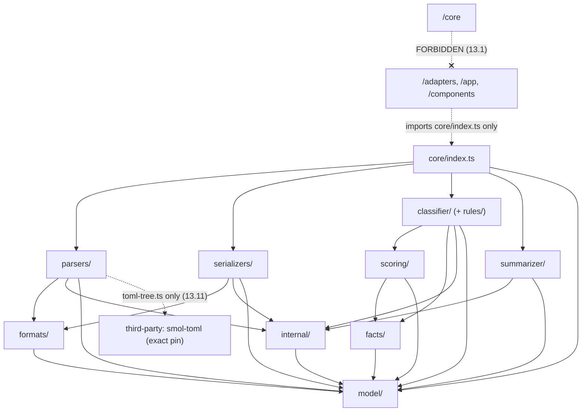
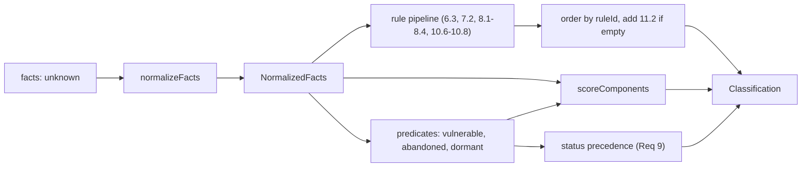

# Design Document: dependency-graveyard-core

## Overview

This document designs the pure logic layer in `/core` for Gravekeeper: manifest parsing and serialization (`package.json`, `requirements.txt`, `Cargo.toml`), dependency health classification with a 0-100 risk score, and the repo-level summary with a grade. It implements `requirements.md` in this folder. Requirement and criterion numbers (for example `8.3`) always refer to that file.

### Design goals

1. **Pure and total.** Every public function returns a value for every input. Nothing throws out of `/core`, nothing reads a clock, the network or the file system, and no argument is mutated.
2. **Untrusted input.** Manifest text and health facts are hostile by default. Parsers build results from `Map`/arrays and own-property reads only, and never assign attacker-chosen keys onto plain objects. The only third-party code in `/core` is `smol-toml`, pinned to an exact version and called through one wrapper that returns a `Result`.
3. **One source of truth.** Thresholds live in one constants object. Each condition (vulnerable, abandoned, dormant) is defined once as a predicate and reused by the rule that emits the Reason and by the scoring component that awards the points.
4. **Provable score bounds.** Component caps sum to exactly 100, so clamping is a defensive no-op. The rule ordering is chosen so the monotonicity properties hold by construction (see "Scoring").
5. **Testable by properties.** Every `[PBT]` criterion maps to at least one property below, and the module split lets each property target one module.

### Public API

```ts
// core/index.ts (public entry point, Requirement 13.5)
export function parseManifest(text: unknown, format: ManifestFormat): ParseResult;
export function serializeManifest(
  dependencies: readonly SerializableDependency[],   // Dependency with an optional rawName (glossary: Dependency)
  format: unknown,
): Result<string, SerializeError>;
export function classify(facts: unknown): Classification;
export function summarize(items: readonly AssessedDependency[]): RepoSummary;
// Pure helpers for consumers (the UI) so no consumer re-implements the merge rules (changed by scan-accuracy):
export function uniquePackages(items: readonly AssessedDependency[]): UniquePackage[]; // grouping by Package_Key + Merged_Classification, exactly what summarize uses
export function mergeClassifications(list: readonly Classification[]): MergedClassification; // criterion 12.22 order
export function compareClassifications(a: Classification, b: Classification): number;       // criterion 12.22 total order
export * from './model';       // types, CONSTANTS, CORE_ALLOWED_PACKAGES, SCOPE_ORDER
```

`uniquePackages` is the grouping-and-merging step of `summarize` (groupAssessed plus mergeClassifications) extracted into a named function so that `summarize` and the UI share one implementation. `summarize` is changed to call it; its results do not change (changed by scan-accuracy). `mergeClassifications` and `compareClassifications` are existing functions in `summarizer/merge.ts` that become public (changed by scan-accuracy).

`parseManifest` takes `text: unknown` and `classify` takes `facts: unknown` on purpose. Callers in `/adapters` hand over data that crossed a trust boundary, and the requirements (4.3, 6.4, 6.6) demand graceful handling of wrongly typed values. The strictly typed `HealthFacts` interface documents the shape callers should produce; it is not trusted at runtime.

### Research summary

- **TOML parsing.** Several JavaScript TOML libraries have had prototype-pollution advisories triggered by `__proto__` keys (for example [js-toml](https://github.com/sunnyadn/js-toml/security/advisories/GHSA-65fc-cr5f-v7r2) and [@std/toml](https://github.com/denoland/std/security/advisories/GHSA-crjp-8r9q-2j9r)). Requirement 4.9 makes this a first-class concern. The user accepted `smol-toml` in `/core` (criterion 3.15), so the design pins an exact version, wraps every call, and keeps a `__proto__` regression test that must pass on every version bump.
- **JSON.parse and `__proto__`.** `JSON.parse` creates `__proto__` as an ordinary own data property, so reading with `Object.entries` and `Object.hasOwn` is safe. Writing the same key back with `obj[key] = value` on a plain object is not safe, so the serializer builds JSON text by hand from `JSON.stringify(string)` fragments.
- **Key order and duplicates.** The parser output is sorted (Dependency_Order), so source key order never reaches the output. It still matters for one decision: which duplicate is the First_Occurrence. `JSON.parse` keeps the last value of a repeated key and hides the earlier ones (criterion 1.11). `smol-toml` returns plain objects and no source positions, so v1 records no line or column for Cargo entries. The Cargo parser decides the First_Occurrence with a documented rule that needs no positions (criterion 3.18, see "Cargo.toml parser").
- Content of the advisories was only used to motivate the regression test; no code was copied.

## Architecture

### Module layout inside `/core`

```text
core/
  index.ts                  public entry point, re-exports only
  model/
    types.ts                Dependency, HealthFacts, Classification, Reason, ParseResult, UniquePackage, RankedPackage, RepoSummary, ...
    constants.ts            CONSTANTS (typed const object), SCOPE_ORDER, CORE_ALLOWED_PACKAGES, named re-exports
    index.ts
  internal/
    result.ts               Result<T,E>, ok(), err()
    safe.ts                 guard(): top-level try/catch safety net
    compare.ts              compareCodePoints(a, b)
    deep-equal-key.ts       canonicalKey() used for tie-breaks
  formats/                  shared lexical knowledge used by BOTH parsers and serializers
    manifest-format.ts      MANIFEST_FORMATS, ecosystemOf(), supportedScopes()
    npm-source-kind.ts      sourceKindOfNpmSpec()           (criterion 1.9)
    requirements-lexical.ts normalizePypiName() (PEP503_Normalization), isNameToken(), writtenName(), line grammar, canonical-spec predicate
    key.ts                  dependencyKey(): JSON.stringify([name, scope]), name = normalized name (ecosystem is fixed per call)
    order.ts                compareDependencies() = Dependency_Order (rawName is the last tie-break), scopeIndex()
  parsers/
    index.ts                parseManifest(): validation, size check, dispatch, finish, safety net
    package-json.ts
    requirements-txt.ts
    cargo-toml.ts
    toml-tree.ts            the ONLY module that imports smol-toml; parseToml() returns a Result, never throws
    finish.ts               rank, dedup by Dependency_Key (first occurrence wins, one warning per discard), sort
  serializers/
    index.ts                serializeManifest()
    representable.ts        isRepresentable(dep, format)    (criterion 5.13)
    package-json.ts
    requirements-txt.ts
    cargo-toml.ts
  facts/
    normalize.ts            normalizeFacts(unknown) -> NormalizedFacts (Valid_Fact vs Unknown_Fact)
    predicates.ts           isVulnerable, isReleaseAbandoned, isDormant, isStaleRelease, ...
  scoring/
    vulnerability.ts        Vulnerability_Component
    abandonment.ts          Abandonment_Component
    maintainers.ts          Maintainer_Component
    index.ts                scoreComponents(), computeScore()
  classifier/
    index.ts                classify()
    pipeline.ts             ordered rule list, sorting, 11.2 fallback
    status.ts               Requirement 9 precedence
    rules/
      unknown-facts.ts      6.3
      vulnerability.ts      7.2
      archived.ts           8.1
      deprecated.ts         8.2
      release-abandoned.ts  8.3
      release-dormant.ts    8.4
      release-stale.ts      10.6
      no-maintainers.ts     10.7
      single-maintainer.ts  10.8
      no-signals.ts         11.2 (fallback, applied by the pipeline)
  summarizer/
    index.ts                summarize()
    group.ts                group entries by Package_Key into Unique_Packages, collect scopes
    merge.ts                Merged_Classification, Classification_Tie_Key, canonicalKey
    partition.ts            assessed vs unassessed, Unassessed_Reason
    order.ts                comparator of criterion 12.6 (total on distinct Package_Keys)
    grade.ts                grade(score)
```

Tests live outside `/core` (`/tests/core/...`, per `structure.md`), so they may use Node APIs. The purity checker and its CLI live in `/scripts`, also outside `/core`.

### Dependency direction



Rules enforced by the dependency graph:

- Arrows point from dependent to dependency. There are no cycles. `model` and `internal` are leaves.
- `parsers` and `serializers` do not import each other. Everything they share lives in `formats`.
- `classifier` and `summarizer` do not import each other. `summarizer` consumes `Classification` values only as data (type import from `model`).
- Only `parsers/toml-tree.ts` imports a third-party package, and it imports only `smol-toml`. `/core` may depend only on pure parsing libraries that perform no I/O. No `/core` file imports Node built-ins.
- `summarizer` and `classifier` share nothing but types from `model`.
- Code outside `/core` imports only `core/index.ts`.

### Classification flow



### How the static purity check (Requirement 13) is enforced

Three layers, all outside `/core`:

1. **Checker library** `scripts/core-purity/check.ts` exports `checkSource(filePath: string, sourceText: string): Violation[]`. It parses with the TypeScript compiler API (`ts.createSourceFile`, a dev dependency) and walks the AST, so words in comments and strings never cause false positives. It reports:
   - Import specifiers (`import ... from`, `export ... from`, `import()`, `require()`, `import x = require()`) that resolve inside `/adapters`, `/app` or `/components`. Relative specifiers are resolved against the file path. The `@/` alias is resolved against the project root using `tsconfig.json` `paths`.
   - **Import allow-list (criterion 13.10).** Every specifier must be either a relative path whose resolved location stays inside `/core`, or exactly a name in `CORE_ALLOWED_PACKAGES` (`smol-toml`). Everything else is a violation, rule `import-not-allowed`: Node built-ins (`fs`, `fs/promises`, `node:*`, `child_process`, `http`, `https`, `net`, `os`, `path` and so on), any other bare package, a subpath such as `smol-toml/x`, the `@/` alias, and a relative path that escapes `/core`.
   - **Single TOML import site (criterion 13.11).** A specifier equal to `smol-toml` is allowed only in `core/parsers/toml-tree.ts` (constant `TOML_WRAPPER_PATH` in the checker). Any other file importing it gets rule `toml-import-outside-wrapper`.
   - Identifiers `fetch` and `XMLHttpRequest` (not when they are property names such as `x.fetch`, but including `globalThis.fetch` and `window.fetch`).
   - `Date.now`, `Date["now"]`, `new Date()` with zero arguments, `Date()` as a call, and `Math.random` / `Math["random"]`.
   - **Package pin check.** `checkPackageJson(text: string): Violation[]` parses `package.json` with `ts.parseJsonText` (which keeps positions) and, for every name in `CORE_ALLOWED_PACKAGES`, requires an entry in `dependencies` whose value matches `^\d+\.\d+\.\d+(-[0-9A-Za-z.-]+)?$`. A missing entry, `^1.2.3`, `~1.2.3`, `1.x`, `*`, `>=1`, `1.2`, `latest`, `npm:`/`git+`/`file:` specs and ranges are violations (rule `package-not-pinned`), reported at the line of the entry.
2. **CLI** `scripts/check-core-purity.ts` walks `core/**/*.ts`, runs `checkSource` on each file, runs `checkPackageJson` on the root `package.json`, prints `path:line:column rule message` for every violation and exits with code 1 if there is at least one (criterion 13.8). `package.json` wires it as `"check:core": "tsx scripts/check-core-purity.ts"` and `"prebuild": "npm run check:core"`, so a violation fails `next build`.
3. **Vitest test** `tests/core/purity.test.ts` runs the same checker over the real `/core` tree and the real `package.json` (expects zero violations) and over inline violating snippets (expects the exact rule, line and column). This keeps the checker itself honest. Criterion 13.4 is covered by `tsc --noEmit` with `"strict": true` in CI, plus an `expectTypeOf` test for criterion 13.5 on the public entry point.

An optional ESLint override for `core/**` (`no-restricted-imports`, `no-restricted-globals`, `no-restricted-properties`) gives editor feedback. It supplements the checker and is not the gate.

## Components and Interfaces

### Shared conventions

- Every rule, predicate and scoring function has a comment on the line directly above it naming the requirement, for example `// Requirement 8.3` (criterion 13.6, steering rule).
- All string comparisons that influence output use `compareCodePoints(a, b)` (a loop over `codePointAt`, not `localeCompare` and not `<` on UTF-16 units), because criteria 5.12, 12.6 and 12.14 require code-point order.
- Warnings are plain English strings built by pure helpers, never by interpolating raw input without bounding it. Package names and line numbers are included; values longer than 80 characters are truncated with an ellipsis inside the warning only.

### `parseManifest`

```ts
export function parseManifest(text: unknown, format: ManifestFormat): ParseResult {
  return guard(
    () => parseUnguarded(text, format),
    (e) => ({ dependencies: [], warnings: [internalErrorWarning(e)] }),
  );
}

function parseUnguarded(text: unknown, format: unknown): ParseResult {
  if (!isManifestFormat(format)) return emptyWith(`Unsupported manifest format: ${describe(format)}.`);
  if (typeof text !== 'string') return emptyWith(`Manifest input must be a string, received ${typeOf(text)}.`); // 4.3
  if (text.length > CONSTANTS.MAX_MANIFEST_LENGTH)
    return emptyWith(`Manifest is longer than ${CONSTANTS.MAX_MANIFEST_LENGTH} characters (MAX_MANIFEST_LENGTH); nothing was parsed.`); // 4.4
  const raw = PARSERS[format](text);          // { candidates, warnings }: candidates carry a rank, may contain duplicates
  return finish(raw, format);                 // rank, dedup by Dependency_Key, warn per discard, sort (4.6, 4.8)
}

// parsers/finish.ts
interface Candidate { readonly dependency: Dependency; readonly rank: readonly number[]; readonly where: string }
```

`typeOf` returns `"null"`, `"array"` or `typeof`. The format check runs first and the format is never inferred from the text (4.1).

**`finish` algorithm (criteria 4.6, 4.8).**

1. Stable-sort a copy of `candidates` by `rank`, comparing the number arrays lexicographically. The rank is the First_Occurrence order defined per format: `[]` for `package.json` (it cannot produce duplicates), `[firstLine]` for `requirements.txt`, `[tableOrdinal, enumIndex]` for `Cargo.toml` (criterion 3.18; no line or column is recorded).
2. Walk the sorted list with a `Set<string>` of Dependency_Keys, `JSON.stringify([name, scope])`, where `name` is the normalized name (the ecosystem is fixed by the format, so it is not part of the key). Two spellings of one pypi package, such as `Foo_Bar` and `foo.bar`, therefore share a key. A string key built from a JSON array is injective, so names containing separators cannot collide. The first candidate for a key is kept, with its own `rawName`. Each later one is discarded, whatever its `rawName`, `sourceKind` or `versionSpec`, and adds exactly one warning (criterion 4.6): `<where>: duplicate dependency "<name>" in scope "<scope>"; the first occurrence was kept.` (`<name>` is the normalized name.) (`where` is `requirements.txt line 7` or `Cargo.toml table [target.'cfg(unix)'.dependencies]`, truncated to 80 characters).
3. Sort the kept dependencies with `compareDependencies` (Dependency_Order: normalized `name` by code point, then index in `SCOPE_ORDER`; ties, which cannot remain after deduplication, by `ecosystem`, `versionSpec`, `sourceKind` and `rawName`). Source order never reaches the output.
4. `warnings` = the format parser's own warnings in the order found, then the duplicate warnings in rank order. The result is a pure function of the text, so it is deterministic (4.7).

**JSON exception (criterion 1.11).** `JSON.parse` returns one value per key (the last one), so `package.json` never reaches `finish` with two candidates for one key and no duplicate warning is possible. This is documented in the module header, pinned by a unit test, and the generator for Property 4 treats it as a separate case with the oracle "last value wins, zero warnings".

### `package.json` parser

Strategy: `JSON.parse`, then read only own properties.

1. `JSON.parse(text)` inside `try`. On failure, return `{ dependencies: [], warnings: ["package.json is not valid JSON: <message>"] }` (1.6). A top-level value that is not a plain object (null, array, string, number, boolean) gives the same single-warning result. Empty text is a `JSON.parse` failure and takes the same path.
2. For each section in the fixed order `dependencies` (runtime), `devDependencies` (dev), `optionalDependencies` (optional), `peerDependencies` (peer), read the value only if `Object.hasOwn(root, section)` (1.1, 1.2). `Object.hasOwn` prevents an inherited `dependencies` from being picked up.
3. If the section value is not a non-null, non-array object, add one warning naming the section and continue (1.5). `null` counts as "present but not an object".
4. For each `[name, value]` of `Object.entries(section)`: a non-string value gives one warning naming package and section and the entry is skipped (1.4). A string value yields a candidate `{ name, rawName: name, ecosystem: "npm", versionSpec: value, scope, sourceKind: sourceKindOfNpmSpec(value) }` with rank `[]`, `versionSpec` untouched (1.3, 1.10) and no normalization of `name` (1.12). An empty `name` is skipped with one warning because criteria 4.5 and 4.10 require `name.length >= 1`. The same name in two sections gives two candidates with different keys (1.8).
6. A repeated key inside one section is resolved by `JSON.parse` itself (last value, no warning, criterion 1.11).
5. `__proto__`, `constructor` and `prototype` need no special case. `JSON.parse` makes them own data properties, `Object.entries` lists them, and the result objects are literals whose `name` is a string value (4.9).

`sourceKindOfNpmSpec(spec)` (criterion 1.9), implemented with prefix checks and one non-backtracking scan, never a nested-quantifier regex:

| Order | Check on the exact value | Result |
|---|---|---|
| 1 | starts with `file:`, `link:` or `workspace:` | `path` |
| 2 | starts with `git+`, `git://`, `github:`, `gitlab:` or `bitbucket:` | `git` |
| 3 | GitHub shorthand: cut at the first `#` (the rest is `<ref>`), then exactly one `/`, with a non-empty user part and a non-empty repo part made only of `[A-Za-z0-9._-]` | `git` |
| 4 | otherwise | `registry` |

The shorthand check splits at the first `#` and then splits the head at `/` and validates each side character by character. A spec such as `foo/bar#v1.0` is git, and so is `a/b#` (an empty `<ref>` is allowed). `@scope/pkg` is not (the user part contains `@`). `1.0.0` has no `/` and stays registry.

### `requirements.txt` parser

Strategy: a line-based scanner. No regex with nested quantifiers (ReDoS safety on 1,000,000 characters).

1. **Split** on `\r\n`, `\n` or `\r` (CRLF is one separator). Keep each physical line with its 1-based number.
2. **Join continuations** (2.6, 2.9): while a line ends with `\` and a following line exists, drop the `\`, append the next line, and continue. A final line ending in `\` with no successor is parsed without that backslash. The joined group carries the number of its first line, and counts as one requirement line.
3. **Strip comments** (2.5): remove from the first `#` that is at index 0 or preceded by whitespace (JavaScript `\s`) to the end of the group.
4. **Skip** blank lines and lines whose trimmed text starts with `-` (2.7), silently.
5. **Tokenize** the trimmed text with a hand scanner:
   - Name_Token: `[A-Za-z0-9][A-Za-z0-9._-]*`. Upper-case letters and non-normalized spellings are accepted (2.2). If the text does not match, warn with the line number and skip (2.8). `__proto__` is rejected here, because it does not start with an alphanumeric character: the line gets exactly one warning, no Dependency, and no prototype is touched (4.11). `constructor` and `prototype` are valid Name_Tokens and become ordinary Dependencies (4.9).
   - optional whitespace, then optional extras `[...]` (skipped up to the first `]`; an unclosed `[` is a warning) (2.4).
   - optional whitespace, then the rest.
6. **Rest begins with `@`** means a direct reference (2.10, 2.11). The target is the text after `@`, trimmed, cut at the first whitespace-followed-by-`;` (an environment marker). Classification of the target:
   - starts with `git+` gives `sourceKind: "git"`.
   - starts with `file:`, `./`, `../` or `/` gives `"path"`.
   - anything else is a warning and the line is skipped (2.8).
   `versionSpec` is the trimmed target exactly as written (an empty target is a warning). A target that contains `\` is skipped with one warning that includes the 1-based number of the first line of the group (2.13).
7. **Bare reference** (2.10, 2.11): if the whole trimmed text starts with `git+`, `file:`, `./`, `../` or `/`, look for an `#egg=<name>` fragment. Because comment stripping removes `#` only when preceded by whitespace, `#egg=` survives when attached to the URL. Without a usable `egg` name, warn and skip (2.8). With one, `rawName` is the `egg` value as written (up to the next `&`, and it must be a Name_Token, else the line is skipped under 2.8) and `versionSpec` is the whole trimmed text. A whole trimmed text that contains `\` is skipped with one warning that includes the 1-based number of the first line of the group (2.13).
8. **Registry line** (2.3, 2.8, 2.12): cut the rest at the first `;` (marker), trim. The rest must be empty (`versionSpec = "*"`) or the literal `*`, or must start with one of the comparison operators `===`, `==`, `!=`, `<=`, `>=`, `~=`, `<`, `>` (criterion 2.8). Otherwise the line "cannot be parsed as a requirement": warn and skip. In addition, a rest that still contains `\` (only possible in the middle of a joined line) is skipped with one warning that includes the 1-based number of the first line of the group (2.13). The same backslash check applies to the git and path `versionSpec` of steps 6 and 7, which can contain a backslash on a single line. Each skipped line produces exactly one warning, never two.
9. **Name normalization** (2.2, 2.14): `normalizePypiName(s)` in `formats/requirements-lexical.ts` maps each ASCII letter `A` to `Z` to its lowercase letter by code point arithmetic (never `toLowerCase()`, which also changes non-ASCII characters) and replaces each run of one or more `-`, `_` and `.` with one `-`, leaving every other character unchanged. It is idempotent (Property 44). The parser sets `rawName` to the Name_Token as written and `name = normalizePypiName(rawName)`, so `normalize(rawName) === name` holds by construction (2.2, 2.14). Examples: `Django` gives `name` `django`; `PyYAML` gives `pyyaml`; `SQLAlchemy` gives `sqlalchemy`; `Foo_Bar` gives `foo-bar`; `foo.bar` gives `foo-bar`.
10. Every candidate is `ecosystem: "pypi"`, `scope: "runtime"` (2.1), with rank `[firstLineNumber]` and `where = "requirements.txt line <n>"`. For git and path references (2.10, 2.11), `rawName` is the written `<name>` or the `egg` value and `name` is its normalization. `finish` then applies criterion 4.6: `Foo_Bar` on line 3 and `foo.bar` on line 9 normalize to the same key `foo-bar`, the line-3 entry is kept with `rawName` `Foo_Bar`, and one warning names `foo-bar`, `runtime` and line 9.

Warnings have the form `requirements.txt line 7: cannot parse requirement "...".` with the quoted text truncated.

### `Cargo.toml` parser

Strategy: parse TOML with a library behind `toml-tree.ts`, then interpret the resulting tree with the same defensive reads as the JSON parser.

```ts
// parsers/toml-tree.ts
export type TomlTable = { readonly [key: string]: unknown };            // own properties only
export function parseToml(text: string): Result<TomlTable, { message: string; line?: number }>;
```

**Library: `smol-toml`, accepted in `/core` (criteria 3.15, 13.10, 13.11).** Pure TypeScript, zero dependencies, no I/O, no Node built-ins, small enough for the Vercel free tier, TOML 1.0 compliant, and its syntax error may carry a `line` property, which criterion 3.9 uses only when it is present. Constraints that the design enforces:

- **Exact pin.** `package.json` lists `smol-toml` under `dependencies` with a plain `<major>.<minor>.<patch>` string. The version is the latest stable release at install time (`npm install smol-toml --save-exact`, task 1.3), pinned exactly. The regression test below must pass on it. The static check of criterion 13.10 fails the build on any `^`, `~`, range or tag.
- **One import site.** Only `parsers/toml-tree.ts` imports `smol-toml` (criterion 13.11). It exports `parseToml` and nothing else from the library.
- **Never throws.** `parseToml` wraps the single library call in `try`/`catch (e: unknown)`. It handles `Error` instances, non-Error throws and `RangeError` from deep nesting. It returns `err({ message, line })`, where `line` is set only when the thrown value has a finite numeric `line` property, and `message` is the error name plus a truncated message. A unit test mocks `smol-toml` to throw an `Error`, a string and `undefined`, and asserts a `Result` each time.
- **Pollution regression test.** A unit test feeds `[dependencies]\n__proto__ = "1"\nconstructor = "2"\nprototype = "3"` and asserts the three keys are own enumerable properties of the result, that `Object.prototype` and `({}).__proto__` are unchanged, and that `Object.entries` lists them. The test must pass again on every version bump. Reads never use `table[key]` on unchecked keys; they use `Object.hasOwn` and `Object.entries`.

**First_Occurrence without positions (criterion 3.18).** `smol-toml` returns plain objects and no source positions, and v1 records no line or column for Cargo entries, so there is no position scan. Every candidate gets the rank `[tableOrdinal, enumIndex]`:

- `tableOrdinal` is 0 for the top-level table of the entry's scope (`[dependencies]`, `[dev-dependencies]` or `[build-dependencies]`) and `1 + k` for the `<cfg>` table whose key is at index `k` in `Object.entries(target)` (the key enumeration order returned by `smol-toml`).
- `enumIndex` is the index of the entry in `Object.entries` of its own table.
- Ranks are compared only between candidates with the same Dependency_Key, so they are compared within one scope. The three table kinds never compete.

The documented rule is therefore: **within a scope, the top-level table comes before every `[target.<cfg>.*]` table; target tables are taken in the key enumeration order of the parser; entries inside a table are taken in enumeration order.** The order of the table headers in the text is deliberately not used, so `[target.'cfg(unix)'.dependencies]` written above `[dependencies]` still loses to `[dependencies]`. The enumeration order is the parser's: integer-like keys of one table come first, then the other keys in insertion order. That quirk can only change the outcome for two entries of one table that map to the same `package` name. The result is deterministic because it depends only on the parsed tree. Unit tests pin one literal example per case and derive the expected `<cfg>` order from the keys the wrapper returns, so a change of enumeration order in a `smol-toml` version bump is caught.

Interpretation (all reads on own properties):

1. On `parseToml` error: `{ dependencies: [], warnings: ["Cargo.toml is not valid TOML: <message>"] }`. The text ` (line N)` is appended only when the wrapper has a `line` taken from the `smol-toml` error. The parser performs no scan of its own to find a line, and omits it otherwise (3.9).
2. Collect dependency tables: for each of `dependencies` (runtime), `dev-dependencies` (dev), `build-dependencies` (build) at top level, then for each `<cfg>` under `target`, the same three names (3.1, 3.3, 3.8). The scope depends only on the table name, never on `<cfg>`. The `target` table is read with `Object.entries`, so `<cfg>` tables are visited in the parser's key order (3.18). A dependency table or a `target` table that is not a table gives one warning naming it and is skipped (3.14).
3. For each `[key, value]` of a table:
   - `value` is a string: `versionSpec = value`, `sourceKind = "registry"` (3.4).
   - `value` is a table: first check `version`, `package`, `git`, `path`. If any is present and is not a string, warn naming `key` and skip the entry (3.10). Then `name = package ?? key` (3.7) and `rawName = name`, with no normalization (3.17); if `git` is a string: `git` source with `versionSpec = git` (3.11, wins over `path` and `version`); else if `path` is a string: `path` source (3.12); else `versionSpec = version ?? "*"`, registry (3.5, 3.6).
   - any other value type (number, boolean, array, date): warn naming `key` and skip (3.14).
4. Empty resulting `name` is skipped with a warning (4.10). A `name` or `versionSpec` that contains a lone surrogate is skipped with one warning naming `key` (3.16). The same condition makes a Cargo Dependency non-Representable (5.13), so parser output stays Representable.
5. Each remaining entry becomes a candidate with the rank above and `where = "Cargo.toml table [<table path>]"`. Candidates for the same key, such as `serde` in `[dependencies]` and in `[target.'cfg(unix)'.dependencies]`, or two `<cfg>` tables of the same kind, are resolved by `finish`: the one with the smallest rank under criterion 3.18 is kept (the top-level table first, then the `target` tables in enumeration order) and each other one gets one duplicate warning that names the package, the scope and the table, without a line or column (3.19). A crate in `[dependencies]` and `[dev-dependencies]` has two keys and yields two Dependencies (3.8).

### `serializeManifest`

```ts
export function serializeManifest(deps: readonly SerializableDependency[], format: unknown): Result<string, SerializeError> {
  return guard(() => serializeUnguarded(deps, format), (e) => err({ kind: 'internal-error', message: errorName(e) }));
}
```

Steps in `serializeUnguarded`:

1. `format` not in `MANIFEST_FORMATS` returns `err({ kind: 'unsupported-format', format: describe(format) })` and never text (5.7).
2. `deps` not an array returns `err({ kind: 'invalid-input' })`. More than `MAX_SERIALIZED_DEPENDENCIES` (10,000) entries returns `err({ kind: 'too-many-dependencies', limit: 10000 })` and no text (5.19).
3. Filter, first of the three steps of criterion 5.2: keep `d` where `isWellFormedDependency(d)` (`rawName`, when present, is a string) and `d.ecosystem === ecosystemOf(format)` and `supportedScopes(format).includes(d.scope)` and `isRepresentable(d, format)`. Everything else is omitted without error (5.2).
4. Sort a copy with `compareDependencies` (Dependency_Order: normalized `name` by code point, then `scope` in `SCOPE_ORDER`, then `ecosystem`, `versionSpec`, `sourceKind`, then `rawName` with an absent `rawName` first), then keep the first entry per Dependency_Key `(name, scope)` (second and third steps of 5.2). The ecosystem is equal for all kept entries after step 3. Filtering before dedup means a Representable Dependency survives an earlier non-Representable one with the same key, and a Dependency is dropped only when an earlier Representable one has its key (5.2). Sorting before dedup makes the output independent of input order (5.12), and the sort is total, so duplicates that differ only in `versionSpec`, `sourceKind` or `rawName` (for example `Foo_Bar` and `foo.bar`) resolve the same way for every permutation.
5. Hand the list to the format writer. The writers walk the sorted list, so within each section or table entries are sorted by `name` and sections or tables follow `SCOPE_ORDER` (5.12).

**Writers.**

- `package.json`: build text by hand. Sections appear in scope order of the sorted list mapped to section names (`dev` to `devDependencies`, `optional` to `optionalDependencies`, `peer` to `peerDependencies`, `runtime` to `dependencies`); only non-empty sections are written. Keys and values use `JSON.stringify(string)` (escapes quotes, backslashes, control characters, and lone surrogates), 2-space indentation, a trailing newline. No object is built, so `__proto__` names are safe. Empty output is `{}\n` (5.3, 5.4, 5.18).
- `Cargo.toml`: tables `[dependencies]`, `[dev-dependencies]`, `[build-dependencies]` in scope order (SCOPE_ORDER), only non-empty ones (`tasks.md` task 5.28 still lists the old order `[build-dependencies]`, `[dev-dependencies]`, `[dependencies]`; `SCOPE_ORDER` is authoritative, decision 20), each entry on one line with a quoted key (`"name" = ...`) so no bare-key rules apply. Registry: `"name" = "<spec>"` (5.16). Git: `"name" = { git = "<spec>" }` (5.14). Path: `"name" = { path = "<spec>" }` (5.15). Strings are TOML basic strings: `\\`, `\"`, `\b \t \n \f \r`, other control characters and DEL as `\uXXXX`, everything else literal (5.11). `rawName` is ignored (5.11). Empty output is the empty string.
- `requirements.txt`: one line per dependency, each ending in a single `\n`, no blank lines (5.6). `<W>` is the Written_Name from `writtenName(d)`: `d.rawName` when it is present and `normalizePypiName(d.rawName) === d.name`, otherwise `d.name` (5.11). Registry: `<W>` when `versionSpec` is `*`, else `<W> <versionSpec>`. Git or path: `<W> @ <versionSpec>` (5.17). Empty output is the empty string. `package.json` writes `name` and ignores `rawName` (5.11).

### Representable rules (`serializers/representable.ts`)

Criterion 5.13 defines Representable completely, including the `;` and `#` conditions and the Written_Name condition. The function implements the criterion and adds nothing:

```ts
// Requirement 5.13
export function isRepresentable(d: SerializableDependency, format: ManifestFormat): boolean;
```

| Format | Criterion 5.13 conditions |
|---|---|
| `package.json` | `sourceKindOfNpmSpec(versionSpec) === sourceKind`; `name.length >= 1` |
| `requirements.txt` | `name.length >= 1`; the Written_Name (`writtenName(d)`) is a Name_Token and `normalizePypiName(writtenName(d)) === name`, so `Django` with `name` `django` is Representable and a non-normalized `name` without a matching `rawName` is not; `git+` prefix iff `git`; `file:`/`./`/`../`/`/` prefix iff `path`; neither for `registry`; `versionSpec` contains no newline and no backslash and has no leading or trailing whitespace; a `registry` `versionSpec` is `*` or starts with `===`, `==`, `!=`, `<=`, `>=`, `~=`, `<` or `>`, and contains no `;` and no `#` preceded by whitespace; a `git` or `path` `versionSpec` contains no whitespace followed by `;` or `#` |
| `Cargo.toml` | every `sourceKind`; `name.length >= 1`; no lone surrogate in `name` or `versionSpec` |

`rawName` takes part only through the Written_Name of `requirements.txt`. For `package.json` and `Cargo.toml` it is ignored.
Parser output is meant to be Representable, which Property 10 (criterion 5.9) needs: re-serializing must not drop a Dependency that the first parse returned. The parsers meet this as follows. Parsed pypi names satisfy `normalize(rawName) === name` and `rawName` is a Name_Token (2.2, 2.14), so the Written_Name condition holds. A `requirements.txt` requirement whose `versionSpec` (registry, git or path) contains `\` is skipped (2.13). A Cargo entry with a lone surrogate is skipped (3.16). Registry specs never contain `;` or whitespace followed by `#`, because the parser cuts them (2.3, 2.5).

### `classify`

```ts
export function classify(facts: unknown): Classification {
  return guard(() => classifyUnguarded(facts), () => allUnknownClassification());
}

function classifyUnguarded(input: unknown): Classification {
  const f = normalizeFacts(input);
  const flags = deriveFlags(f);                    // vulnerable, abandoned, dormant (single definitions)
  const reasons = runPipeline(f, flags);           // ordered rule list, sorted by ruleId, 11.2 fallback
  const parts = scoreComponents(f, flags);         // { vulnerability, abandonment, maintainer }
  const raw = parts.vulnerability + parts.abandonment + parts.maintainer;
  const score = Math.min(100, Math.max(0, raw));   // Requirement 10.1, clamp is a defensive no-op (Property 21)
  return { status: statusOf(flags), score, reasons, ...flags };
}
```

The fallback `allUnknownClassification()` is the correct result for an all-unknown input (ALIVE, 0, one `6.3` reason), so the safety net degrades to a consistent value (see Error Handling).

**Fact normalization (`facts/normalize.ts`)** implements Valid_Fact and Unknown_Fact (6.2, 6.6):

```ts
export const HEALTH_FACT_FIELDS = [
  'daysSinceLastRelease', 'daysSinceLastCommit', 'archived', 'deprecated',
  'openVulnerabilityCount', 'maxSeverity', 'maintainerCount',
] as const;

export interface NormalizedFacts {
  readonly daysSinceLastRelease: number | null;     // finite and >= 0, else null
  readonly daysSinceLastCommit: number | null;      // finite and >= 0, else null
  readonly archived: boolean | null;
  readonly deprecated: boolean | null;
  readonly openVulnerabilityCount: number | null;   // finite integer >= 0, else null
  readonly maxSeverity: Severity | null;
  readonly maintainerCount: number | null;          // finite integer >= 0, else null
  readonly unknownFields: readonly HealthFactField[]; // in HEALTH_FACT_FIELDS order, each once
}
```

Reading is `typeof input === 'object' && input !== null && Object.hasOwn(input, field) ? input[field] : undefined`, so non-object input (null, numbers, strings) gives all-unknown (6.5) and inherited properties are ignored. Numbers pass only through `Number.isFinite` (this rejects NaN, ±Infinity, and wrong types, since `typeof` is checked first); integer fields additionally require `Number.isInteger`. `-0` is a Valid_Fact equal to 0.

**Predicates (`facts/predicates.ts`)**, each with a requirement comment:

```ts
// Requirement 7.1
export const isVulnerable = (f: NormalizedFacts): boolean => f.openVulnerabilityCount !== null && f.openVulnerabilityCount >= 1;

// Requirement 8.3 (release-based abandonment; unknown commit counts as no recent activity) (changed by scan-accuracy: COMMIT_ABANDONMENT_DAYS replaces STALE_DAYS)
export const isReleaseAbandoned = (f: NormalizedFacts): boolean =>
  f.daysSinceLastRelease !== null && f.daysSinceLastRelease >= ABANDONMENT_DAYS &&
  (f.daysSinceLastCommit === null || f.daysSinceLastCommit >= COMMIT_ABANDONMENT_DAYS);

// Requirement 8.4
export const isDormant = (f: NormalizedFacts): boolean =>
  f.daysSinceLastRelease !== null && f.daysSinceLastRelease >= ABANDONMENT_DAYS &&
  f.daysSinceLastCommit !== null && f.daysSinceLastCommit < COMMIT_ABANDONMENT_DAYS;

// Requirements 8.1, 8.2, 8.3
export const isAbandoned = (f: NormalizedFacts): boolean => f.archived === true || f.deprecated === true || isReleaseAbandoned(f);

// Requirement 10.6
export const isStaleRelease = (f: NormalizedFacts): boolean =>
  f.daysSinceLastRelease !== null && f.daysSinceLastRelease >= STALE_DAYS && f.daysSinceLastRelease < ABANDONMENT_DAYS;
```

`isReleaseAbandoned` and `isDormant` are mutually exclusive by construction (the commit condition is `>= COMMIT_ABANDONMENT_DAYS or unknown` versus `valid and < COMMIT_ABANDONMENT_DAYS`) (changed by scan-accuracy). `maintainerCount` is not an input to any predicate, which makes Property 17 true structurally.

**Rule pipeline (`classifier/pipeline.ts`).** A rule is `{ ruleId: RuleId; evaluate(f: NormalizedFacts): Reason | null }`. The list is declared once, in ascending `ruleId` order. Each rule file has the requirement comment directly above the exported rule:

| # | Rule module | Requirement | Fires when | Reason `facts` |
|---|---|---|---|---|
| 1 | `unknown-facts.ts` | 6.3 | the reportable list is non-empty: `unknownFields` without `maxSeverity` when `openVulnerabilityCount === 0` (a Valid_Fact equal to 0) | none; message lists the reportable field names with the singular or plural text of criterion 6.3 (singular `This health fact is unknown and adds no risk points: <name>.`, plural `These health facts are unknown and add no risk points: <a, b and c>.`) (changed by scan-accuracy) |
| 2 | `vulnerability.ts` | 7.2, 7.3 | `isVulnerable` | `openVulnerabilityCount`, `maxSeverity` (assumed `DEFAULT_SEVERITY` if unknown, message says "assumed") |
| 3 | `archived.ts` | 8.1 | `archived === true` | `archived` |
| 4 | `deprecated.ts` | 8.2 | `deprecated === true` | `deprecated` |
| 5 | `release-abandoned.ts` | 8.3 | `isReleaseAbandoned` | `daysSinceLastRelease`, `daysSinceLastCommit` (null means unknown and assumed to show no recent activity; the message names `COMMIT_ABANDONMENT_DAYS` instead of `STALE_DAYS`) (changed by scan-accuracy) |
| 6 | `release-dormant.ts` | 8.4 | `isDormant` | `daysSinceLastRelease`, `daysSinceLastCommit` |
| 7 | `release-stale.ts` | 10.6 | `isStaleRelease` | `daysSinceLastRelease` as a whole number of days |
| 8 | `no-maintainers.ts` | 10.7 | `maintainerCount === 0` | `maintainerCount` |
| 9 | `single-maintainer.ts` | 10.8 | `maintainerCount === 1` | `maintainerCount` |

After evaluation the pipeline sorts by `(requirement, criterion)` compared as integers (criterion 11.5; a defensive sort, the declaration order already satisfies it). If the list is empty it appends the `11.2` Reason: empty `facts`, message "No risk signals were found." (11.2). Because `11.2` is added only when no other Reason exists, and `6.3` fires whenever any fact is unknown, `11.2` appears only when every fact is valid and no rule fired. The maximum Reason count is 8 (rules 1, 2, 3, 4, one of 5/6/7, one of 8/9), within the 1 to 20 bound (11.1).

Messages are single sentences built from templates such as `"daysSinceLastRelease is 800, at least ABANDONMENT_DAYS (730), and daysSinceLastCommit is 800, at least COMMIT_ABANDONMENT_DAYS (730), so the package looks abandoned."` (changed by scan-accuracy). Numbers are formatted with `String(n)`. A unit test builds the longest possible message (the `6.3` reason listing all seven fields, and `8.3` with 22-character numbers) and asserts the length is at most 200.

**Status (`classifier/status.ts`, Requirement 9):**

```ts
// Requirements 9.1 to 9.4: vulnerable wins over abandoned
export const statusOf = (p: { vulnerable: boolean; abandoned: boolean }): Status =>
  p.vulnerable ? 'HAUNTED' : p.abandoned ? 'DEAD' : 'ALIVE';
```

`dormant` never influences status (9.3), and both Reason sets are retained when both flags are true (9.4) because the pipeline never filters Reasons by status.

### Scoring

```ts
// scoring/vulnerability.ts, Requirement 10.2
export const vulnerabilityPoints = (f: NormalizedFacts): number => {
  if (!isVulnerable(f)) return 0;
  const sev = f.maxSeverity ?? DEFAULT_SEVERITY;                         // Requirement 7.3
  const extra = Math.min(VULN_COUNT_POINTS_CAP, VULN_COUNT_POINTS_EACH * (f.openVulnerabilityCount! - 1));
  return Math.min(VULNERABILITY_POINTS_CAP, SEVERITY_POINTS[sev] + extra);
};

// scoring/abandonment.ts, Requirements 10.3 to 10.6, 10.17, 10.23
export const abandonmentPoints = (f: NormalizedFacts): number => {
  let subtotal = 0;
  if (f.archived === true) subtotal += ARCHIVED_POINTS;                  // 10.3
  if (f.deprecated === true) subtotal += DEPRECATED_POINTS;              // 10.4
  if (isReleaseAbandoned(f)) subtotal += ABANDONED_AGE_POINTS;           // 10.5 (8.3)
  else if (isDormant(f)) subtotal += DORMANT_RELEASE_POINTS;             // 10.5 (8.4), 10.23
  else if (isStaleRelease(f)) subtotal += STALE_AGE_POINTS;              // 10.6
  return Math.min(ABANDONMENT_POINTS_CAP, subtotal);                     // 10.17
};

// scoring/maintainers.ts, Requirements 10.7, 10.8
export const maintainerPoints = (f: NormalizedFacts): number =>
  f.maintainerCount === 0 ? NO_MAINTAINER_POINTS : f.maintainerCount === 1 ? SINGLE_MAINTAINER_POINTS : 0;
```

`scoreComponents(f)` returns `{ vulnerability, abandonment, maintainer }`. The classifier imports it, and tests import it too (Property 21). Unknown facts are `null` and every branch treats `null` as "no points" (6.2, 10.9).

**Consistency argument (max total at most 100).**

- Vulnerability: `min(55, SEVERITY_POINTS[sev] + min(5, 2(n-1)))`. The cap is 55 and the unclamped maximum is 50 + 5 = 55, so the component is in `[0, 55]`, and in `[10, 55]` when vulnerable (lowest severity points 10 > 0).
- Abandonment: the final `Math.min` makes it at most 30, and it is at least 0.
- Maintainer: at most `NO_MAINTAINER_POINTS` = 15.
- Therefore `raw <= 55 + 30 + 15 = 100` and `raw >= 0`; the clamp in `classify` never changes a value (10.1, 10.22).

**Why the monotonicity properties hold by construction.**

- *More vulnerabilities (10.11).* From `n = 0` or unknown to `n = 1`, the component goes from 0 to at least 10. For `n >= 1`, `extra` is non-decreasing in `n` and the cap is applied after the sum, so the component is non-decreasing. Other components do not read `openVulnerabilityCount`.
- *Higher severity (10.12).* `SEVERITY_POINTS` is strictly increasing, and `min(55, x + extra)` is non-decreasing in `x`. Criterion 10.12 applies only when the original `maxSeverity` is a known Severity, because raising an unknown severity to `LOW` would lower the score from the assumed `MEDIUM`. Criterion 10.24 covers the unknown case separately: an unknown severity scores exactly like `MEDIUM`, because the scoring code reads `f.maxSeverity ?? DEFAULT_SEVERITY` in one place and no other component or rule reads severity (Property 24).
- *Release age (10.13, 10.20).* With the other facts fixed, the release points follow the steps 0 (below 365), 10 (365 to 729), then 20 (at least 730 with commit stale or unknown) or 10 (at least 730 with commit fresh). Every step is at least the previous one because `STALE_AGE_POINTS` (10) <= `DORMANT_RELEASE_POINTS` (10) < `ABANDONED_AGE_POINTS` (20). The outer `min(30, ...)` is monotone.
- *Archived or deprecated (10.14).* Adds a positive term before a monotone cap.
- *Abandoned flag raised (10.19).* If `abandoned` is false, release points are at most 10 (stale or dormant) and archived and deprecated contribute 0, so the subtotal is at most 10. If `abandoned` is true, the subtotal is at least `min(30, 20)` = 20 (archived 30, deprecated 25, or 20 from 8.3, and the cap is at least 20). So the Abandonment_Component never decreases.
- *Combined strictly greater (10.18).* With `vulnerable` and `abandoned` both true, removing the vulnerability lowers the sum by at least 10 (the Vulnerability_Component is at least 10 and no other component reads vulnerability facts). Removing abandonment sets archived and deprecated to false and, when 8.3 holds, `daysSinceLastCommit` to 0, so the Abandonment_Component drops from at least 20 to at most 10 (stale or dormant points only). The clamp is a no-op, so both comparisons are strict on the final score.
- *Critical floor (10.16).* A vulnerable `CRITICAL` package gets at least 50 vulnerability points.

### `summarize`

```ts
export function summarize(items: readonly AssessedDependency[]): RepoSummary {
  return guard(() => summarizeUnguarded(items), () => summarizeUnguarded([]));
}
```

0. **Public helpers (changed by scan-accuracy)**: steps 1 to 3 below are exposed as `uniquePackages(items)` in `summarizer/unique-packages.ts` (`groupAssessed` plus `mergeClassifications` per group), and `core/index.ts` re-exports `uniquePackages`, `mergeClassifications` and `compareClassifications` (criteria 13.12, 13.13). `summarizeUnguarded` calls `uniquePackages` instead of grouping inline, so the UI and the Summarizer share one implementation. The functions are total (wrapped by `guard` like `summarize`) and pure.
1. **Group** (`group.ts`, 12.1): iterate the input once and fill a `Map<string, Group>` keyed by the Package_Key `JSON.stringify([ecosystem, name, sourceKind])`. `scope` and `versionSpec` are not in the key, so the same package in `runtime` and `dev` joins one group. Each `Group` holds `{ name, ecosystem, sourceKind, scopeSet: Set<Scope>, classifications: Classification[] }`. For each entry the scope is added to `scopeSet`, and a non-null classification is appended to `classifications`. Maps and sets are used, so `__proto__` names are safe.
2. **Finish each group into a Unique_Package**: `scopes = SCOPE_ORDER.filter((s) => scopeSet.has(s))` (sorted in Scope_Order, no repeats, non-empty for well-typed input) and `classification = mergeClassifications(classifications)`, which is null for an empty list.
3. **Merge** (`merge.ts`, Merged_Classification): pick the minimum of `classifications` under `compareClassifications`: `score` descending; then status precedence `HAUNTED`, `DEAD`, `ALIVE`; then `classificationTieKey` ascending; then `canonicalKey` ascending. `classificationTieKey(c)` is the tuple of the three flags `vulnerable`, `abandoned`, `dormant` (false before true) followed by the string `c.reasons.map((r) => r.ruleId).join(',')` compared by code point. The result does not depend on input order whenever the comparator is a total order on the group's distinct classifications. The Classification_Tie_Key alone is not total: two classifications with the same score, status, flags and `ruleId` list can differ in Reason text (for example `8.3` with 800 and with 900 days). The final `canonicalKey(c)`, the Classification_Canonical_Key, makes the order total (criterion 12.22). It is the canonical JSON of the whole Classification: no insignificant whitespace, keys of every object sorted in code point order at every depth, array order (such as `reasons`) kept. Equal keys mean deeply equal Classifications, so the choice is independent of input order (12.10). `internal/deep-equal-key.ts` implements it with a recursive writer that sorts keys by `compareCodePoints` and emits strings through `JSON.stringify`.
4. **Partition** (`partition.ts`, 12.2, 12.14): a Unique_Package is an Assessed_Package iff `sourceKind === 'registry' && classification !== null`. Otherwise it is unassessed with reason `non-registry-source` when `sourceKind` is `git` or `path` (even when a classification exists) and `no-health-data` when `sourceKind` is `registry` and `classification` is null. `total` is the number of groups, `unassessed = total - assessed`.
5. **Counts** (12.3): a plain object `{ ALIVE: 0, HAUNTED: 0, DEAD: 0 }` incremented by the Merged_Classification status of each Assessed_Package. Keys come from the fixed union, never from input strings.
6. **Ordering** (`order.ts`, 12.6): comparator on Assessed_Packages: `score` descending, status precedence `HAUNTED < DEAD < ALIVE`, then `name`, `ecosystem`, `sourceKind` ascending by code point, then Classification_Tie_Key ascending. Two distinct Unique_Packages never share `(name, ecosystem, sourceKind)`, because that is the Package_Key, so the order is already total and independent of input order. The last key is kept because criterion 12.6 lists it.
7. **Statistics** (12.4, 12.5, 12.13): if `assessed === 0` the nullable fields are null, `counts` are all 0, and `worst` is empty. Otherwise `averageScore = Math.floor((2 * sum + n) / (2 * n))` over the Assessed_Packages (each counted once; integer arithmetic, halves round up, no floating point), `maxScore` is the maximum score, and `maxScorePackage` is `{ name, ecosystem }` of the first package of the full sorted list (before the 12.7 exclusion and before truncation).
8. **Worst list** (12.6, 12.7): from the sorted list drop packages with status `ALIVE` and score 0, take `WORST_LIST_SIZE`, and map each to a Ranked_Package `{ name, ecosystem, sourceKind, scopes, classification }`.
9. **Unassessed items** (12.14): one Unassessed_Item `{ name, ecosystem, sourceKind, scopes, unassessedReason }` per unassessed Unique_Package, sorted by `ecosystem`, `name`, `sourceKind` by code point. The Package_Key makes this order total.
10. **Grade** (`grade.ts`, 12.15, 12.16, 12.23, 12.24):

```ts
// Requirement 12.15: one threshold set, GRADE_A_MAX 19, GRADE_B_MAX 39, GRADE_C_MAX 59, GRADE_D_MAX 79, otherwise F
export function grade(score: number): Grade;
repoGrade = assessed === 0 ? null : grade(maxScore);
```

The repo grade is `grade(maxScore)` and nothing else. `averageScore` is reported as a number and has no Grade of its own. The earlier "worse of average grade and worst-package grade" rule and the Average_Grade and Worst_Grade terms are removed (decision 18). `grade` is monotonic: a larger score never gives a better Grade. Two consequences follow, and Properties 45 and 46 test them. First, `maxScore` is the maximum Merged_Classification score of the Assessed_Packages, so the repo grade is never better than `grade(score)` of any one Assessed_Package (12.23). Second, adding one Assessed_Dependency can only add a package or raise the Merged_Classification score of an existing package, so `maxScore` never falls and the grade never improves (12.24). Adding an entry to an empty list may turn `null` into any Grade, and `null` is outside the Grade order. A single package with a score above `GRADE_C_MAX` (59) gives `D` or `F` (12.16). The input array is copied before sorting so the caller's array is never mutated (13.3).

## Data Models

### Types (strict TypeScript)

```ts
// core/model/types.ts
export type ManifestFormat = 'package.json' | 'requirements.txt' | 'Cargo.toml';
export type Ecosystem = 'npm' | 'pypi' | 'cargo';
export type SourceKind = 'registry' | 'git' | 'path';             // Source_Kind
export type Scope = 'runtime' | 'dev' | 'build' | 'optional' | 'peer';
export type Severity = 'LOW' | 'MEDIUM' | 'HIGH' | 'CRITICAL';    // ordered low to high
export type Status = 'ALIVE' | 'HAUNTED' | 'DEAD';
export type Grade = 'A' | 'B' | 'C' | 'D' | 'F';
export type UnassessedReason = 'non-registry-source' | 'no-health-data';   // Unassessed_Reason

export interface Dependency {
  /** Normalized name: identity, ordering and deduplication use it. pypi: PEP503_Normalization of rawName. npm, cargo: equal to rawName. */
  readonly name: string;
  /** Name as written in the manifest. Always set by the parser (npm and cargo: equal to name). Excluded from Dependency_Set comparison. */
  readonly rawName: string;
  readonly ecosystem: Ecosystem;
  readonly versionSpec: string;
  readonly scope: Scope;
  readonly sourceKind: SourceKind;
}

/** Serializer input: a Dependency whose rawName is optional (glossary: Dependency). */
export type SerializableDependency = Omit<Dependency, 'rawName'> & { readonly rawName?: string };

/** Dependency_Set element: the five compared fields. rawName is excluded (glossary: Dependency_Set). */
export type DependencyIdentity = Omit<Dependency, 'rawName'>;

/**
 * Dependency_Key: (name, scope), where name is the normalized name. The ecosystem is fixed by the Manifest_Format,
 * so it is not part of the key. rawName, sourceKind and versionSpec are not part of it.
 * Encoded for Map/Set use as JSON.stringify([name, scope]).
 */
export type DependencyKey = readonly [name: string, scope: Scope];

/** Package_Key used by the Summarizer: (ecosystem, name, sourceKind). Encoded as JSON.stringify([ecosystem, name, sourceKind]). */
export type PackageKey = readonly [ecosystem: Ecosystem, name: string, sourceKind: SourceKind];

export interface ParseResult {                                    // Parse_Result
  readonly dependencies: readonly Dependency[];
  readonly warnings: readonly string[];
}

/** Callers should supply this shape. classify() accepts `unknown` and validates at runtime. */
export interface HealthFacts {
  readonly daysSinceLastRelease: number | null;
  readonly daysSinceLastCommit: number | null;                    // nullable: unknown commit date
  readonly archived: boolean | null;
  readonly deprecated: boolean | null;
  readonly openVulnerabilityCount: number | null;
  readonly maxSeverity: Severity | null;
  readonly maintainerCount: number | null;
}
/** What may arrive at runtime across a trust boundary: any field may be missing or wrongly typed. */
export type RawHealthFacts = { readonly [K in keyof HealthFacts]?: unknown };
export type HealthFactField = keyof HealthFacts;

export type RuleId = '6.3' | '7.2' | '8.1' | '8.2' | '8.3' | '8.4' | '10.6' | '10.7' | '10.8' | '11.2';

export interface ReasonFact {
  readonly field: HealthFactField;
  readonly value: number | boolean | Severity | null;             // normalized value, null = unknown
}
export interface Reason {
  readonly ruleId: RuleId;
  readonly message: string;                                       // one English sentence, 1 to 200 chars
  readonly facts: readonly ReasonFact[];
}

export interface Classification {
  readonly status: Status;
  readonly score: number;                                         // integer 0..100
  readonly reasons: readonly Reason[];                            // 1..20, ascending ruleId
  readonly vulnerable: boolean;
  readonly abandoned: boolean;
  readonly dormant: boolean;
}

export interface AssessedDependency {                             // Assessed_Dependency (input of summarize)
  readonly dependency: Dependency;
  readonly classification: Classification | null;
}

/** Merged_Classification: the Classification chosen for a group, or null when every entry has null. */
export type MergedClassification = Classification | null;

export interface UniquePackage {                                  // Unique_Package, one per Package_Key
  readonly name: string;
  readonly ecosystem: Ecosystem;
  readonly sourceKind: SourceKind;
  readonly scopes: readonly Scope[];                              // set of scopes, sorted in SCOPE_ORDER, no repeats
  readonly classification: MergedClassification;
}
/** Assessed_Package: a Unique_Package with sourceKind 'registry' and a non-null Merged_Classification. */
export interface AssessedPackage extends UniquePackage {
  readonly sourceKind: 'registry';
  readonly classification: Classification;
}
export interface RankedPackage {                                  // Ranked_Package, entry of Repo_Summary.worst
  readonly name: string;
  readonly ecosystem: Ecosystem;
  readonly sourceKind: SourceKind;
  readonly scopes: readonly Scope[];
  readonly classification: Classification;
}
export interface UnassessedItem {                                 // Unassessed_Item
  readonly name: string;
  readonly ecosystem: Ecosystem;
  readonly sourceKind: SourceKind;
  readonly scopes: readonly Scope[];
  readonly unassessedReason: UnassessedReason;
}

export interface RepoSummary {                                    // Repo_Summary
  readonly total: number;
  readonly assessed: number;
  readonly unassessed: number;
  readonly counts: { readonly ALIVE: number; readonly HAUNTED: number; readonly DEAD: number };
  readonly averageScore: number | null;
  readonly maxScore: number | null;
  readonly maxScorePackage: { readonly name: string; readonly ecosystem: Ecosystem } | null;
  readonly grade: Grade | null;
  readonly worst: readonly RankedPackage[];
  readonly unassessedItems: readonly UnassessedItem[];
}
```

Field names match `requirements.md` exactly. `total` counts Unique_Packages, not input entries. `unassessedReason` lives on `Unassessed_Item`, and `Assessed_Dependency` carries `dependency` and `classification` only. The public entry point exports `Dependency`, `SourceKind`, `HealthFacts`, `Classification`, `Reason`, `ParseResult`, `AssessedDependency`, `UniquePackage`, `RankedPackage`, `UnassessedItem` and `RepoSummary` (criterion 13.5), plus the supporting types.

### Constants

```ts
// core/model/constants.ts
export const CONSTANTS = {
  ABANDONMENT_DAYS: 730,
  COMMIT_ABANDONMENT_DAYS: 730, // changed by scan-accuracy: commit-age threshold of rules 8.3 and 8.4
  STALE_DAYS: 365,               // changed by scan-accuracy: used by rule 10.6 only
  SEVERITY_POINTS: { LOW: 10, MEDIUM: 20, HIGH: 35, CRITICAL: 50 },
  DEFAULT_SEVERITY: 'MEDIUM',
  VULN_COUNT_POINTS_EACH: 2,
  VULN_COUNT_POINTS_CAP: 5,
  VULNERABILITY_POINTS_CAP: 55,
  ARCHIVED_POINTS: 30,
  DEPRECATED_POINTS: 25,
  ABANDONED_AGE_POINTS: 20,
  DORMANT_RELEASE_POINTS: 10,
  STALE_AGE_POINTS: 10,
  ABANDONMENT_POINTS_CAP: 30,
  NO_MAINTAINER_POINTS: 15,
  SINGLE_MAINTAINER_POINTS: 5,
  MAINTAINER_POINTS_CAP: 15,
  GRADE_A_MAX: 19,
  GRADE_B_MAX: 39,
  GRADE_C_MAX: 59,
  GRADE_D_MAX: 79,
  MAX_MANIFEST_LENGTH: 1_000_000,
  WORST_LIST_SIZE: 10,
  MAX_SERIALIZED_DEPENDENCIES: 10_000,
  SCOPE_ORDER: ['runtime', 'dev', 'build', 'optional', 'peer'],
  CORE_ALLOWED_PACKAGES: ['smol-toml'],
} as const satisfies ConstantsShape;

export const {
  ABANDONMENT_DAYS, COMMIT_ABANDONMENT_DAYS, STALE_DAYS, SEVERITY_POINTS, DEFAULT_SEVERITY, /* ... every key ... */
} = CONSTANTS;

export const SEVERITIES = ['LOW', 'MEDIUM', 'HIGH', 'CRITICAL'] as const satisfies readonly Severity[];
```

`ConstantsShape` is an internal interface (numbers for point fields, `Record<Severity, number>`, `Severity` for `DEFAULT_SEVERITY`, plain numbers for the four `GRADE_*_MAX` thresholds) so `satisfies` catches typos and missing keys at compile time while `as const` keeps literal types. The consistency rules of criterion 10.21 are asserted in `tests/core/constants.test.ts`.

### Internal representations

- **Dependency_Key string**: `JSON.stringify([name, scope])`, used in `Set`/`Map` only, never as an object property key. **Package_Key string**: `JSON.stringify([ecosystem, name, sourceKind])`, same rule.
- **Parser accumulation**: arrays of `Candidate` plus a `Set<string>`. No `Record<string, ...>` is ever indexed by manifest-controlled keys.
- **Dependency_Order**: `compareDependencies(a, b)` compares the normalized `name` by code point, then `SCOPE_ORDER.indexOf(scope)`, then `ecosystem`, `versionSpec`, `sourceKind`, then `rawName` by code point with an absent `rawName` before any present one. It is a total order on `SerializableDependency` values.
- **PEP503_Normalization**: `normalizePypiName(s)` (see the requirements.txt parser, step 9). `writtenName(d)` returns `d.rawName` when it is a string and `normalizePypiName(d.rawName) === d.name`, otherwise `d.name`. `isNameToken(s)` implements the Name_Token pattern with a character loop. All three live in `formats/requirements-lexical.ts` and are shared by the parser and the serializer.
- **Result type** (`internal/result.ts`):

```ts
export type Result<T, E> = { readonly ok: true; readonly value: T } | { readonly ok: false; readonly error: E };
export const ok = <T>(value: T): Result<T, never> => ({ ok: true, value });
export const err = <E>(error: E): Result<never, E> => ({ ok: false, error });

export type SerializeError =
  | { readonly kind: 'unsupported-format'; readonly format: string }
  | { readonly kind: 'invalid-input'; readonly message: string }
  | { readonly kind: 'too-many-dependencies'; readonly limit: number }
  | { readonly kind: 'internal-error'; readonly message: string };
```

## Correctness Properties

*A property is a characteristic or behavior that should hold true across all valid executions of a system-essentially, a formal statement about what the system should do. Properties serve as the bridge between human-readable specifications and machine-verifiable correctness guarantees.*

**Analysis of acceptance criteria**

Testing with generated inputs applies: the feature is pure logic over large input spaces (parsers, serializers, scoring, aggregation). Each `[PBT]` criterion in `requirements.md` maps to at least one property below (40 tagged criteria). Untagged criteria are verified with unit tests (see the Testing Strategy). A few untagged criteria that are cheap to generalize also get a property, marked "(extra)".

Reflection (redundancy removed):

- The "crossing `ABANDONMENT_DAYS`" criterion 10.20 is a special case of the general release-age monotonicity 10.13. One property (Property 25) validates both, and its generator biases pairs across the boundary.
- Criterion 12.17 contains three claims (domain, determinism, permutation). The domain claim is Property 37. Determinism and permutation are covered by Properties 35 and 34, which compare the whole summary including `grade`.
- Criteria 8.10 and 8.11 are separate iff statements over different flags and stay separate.
- Criterion 10.22 and the clamp of 10.1 are one property (Property 21).
- Property 20 (range) is kept even though Property 21 implies it for the raw sum, because it checks the published `score` field type and range directly.
- Criteria 10.12 (known severities only) and 10.24 (unknown severity equals `MEDIUM`) stay separate: one is a monotonicity relation, the other an equivalence between two inputs.
- The dependency identity rule (same package in other scopes is a separate entry, a repeat in the same `(name, scope)` collapses) is spread over criteria 1.8, 3.8, 3.18, 4.6 and 5.2. Property 7 states it once for parser and serializer, and Property 4 covers the first-occurrence and warning part, so neither repeats the other.
- Criterion 2.14 has two claims: idempotence of `normalize` over all strings, and `normalize(rawName) === name` over all parsed pypi Dependencies. Both go into one property (Property 44), which is kept separate from Property 3 because it quantifies over arbitrary strings for `normalize` and is the only property on the pypi `rawName`/`name` relation.
- Round-trip comparisons (Properties 9 and 10) use the Dependency_Set projection, which drops `rawName`. Property 11 compares text, where `rawName` matters through the Written_Name, and is stated separately.
- The properties are written with an independent oracle in the test code (a re-implementation from the glossary text), not by calling the module's own predicates.

### Property 1: Parsers never throw on strings

*For any* string of length 0 to a bounded test size (plus the `MAX_MANIFEST_LENGTH` boundary examples) and *for any* Manifest_Format, `parseManifest` returns a Parse_Result with an array `dependencies` and an array of string `warnings`, does not throw, and no warning starts with the internal-error prefix (so the safety net was not needed).

**Validates: Requirements 4.2**

### Property 2: Non-string input is rejected with one warning

*For any* value that is not a string (null, undefined, numbers, booleans, arrays, objects, functions, symbols, bigints) and *for any* Manifest_Format, `parseManifest` returns an empty `dependencies` list and exactly one warning that mentions the input is not a string, and does not throw.

**Validates: Requirements 4.3**

### Property 3: Parsed dependencies are well formed

*For any* string input and *for any* Manifest_Format, every returned Dependency has `name.length >= 1` and `rawName.length >= 1`, `ecosystem` equal to the ecosystem of the requested format, a `scope` in `SCOPE_ORDER`, and a `sourceKind` in `registry`, `git`, `path`; `versionSpec` is a string. For `package.json` and `Cargo.toml`, `rawName` equals `name`.

**Validates: Requirements 4.5, 1.12, 3.17**

### Property 4: One Dependency per key, first occurrence wins, one warning per discard

*For any* string input and *for any* Manifest_Format, no two returned Dependencies share the same Dependency_Key `(name, scope)`. *For any* manifest in `requirements.txt` or `Cargo.toml` format rendered from a model whose entries share Dependency_Keys but differ in `versionSpec` or `sourceKind` (spellings of one pypi package that differ only by case or by `-`, `_`, `.` runs, such as `Foo_Bar` and `foo.bar`, which share one Dependency_Key; `package` renames, `[dependencies]` against `[target.<cfg>.dependencies]`, two `<cfg>` tables of one kind, `[dependencies.foo]` entry headers, interleaved headers), the returned Dependency for each key equals the First_Occurrence of the model, including its `rawName` (line order for `requirements.txt`; the position-free rule of criterion 3.18 for `Cargo.toml`: the top-level table of the scope first, then `[target.<cfg>.*]` tables in key enumeration order, then entries in enumeration order within a table), and the warnings contain exactly one duplicate warning for each discarded occurrence, each naming the package (normalized name) and its scope. *For any* `package.json` text in which a key is repeated inside one section, the result holds the last value for that key and no duplicate warning is added (the exception of criterion 1.11).

**Validates: Requirements 4.6, 1.11, 3.8, 3.18, 3.19**

### Property 5: Parser determinism

*For any* input and *for any* Manifest_Format, two calls with the same arguments return deeply equal Parse_Results (same dependencies in the same order, same warnings).

**Validates: Requirements 4.7**

### Property 6: Parser output is sorted in Dependency_Order

*For any* string input and *for any* Manifest_Format, `dependencies` is sorted by normalized `name` ascending in Unicode code point order (not UTF-16 code unit order), then by `scope` in `SCOPE_ORDER`, regardless of the spelling (`rawName`) of the entries. *For any* manifest rendered from a model without duplicate keys, and *for any* permutation of its entries (lines, keys, entries across tables, order of tables), the Parse_Result has the same `dependencies` list in the same order. Names include integer-like names (`"1"`, `"42"`), mixed-case names and names that sort differently by code point and by UTF-16 unit (for example `"\uFF5E"` and `"\u{1F600}"`).

**Validates: Requirements 4.8**

### Property 7: Dependency identity is name and scope (extra)

*For any* package name and *for any* non-empty set `S` of scopes supported by the format, a manifest that declares the name once in each scope of `S` (with different `versionSpec` and `sourceKind` values) parses to exactly one Dependency per scope of `S` with that name, with no warning. *For any* Dependency list that contains the same `(name, scope)` several times, including repeats that differ only in `rawName`, `serializeManifest` writes exactly one entry for that key, and writes separate entries for the same name in different scopes.

**Validates: Requirements 1.8, 3.8, 3.18, 5.2, 4.6**

### Property 8: Prototype safety (extra)

*For any* `package.json` or `Cargo.toml` manifest that declares dependencies named from `{ "__proto__", "constructor", "prototype", "toString", "hasOwnProperty" }` mixed with random names, every such name appears as an ordinary Dependency with that exact name and the declared fields, `Object.prototype` is unchanged afterwards (same own keys, and `({}).polluted === undefined`), and no returned object has a prototype other than `Object.prototype`. *For any* `requirements.txt` text, the names `constructor`, `prototype`, `toString` and `hasOwnProperty` are valid Name_Tokens and appear as ordinary Dependencies, while a line whose package name is `__proto__` is not a Name_Token (criterion 2.8 requires a leading alphanumeric character). That line is rejected cleanly: exactly one warning that includes its 1-based line number, no Dependency for it, and no change to `Object.prototype` or to the prototype of any returned object. `__proto__` is therefore a real dependency name only for `package.json` and `Cargo.toml`.

**Validates: Requirements 4.9, 4.11**

### Property 9: Serialize then parse round trip

*For any* Valid_Dependency_List and *for any* Manifest_Format, parsing the serialized manifest returns a Dependency_Set (set equality, independent of order) equal to the input restricted to the format's ecosystem, supported scopes and Representable Dependencies, with equality over normalized `name`, `versionSpec`, `scope`, `sourceKind` and `ecosystem`. Both sides are projected without `rawName` before comparison (`rawName` is excluded). The generator mixes input Dependencies with an absent `rawName`, a `rawName` whose normalization equals `name` (`Django` for `django`), and a `rawName` whose normalization differs from `name`. The last kind is written as `name`, and the parsed `rawName` then equals `name`, which the projection hides. Parsing returns zero warnings.

**Validates: Requirements 5.8, 5.3**

### Property 10: Parse, serialize, parse is stable

*For any* string and *for any* Manifest_Format, let `p1 = parse(s)`, `t = serialize(p1.dependencies)`, `p2 = parse(t)`. Then `t` is a successful Result and the Dependency_Set of `p2` equals the Dependency_Set of `p1`, with equality over normalized `name`, `versionSpec`, `scope` and `sourceKind` (the `rawName` projection is dropped on both sides). The noise generator includes mixed-case and non-normalized pypi names, so the Written_Name path is exercised. The generator also produces git and path references whose spec contains a backslash (for example `foo @ git+https://h/a\b`). Criterion 2.13 makes the parser skip those lines with one warning, so they never reach the serializer and the property holds.

**Validates: Requirements 5.9**

### Property 11: Serialization is idempotent

*For any* Valid_Dependency_List and *for any* Manifest_Format, `serialize(parse(serialize(deps)).dependencies)` is text identical to `serialize(deps)`. The text is compared byte for byte, so the Written_Name (`rawName` when `normalize(rawName)` equals `name`, else `name`) must be stable through one parse, which holds because the parser returns `rawName` as written.

**Validates: Requirements 5.10**

### Property 12: Serializer determinism and Dependency_Order output (extra)

*For any* Dependency list and *for any* permutation of it (including lists with repeated keys), `serializeManifest` returns byte-identical text on repeated calls and for the permuted list, and the Parse_Result of that text lists exactly the restricted, deduplicated input in Dependency_Order (by normalized `name`; ties between spellings are broken on `rawName`, absent first, before deduplication keeps the first). For `requirements.txt` each line ends in one `\n` and there are no blank lines.

**Validates: Requirements 5.12, 5.6, 5.4, 5.5**

### Property 13: Classifier never throws

*For any* value, including null, undefined, primitives, arrays, objects whose fields are null, undefined, NaN, negative numbers, `Infinity`, `-Infinity`, strings, nested objects, and objects with getters that throw, `classify` returns a Classification and does not throw.

**Validates: Requirements 6.4**

### Property 14: Unknown facts are reported exactly once (extra)

*For any* raw facts value, let `U` be the set of fields that are Unknown_Facts according to the oracle (null, missing, wrong type, NaN, infinite, negative, or non-integer for count fields), and let `V` be `U` without `maxSeverity` when `openVulnerabilityCount` is a Valid_Fact equal to 0. If `V` is non-empty, the Reasons contain exactly one Reason with `ruleId` `6.3` whose listed field names are exactly `V`, each once, in field order, and whose `message` equals the singular text of criterion 6.3 when `V` has one element and the plural text when `V` has two or more. If `V` is empty, there is no `6.3` Reason. If `U` contains all seven fields, the result is status `ALIVE`, score 0 and exactly that one Reason. (changed by scan-accuracy)

**Validates: Requirements 6.3, 6.5, 6.6** (changed by scan-accuracy)

### Property 15: Abandoned flag matches its definition

*For any* raw facts value, `abandoned` is true if and only if `archived` is true, or `deprecated` is true, or `daysSinceLastRelease` is a Valid_Fact at least `ABANDONMENT_DAYS` and `daysSinceLastCommit` is either a Valid_Fact at least `COMMIT_ABANDONMENT_DAYS` or an Unknown_Fact. (changed by scan-accuracy)

**Validates: Requirements 8.10**

### Property 16: Dormant flag matches its definition

*For any* raw facts value, `dormant` is true if and only if `daysSinceLastRelease` is a Valid_Fact at least `ABANDONMENT_DAYS` and `daysSinceLastCommit` is a Valid_Fact less than `COMMIT_ABANDONMENT_DAYS`; and whenever `dormant` is true there is no Reason with `ruleId` `8.3`.

**Validates: Requirements 8.11**

### Property 17: Maintainer count never changes abandonment or status

*For any* raw facts value and *for any* replacement value of `maintainerCount` (valid or not), with all other fields unchanged, `abandoned` and `status` are equal before and after the change.

**Validates: Requirements 8.12**

### Property 18: Exactly one status, consistent with the flags

*For any* raw facts value, `status` is one of `HAUNTED`, `DEAD`, `ALIVE`, and `status === 'HAUNTED'` iff `vulnerable`; `status === 'DEAD'` iff `!vulnerable && abandoned`; `status === 'ALIVE'` iff `!vulnerable && !abandoned`.

**Validates: Requirements 9.5**

### Property 19: Classifier determinism

*For any* raw facts value, two calls return Classifications with equal `status`, `score`, `reasons` (same items, same order) and flags.

**Validates: Requirements 9.6**

### Property 20: Score is an integer from 0 to 100

*For any* raw facts value, `classify(facts).score` is an integer with `0 <= score <= 100`.

**Validates: Requirements 10.10**

### Property 21: Score equals the sum of the components, clamp is a no-op

*For any* raw facts value, the unclamped sum of `vulnerabilityPoints`, `abandonmentPoints` and `maintainerPoints` is at most 100 and at least 0, each component is within its cap, and `classify(facts).score` equals that sum.

**Validates: Requirements 10.22, 10.1, 10.17**

### Property 22: Adding a vulnerability never lowers the score

*For any* facts value whose `openVulnerabilityCount` is a Valid_Fact, increasing it by 1 with all other fields unchanged yields a score greater than or equal to the original.

**Validates: Requirements 10.11**

### Property 23: Raising a known severity never lowers the score

*For any* facts value whose `maxSeverity` is a known Severity, replacing it with a strictly higher known Severity with all other fields unchanged yields a score greater than or equal to the original.

**Validates: Requirements 10.12**

### Property 24: Unknown severity scores like MEDIUM

*For any* facts value in which `maxSeverity` is an Unknown_Fact (null, missing, wrong type or an unrecognized string such as `"critical"`), including the cases `openVulnerabilityCount` equal to 0, unknown, or at least 1, `classify` returns the same `status`, the same `score`, the same flags and the same sequence of Reason `ruleId` values, after removing the `6.3` and `11.2` entries from both sequences, as for the same facts with `maxSeverity` set to `DEFAULT_SEVERITY` (`MEDIUM`). Only the text and `facts` of the `7.2` Reason and the presence of the `6.3` and `11.2` Reasons may differ. When `openVulnerabilityCount` is 0 the `6.3` Reason no longer lists `maxSeverity` (criterion 6.3), so the oracle computes the expected `6.3` presence with the reportable set `V` of Property 14 (changed by scan-accuracy). (Counterexample that led to this: all facts known and healthy except `maxSeverity: null` gives only `6.3`, while `MEDIUM` gives only `11.2`; user decision in session 7.)

**Validates: Requirements 10.24, 7.3**

### Property 25: Larger release age never lowers the score

*For any* facts value and *for any* pair of Valid_Fact day counts `d1 <= d2` (with pairs biased to straddle `STALE_DAYS` and `ABANDONMENT_DAYS`, including `d1 < ABANDONMENT_DAYS <= d2`), setting `daysSinceLastRelease` to `d2` yields a score greater than or equal to the score with `d1`, with all other fields unchanged, including when `daysSinceLastCommit` is fresh (the dormant case) or unknown.

**Validates: Requirements 10.13, 10.20**

### Property 26: Archived or deprecated never lowers the score

*For any* facts value in which `archived` or `deprecated` is false, setting it to true with all other fields unchanged yields a score greater than or equal to the original.

**Validates: Requirements 10.14**

### Property 27: Becoming abandoned never lowers the score

*For any* pair of facts values that differ only in `archived`, `deprecated`, `daysSinceLastRelease` and `daysSinceLastCommit`, if `abandoned` is false for the first and true for the second, the second score is greater than or equal to the first.

**Validates: Requirements 10.19**

### Property 28: Combined haunted and abandoned strictly exceeds either alone

*For any* facts value with `vulnerable` true and `abandoned` true, the score is strictly greater than the score of the same facts with the vulnerability removed (`openVulnerabilityCount = 0`) and strictly greater than the score with abandonment removed (`archived = false`, `deprecated = false`, and `daysSinceLastCommit = 0` when criterion 8.3 holds).

**Validates: Requirements 10.18**

### Property 29: No risk signals means ALIVE

*For any* facts value in which `openVulnerabilityCount` is 0 or an Unknown_Fact, and `archived`, `deprecated`, `daysSinceLastRelease` and `daysSinceLastCommit` are chosen so that none of criteria 8.1 to 8.3 applies, `status` is `ALIVE`.

**Validates: Requirements 10.15**

### Property 30: Reasons are well formed and ordered

*For any* raw facts value, the number of Reasons is between 1 and 20, every `ruleId` is in `{6.3, 7.2, 8.1, 8.2, 8.3, 8.4, 10.6, 10.7, 10.8, 11.2}`, every entry of every `facts` list names a field of Health_Facts, every `message` has 1 to 200 characters, `ruleId`s are in ascending order comparing requirement and criterion as integers, and `11.2` appears only as the single Reason with an empty `facts` list.

**Validates: Requirements 11.6, 11.1, 11.3, 11.4, 11.5, 11.2**

### Property 31: Status is explained by Reasons

*For any* raw facts value, if `status` is `HAUNTED` the Reasons include a `7.2` Reason; if `status` is `DEAD` the Reasons include at least one Reason with `ruleId` in `{8.1, 8.2, 8.3}`.

**Validates: Requirements 11.7**

### Property 32: Counts and unassessed partition the Unique_Packages

*For any* list of Assessed_Dependencies, `total` equals the number of distinct Package_Keys `(ecosystem, name, sourceKind)` in the input, `counts.ALIVE + counts.HAUNTED + counts.DEAD === assessed`, `assessed + unassessed === total`, and each count is an integer between 0 and `assessed`.

**Validates: Requirements 12.8, 12.1, 12.2, 12.3**

### Property 33: Average and maximum are bounded

*For any* list of Assessed_Dependencies with `assessed > 0`, `averageScore` and `maxScore` are integers from 0 to 100, `min <= averageScore <= max` over the Merged_Classification scores of the Assessed_Packages (each package counted once, however many scopes it has), and `averageScore` equals the half-up rounded mean computed by the oracle.

**Validates: Requirements 12.9, 12.4**

### Property 34: Confluence under input permutation

*For any* list of Assessed_Dependencies and *for any* permutation of it, `summarize` returns deeply equal Repo_Summaries (all fields, including `total`, `averageScore`, `maxScore`, `maxScorePackage`, `grade`, `worst` with its `scopes` and Merged_Classifications, and `unassessedItems`). The generators put several entries with the same Package_Key, different scopes and different classifications into one list, including classifications that tie on score, status, flags and `ruleId` list but differ in Reason text.

**Validates: Requirements 12.10, 12.17**

### Property 35: Summarizer determinism

*For any* list of Assessed_Dependencies, two calls with the same input return deeply equal Repo_Summaries, including `grade`.

**Validates: Requirements 12.11, 12.17**

### Property 36: Worst list is bounded and ordered

*For any* list of Assessed_Dependencies, `worst.length <= WORST_LIST_SIZE`, `worst` is sorted by the oracle comparator of criterion 12.6 (score descending, status precedence, `name`, `ecosystem`, `sourceKind`, Classification_Tie_Key, all by code point), contains no unassessed package and no `ALIVE` package with score 0, and equals the first `WORST_LIST_SIZE` entries of the oracle-sorted eligible Assessed_Packages.

**Validates: Requirements 12.12, 12.6, 12.7**

### Property 37: Grade domain

*For any* list of Assessed_Dependencies, `grade` is one of `A`, `B`, `C`, `D`, `F` when `assessed > 0` and `null` when `assessed === 0` (in which case `averageScore`, `maxScore` and `maxScorePackage` are also null, counts are 0 and `worst` is empty).

**Validates: Requirements 12.17, 12.5**

### Property 38: Repo grade equals the grade of the maximum score

*For any* list of Assessed_Dependencies with `assessed > 0`, `grade` equals `grade(maxScore)` and does not depend on `averageScore`. `grade(score)` is monotonic (a larger score never gives a better Grade) and equals `A` for 0 to 19, `B` for 20 to 39, `C` for 40 to 59, `D` for 60 to 79 and `F` for 80 to 100. When some Assessed_Package has a score above `GRADE_C_MAX` (59), `grade` is `D` or `F`.

**Validates: Requirements 12.18, 12.15, 12.16**

### Property 39: maxScore is consistent with the package it names

*For any* list of Assessed_Dependencies with `assessed > 0`, `maxScore` equals the maximum Merged_Classification score of the Assessed_Packages, is at least `averageScore`, and equals the score of the Unique_Package named by `maxScorePackage`, which is the first package of the full 12.6 ordering (before the 12.7 exclusion and before truncation).

**Validates: Requirements 12.19, 12.13**

### Property 40: Unassessed items match unassessed packages

*For any* list of Assessed_Dependencies, `unassessedItems.length === unassessed`, every item with `sourceKind` `git` or `path` has `unassessedReason` `non-registry-source` (even when a classification was supplied), every `registry` item has `no-health-data`, and the items are ordered by `ecosystem`, `name`, `sourceKind` by code point.

**Validates: Requirements 12.20, 12.14**

### Property 41: Repeating an entry in another scope only adds a scope

*For any* list of Assessed_Dependencies and *for any* choice of entries to repeat with a different `scope` (same `name`, `ecosystem`, `sourceKind`, `versionSpec` and classification), the Repo_Summary equals the summary of the original list except that the `scopes` of the affected packages gain that scope. Every entry of `worst` and `unassessedItems` has a non-empty `scopes` list sorted in `SCOPE_ORDER` without repeats.

**Validates: Requirements 12.21, 12.1**

### Property 42: Merged classification picks the best classification of the group (extra)

*For any* group of entries with the same Package_Key and non-null classifications, the classification reported for that package (in `worst`, when eligible) equals the oracle choice: highest `score`, then `HAUNTED`, `DEAD`, `ALIVE`, then smallest Classification_Tie_Key, then smallest canonical key. Adding entries with a null classification to the group changes neither the choice nor `total`.

**Validates: Requirements 12.1, 12.2, 12.22**

### Property 43: Core functions do not mutate their inputs

*For any* generated input (a manifest string and format, a Dependency list, raw facts including wrong-typed values, a list of Assessed_Dependencies), a deep copy taken before the call is deeply equal to the input after the call. The test also runs each call on a deeply frozen copy, which must not throw.

**Validates: Requirements 13.7, 13.3**

### Property 44: PEP 503 normalization is idempotent and consistent with parsed names

*For any* string `s`, `normalizePypiName(normalizePypiName(s))` equals `normalizePypiName(s)`. *For any* string input, every `pypi` Dependency returned by `parseManifest(input, 'requirements.txt')` satisfies `normalizePypiName(rawName) === name`. The input generators cover mixed-case names (`Django`, `PyYAML`, `SQLAlchemy`), separator runs (`Foo__Bar`, `foo.-_bar`), spelling pairs of one package, and git and path references with `egg` or `<name> @` names.

**Validates: Requirements 2.14, 2.2**

### Property 45: Repo grade is never better than any assessed package

*For any* list of Assessed_Dependencies with `assessed > 0`, `grade` is not better than `grade(score)` of the Merged_Classification Risk_Score of any Assessed_Package, with each Unique_Package counted once (Grade order `A` best to `F` worst, compared by position in `['A','B','C','D','F']`). The oracle merges per Package_Key independently, so a package that appears in several scopes counts with its highest-risk Classification.

**Validates: Requirements 12.23, 12.15**

### Property 46: Adding an assessed dependency never improves the repo grade

*For any* list `L` of Assessed_Dependencies and *for any* additional Assessed_Dependency `e` (a new package, a new scope of an existing package, a duplicate, a `git` or `path` entry, or an entry with a null classification), when `summarize(L).grade` is not null, `summarize(L + e).grade` is not better than `summarize(L).grade`. When `summarize(L).grade` is null, which means `assessed` is 0, the grade of `L + e` is null or any Grade, and the property makes no claim. The test also checks that an entry that leaves the set of Assessed_Packages unchanged leaves the grade unchanged.

**Validates: Requirements 12.24, 12.15**

### Property 47: Exported merge functions agree with the Summarizer (changed by scan-accuracy)

*For any* list of Assessed_Dependencies, `uniquePackages(items).length` equals `summarize(items).total`, and the Merged_Classification of each Unique_Package equals the one the Summarizer ranks for it. *For any* non-empty list of Classifications, `mergeClassifications(list)` is a member of the list and no other member is smaller under `compareClassifications`.

**Validates: Requirements 13.12, 13.13**

**Traceability: criterion to property**

| Criterion | Tag | Property |
|---|---|---|
| 2.14 | [PBT] | Property 44 |
| 4.2 | [PBT] | Property 1 |
| 4.3 | [PBT] | Property 2 |
| 4.5 | [PBT] | Property 3 (includes `rawName`) |
| 4.6 | [PBT] | Property 4 (and Property 7), including spelling duplicates across `Foo_Bar` and `foo.bar` |
| 4.7 | [PBT] | Property 5 |
| 4.8 | [PBT] | Property 6 |
| 5.8 | [PBT] | Property 9 |
| 5.9 | [PBT] | Property 10 |
| 5.10 | [PBT] | Property 11 |
| 6.4 | [PBT] | Property 13 |
| 8.10 | [PBT] | Property 15 |
| 8.11 | [PBT] | Property 16 |
| 8.12 | [PBT] | Property 17 |
| 9.5 | [PBT] | Property 18 |
| 9.6 | [PBT] | Property 19 |
| 10.10 | [PBT] | Property 20 |
| 10.11 | [PBT] | Property 22 |
| 10.12 | [PBT] | Property 23 |
| 10.13 | [PBT] | Property 25 |
| 10.14 | [PBT] | Property 26 |
| 10.15 | [PBT] | Property 29 |
| 10.18 | [PBT] | Property 28 |
| 10.19 | [PBT] | Property 27 |
| 10.20 | [PBT] | Property 25 |
| 10.22 | [PBT] | Property 21 |
| 10.24 | [PBT] | Property 24 |
| 11.6 | [PBT] | Property 30 |
| 11.7 | [PBT] | Property 31 |
| 12.8 | [PBT] | Property 32 |
| 12.9 | [PBT] | Property 33 |
| 12.10 | [PBT] | Property 34 |
| 12.11 | [PBT] | Property 35 |
| 12.12 | [PBT] | Property 36 |
| 12.17 | [PBT] | Properties 34, 35, 37 |
| 12.18 | [PBT] | Property 38 |
| 12.19 | [PBT] | Property 39 |
| 12.20 | [PBT] | Property 40 |
| 12.21 | [PBT] | Property 41 |
| 12.23 | [PBT] | Property 45 |
| 13.13 | [PBT] | Property 47 (changed by scan-accuracy) |
| 12.24 | [PBT] | Property 46 |
| 4.11 | [PBT] | Property 8 |
| 13.7 | [PBT] | Property 43 |
| 1.8, 1.11, 3.8, 3.18, 3.19 | untagged | Properties 7 and 4 plus unit tests |
| 1.12, 3.17 | untagged | Property 3 plus unit tests |
| 2.2, 2.10, 2.11 | untagged | Property 44 plus unit tests (`Django`, `PyYAML`, `SQLAlchemy`, `Foo_Bar`) |
| 2.13, 3.16 | untagged | unit tests (one warning each, with line number or key), covered indirectly by Property 10 |
| 5.11, 5.13, 5.17 | untagged | Properties 9, 10 and 11 (Written_Name, Representable) plus unit tests |
| 4.9 | untagged | Property 8 (`package.json`, `Cargo.toml` and the valid `requirements.txt` names) plus unit tests |
| 5.2, 5.4 to 5.6, 5.12 | untagged | Properties 7 and 12 plus unit tests |
| 12.22 | untagged | Properties 34 and 42 plus merge unit tests |
| 6.3, 6.5, 6.6 | untagged | Property 14 plus unit tests |
| 10.1, 10.17 | untagged | Property 21 |
| 11.1 to 11.5 | untagged | Property 30 plus unit tests |
| 12.1 to 12.7, 12.13 to 12.16 | untagged | Properties 32, 33, 36 to 42 plus unit tests |
| 13.1, 13.2, 13.8, 13.10, 13.11 | untagged | purity checker tests (unit), not properties |

All 43 `[PBT]` criteria (2.14, 4.2, 4.3, 4.5 to 4.8, 4.11, 5.8 to 5.10, 6.4, 8.10 to 8.12, 9.5, 9.6, 10.10 to 10.15, 10.18 to 10.20, 10.22, 10.24, 11.6, 11.7, 12.8 to 12.12, 12.17 to 12.21, 12.23, 12.24, 13.7) appear in the table.

## Error Handling

### Principles

- **No exception crosses the `/core` boundary.** Expected failures are values: warnings (parsers), `Result` errors (serializer), or unknown facts (classifier).
- **Defense in depth.** Expected-failure handling is written explicitly and tested. A top-level safety net exists only to turn an unforeseen bug into a safe value. Property tests assert the net was not needed (Property 1 forbids the internal-error warning).

### Result type and where it is used

`Result<T, E>` (see Data Models) is a discriminated union on `ok`. It is used by:

- `serializeManifest`, which returns `Result<string, SerializeError>`.
- `parseToml`, the only module that calls `smol-toml`, returning `Result<TomlTable, { message: string; line?: number }>`. Every call into the library sits inside its `try`/`catch`, so a throw (including a non-Error value or a stack overflow `RangeError`) becomes `err(...)` and never leaves the wrapper (3.15).

`parseManifest`, `classify` and `summarize` return plain values because the requirements define their failure output inside the value (`warnings`, an all-unknown classification, an empty summary).

### Warnings

Warnings are `string[]` in `ParseResult.warnings`: first the format parser's warnings in the order the problems were found in the source, then one duplicate warning per discarded occurrence in First_Occurrence rank order (4.6). Each warning is one sentence and includes what the requirements ask for: package and section for `package.json` entries (1.4, 1.5), the 1-based line number of the first line of a joined group for `requirements.txt` (2.8), the dependency key for `Cargo.toml` (3.10), the package name and scope for a discarded duplicate (4.6), and the TOML message plus line when the wrapper has one (3.9). Long raw text inside a warning is truncated to 80 characters. A malformed manifest that fails as a whole produces exactly one warning and no dependencies (1.6, 3.9). Per-entry problems never stop parsing.

### Safety net (`internal/safe.ts`)

```ts
export function guard<T>(run: () => T, fallback: (error: unknown) => T): T {
  try {
    return run();
  } catch (error) {
    return fallback(error);          // fallback itself is total: it never throws and never inspects `error` beyond its name
  }
}
```

| Function | Fallback on an unexpected exception |
|---|---|
| `parseManifest` | `{ dependencies: [], warnings: ["Internal error while parsing: <error name>"] }` |
| `serializeManifest` | `err({ kind: 'internal-error', message: '<error name>' })` |
| `classify` | the all-unknown classification: `ALIVE`, score 0, exactly one `6.3` Reason listing all seven fields |
| `summarize` | the summary of an empty list |

The fallback never includes stack traces or input text. A stack overflow or out-of-memory inside the library is the only case the net cannot guarantee, which is why the length cap runs before parsing and why scanners are iterative.

### Input classes

| Case | Behavior | Criterion |
|---|---|---|
| `text` is not a string | empty dependencies, one warning "Manifest input must be a string, received <type>." | 4.3 |
| `text.length > MAX_MANIFEST_LENGTH` | empty dependencies, one warning that states `1000000`; no parsing is attempted | 4.4 |
| `format` is not a Manifest_Format (parser) | empty dependencies, one warning naming the format; checked before the text | 4.1 |
| Invalid JSON, empty text, top-level non-object | empty dependencies, one warning | 1.6 |
| Non-string entry, non-object section | entry or section skipped, one warning each | 1.4, 1.5 |
| Unparseable requirement line | line skipped, one warning with line number | 2.8 |
| Invalid TOML, or `smol-toml` throws anything | empty dependencies, one warning with line when available | 3.9, 3.15 |
| Non-string `version`, `package`, `git`, `path` | entry skipped, one warning naming the key | 3.10 |
| Cargo value that is not a string or table, section or `target` that is not a table | entry or section skipped, one warning naming it | 3.14 |
| Cargo `name` or `versionSpec` with a lone surrogate | entry skipped, one warning naming the key | 3.16 |
| `requirements.txt` `versionSpec` of any `sourceKind` (registry, git or path) containing a backslash after joining | line skipped, one warning with the 1-based line number of the group | 2.13 |
| `requirements.txt` name that is not normalized (`Django`, `Foo_Bar`) | accepted: `name` normalized, `rawName` as written, no warning | 2.2 |
| Serializer: pypi `rawName` whose normalization differs from `name`, or an absent `rawName` | the Written_Name is `name`; the Dependency is Representable only if `name` is a normalized Name_Token | 5.11, 5.13 |
| Same `(name, scope)` twice | first occurrence kept, one warning per discarded one naming package and scope | 4.6 |
| Repeated key in a `package.json` section | last value (JSON.parse), no warning | 1.11 |
| `__proto__`, `constructor`, `prototype` names | ordinary Dependencies | 4.9 |
| Serializer format unsupported | `err({ kind: 'unsupported-format' })`, no text | 5.7 |
| Serializer input not an array, or over `MAX_SERIALIZED_DEPENDENCIES` entries | `err` with `invalid-input` or `too-many-dependencies`, no text | 5.19 |
| Dependency of another ecosystem, unsupported scope, not Representable, repeated `(name, scope)`, or malformed element | omitted silently, no error | 5.2 |
| Facts that are not an object, or have wrong-typed fields | Unknown_Facts, classification still returned | 6.4, 6.6 |
| Entry with null classification in `summarize` | contributes its scope to the group and no classification; a registry group whose entries are all null is unassessed `no-health-data` | 12.1, 12.14 |
| Same package in several scopes or with several classifications | one Unique_Package, merged classification, union of scopes | 12.1 |
| Static check finds a banned import, a non-allow-listed package, a second `smol-toml` import site or an unpinned version | build fails, `path:line:column rule` printed | 13.8, 13.10, 13.11 |

Regex hygiene: scanners use character loops and anchored regexes without nested quantifiers, so a 1,000,000-character line of `a` characters cannot cause catastrophic backtracking. A performance unit test parses a maximum-length hostile string per format and asserts completion within a generous time limit.

## Testing Strategy

### Dual approach

Unit tests pin specific examples, boundaries and error paths. Property tests cover universal behavior. Property-based testing is appropriate here (pure functions, large input spaces), so the Correctness Properties section applies. Library: **fast-check** with **Vitest** (`npx vitest --run`), per `tech.md`. No property-testing framework is built from scratch.

### File layout and naming

```text
tests/
  core/
    model/constants.test.ts
    parsers/package-json.test.ts            parsers/package-json.property.test.ts
    parsers/requirements-txt.test.ts        parsers/requirements-txt.property.test.ts
    parsers/cargo-toml.test.ts              parsers/cargo-toml.property.test.ts
    parsers/parse-manifest.test.ts          parsers/parse-manifest.property.test.ts      (Properties 1-8, 44)
    formats/normalize-pypi-name.test.ts     (examples: Django, PyYAML, SQLAlchemy, Foo_Bar, foo.bar, separator runs, non-ASCII untouched, Written_Name)
    parsers/toml-tree.test.ts               (mocked smol-toml throws, __proto__ regression, never throws)
    serializers/serialize-manifest.test.ts  serializers/serialize-manifest.property.test.ts   (Properties 9-12)
    facts/normalize.test.ts
    scoring/scoring.test.ts                 scoring/scoring.property.test.ts
    classifier/rules.test.ts                classifier/classify.property.test.ts         (Properties 13-31)
    summarizer/summarize.test.ts            summarizer/summarize.property.test.ts        (Properties 32-42)
    summarizer/merge.test.ts                (Merged_Classification, tie keys)
    purity.test.ts                          no-mutation.property.test.ts                 (Property 43)
    public-api.test.ts                      (expectTypeOf on exports, 13.5)
  support/
    fc-config.ts        shared fc.assert parameters
    arbitraries/        manifests.ts, facts.ts, assessed.ts, tokens.ts
    oracles/            facts-oracle.ts, summary-oracle.ts, manifest-model.ts
  fixtures/             real-world manifests and regression examples
scripts/
  core-purity/check.ts  check-core-purity.ts
```

Names follow `<module>.test.ts` and `<module>.property.test.ts` from `structure.md`. Each property test carries a tag comment:

```ts
// Feature: dependency-graveyard-core, Property 28: Combined haunted and abandoned strictly exceeds either alone
// Validates: Requirements 10.18
it('P28 combined haunted+abandoned strictly exceeds either alone', () => { fc.assert(fc.property(...), cfg()); });
```

Each correctness property is implemented by exactly one `fc.property`.

### fast-check run policy

```ts
// tests/support/fc-config.ts
export const cfg = (over: Partial<fc.Parameters<unknown>> = {}): fc.Parameters<unknown> => ({
  numRuns: Number(process.env.FC_NUM_RUNS ?? 100),
  ...(process.env.FC_SEED ? { seed: Number(process.env.FC_SEED) } : {}),
  ...(process.env.FC_PATH ? { path: process.env.FC_PATH } : {}),
  verbose: 1,                      // print shrunk counterexample, seed and path on failure
  ...over,
});
```

- **numRuns.** Minimum 100 for every property. Cheap pure properties (classifier, scoring, summarizer) set `numRuns: 500` locally. String-heavy parser properties use 100 locally. CI runs everything with `FC_NUM_RUNS=1000`, and a nightly job with `FC_NUM_RUNS=10000`. Parser string generators are capped (about 20,000 characters) for speed. The `MAX_MANIFEST_LENGTH` boundary (length 1,000,000 and 1,000,001) is covered by unit tests, not by random generation.
- **Seed.** By default fast-check picks a fresh random seed each run, which explores more inputs over time. Vitest output always contains the failing seed and path because `verbose: 1` and fast-check's failure report print them. To reproduce, set `FC_SEED` and `FC_PATH` (copied from the report) and rerun that file. CI archives test logs so a red run can be replayed.
- **Shrinking and reporting.** Default fast-check shrinking is kept on (it yields minimal manifests and minimal facts). Failure reports must show the shrunk counterexample. Oracles return a readable diff message instead of a bare boolean (use `expect(...).toEqual(...)` inside the property so Vitest prints the diff).
- **Regressions.** When a failure is found, the shrunk counterexample is added in two places: as an entry in the `examples: [[...]]` parameter of the same `fc.assert` (so it always runs first), and as a named case in the module's `<module>.test.ts` with a comment naming the bug. Real-world manifests (a small set of public `package.json`, `requirements.txt`, `Cargo.toml` samples) live in `tests/fixtures/` and run as example tests plus as `examples` seeds for Properties 9 to 11.
- **Timeouts.** `testTimeout` of 30 seconds for property files. fast-check `interruptAfterTimeLimit` is not used, since silent truncation would hide gaps.

### Generator strategy: manifests

All generators live in `tests/support/arbitraries/`.

**Valid path (structured, then serialized).** Used by Properties 6 to 9, 11 and 12.

```ts
const arbName = {
  npm:   fc.oneof(tokenName, fc.constantFrom('__proto__','constructor','prototype','toString'), fc.string({ minLength: 1 }), scopedName),
  pypi:  arbPypiName,                                                          // see "pypi names and spellings" below
  cargo: fc.oneof(fc.stringMatching(/^[A-Za-z_][A-Za-z0-9_-]{0,15}$/), fc.string({ minLength: 1 })),
};
const arbSpec = (eco, kind) => ...;   // per ecosystem and sourceKind, see below
// Serializer input: rawName is optional. npm and cargo: absent or equal to name (it is ignored there). pypi: see below.
const arbDependency = (eco) => fc.record({ name: arbName[eco], rawName: arbRawName(eco), ecosystem: fc.constant(eco), versionSpec: ..., scope: fc.constantFrom(...scopesOf(eco)), sourceKind: ... }, { requiredKeys: [...] });
const arbDependencyList = (eco) => fc.uniqueArray(arbDependency(eco), { selector: dependencyKeyString, maxLength: 60 });   // key = normalized name + scope
```

**pypi names and spellings.** A pypi dependency is generated from a normalized base name and a spelling of it:

- `arbNormalizedName` is `fc.stringMatching(/^[a-z0-9]+(-[a-z0-9]+){0,3}$/)`, mixed with dictionary names (`django`, `pyyaml`, `sqlalchemy`, `foo-bar`, `a`, `a-b`).
- `arbSpelling(base)` rewrites `base` into a spelling that normalizes back to it: random upper-casing of ASCII letters (`Django`, `PyYAML`, `SQLAlchemy`), each `-` replaced by a run of 1 to 3 characters from `-`, `_`, `.` (`Foo_Bar`, `foo.bar`, `FOO__BAR`, `foo.-_bar`). Every spelling is a Name_Token. The dictionary pairs `Foo_Bar` against `foo.bar` and `PyYAML` against `pyyaml` are always in the pool, so spelling collisions are common.
- `arbRawName('pypi')` yields, with weights: `undefined` (absent, serializer only), a spelling of `name` (`normalize(rawName) === name`), and a deliberately inconsistent spelling of another name (serializer only; it must fall back to `name`).
- Parser-facing generators (manifests) use only spellings, never inconsistent ones, since the parser derives `name` from `rawName`.
- Non-ASCII look-alikes (`K` KELVIN SIGN `U+212A`, `İ`) are generated only in the noise path. They are not Name_Tokens, so the parser must reject the line with a warning and never fold them to ASCII.

**Set comparison with the `rawName` projection.** Every comparison of Dependency_Sets goes through `project(d) = { name, ecosystem, versionSpec, scope, sourceKind }` in `oracles/manifest-model.ts`, applied to both sides, then compared as sets of `JSON.stringify([name, ecosystem, versionSpec, scope, sourceKind])` strings. `rawName` is compared only where a property says so (Properties 3, 4 and 44, and the text comparison in Property 11).

Per-ecosystem spec generators produce only values consistent with `sourceKind`: npm registry specs (`^1.2.3`, `~0`, `>=1 <2`, `*`, `latest`, `""`, `npm:alias@1`, unicode), npm git specs (`git+https://...`, `github:u/r`, `u/r#ref`), npm path specs (`file:../x`, `link:./y`, `workspace:*`); pypi registry specs (`>=2.0,<3`, `==1.*`, `~=1.4`, `!=2`, `*`), pypi git (`git+https://...@v1`), pypi path (`./x`, `../y`, `/abs`, `file:///z`); cargo registry (`1.0`, `^0.3`, `*`, `=1.2.3`, `>=1, <2`), cargo git (URLs), cargo path (`../crate`). "Valid_Dependency_List" in Properties 9 and 11 means lists drawn from these generators: non-empty names and no two entries of one ecosystem with the same normalized `name` and `scope` (the same name in several scopes is allowed and common), pypi `name` always normalized and `rawName` absent or a spelling of it, lexically canonical specs. Non-Representable entries are deliberately mixed in at low weight (a wrong-ecosystem entry, an unsupported scope, an npm spec whose classification disagrees with `sourceKind`, a requirements spec starting with `git+` but marked `registry`, a pypi `name` that is not normalized and has no matching `rawName`) to check omission. The expected result is computed by the model `restrict(deps, format)` in `oracles/manifest-model.ts`.

**Mutation and corruption path.** Takes a serialized valid manifest (or a fixture) and applies one to three mutations from: truncate at a random index; insert random characters at random positions; delete a random slice; duplicate a random line or slice; replace a random delimiter (`"`, `,`, `{`, `}`, `[`, `]`, `=`, `\`) with another; convert to CRLF or lone CR line endings; prepend a BOM; insert a huge string value (100,000 characters) as a value or name; swap in a `__proto__` name; replace a random character with an unpaired surrogate or NUL; repeat a section header. Used by Properties 1, 3 to 6, 10 and 43.

**Pure noise path.** `fc.string()`, `fc.fullUnicodeString()`, `fc.string({ unit: 'binary' })` (lone surrogates and control characters), `fc.json()` and `fc.jsonValue().map(JSON.stringify)` for valid-but-unexpected JSON shapes (arrays, nested nulls, numbers at top level), `fc.lorem()`-like lines for requirements. Used by Properties 1, 3, 5, 6 and 10 (never-throw, shape, sorted output and stability on garbage).

**Model-based manifests (duplicates and shuffles).** Used by Properties 4, 6, 7 and 12. A model is a list of entries `{ name, scope, versionSpec, sourceKind, table }` in explicit text order, and per-format `render(model)` functions write the text. The oracle reads the model, not the text.

- *Duplicates.* A pool of 2 to 4 names is drawn per manifest so that collisions are likely, with colliding entries that differ in `versionSpec` and `sourceKind`. For `requirements.txt` the spellings of one name vary (`Foo_Bar`, `foo-bar`, `FOO.BAR`, `foo__bar`) and repeats are separated by comments, blank lines, option lines and continuation lines. For `Cargo.toml` the same crate appears in `[dependencies]`, in several `[target.'<cfg>'.dependencies]` tables with distinct cfg strings (including cfgs that contain `.` and quotes), in `[dev-dependencies]` (a different key), as `[dependencies.foo]` entry headers, as `package = "x"` renames under different keys, and with table headers interleaved (`[dependencies.a]`, `[target.x.dependencies]`, `[dependencies.b]`), which must not change the outcome because header order is not used (3.18). Traps are inserted: multi-line strings and arrays that contain header-looking lines, comments with `[dependencies]`, CRLF endings and a BOM. For `package.json` a key is repeated inside one section with different values (oracle: last value, zero warnings) and the same name is placed in several sections (separate Dependencies).
- *Oracle.* `firstOccurrence(model)` keeps, per `(name, scope)` after pypi normalization, the entry with the smallest `(tableOrdinal, enumIndex)` of criterion 3.18 computed from the model (top-level table first, then `<cfg>` tables in the order of the target-table keys, then entries in key order, integer-like keys first and the others in insertion order, written independently of the implementation), and returns the expected Dependencies (with the `rawName` of the kept first spelling) and the expected count of discard warnings.
- *Shuffles.* For no-duplicate models, `fc.shuffledSubarray(entries, { minLength: n, maxLength: n })` permutes the entries (within tables, and the order of tables), and the test compares the Parse_Results for the original and shuffled renderings.
- *Sorted-output checks.* The name pool mixes integer-like names (`"1"`, `"10"`, `"2"`), upper and lower case, `_` against `-`, an astral character against a high BMP character (`"\u{1F600}"` against `"\uFF5E"`), and the proto names. The oracle sorts with an independent code point comparator (`Array.from(s)` and `codePointAt`), never with `localeCompare` or `<`. Property 6 also feeds noise and checks sortedness with that comparator.
- *Serializer lists.* `arbDuplicatedList` repeats `(name, scope)` pairs with different specs and appends the same name in other scopes, then shuffles the list for Property 12 (permutation) and Property 7 (identity).

**Per-format token dictionaries** mixed into noise with `fc.array(fc.oneof(fc.constantFrom(...dictionary), fc.string()))` followed by `join`:

| Format | Tokens |
|---|---|
| `package.json` | `{`, `}`, `[`, `]`, `"dependencies"`, `"devDependencies"`, `"optionalDependencies"`, `"peerDependencies"`, `":"`, `","`, `null`, `true`, `1e999`, `"\u0000"`, `"__proto__"`, `"constructor"`, `"file:"`, `"git+https://x"`, `"github:a/b"`, `"a/b#c"`, `"workspace:*"`, a duplicated key |
| `requirements.txt` | `\`, `\r\n`, `\r`, ` #`, `#egg=`, `[extras]`, `;`, ` ; python_version<"3"`, `@`, ` @ git+https://h/r`, `-r `, `--index-url `, `==`, `>=`, `~=`, `!=`, `*`, `./`, `../`, `/`, `file:`, `git+`, `_`, `.`, `--`, uppercase and unicode letters |
| `Cargo.toml` | `[dependencies]`, `[dev-dependencies]`, `[build-dependencies]`, `[target.'cfg(unix)'.dependencies]`, `[dependencies.foo]`, `{`, `}`, `=`, `"""`, `'''`, `version`, `package`, `git`, `path`, `workspace = true`, `__proto__`, `1979-05-27T07:32:00Z`, `0x1F`, `inf`, `nan`, `\u0000`, a duplicate table header, an unterminated string |

**Cross-format cases.** Property 2 uses `fc.anything()` filtered to non-strings (plus `fc.constantFrom(null, undefined, NaN, 0, -1, true, [], {}, () => 1, Symbol('x'), 10n)`), crossed with `fc.constantFrom(...MANIFEST_FORMATS)`. Property 1 also feeds each format's text to the other two parsers.

### Generator strategy: facts

```ts
const dayBoundaries = [0, 1, STALE_DAYS - 1, STALE_DAYS, STALE_DAYS + 1, ABANDONMENT_DAYS - 1, ABANDONMENT_DAYS, ABANDONMENT_DAYS + 1, COMMIT_ABANDONMENT_DAYS - 1, COMMIT_ABANDONMENT_DAYS, COMMIT_ABANDONMENT_DAYS + 1, 3650] as const; // COMMIT_ABANDONMENT_DAYS entries added by scan-accuracy
const arbValidDays = fc.oneof(
  { weight: 5, arbitrary: fc.constantFrom(...dayBoundaries) },
  { weight: 3, arbitrary: fc.integer({ min: 0, max: 5000 }) },
  { weight: 1, arbitrary: fc.double({ min: 0, max: 5000, noNaN: true }) },     // fractional days
  { weight: 1, arbitrary: fc.constantFrom(-0, Number.MAX_VALUE) },
);
const arbBadNumber = fc.constantFrom(NaN, Infinity, -Infinity, -1, -0.5, -1e308, 0.5, 1.5);
const arbWrongType = fc.oneof(fc.string(), fc.boolean(), fc.array(fc.anything(), { maxLength: 2 }), fc.object({ maxDepth: 1 }), fc.constantFrom('LOW', '10', 'true', undefined, Symbol('s'), 10n));

const daysFact   = fc.oneof({ weight: 8, arbitrary: arbValidDays }, { weight: 1, arbitrary: fc.constant(null) }, { weight: 1, arbitrary: arbBadNumber }, { weight: 1, arbitrary: arbWrongType });
const countFact  = /* valid: boundary ints 0,1,2,3,6,7,100, MAX_SAFE_INTEGER; plus null, bad numbers, wrong types */;
const boolFact   = fc.oneof({ weight: 8, arbitrary: fc.boolean() }, null, wrong types);
const severityFact = fc.oneof({ weight: 8, arbitrary: fc.constantFrom(...SEVERITIES) }, null, wrong types (e.g. 'critical', 'SEVERE'));

export const arbRawFacts = fc.record({ daysSinceLastRelease: daysFact, ... }, { requiredKeys: [] });   // keys may be missing
export const arbAnyFactsInput = fc.oneof({ weight: 8, arbitrary: arbRawFacts }, { weight: 1, arbitrary: fc.anything() }, { weight: 1, arbitrary: fc.constantFrom(null, undefined, 0, 'x', []) }, { weight: 1, arbitrary: arbThrowingGetters });
export const arbValidFacts = /* same record but only valid values or null (no wrong types), used where a metamorphic step needs a valid base */;
```

`arbThrowingGetters` builds objects with `Object.defineProperty(o, field, { get() { throw new Error('x') }, enumerable: true })` to exercise the safety net and Property 12.

**Derived generators (metamorphic pairs).** Each returns `[original, transformed]`:

| Generator | Derivation | Property |
|---|---|---|
| `arbVulnIncrement` | base with a Valid_Fact `openVulnerabilityCount` (boundary-biased: 0, 1, 2, 3, 4), second = count + 1 | 22 |
| `arbSeverityRaise` | base with a known `maxSeverity`, second = a strictly higher known Severity (choose index pair `i < j` in `SEVERITIES`, so no `fc.pre`) | 23 |
| `arbUnknownSeverityPair` | base facts (count biased to 0, 1, 2, null, 7) and a bad severity drawn from `null`, missing, `'critical'`, `'SEVERE'`, `''`, numbers, objects; second = same facts with `maxSeverity: 'MEDIUM'`. The oracle removes `6.3` from both `ruleId` sequences before comparing | 24 |
| `arbReleasePair` | base facts plus `d1 <= d2` from `arbValidDays`, with a 40 percent weight on pairs that straddle `STALE_DAYS` or `ABANDONMENT_DAYS`; `daysSinceLastCommit` biased to `COMMIT_ABANDONMENT_DAYS - 1`, `COMMIT_ABANDONMENT_DAYS`, null (changed by scan-accuracy) | 25 |
| `arbFlagRaise` | base with `archived` or `deprecated` false, second = true | 26 |
| `arbAbandonmentRaise` | two variants of `(archived, deprecated, release, commit)` over the same other fields, filtered by the oracle so first is not abandoned and second is | 27 |
| `arbHauntedAndAbandoned` | constructive: count integer from 1 up, optional severity, plus one of: `archived = true`, `deprecated = true`, or release at least 730 with commit at least 365 or null; other fields random. A helper `removeVulnerability(f)` and `removeAbandonment(f)` implement the definitions of criterion 10.18 | 28 |
| `arbNoRisk` | count in `{0, null, bad}`, `archived`/`deprecated` in `{false, null, bad}`, release below 730 or commit fresh, never 8.3 | 29 |
| `arbMaintainerChange` | base facts, second differing only in `maintainerCount` (valid, boundary 0, 1, 2, or invalid) | 17 |

The oracle (`oracles/facts-oracle.ts`) re-implements Valid_Fact, the three flags, and the expected Unknown_Fact set directly from the glossary, so tests do not call the production predicates.

**Assessed_Dependency lists.**

- `arbAssessedDependency`: `dependency` from `fc.record` with names from a tiny alphabet (`['a','b','a-b','Z','é']`) and few ecosystems, scopes and spec values to force ties and duplicates; `sourceKind` weighted 70 percent registry; `classification` is `null` (15 percent), `classify(arbValidFacts)` output (real classifications), or a synthetic coherent classification with `score` from `fc.constantFrom(0, 1, 45, 46, 60, 61, 100)` mixed with `fc.integer({ min: 0, max: 100 })` and a status consistent with the flags. Entries with the same Package_Key `(ecosystem, name, sourceKind)` but different `scope`, `versionSpec` and classification occur on purpose, as do pairs of classifications that tie on score, status, flags and `ruleId` list but differ in Reason text (built by `classify` on facts that differ only in day counts).
- Lists: `fc.array(arbAssessedDependency, { maxLength: 40 })` plus targeted lists: all unassessed, empty, more than `WORST_LIST_SIZE` entries sharing one score, a single dangerous package among many perfect ones.
- Permutations: `fc.array(a).chain(xs => fc.tuple(fc.constant(xs), fc.shuffledSubarray(xs, { minLength: xs.length, maxLength: xs.length })))`, so Property 34 compares a list with a shuffled version of itself (including identical entries).
- Scope repetition (Property 41): `fc.subarray(entries)` picks entries, and each pick is copied with a scope from `SCOPE_ORDER` that the entry does not already have (everything else identical). The expected summary is the original summary with the scope added to the affected packages' `scopes` by the oracle.
- Oracle: `oracles/summary-oracle.ts` groups by Package_Key with a `Map`, merges classifications with an independent comparator (score, status precedence, tie key, canonical key), computes the expected counts, mean with half-up rounding (integer math), the ordering by an independent code-point comparator (no `localeCompare`), the grade as `grade(maxScore)` through the threshold constants, `scopes` sorted in `SCOPE_ORDER`, and `unassessedItems`.

### Unit tests (examples)

Unit tests cover what properties do not pin down well:

- **Constants** (10.21): the four consistency rules and the exact table values.
- **Parsers**: one example per criterion 1.1 to 1.10, 2.1 to 2.12, 3.1 to 3.19, 4.1, 4.4, 4.6, 4.8, 4.9, 4.10, including the required boundary examples (empty string value, `null` section, `__proto__` entry, `a/b#c` shorthand versus `@scope/pkg`, CRLF, trailing backslash on the last line, `foo @ https://x` rejected, bare `./pkg` without `#egg` rejected, `foo 1.0` rejected, `foo ===1` accepted). Name examples (2.2, 2.10, 2.11, 1.12, 3.17): `Django` gives `name` `django` and `rawName` `Django`; `PyYAML`, `SQLAlchemy`, `Foo_Bar` (`foo-bar`), `foo.bar`; a git reference `Foo_Bar @ git+https://h/r` and a bare `git+https://h/r#egg=Foo_Bar` keep the written `rawName`; a name with a non-ASCII letter is rejected with one warning; an npm `Foo` and a cargo `Foo_Bar` keep `name` equal to `rawName`, un-normalized; backslash spec (2.13) and lone surrogate (3.16) each give one warning. Duplicate examples: `Foo_Bar` on line 3 and `foo.bar` on line 9 give the line-3 entry (`rawName` `Foo_Bar`) and one warning; a `package.json` key repeated in one section (last value, no warning, 1.11), the same package in `dependencies` and `devDependencies` (two entries, 1.8), `Foo_Bar` and `foo-bar` in `requirements.txt` (first line kept, one warning), `serde` in `[dependencies]`, `[target.'cfg(unix)'.dependencies]` and `[target.'cfg(windows)'.dependencies]` with the target tables written first (the top-level `[dependencies]` entry wins whatever the header order, then the `target` tables in enumeration order; two warnings that name the table and no line), `[dependencies]` against `[dev-dependencies]` (two entries). Output order: integer-like names sorted by code point, `"\uFF5E"` after `"\u{1F600}"`.
- **TOML wrapper**: mocked `smol-toml` throwing an `Error`, a string and `undefined` returns a `Result` (3.15); `__proto__` regression.
- **Serializer**: exact expected output text per format for a small list (5.4 to 5.6, 5.14 to 5.18), Written_Name cases (5.11, 5.13, 5.17: `rawName` `Django` with `name` `django` is written as `Django`; `rawName` `Flask2` with `name` `django` and an absent `rawName` are written as `django`; a non-normalized `name` without matching `rawName` is omitted; `package.json` and `Cargo.toml` ignore `rawName`), filter-then-sort-then-dedupe order (5.2: a non-Representable earlier duplicate does not hide a Representable later one; `Foo_Bar` and `foo.bar` with equal other fields give one entry, the one whose `rawName` sorts first by code point, here `Foo_Bar`, and an absent `rawName` sorts before both), unsupported format error (5.7), empty list output parses to empty (5.3), omission cases (5.2, including a repeated `(name, scope)` and the same name in two scopes), over-`MAX_SERIALIZED_DEPENDENCIES` error (5.19), escaping examples for quotes, backslashes, control characters and unicode (5.11).
- **Classifier**: one example per rule 6.3, 7.2 to 7.5, 8.1 to 8.9, 9.1 to 9.4, 10.2 to 10.8, 10.16, 11.2, including every boundary in the table below, and a message-length test for the longest messages.
- **Summarizer**: examples for 12.1 to 12.7, 12.13 to 12.16 (a single package of score 60 among many zeros gives grade `D` or `F`), empty list, all-unassessed list, tie-break examples, half-up rounding (mean 2.5 rounds to 3). Grouping examples: one package in `runtime` and `dev` with different scores is one Unique_Package with `scopes` `['runtime', 'dev']` and the higher score; the same name as `registry` and as `git` is two packages; a package with one null and one non-null classification is assessed; a `git` package with a classification is `non-registry-source`. Merge examples: equal score, status and flags with different `ruleId` lists; equal on all of those with different Reason text (canonical key decides).
- **Purity** (13.1, 13.2, 13.8, 13.10, 13.11): checker runs on real `/core` and the real `package.json` (zero violations) and on inline violating snippets, one per banned construct, asserting rule name and line and column. Allow-list examples: `import 'fs'`, `'node:fs'`, `'path'`, a bare `lodash`, `'smol-toml/x'`, the `@/core/...` alias and a relative path that leaves `/core` are violations; `import { parse } from 'smol-toml'` is a violation anywhere except `core/parsers/toml-tree.ts`; a relative import inside `/core` is clean. Pin examples: `1.2.3` and `1.2.3-beta.1` pass; `^1.2.3`, `~1.2.3`, `1.2`, `1.x`, `*`, `>=1.0.0`, `latest`, `npm:smol-toml@1.2.3` and a missing entry fail. CLI exit-code test spawns `tsx` on a temporary directory.
- **Public API** (13.5): `expectTypeOf` assertions that `core/index.ts` exports the required types (`Dependency`, `SourceKind`, `HealthFacts`, `Classification`, `Reason`, `ParseResult`, `AssessedDependency`, `UniquePackage`, `RankedPackage`, `UnassessedItem`, `RepoSummary`).
- **Compile** (13.4): `tsc --noEmit` in CI (strict).

### Boundary coverage

| Boundary | Examples and generator bias |
|---|---|
| `daysSinceLastRelease` | `ABANDONMENT_DAYS - 1` (no 8.3, no 8.4, but 10.6), `ABANDONMENT_DAYS` (8.3 or 8.4), `STALE_DAYS - 1`, `STALE_DAYS` (10.6 begins), 0, `-0`, fractional, `NaN`, `Infinity`, negative |
| `daysSinceLastCommit` at release at least 730 | `COMMIT_ABANDONMENT_DAYS - 1` gives 8.4 and no 8.3, `COMMIT_ABANDONMENT_DAYS` gives 8.3 and no 8.4, `STALE_DAYS` (365) gives 8.4, null gives 8.3 with "assumed" wording, 0 gives 8.4 (changed by scan-accuracy) |
| `openVulnerabilityCount` | 0, 1, 2, 3 (extra points just below cap), 4 (cap reached), 7, 100, `-1`, `0.5`, `NaN`, `Infinity`, null |
| `maxSeverity` | each Severity, null with count at least 1 (assumed `MEDIUM`, Reason says "assumed"), invalid string, ignored when count is 0 and then never listed in `6.3` (changed by scan-accuracy) |
| `maintainerCount` | 0, 1, 2, null, `-1`, `1.5` |
| Component caps | archived plus deprecated plus release 8.3 (subtotal 75 capped to 30); CRITICAL with 7 vulnerabilities (55); worst case total 100 |
| Grades | scores 0, 19, 20, 39, 40, 59, 60, 79, 80, 100 through `grade(score)`, `averageScore` and `maxScore` on both sides of each threshold, and `grade(maxScore)` with `averageScore` on the other side of the threshold (the average never changes the grade) |
| Summary | 0, 1, 10, 11 assessed (worst list truncation), ALIVE with score 0 excluded, all entries tied |
| Manifest size | length `MAX_MANIFEST_LENGTH` (parsed) and `MAX_MANIFEST_LENGTH + 1` (rejected) |
| Serializer size | `MAX_SERIALIZED_DEPENDENCIES` entries (written) and `MAX_SERIALIZED_DEPENDENCIES + 1` (error, no text) |
| Duplicates | 1 occurrence, 2, many; same `(name, scope)` with different `sourceKind`; same name in 1, 2 and all supported scopes; table-order inversions in `Cargo.toml` (target tables before `[dependencies]`) |
| Sorted output | integer-like names, upper against lower case, `_` against `-`, astral against high BMP code points, empty-adjacent names such as `a` and `a-` |
| Severity | unknown severity with count 0, 1 and 7 against the same facts with `MEDIUM` |
| Static check | allow-listed import in the wrapper file (clean), in any other file (violation), exact pin against each range form |

### Coverage and CI

- Vitest coverage (v8) on `core/**` with thresholds of 95 percent lines and 90 percent branches. Defensive branches (the safety-net fallbacks, the defensive sort) are tested by injecting a throwing getter or a spy on an internal function, not excluded.
- CI order: `tsc --noEmit`, `npm run check:core`, `npx vitest --run`. The nightly job reruns the property tests with `FC_NUM_RUNS=10000`.


## Resolved decisions

These were open in earlier drafts and are now settled by the approved `requirements.md`. Rules that earlier drafts left to the design now name the criterion that states them.

1. **Duplicates.** Identity is `(name, scope)` (Dependency_Key) with `name` the normalized name. The same package in different scopes is a separate entry. A repeat within one `(name, scope)` keeps the First_Occurrence in text order and adds one warning naming the package and scope (4.6). Two spellings of one pypi package (`Foo_Bar`, `foo.bar`) are such a repeat, and the kept Dependency keeps its own `rawName` (4.6). The Summarizer groups by `(ecosystem, name, sourceKind)` into Unique_Packages that carry the set of scopes (12.1). For `Cargo.toml`, First_Occurrence uses the position-free rule of criterion 3.18 (decision 17). For `package.json`, `JSON.parse` keeps the last value of a repeated key and no warning is added (1.11).
2. **Ordering.** The parser does not preserve source order. Output is always in Dependency_Order (normalized name by code point, then `SCOPE_ORDER`; the serializer breaks remaining ties on `rawName`, absent first), and round trips compare sets (4.8, 5.8, 5.9, 5.12).
3. **Names and `rawName`.** `name` is the identity and `rawName` is the spelling as written. pypi `name` is the PEP503_Normalization of `rawName`, and non-normalized names are accepted (2.2). npm and cargo keep `rawName` equal to `name` (1.12, 3.17). The round trip compares the projection without `rawName` (5.8, 5.9). The idempotence and consistency of normalization is Property 44 (2.14).
4. **Written_Name.** `requirements.txt` output uses `rawName` when its normalization equals `name`, otherwise `name` (5.11, 5.13, 5.17). `package.json` and `Cargo.toml` ignore `rawName` (5.11). This replaces the former rule that non-normalized names are not Representable.
5. **Representable.** Criterion 5.13 is the complete rule, including the `;` and `#` conditions for specs and the Written_Name condition for names. The design adds no conditions of its own.
6. **Serializer order of operations.** Filter, then sort in Dependency_Order, then deduplicate by key (5.2). A Representable Dependency survives an earlier non-Representable one with the same key.
7. **Parser skips that keep output Representable.** A `requirements.txt` spec of any `sourceKind` (registry, git or path) with a backslash after continuation joining is skipped with one warning including the line (2.13). A Cargo entry with a lone surrogate in `name` or `versionSpec` is skipped with one warning naming the key (3.16).
8. **Merged_Classification.** The total order is score descending, Status precedence, Classification_Tie_Key, then Classification_Canonical_Key (12.22), so the summary is independent of input order (12.10).
9. **Severity.** Monotonicity (10.12) applies only to known severities. An unknown severity scores exactly like `MEDIUM` (10.24, Property 24).
10. **TOML library.** `smol-toml` is accepted in `/core` with an exact pinned version. Every call goes through one wrapper that returns a `Result` and never throws (3.15). The static check enforces the allow-list, the exact pin and the single import site (13.10, 13.11). The version itself is decision 15.
11. **`requirements.txt` grammar.** Criterion 2.8 lists the accepted comparison operators, so `foo 1.0` is rejected by requirement.
12. **Where `unassessedReason` lives.** On `Unassessed_Item` only. `Assessed_Dependency` stays `{ dependency, classification }`.
13. **Serializer size limit.** More than `MAX_SERIALIZED_DEPENDENCIES` returns an error and no text (5.19).
14. **Backslash in git and path specs.** Criterion 5.13 makes any `requirements.txt` `versionSpec` with a backslash non-Representable. Criterion 2.13 now skips every requirement (registry, git or path) whose `versionSpec` still contains a backslash after joining, with one warning that includes the line number. `foo @ git+https://h/a\b` is therefore skipped, and `parse(serialize(parse(x)))` keeps 5.9 (Property 10).
15. **`smol-toml` version.** The version is the latest stable release at install time, pinned exactly with `--save-exact` (no `^` or `~`) (3.15, 13.10, task 1.3). The `__proto__` regression test must pass on it, and the static check keeps the pin exact.
16. **Grade thresholds.** One named set on the risk score replaces the two former tables: `GRADE_A_MAX` 19, `GRADE_B_MAX` 39, `GRADE_C_MAX` 59, `GRADE_D_MAX` 79, and `F` for 80 to 100, applied by `grade(score)` (12.15). The repo grade is `grade(maxScore)` (decision 18). A lone package with score 60 or more gives `D` or `F` (12.16).
17. **No source positions for Cargo.** v1 records no line or column for `Cargo.toml` entries, so `parsers/toml-positions.ts` is removed. First_Occurrence for Cargo duplicates is position-free: the top-level table of a scope first, then `[target.<cfg>.*]` tables in the key enumeration order of `smol-toml`, then entries in enumeration order within a table (3.18). Cargo warnings name the package and the table (3.19). For invalid TOML (3.9) the line number is kept only when the `smol-toml` error provides it; the parser does no scan of its own.
18. **Repo grade.** The repo `grade` is `grade(maxScore)` with the thresholds `GRADE_A_MAX` 19, `GRADE_B_MAX` 39, `GRADE_C_MAX` 59 and `GRADE_D_MAX` 79 (`F` for 80 to 100), and is null when no package is assessed (12.5, 12.15). The "worse of average grade and worst-package grade" rule and the Average_Grade and Worst_Grade terms are removed. `averageScore` stays in Repo_Summary as a number with no Grade of its own. This closes the former open question 5 (separate thresholds for the average): the user decided that the average does not affect the grade. Two properties guard the rule: the grade is never better than the grade of any assessed package (12.23, Property 45), and adding an Assessed_Dependency never improves it (12.24, Property 46).
19. **`__proto__` in `requirements.txt`.** The name `__proto__` cannot be a `requirements.txt` name, because criterion 2.8 requires a leading alphanumeric character. It is therefore only checked as a clean rejection there (one warning with the line number, no Dependency, no prototype change; 4.11). For `package.json` and `Cargo.toml` it stays a real dependency name (4.9). Property 8 covers both cases.
20. **Cargo writer table order.** The writer emits `[dependencies]`, `[dev-dependencies]`, `[build-dependencies]`, which is `SCOPE_ORDER` (see "Serializers"). `tasks.md` task 5.28 still lists the old order `[build-dependencies]`, `[dev-dependencies]`, `[dependencies]`, because the task file is managed by the task tool and was not edited. The implementation and this design follow `SCOPE_ORDER`.
21. **Grade tasks in `tasks.md`.** The grade tasks 9.6, 9.7, 9.14 and 9.15 predate decision 18 and still describe the worse-of rule. `requirements.md` and this design are authoritative.

## Open questions / risks

These are decisions the design made where the requirements are silent.

1. **Other behaviors the design chose.** A `package.json` or Cargo entry with an empty name is skipped with a warning (4.10). A Cargo dependency value that is neither string nor table, and a dependency section or `target` that is not a table, produce one warning each (3.14). The warning list is not capped, so a hostile 1,000,000-character file of bad lines yields hundreds of thousands of warnings; a cap would conflict with "exactly one warning" per bad line (2.8). Duplicate warnings are appended after the parser's own warnings, in First_Occurrence order.
2. **Property tests and `MAX_MANIFEST_LENGTH`.** Criterion 4.2 quantifies over strings up to 1,000,000 characters. Random generation up to that size is too slow for 100 or more runs, so properties use sizes up to about 20,000 characters and the maximum-size boundary is covered by examples and a timing test.
3. **Purity checker dependency.** The checker uses the TypeScript compiler API (already present through Next.js), including `ts.parseJsonText` for the `package.json` pin check, and lives in `/scripts`, outside `/core`.
4. **Duplicate warning wording for spellings.** The duplicate warning names the normalized `name`, not the discarded spelling, so `Foo_Bar` against `foo.bar` reads `"foo-bar"`. Criterion 4.6 only requires that the package and scope be named. Say so if the discarded spelling should be quoted too.
