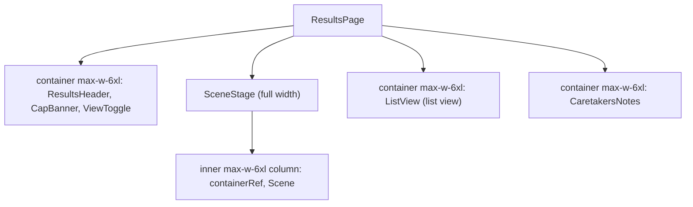

# Design Document: graveyard-art

## Overview

The art pass changes how Gravekeeper looks and reads, not what it computes. A static night landscape (one SVG layer plus CSS gradients) sits behind the plots. The plots get four tombstone silhouettes, three ivy levels, a small tilt and a depth step per row, all derived from the Package_Key by pure View_Model functions. The header, the detail panel, the landing page, the scanning screen and the empty states get new copy and new markup. Everything the pass adds is either a pure function in `/view-model` with a property test, or CSS and SVG with a style test, a component test, an axe scan and a screenshot.

This design implements `.kiro/specs/graveyard-art/requirements.md` (Requirements 1 to 19). It reads the finished graveyard-ui spec and cites it by number ("graveyard-ui R8.11", "graveyard-ui P14"). Section references such as "R3.6" mean Requirement 3, criterion 6 of this spec.

### Facts the design starts from

Read from the repository before this design was written:

- `app/globals.css` holds the `@theme` tokens (night, night-raised, bone, bone-muted, amber, spectral, stone, moss, focus, moss-deep), the fog (`.gk-fog`, `.gk-fog-b`, keyframe `gk-fog-drift` with opacity 0.35 to 0.65), the scanning decor (`.gk-scanning-*`), the scene rules (`.gk-scene`, `.gk-scene-band` with `content-visibility: auto`, `.gk-plot`, `.gk-plot-art`, `.gk-plot-label`), the ghost, restless and lantern animations (the lantern animation `gk-lantern-pulse` also scales, so it is not opacity-only), the simplified-mode rule and the reduced-motion block.
- `components/scene-sprites.tsx` draws one `<symbol>` per kind (`plot-tombstone`, `plot-overgrown`, `plot-ghost`, `plot-restless`, `plot-lantern`, `plot-unmarked`) plus `-flat` twins, on a `0 0 80 104` viewBox. `scene-plot.tsx` renders button, svg, use, label (4 elements per plot). `scene.tsx` builds row bands and renders `FogLayer` inside `.gk-scene`.
- `view-model/scene.ts` computes `x`, `y`, `width`, `height`, `phase` from `hashKey(row.key)` (FNV-1a) with jitter from `h % 17` and `(h >>> 8) % 17`, and `phase` from `h >>> 16`. The cell formula is the basis of graveyard-ui P14, P15, P16.
- `components/results-header.tsx` renders the h1 (repo name), a meta paragraph, the headline at `text-xl`, a bullet list of counts and `GradeLine`. For `assessed === 0` it renders "No dependencies could be assessed", then `GradeLine` prints "no grade" twice (letter and explanation) while the grade label renders the "NO GRADE" look. `view-model/notes.ts` returns `empty.message` and also keeps the same `no-manifests` note in its group, so the "No manifests" message is shown twice.
- `components/detail-panel.tsx` shows reasons as `message` plus `(rule <id>)`. `view-model/detail.ts` builds them. `view-model/reasons.ts` holds `strongestReason`, `shortForm`, `epitaphOf` (the short plot epitaph, unrelated to the new Epitaph_Block).
- `components/landing-page.tsx` is a plain column (h1, pitch, form, featured, legend). `components/scanning-screen.tsx` shows Cancel, a CSS fog and a pulsing lantern dot, the h1, `StageList`, a note and a status region. `GateFallback` is the static shell.
- `tests/ui/traceability.test.ts` counts `// Feature: graveyard-ui, Property <n>` tags and needs 1 to 34 exactly once. `tests/ui/tokens.test.ts` parses tokens from `globals.css` and checks contrast against `night` and `night-raised`. `tests/ui/reduced-motion-css.test.ts` parses `globals.css` blocks. `tests/packages.test.ts` lists `vite-tsconfig-paths` in `UI_TOOLING`. `vitest.config.mts` uses the plugin. `playwright.config.ts` has the `deployed` project when `E2E_BASE_URL` is set and no `workers` setting.
- Installed Vite is 8.3.8 (`vitest` 4.x). The Vite option `resolve.tsconfigPaths` is the native replacement for the plugin and the plugin prints the redundancy warning (graveyard-ui M2 design changes).
- Milestone 1 measured the 300-plot synthetic scene at a 65.4 ms median (4x throttle) and the client JavaScript at 156353 bytes gzip of 256000. Milestone 2 reports a 50 ms local median after the measured-width change.

No web research was needed: every technique used (CSS individual transform properties `rotate` and `scale`, `content-visibility`, SVG `<use>` with CSS custom property inheritance, native `<details>`) is already used in the repository or is standard CSS, and Playwright and axe are the tools already installed. Next.js guides were not re-read because the pass adds no route, no metadata, no font and no `next.config.ts` change. The one Next.js-relevant fact is that `GateFallback` and the new `Hero` stay Server Component-safe (no hooks, no browser APIs), as the existing static shell requires (graveyard-ui D1).

### Key design decisions

| ID | Decision | Rationale |
|---|---|---|
| GA-D1 | One static `Backdrop` SVG per screen draws sky, moon, stars, hills, trees and fence. Its gradients and the fence pattern are defined once in the Sprite_Sheet `<defs>` and referenced by `url(#id)`. | R1, R14.4. One element costs one paint layer. Shared defs avoid duplicated ids when the Hero, the stage and the Caretaker_Scene reuse the component (only one screen is mounted at a time, but the sheet is the one place that owns ids). |
| GA-D2 | The Ground is a CSS gradient on the Scene_Stage (not SVG), the Horizon_Strip height is pure CSS (two values and a breakpoint), and the Scene sits under it with its own reserved height. | The Scene height is data-dependent (rows), so a fixed-aspect SVG would stretch or crop. CSS gradients scale for free. Reserved height stays `sceneHeight(...)` plus the CSS strip, which does not depend on data, so there is no layout shift (R14.7, R14.8). |
| GA-D3 | Tilt and Depth_Scale use the individual CSS properties `rotate` and `scale` on `.gk-plot-art`, with `transform-origin: 50% 100%`. The existing ghost drift animation keeps using `transform`. | Individual transform properties compose with an animated `transform` (order: translate, rotate, scale, transform), so tilt and depth need no wrapper element and no extra DOM node per plot (R14.4). They do not change layout boxes (R2.8, R3.7). Chromium and current Safari and Firefox support them. |
| GA-D4 | Depth_Brightness is applied inside each `<symbol>` on its root `<g>` as `style="opacity: var(--depth-bright, 1)"`. | The ghost, restless and lantern art animate `opacity` on the `svg` element itself, so dimming that same property would collide. A multiplication of two opacities (inner group and animated svg) is correct and needs no filter. Custom properties inherit into the `<use>` tree, as `--glow` already does. Labels sit outside the symbol and keep full brightness (R2.9). |
| GA-D5 | Variant, tilt and depth are computed in the View_Model and stored on `PlotModel` (`variant`, `symbolId`, `tilt`, `depthScale`, `depthBrightness`). The component only writes them as CSS custom properties on the button. | Pure, testable, and part of the memoised scene model. No `Math.random`, no clock. `ScenePlot` stays a memoised component with the same props. |
| GA-D6 | Variant and tilt use their own salted hashes: `hashKey("variant:" + key)` and `hashKey("tilt:" + key)`. Jitter and phase keep `hashKey(key)`. | The existing hash bits already drive jitter (`h % 17`, `(h >>> 8) % 17`) and phase (`h >>> 16`). Reusing them would correlate variant with position. Salting keeps `x`, `y` and `phase` bit-for-bit unchanged, so graveyard-ui P14 to P16 and the committed screenshots keep their layout. |
| GA-D7 | The sprite id scheme is `plot-<kind>-<variant>` with `-flat` appended in the Simplified_Form. The old ids `plot-<kind>` are removed. One table `SPRITE_VARIANTS` in the View_Model is the single source for the View_Model, the Sprite_Sheet and the tests. | R4.7, R4.8. A table makes "each kind still has a unique symbol id" a test over data, and keeps the sheet and the view-model from drifting. |
| GA-D8 | Fog stays in front of the plots but draws no text-bearing area at a lighter value than the contrast test allows. Both layers use the decorative token `--color-mist`; the highest composite (`FOG_OPACITY_HIGH` over night) is contrast-tested against bone. | R13.3. Fog in front is what the user asked for. The test bounds the worst case, so labels stay AA wherever fog drifts. axe cannot see through `pointer-events: none` overlays reliably, so the test is the guarantee. |
| GA-D9 | The Scene_Stage is a full-width wrapper outside the `max-w-6xl` container. The measured container (`containerRef`, `useContainerWidth`) stays the inner `max-w-6xl` column, so `columnsFor(width - 2 * SCENE_PADDING_PX)` is unchanged. | The full-bleed look needs no `100vw` hack and no horizontal scrollbar. Column counts and graveyard-ui P14 to P16 inputs do not change. |
| GA-D10 | Epitaph sentences, plain reason lines and the empty-state sentences are generated in the View_Model from facts, never from free text of the API. Every number in a sentence is a fact value or a count from the summary. | R7.8, R8.4. Pure functions can be property-tested for "contains the name" and "invents nothing". |
| GA-D11 | `humanizeDays` has three unit boundaries (1, 60, 730 days) and fixed divisors (30, 365). | R6. 60 days is where "40 days" stops being the natural unit and two months starts; 730 days equals `COMMIT_ABANDONMENT_DAYS`, so "2 years" and the abandonment rule line up. Fixed divisors keep it a pure function with no calendar. |
| GA-D12 | The empty graveyard message is removed from the Caretaker's notes by message equality (the note whose `message` equals `empty.message` is dropped from its group). | R11.6. One rule, total over all codes, no dependence on which of the two codes produced the message. |
| GA-D13 | The landing Hero and `GateFallback` render the same `Hero` component. | R9.8. The shell and the hydrated page share markup and CSS, so their heights are equal by construction. |
| GA-D14 | The Caretaker_Scene is driven by `stageStates(elapsedMs)` through one pure function `caretakerScene(states, still)`. The component does not read the clock. | R10. Lit stones and lantern position become a testable function (GA-P11). |
| GA-D15 | The deployed project gets `workers: 1` through the top-level `workers` option when `E2E_BASE_URL` is set. | R15. Playwright sets `workers` per run, not per project. With `E2E_BASE_URL` the only projects that run meaningful work are the deployed ones and the mocked desktop and mobile ones; one worker is slower but safe. The deploy tasks also pass `--workers=1`. |
| GA-D16 | `vitest.config.mts` uses `resolve: { tsconfigPaths: true }` and drops the plugin. The package is removed only when no other file imports it. | R16. The task starts with `grep` for imports. Today only `vitest.config.mts` imports it and `tests/packages.test.ts` lists it. |

### Property namespace and traceability

Properties of this spec are numbered `GA-P1` to `GA-P14`, in their own namespace, with the Feature tag `graveyard-art`:

```ts
// Feature: graveyard-art, Property GA-P3: Depth is monotone by row
// Validates: Requirements 2.7
```

`tests/ui/traceability.test.ts` matches only `Feature:\s*graveyard-ui,\s*Property\s+(\d+)` and checks the numbers 1 to 34, so graveyard-art tags are invisible to it and it stays green without any edit. A new file `tests/ui/art-traceability.test.ts` applies the same three checks to the `graveyard-art` tags: each of `GA-P1` to `GA-P14` appears in exactly one tag, every tagged file has a `// Validates:` line, and every `it` or `test` title in a tagged file starts with `GA-P<n>` of its first tag. Test titles of graveyard-art start with `GA-P`, which cannot match the graveyard-ui check `^P<n>(?!\d)` because that check only reads files that carry a graveyard-ui tag, and no file carries both.

---

## Architecture

### Module layout (new and changed files)

```
app/
  globals.css                    + new tokens, stage, ground, fog, depth, tilt, flicker, plaque, chips, epitaph,
                                   hero, headstone cards, caretaker scene; keyframes updated; reduced-motion block extended
view-model/                      PURE
  constants.ts                   + TOMBSTONE_VARIANTS, OVERGROWN_VARIANTS, TILT_MAX_DEG, DEPTH_*, FOG_*, DURATION_*, SCAN_STONE_COUNT
  variants.ts          (new)     SPRITE_VARIANTS, variantOf, tiltOf, symbolIdOf, STONE_KINDS
  depth.ts             (new)     depthOf(row, rowCount)
  duration.ts          (new)     humanizeDays, durationParts
  epitaph.ts           (new)     buildEpitaph(row)
  plain-reasons.ts     (new)     plainReasonLine(reason)
  caretaker-scene.ts   (new)     caretakerScene(states, still)
  scene.ts                       PlotModel gains variant, symbolId, tilt, depthScale, depthBrightness
  header.ts                      HeaderModel: chips, meta, nullable grade, emptySentence
  detail.ts                      DetailModel: epitaph, reasons[].plain
  notes.ts                       drops the note equal to empty.message from its group
  types.ts                       the type changes above
  index.ts                       exports the new functions
components/
  night-landscape.tsx  (new)     <NightLandscape variant="stage|hero|scanning"> = Backdrop + fog; shared
  scene-backdrop.tsx   (new)     <SceneBackdrop variant> one static SVG (STAR_COUNT stars, hills, trees, fence)
  scene-stage.tsx      (new)     full-width wrapper: horizon strip, ground, inner max-w-6xl column
  fog-layer.tsx                  two layers, class names gk-fog-low and gk-fog-high (the old names stay as aliases)
  scene-sprites.tsx              rebuilt from SPRITE_VARIANTS (see "Sprite sheet")
  scene-plot.tsx                 writes --tilt, --depth-scale, --depth-bright; uses plot.symbolId
  results-header.tsx             headline, plaque, chips, meta
  grade-plaque.tsx     (new)     replaces grade-line.tsx content (explanation and scale disclosure kept)
  status-chip.tsx      (new)     chip with plot icon
  epitaph-block.tsx    (new)     engraved block
  reason-item.tsx      (new)     plain line plus Rule_Disclosure
  detail-panel.tsx               Epitaph_Block and ReasonItem
  hero.tsx             (new)     Night landscape, cemetery gate, h1, pitch (Server Component-safe)
  cemetery-gate.tsx    (new)     original SVG
  how-it-decides.tsx   (new)     the section with three sentences and the legend link
  featured-graveyards.tsx        Headstone_Card links
  landing-page.tsx, gate-fallback.tsx   use Hero
  caretaker-scene.tsx  (new)     path, four stones, lantern
  scanning-screen.tsx            uses CaretakerScene instead of the CSS dot
  results-page.tsx               header container, SceneStage for the scene view, list view in the container
playwright.config.ts             workers: 1 with E2E_BASE_URL
vitest.config.mts                resolve.tsconfigPaths
scripts/write-m3-report.ts       (new)
tests/                           see "Testing Strategy"
```

One component per file, kebab-case names, no default exports.

### How the landscape is shared

```mermaid
flowchart TD
  sheet["SceneSprites (hidden svg): gradients, fence pattern, plot symbols"]
  bd["SceneBackdrop variant: stage | hero | scanning"]
  fog["FogLayer"]
  nl["NightLandscape = SceneBackdrop + FogLayer"]
  stage["SceneStage (results, scene view)"]
  hero["Hero (landing, GateFallback)"]
  care["CaretakerScene (scanning)"]
  sheet -. url(#sky-gradient) etc. .-> bd
  bd --> nl
  fog --> nl
  nl --> stage
  nl --> hero
  nl --> care
```

`SceneBackdrop` takes `variant` and changes only the `viewBox` crop and the amount of detail:

| Variant | viewBox | Shows | Height |
|---|---|---|---|
| `stage` | `0 0 1600 240` | sky, moon, stars, hills, trees, fence | `--horizon-h` (240 px, 150 px under 640 px) |
| `hero` | `0 0 1600 360` | same, larger moon, gate placed over it by `Hero` | `--hero-h` (360 px, 300 px under 640 px) |
| `scanning` | `0 0 400 180` | sky, moon, stars, a short hill line, one tree, short fence | `--caretaker-h` (180 px) |

All variants use `preserveAspectRatio="xMidYMax slice"`, so the ground edge of the drawing stays on the bottom edge and the sides crop on narrow screens. The element is `aria-hidden="true"`, `focusable="false"`, has no `<title>` and no text. The star table (`STAR_COUNT` = 24 positions in the viewBox, radius 1 to 2 units) and the tree table (three bare trees, each a trunk path and branch paths) are constants in `scene-backdrop.tsx`. The fence is one `<rect>` filled with `url(#fence-pattern)` along the hill base, where the pattern draws one iron bar with a spear tip and a rail.

### The results page layout



The scene view renders `SceneStage` between the toggle and the notes. The list view renders the table in the container and no stage. The empty-graveyard branch renders the message and the picker in the container and no stage (nothing to draw). `SceneStage` markup:

```tsx
<div className="gk-stage">
  <SceneBackdrop variant="stage" />
  <div className="gk-stage-inner mx-auto w-full max-w-6xl px-4">{children}</div>
</div>
```

CSS (values from the Constants table, colours from tokens):

```css
.gk-stage {
  --horizon-h: 240px;
  position: relative;
  padding-top: var(--horizon-h);
  background:
    linear-gradient(to bottom, var(--color-ground) 0, var(--color-night) 100%);
}
@media (max-width: 639px) { .gk-stage { --horizon-h: 150px; } }
.gk-stage > .gk-backdrop { position: absolute; inset: 0 0 auto 0; width: 100%; height: var(--horizon-h); }
```

The top of the Backdrop is `--color-night` (its sky gradient's first stop), so the join with the page is invisible; the Ground gradient ends in `--color-night`, so the stage fades into the notes section below. The Scene keeps `overflow: hidden` and its own width; the `.gk-scene` background stays transparent.

### Depth, tilt and variants in the DOM

`ScenePlot` writes three more custom properties on the button, only when they differ from the neutral value, to keep the style string short:

```tsx
if (plot.tilt !== 0) style["--tilt"] = `${plot.tilt}deg`;
if (plot.depthScale !== 1) style["--depth-scale"] = plot.depthScale;
if (plot.depthBrightness !== 1) style["--depth-bright"] = plot.depthBrightness;
```

CSS:

```css
.gk-plot-art {
  transform-origin: 50% 100%;
  rotate: var(--tilt, 0deg);
  scale: var(--depth-scale, 1);
}
```

`<use href={"#" + plot.symbolId + (simplified ? "-flat" : "")} />`. The element count per plot stays four.

### Motion inventory

| Animation | Selector | Properties | Stops under |
|---|---|---|---|
| Fog drift low | `.gk-fog-low` | `transform` (keyframes `gk-fog-drift`), 70 s | Reduced_Motion, simplified |
| Fog drift high | `.gk-fog-high` | `transform`, 110 s, reverse | same |
| Ghost drift | `.gk-plot[data-kind="ghost"] .gk-plot-art` | `transform` (existing) | same |
| Ghost and restless pulse | `.gk-plot[data-kind="ghost" or "restless"] .gk-plot-art` | `opacity` (existing) | same |
| Lantern flicker | `.gk-plot[data-kind="lantern"] .gk-plot-art` | `opacity`, keyframes `gk-lantern-flicker` (1 to `LANTERN_FLICKER_MIN_OPACITY`), 2.4 s | same |
| Caretaker lantern move | `.gk-caretaker` | `transform` transition, 900 ms | `data-still`, Reduced_Motion |
| Stone lighting | `.gk-stone-glow` | `opacity` transition, 600 ms | same |

The old `gk-lantern-pulse` keyframes (opacity and scale) are replaced for plots by `gk-lantern-flicker`; they are removed together with the `.gk-scanning-lantern` dot, because no selector uses them afterwards. The reduced-motion block lists `.gk-fog-low`, `.gk-fog-high`, `.gk-caretaker`, `.gk-caretaker *`, `.gk-stone-glow` and the hero selectors, and the style test (task) verifies that every selector with an `animation` or `transition` declaration appears in the block.

---

## Components and Interfaces

### View_Model

```ts
// variants.ts
export const SPRITE_VARIANTS: Readonly<Record<PlotKind, readonly string[]>> = {
  tombstone: ['rounded', 'cross', 'obelisk', 'slab'],
  restless:  ['rounded', 'cross', 'obelisk', 'slab'],
  overgrown: ['ivy-light', 'ivy-medium', 'ivy-heavy'],
  ghost:     ['wisp'],
  lantern:   ['iron'],
  unmarked:  ['mound'],
};
export const STONE_KINDS: ReadonlySet<PlotKind>;                       // tombstone, overgrown, restless
export function variantOf(kind: PlotKind, key: string): string;        // SPRITE_VARIANTS[kind][hashKey('variant:' + key) % n]
export function tiltOf(kind: PlotKind, key: string): number;           // STONE: (hashKey('tilt:' + key) % 13) - 6, else 0
export function symbolIdOf(kind: PlotKind, variant: string, flat: boolean): string; // plot-<kind>-<variant>[-flat]

// depth.ts
export function depthOf(row: number, rowCount: number): { scale: number; brightness: number };
//   t = rowCount <= 1 ? 1 : clamp(row / (rowCount - 1), 0, 1)
//   scale = DEPTH_SCALE_BACK + (1 - DEPTH_SCALE_BACK) * t
//   brightness = DEPTH_BRIGHTNESS_BACK + (1 - DEPTH_BRIGHTNESS_BACK) * t
//   both rounded to 3 decimals (stable text for CSS and snapshots)

// duration.ts
export function humanizeDays(days: number): string;
export function durationParts(days: number): { unit: 'none' | 'lessThanDay' | 'days' | 'months' | 'years'; count: number };

// epitaph.ts
export function buildEpitaph(row: PackageRow): EpitaphModel;            // { lines: string[]; text: string }

// plain-reasons.ts
export function plainReasonLine(reason: Reason): string;

// caretaker-scene.ts
export function caretakerScene(states: readonly StageState[], still: boolean): CaretakerSceneModel;
```

`hashKey` is exported from `scene.ts` and moves nowhere. `variants.ts` imports it from `./scene`; to avoid a cycle (`scene.ts` imports `variants.ts` for `variantOf`), `hashKey` moves to a new `view-model/hash.ts` that both import, and `scene.ts` re-exports it so every existing import (`hashKey` from `./scene`, the barrel) keeps working.

#### `humanizeDays`

```
durationParts(days):
  if not finite or days < 0: { unit: 'none', count: 0 }
  d = floor(days)
  if d < 1:                             { lessThanDay, 0 }
  if d < DURATION_DAYS_MAX_EXCLUSIVE:   { days, d }                          // 1 .. 59
  if d < DURATION_MONTHS_MAX_EXCLUSIVE: { months, floor(d / 30) }            // 60 .. 729  => 2 .. 24
  else                                  { years, floor(d / 365) }            // 730 ..     => 2 ..
humanizeDays(days):
  none        -> "an unknown time"
  lessThanDay -> "less than a day"
  days        -> count === 1 ? "1 day" : `${count} days`
  months      -> `${count} months`        // count >= 2 always
  years       -> `${count} years`         // count >= 2 always
```

Unit rank order for the monotone property: `lessThanDay` 0, `days` 1, `months` 2, `years` 3. Checks: 40 gives "40 days", 210 gives "7 months", 3285 gives "9 years", 729 gives "24 months", 730 gives "2 years", 59 gives "59 days", 60 gives "2 months". `Number.MAX_VALUE` gives a large integer string, `Infinity` and `NaN` give "an unknown time". Years use no thousands separators and no exponent for values below 1e21 (the property generator stops at 1e15 days, and `String(count)` of an integer below 1e21 has no exponent).

#### `buildEpitaph`

```
lines = []
lines.push(`Here lies ${row.displayName}.`)
release = finiteNonNegative(row.facts.daysSinceLastRelease)
commit  = finiteNonNegative(row.facts.daysSinceLastCommit)
if release != null: lines.push(`Last release ${humanizeDays(release)} ago.`)
if commit  != null: lines.push(`Last commit ${humanizeDays(commit)} ago.`)
if release == null and commit == null: lines.push('The records do not say when it was last released or changed.')
lines.push(...verdict(row))
text = lines.join(' ')
```

`verdict(row)` by `row.kind`:

| kind | sentences |
|---|---|
| `overgrown` | "It may be finished, or abandoned." |
| `tombstone` | "It was archived." if rule `8.1`; "It was deprecated." if rule `8.2`; else "An advisory flags it as unmaintained." if the classification has no `8.1` or `8.2` but the package is a buried grave (graveyard-ui R7.15 says the third cause is an unmaintained advisory); both archived and deprecated give both sentences |
| `ghost` | "It is haunted by <n> open vulnerabilities." with "of severity <SEVERITY>" appended before the full stop only when `facts.maxSeverity` is a known severity (1 gives "1 open vulnerability"); when `openVulnerabilityCount` is unknown: "It is haunted by open vulnerabilities." |
| `restless` | the ghost sentence, then "It is also archived." or "It is also deprecated." (or "It is also archived and deprecated.") |
| `lantern` | "The records show no risk signals." |
| `unmarked` | `The caretaker could not assess it: ${unassessedLabel}.` with the label of graveyard-ui `unassessedLabelOf` lower-cased first letter kept as the existing label text |

Rule presence is read from `row.classification.reasons[].ruleId`, the same source that `plotKindOf` uses, so the verdict agrees with the drawn plot. The release and commit facts come from `row.facts` (the narrowed facts of graveyard-ui `narrow.ts`), so a value of the wrong type is already `null`. `finiteNonNegative(v)` returns `v` when it is a finite number of at least 0, else `null`.

#### `plainReasonLine`

A closed table for the rule ids that core defines (graveyard-ui DG-2), with a total default:

| ruleId | Plain line (n and word are filled from the reason facts when present) |
|---|---|
| `7.2` | "It has <n> open vulnerabilities, the worst of severity <SEVERITY>." Without count: "It has open vulnerabilities." |
| `8.1` | "Its maintainers archived the repository, so it takes no more changes." |
| `8.2` | "Its maintainers deprecated this package and point people elsewhere." |
| `8.3` | "It has had no release and no commit for a very long time." |
| `8.4` | "It has not had a release for a long while, but its code is still being changed." |
| `10.6` | "Its last release is old." |
| `10.7` | "No one is listed as maintaining it." |
| `10.8` | "A single person maintains it." |
| `6.3` | "The records leave out some facts, so the caretaker added no risk for them." |
| `11.2` | "The caretaker found no risk signals." |
| any other | "The caretaker has no plain wording for this rule yet. Open \"Show the rule\" to read the exact message." |

Numbers come only from `reason.facts` entries (`openVulnerabilityCount` finite integer at least 0, `maxSeverity` one of LOW, MEDIUM, HIGH, CRITICAL). A fact of another type is ignored and the number-free form is used. No `ruleId` string is interpolated into the line, so an unknown id cannot inject text; the id appears only inside the disclosure. The function never reads `reason.message`. The wording of 8.3 and 8.4 avoids numbers because the day counts live in the epitaph and in the facts section.

#### Scene model changes

`PlotModel` gains `variant: string`, `symbolId: string`, `tilt: number`, `depthScale: number`, `depthBrightness: number`. `plotOf(row, i, cols, rowCount)` calls `variantOf(row.kind, row.key)`, `tiltOf`, `depthOf(r, rowCount)` where `r = floor(i / cols)` and `rowCount = ceil(rows.length / cols)`. `x`, `y`, `width`, `height`, `phase` use the same formulas and the same `hashKey(row.key)` as before.

#### Header model changes

```ts
interface HeaderModel {
  repoName: string; canonicalUrl: string; shortSha: string; fullSha: string; branch: string; notDefaultBranch: boolean;
  asOfIso: string; asOfText: string;
  headline: Headline | null;                 // null when assessed === 0
  emptySentence: string | null;              // replaces emptyText; null when assessed > 0 or no manifests
  chips: readonly StatusChipModel[];         // [] when assessed === 0
  counts: {...};                             // unchanged, kept for the table and tests
  grade: GradeModel | null;                  // null when assessed === 0
  entriesSentence: string | null;
}
interface StatusChipModel { status: 'dead' | 'haunted' | 'alive' | 'unassessed'; iconSymbolId: string; text: string; }
```

Chip text: "<n> dead (<b> buried, <f> forgotten)", "<n> haunted", "<n> alive", "<n> unassessed". Icon symbols: `plot-tombstone-rounded`, `plot-ghost-wisp`, `plot-lantern-iron`, `plot-unmarked-mound` (flat forms are not needed at icon size, the full symbols are used).
`GradeModel` is the existing grade object (letter, label, explanation, scale), with `letter` never null (the plaque exists only when assessed > 0). The "no grade" explanation string path in `explanationOf` is removed.

`emptySentence`: when `assessed === 0` and `result.manifests.length > 0`: `total === 0` gives the "declares no dependencies" sentence, `total >= 1` gives the "could not assess any of the <total> dependencies" sentence. When `manifests.length === 0`, it is `null` and the page's empty graveyard message is the only text.

#### Detail model changes

`DetailModel` gains `epitaph: EpitaphModel`; each entry of `reasons` gains `plain: string`. `ruleId`, `message` and `isMain` are unchanged.

#### Notes model change

In `buildSections`, after the groups are built, any message equal to `empty.message` (when `empty !== null`) is removed from its group; a group left with no messages is removed; a section left with no groups is removed. `previewCount` and `count` are recomputed from the remaining messages.

#### Caretaker scene model

```ts
interface CaretakerSceneModel {
  stones: readonly { index: number; x: number; lit: boolean }[];   // x from SCAN_STONE_X
  lanternX: number;                                                // x of the last lit stone
  lanternIndex: number;
}
export const SCAN_STONE_X = [50, 150, 250, 350] as const;
caretakerScene(states, still):
  lit(i) = still || states[i]?.state is 'in progress' or 'done'
  lanternIndex = still ? SCAN_STONE_COUNT - 1 : index of the last lit stone (0 when none)
```

### Components

- `SceneBackdrop({ variant })`: one `<svg class="gk-backdrop" viewBox preserveAspectRatio="xMidYMax slice" aria-hidden focusable="false">`. Layers in paint order: sky `<rect fill="url(#sky-gradient)">`, moon halo `<circle fill="url(#moon-halo-gradient)">`, moon `<circle fill="var(--color-moon)">`, stars (24 `<circle fill="var(--color-bone)" opacity="...">`), far hill `<path fill="var(--color-hill)">`, trees `<path stroke="var(--color-iron)" fill="none">`, fence `<rect fill="url(#fence-pattern)">`, near ground band `<rect fill="var(--color-ground)">`.
- `FogLayer`: two `div`s: `gk-fog gk-fog-low` and `gk-fog gk-fog-high`. Positioned in the lower 60% of the Scene (`top: 25%`), `pointer-events: none`.
- `ResultsHeader`: structure top to bottom: h1 repo name (display, `text-2xl`), headline `<p class="gk-headline">` (display font, `font-size: clamp(2rem, 5vw + 0.5rem, 3.5rem)`, line-height 1.1), row of `GradePlaque` and chips, meta line (`text-sm text-bone-muted`: "Commit abc1234, branch main, as of 2026-11-19 12:00 UTC. scanned 3 hours ago"), the `entriesSentence` line when present. When `header.grade === null` the plaque and chips are not rendered and `emptySentence` is a single `<p class="gk-headline gk-headline-empty">` (same display font, `clamp(1.5rem, 3vw + 0.5rem, 2.25rem)`).
- `GradePlaque`: `<figure class="gk-plaque">` with `<strong class="gk-plaque-letter">` and `<figcaption>worst single risk</figcaption>`, then the explanation and the "Grade scale" `<details>` below the figure (the explanation line is outside the plaque so the plaque stays small and the text stays muted-on-night).
- `StatusChip`: `<li class="gk-chip"><svg aria-hidden><use href="#plot-..."/></svg><span>{text}</span></li>` in a `<ul aria-label="Status counts">`.
- `EpitaphBlock({ epitaph })`: `<section aria-label="Epitaph" class="gk-epitaph"><p>` with one `<span>` per sentence so the sentences wrap naturally. Class `gk-epitaph`: display font, `font-size: 1.25rem`, `text-shadow: 0 1px 0 rgb-from-token highlight, 0 -1px 0 shadow` via `color-mix` on tokens (a carved look, no filter), a `border: 1px solid var(--color-iron)`, background `var(--color-plaque)`.
- `ReasonItem`: `<li><p>[main reason: ]{plain}</p><details class="gk-rule"><summary>Show the rule</summary><p>{message} <span>(rule {ruleId})</span></p></details></li>`.
- `Hero`: `<section class="gk-hero" aria-labelledby="hero-title"><NightLandscape variant="hero"/><CemeteryGate/><div class="gk-hero-copy"><h1 id="hero-title">Gravekeeper</h1><p>pitch</p></div></section>`. The existing grade sentence stays directly under the hero in `LandingPage` (graveyard-ui R1: one adjacent paragraph for the pitch, then the grade sentence).
- `HowItDecides`: `<section aria-labelledby="how-heading"><h2 id="how-heading">How the caretaker decides</h2><p>…</p><p>…</p><p>…</p></section>`; copy below.
- `FeaturedGraveyards`: each item keeps its link and handler; the class `gk-headstone` gives the arch (`border-radius: 2.5rem 2.5rem 0.25rem 0.25rem`), a stone border and a bottom plinth (`border-bottom-width: 6px`). Label text stays `owner/repo` in bone on `--color-plaque`.
- `CaretakerScene({ model, still })`: `<div class="gk-caretaker-scene" aria-hidden="true" data-still={still}><SceneBackdrop variant="scanning"/><svg viewBox="0 0 400 180"> path, 4 stones, lantern </svg><FogLayer/></div>`.

Copy of "How the caretaker decides" (three sentences, fixed text in `how-it-decides.tsx`):

1. "The caretaker reads your manifests, then asks deps.dev, the npm, PyPI and crates.io registries, OSV and GitHub about every dependency."
2. "A package is dead when it is archived, deprecated or untouched for years, haunted when it has open security advisories, and alive when neither applies."
3. "A package the caretaker cannot look up stays an unmarked grave, and the grade is the worst single risk, not an average. See the [legend](#legend-heading)."

The third sentence ends with an inline link to the Legend heading (`href="#legend-heading"`); the three sentences are three `<p>` elements, the link is inside the third.

### Sprite sheet

`SceneSprites` is generated from `SPRITE_VARIANTS` so ids cannot drift. Structure (all on the `0 0 80 104` viewBox, bottom ground line at y = 98):

```
<svg width=0 height=0 aria-hidden style="position:absolute">
  <defs>
    gradients:  sky-gradient, moon-halo-gradient, plot-glow-gradient (existing),
                ghost-body-gradient (spectral opaque top to transparent at the tail),
                lantern-pool-gradient (amber, stop-opacity .55 at centre to 0)
    pattern:    fence-pattern
    shared shapes (g): shape-stone-rounded, shape-stone-cross, shape-stone-obelisk, shape-stone-slab,
                shape-ivy-light, shape-ivy-medium, shape-ivy-heavy, shape-ghost-wisp, shape-glow
  </defs>
  <symbol id="plot-tombstone-rounded"> <g style="opacity:var(--depth-bright,1)"> <use href="#shape-stone-rounded"/> </g> </symbol>
  ... one symbol per row of the table below, then the same set with -flat
</svg>
```

| Symbol id | Silhouette |
|---|---|
| `plot-tombstone-rounded` | arched slab, small cross engraved, base line |
| `plot-tombstone-cross` | a stone Celtic-style cross on a plinth |
| `plot-tombstone-obelisk` | tall tapering four-sided pillar on two steps |
| `plot-tombstone-slab` | wide low rectangular slab with chipped top corner |
| `plot-overgrown-ivy-light` / `-medium` / `-heavy` | a weathered irregular stone (no inscription) with 1, 2 or 3 ivy strands and moss; the built-in `rotate(-9)` of the old symbol is removed because Tilt supplies the lean |
| `plot-ghost-wisp` | the glow, then a wisp body: a narrow head, a body filled with `ghost-body-gradient`, two tail curls that thin to a point, two hollow dark eye ovals, no mouth, a thin low-opacity bone stroke |
| `plot-restless-<v>` | the stone of `<v>` and a smaller wisp rising from its top, the wisp tail overlapping the stone top |
| `plot-lantern-iron` | the Light_Pool ellipse on the ground line, a short crooked post (two segments, bent), a hook, an iron lantern with a cap, a cage of vertical bars, an amber glass, a flame |
| `plot-unmarked-mound` | a low mound, a small wooden marker (two planks) with a dashed ground line |
| `...-flat` | solid single-fill silhouette of the same outline, no gradients, no Light_Pool, no engraving (unique outline per variant) |

The tests identify each `<symbol>`'s outline by the serialized markup of the symbol; two symbols of the same form must not serialize identically. Greyscale distinction rests on distinct outlines (cross arms, obelisk taper, slab width, wisp tail, post and lantern cage, mound and marker), not on colour.

### Landscape tokens

New tokens in the `@theme` block, with the value choice and the use (hex values are fixed by the task, which also runs the contrast test; numbers below are the design's targets, computed with the WCAG formula):

| Token | Value | Use | Marked decorative |
|---|---|---|---|
| `--color-sky-low` | `#1c2750` | brightest sky colour near the horizon, hero text backdrop | no (text sits on it) |
| `--color-moon` | `#efe9d2` | moon disc | yes |
| `--color-ground` | `#101728` | Ground at the horizon | no (label text sits on it) |
| `--color-hill` | `#151d36` | distant hill fill | yes |
| `--color-iron` | `#2a3350` | tree and fence silhouettes, epitaph border | yes |
| `--color-mist` | `#9aa6c0` | fog tint | yes |
| `--color-plaque` | `#252c40` | plaque, epitaph block, headstone cards | no (text sits on it) |

Target contrasts (to be confirmed by the token test, not asserted here): bone on sky-low about 11, bone-muted on sky-low about 7, stone on sky-low about 5.5, moss on sky-low about 6; bone on plaque about 10; bone over the worst fog composite (mist at 0.35 over night) about 7.8. If a computed value falls below 4.5 the task adjusts the hex, never the threshold.

### Performance approach

- **One Backdrop element** per screen, static. No per-plot background, no per-plot filter, no per-plot style rule. Depth, tilt and variant reach the DOM as three custom properties on the existing button.
- **Sprite sheet size:** 28 plot symbols (14 variants and 14 flat twins) instead of 12. The sheet is JSX in the client bundle, so it counts toward `CLIENT_JS_BUDGET_BYTES`. Flat twins are single paths. The estimate is 6 to 9 KB gzip for the sheet, 3 KB for the new view-model code, 5 KB for new components; the soft ceiling `GA_CLIENT_JS_SOFT_CEILING_BYTES` (180000) leaves 24 KB over the Milestone 1 total and 76 KB under the hard budget.
- **Render cost:** per plot the view-model adds two hashes and three number computations (cheap). `ScenePlot` is memoised on `plot` and `tabbable`/`simplified`, unchanged. The browser cost of the new `rotate` and `scale` is compositing only. The band `content-visibility: auto` and windowed mounting stay as they are (R14.5). `use` elements pointing to larger symbols add shadow-tree nodes per plot; the budget test measures it.
- **Measure before and after:** task group 14 runs `scene-perf.spec.ts` on the pre-change commit baseline numbers recorded in `docs/milestone-2-report.md` and `docs/milestone-1-report.md`, then after each art group (sprites, stage), so a regression is caught in the group that causes it. If the 300-plot median exceeds `GA_RENDER_REGRESSION_MAX_MS` above the baseline, the contingencies in this order are: use the flat symbols for rows more than 6 away from the viewport (they already mount late), drop the `rotate` for plots in bands not yet visible, simplify the ghost wisp (fewer path commands). These are listed, not planned.
- **JS size:** `npm run check:bundle` after the sprites group and after the last component group.

### Reduced motion and the simplified form

- `@media (prefers-reduced-motion: reduce)` sets `animation: none; transition: none` for the old selectors plus every new one (see the motion inventory). Fog, ghost, lantern, caretaker and stones are static; the lantern of the Caretaker_Scene and the lit stones are drawn at their final values by the component (`still` prop), not only by CSS, so a screen reader or a screenshot sees the same state.
- Simplified form (`data-simplified="true"`): flat symbols, `animation: none` for plots and fog (existing rule, extended to the new fog class names), Light_Pool omitted (flat lantern has no pool). Tilt and depth stay (static values, no cost).

### Accessibility notes

- The Backdrop, the fog, the cemetery gate, the Caretaker_Scene and the chip icons are `aria-hidden`. The chip text, the plaque caption and the text stage list carry the information.
- The Rule_Disclosure is a native `<details>`: keyboard and screen-reader support are built in, the focus ring comes from the existing `summary:focus-visible` rule.
- Every new text sits on a token pair covered by the token test. The hero title sits on the sky; the title block is placed on the left and the moon on the upper right, and the hero copy has a `background: color-mix(in srgb, var(--color-night) 55%, transparent)` plate behind the text lines so no star or tree crosses a text line.
- The epitaph keeps normal text size (`1.25rem`), no letter-spacing tricks, no all caps.

---

## Data Models

```ts
// view-model/types.ts (additions and changes)

type Variant = string;                         // an element of SPRITE_VARIANTS[kind]

interface PlotModel {                          // existing fields unchanged, plus:
  readonly variant: Variant;
  readonly symbolId: string;                   // plot-<kind>-<variant>, no -flat
  readonly tilt: number;                       // integer, -6..6, 0 for non-stone kinds
  readonly depthScale: number;                 // 0.88 .. 1
  readonly depthBrightness: number;            // 0.7 .. 1
}

interface EpitaphModel { readonly lines: readonly string[]; readonly text: string; }

interface ReasonModel { ruleId: RuleId | string; message: string; isMain: boolean; plain: string; }

interface DetailModel { /* existing */ readonly epitaph: EpitaphModel; readonly reasons: readonly ReasonModel[]; }

interface StatusChipModel { readonly status: 'dead' | 'haunted' | 'alive' | 'unassessed'; readonly iconSymbolId: string; readonly text: string; }

interface HeaderModel { /* see "Header model changes" */ }

interface CaretakerSceneModel { readonly stones: readonly { index: number; x: number; lit: boolean }[]; readonly lanternX: number; readonly lanternIndex: number; }
```

All new model values are JSON-safe (numbers, strings, arrays), so graveyard-ui P6 (model values are JSON-safe) keeps holding when the arbitrary is extended.

### Constants (additions to `view-model/constants.ts`)

```ts
export const TOMBSTONE_VARIANTS = ['rounded', 'cross', 'obelisk', 'slab'] as const;
export const OVERGROWN_VARIANTS = ['ivy-light', 'ivy-medium', 'ivy-heavy'] as const;
export const TILT_MAX_DEG = 6;
export const DEPTH_SCALE_BACK = 0.88;
export const DEPTH_BRIGHTNESS_BACK = 0.7;
export const FOG_OPACITY_LOW = 0.25;
export const FOG_OPACITY_HIGH = 0.35;
export const DURATION_DAYS_MAX_EXCLUSIVE = 60;
export const DURATION_MONTHS_MAX_EXCLUSIVE = 730;
export const DAYS_PER_MONTH_TEXT = 30;
export const DAYS_PER_YEAR_TEXT = 365;
export const SCAN_STONE_COUNT = 4;
export const SCAN_STONE_X = [50, 150, 250, 350] as const;
```

`view-model` may not import from `components` or `app`, so the CSS-owned values (fog duration, flicker period, horizon heights, headline sizes) live in `globals.css` and are read by tests by parsing the file, like `tokens.test.ts` does. `FOG_OPACITY_*` are both in the View_Model (so the contrast test imports them) and in the CSS; a unit test asserts they are equal.

---

## Correctness Properties

*A property is a characteristic or behavior that should hold true across all valid executions of a system-essentially, a formal statement about what the system should do. Properties serve as the bridge between human-readable specifications and machine-verifiable correctness guarantees.*

Only the pure View_Model functions of this spec have properties. The SVG art, the CSS, the layout, the performance numbers, the deploy and the report are covered by unit, component, style, Playwright, axe and measurement tests (see "Testing Strategy"). Property numbers use the namespace `GA-P<n>` and the Feature tag `graveyard-art`. Headings read "Property N: Title (GA-PN)" so that the spec format validator accepts them; N and the number in GA-PN are always equal.

### Property 1: Variant choice is a deterministic function of kind and key (GA-P1)

*For any* PlotKind and any Package_Key, `variantOf(kind, key)` SHALL be an element of `SPRITE_VARIANTS[kind]`, SHALL be the same on every call, and SHALL be the same in every Scene model (any column count, any row order) that contains a Plot with that kind and key. `symbolIdOf(kind, variantOf(kind, key), false)` SHALL equal `plot-<kind>-<variant>`.

**Validates: Requirements 3.2, 3.3, 3.4**

### Property 2: Tilt stays within the range and only stones lean (GA-P2)

*For any* PlotKind and any Package_Key, `tiltOf(kind, key)` SHALL be an integer from −`TILT_MAX_DEG` to `TILT_MAX_DEG` for `tombstone`, `overgrown` and `restless`, SHALL be 0 for `ghost`, `lantern` and `unmarked`, SHALL be the same on every call, and the `restless` tilt and variant of a key SHALL equal the `tombstone` tilt and variant of the same key.

**Validates: Requirements 3.6, 3.8**

### Property 3: Depth is monotone by row and stays in range (GA-P3)

*For any* row count of at least 1 and any row indices r1 ≤ r2 below that count, `depthOf(r1, n).scale ≤ depthOf(r2, n).scale` and `depthOf(r1, n).brightness ≤ depthOf(r2, n).brightness`, every scale SHALL lie in [`DEPTH_SCALE_BACK`, 1] and every brightness in [`DEPTH_BRIGHTNESS_BACK`, 1], and the last row and a Scene of one row SHALL have scale 1 and brightness 1. *For any* Scan_Result and column count, the Plots of one row SHALL share the same depth values and a Plot of a later row SHALL have values at least those of a Plot of an earlier row.

**Validates: Requirements 2.6, 2.7**

### Property 4: Depth does not change any layout box (GA-P4)

*For any* valid Scan_Result (up to 1000 rows) and column count from 2 to 20, the `x`, `y`, `width` and `height` of every Plot SHALL equal the values of the cell formula (`SCENE_PADDING_PX + col * PLOT_CELL_WIDTH_PX + PLOT_JITTER_MAX_PX + jx` and the matching `y`, with `jx` and `jy` from `hashKey(key)`, and `width = PLOT_BOX_WIDTH_PX`, `height = PLOT_BOX_HEIGHT_PX`), recomputed in the test independently of `buildSceneModel`, and graveyard-ui P14 and P15 SHALL hold on the same input.

**Validates: Requirements 2.8, 17.1**

### Property 5: Duration formatting is total (GA-P5)

*For any* number `days`, including `NaN`, `Infinity`, `−Infinity`, negative numbers, fractions and values up to 10^15, `humanizeDays(days)` SHALL return a non-empty string and SHALL not throw, and *for any* finite `days` of at least 0 the string SHALL match `^(less than a day|1 day|([2-9]|[1-5]\d) days|([2-9]|[1-9]\d+) months|([2-9]|[1-9]\d+) years)$` (the days count is 2 to 59 because "1 day" is its own alternative, and the months and years counts are any integer of at least 2 by the unit boundaries, so "10 months" matches). This correction was found by GA-P5: the earlier regex `[2-9]\d* months` rejected the counterexample 300 days, which formats as "10 months".

**Validates: Requirements 6.1, 6.2, 6.6**

### Property 6: Duration formatting is monotone with exact unit boundaries (GA-P6)

*For any* finite `a` and `b` with 0 ≤ a ≤ b, the pair (unit rank, count) of `durationParts(a)` SHALL be less than or equal to that of `durationParts(b)` in lexicographic order (rank: lessThanDay 0, days 1, months 2, years 3), and the unit of `durationParts(d)` SHALL be `lessThanDay` for d < 1, `days` for 1 ≤ d < `DURATION_DAYS_MAX_EXCLUSIVE`, `months` for `DURATION_DAYS_MAX_EXCLUSIVE` ≤ d < `DURATION_MONTHS_MAX_EXCLUSIVE` and `years` from `DURATION_MONTHS_MAX_EXCLUSIVE`.

**Validates: Requirements 6.3, 6.4**

### Property 7: Plain reason lines are total and take numbers only from the facts (GA-P7)

*For any* Reason, including a `ruleId` string that core does not define (arbitrary strings), a `message` of any text, and a `facts` list with missing, empty, duplicated or wrongly typed values, `plainReasonLine(reason)` SHALL return a non-empty string, SHALL not throw, SHALL not contain "undefined", "NaN" or "[object", SHALL give the same string for the same reason, and every decimal digit sequence in the string SHALL be the decimal text of a finite non-negative integer fact value of that reason.

**Validates: Requirements 8.1, 8.2, 8.3, 8.4**

### Property 8: The epitaph contains the name and is made of sentences (GA-P8)

*For any* Package_Row of any generated Scan_Result, `buildEpitaph(row).text` SHALL contain `row.displayName`, SHALL start with "Here lies ", SHALL equal `lines.join(" ")`, and every entry of `lines` SHALL end with a full stop.

**Validates: Requirements 7.2, 7.7**

### Property 9: The epitaph invents no fact (GA-P9)

*For any* Package_Row, the epitaph SHALL contain "Last release" if and only if `facts.daysSinceLastRelease` is a finite number of at least 0, SHALL contain "Last commit" if and only if `facts.daysSinceLastCommit` is a finite number of at least 0, SHALL contain "The records do not say" if and only if both are not, SHALL contain "archived" only when the classification has rule `8.1`, SHALL contain "deprecated" only when it has rule `8.2`, SHALL contain "abandoned" only for an `overgrown` plot, and every number in the text SHALL be a Humanised_Duration count of one of the two day facts or the value of `openVulnerabilityCount`.

**Validates: Requirements 7.3, 7.4, 7.5, 7.6, 7.8**

### Property 10: Every plot resolves to one existing, kind-unique symbol (GA-P10)

*For any* valid Scan_Result and column count, the `symbolId` of every Plot SHALL be an id of the Sprite_Sheet table (`SPRITE_VARIANTS`), its `-flat` twin SHALL exist, the set of symbol ids of one PlotKind SHALL be disjoint from the set of every other PlotKind, and the table SHALL hold no duplicate id.

**Validates: Requirements 4.7, 4.8**

### Property 11: Lit stones grow as a prefix and the lantern follows the last lit stone (GA-P11)

*For any* elapsed times 0 ≤ t1 ≤ t2 up to 10^6 ms, the lit stones of `caretakerScene(stageStates(t1), false)` SHALL be a prefix of the four stones, SHALL be a prefix of the lit stones at t2, their number SHALL equal `stageAt(t1) + 1`, and `lanternIndex` SHALL equal that number minus 1; *for any* states and `still = true`, all `SCAN_STONE_COUNT` stones SHALL be lit and the lantern SHALL be at the last stone.

**Validates: Requirements 10.2, 10.3, 10.5**

### Property 12: The header shows either a verdict or one empty sentence (GA-P12)

*For any* valid Scan_Result with `summary.assessed` of at least 1, the Header_Model SHALL have a headline equal to the graveyard-ui headline, a grade letter, no `emptySentence`, and four chips whose counts equal `summary.counts.DEAD` (with buried and forgotten equal to the model counts), `summary.counts.HAUNTED`, `summary.counts.ALIVE` and `summary.unassessed`; *for any* valid Scan_Result with `summary.assessed` of 0, the Header_Model SHALL have no headline, no grade, no chips, and `emptySentence` SHALL be non-null if and only if the result has at least one manifest, SHALL not contain "no grade" in lower case twice and SHALL not contain "NO GRADE".

**Validates: Requirements 5.4, 5.9, 11.1, 11.2, 11.3, 11.4, 11.5**

### Property 13: The empty-graveyard message appears once (GA-P13)

*For any* valid Scan_Result, when the Notes_Model has an `empty` block, no message of any group of any section of the Notes_Model SHALL equal `empty.message`, and the number of messages of all other notes SHALL equal the number of notes of the result minus the number of notes whose message equals `empty.message`.

**Validates: Requirements 11.6, 11.8**

### Property 14: Reasons keep the core message and rule id verbatim (GA-P14)

*For any* Package_Row with a Merged_Classification, the `reasons` of the Detail_Model SHALL have the same length and order as the reasons of the classification, and each entry SHALL carry `ruleId` and `message` equal, character for character, to those of the core Reason, a non-empty `plain` string, and `isMain` true for exactly the Strongest_Reason.

**Validates: Requirements 8.1, 8.6, 8.8**

**Reflection on redundancy**

- Depth monotonicity (GA-P3) and geometry independence (GA-P4) check different things (the value of two numbers versus the absence of effect on layout) and stay separate.
- Variant (GA-P1) and tilt (GA-P2) are different functions with different ranges. They stay separate.
- Totality (GA-P5) covers invalid inputs and the grammar. Monotonicity (GA-P6) covers finite ordered inputs and the unit boundaries. Neither implies the other.
- The release sentence, the commit sentence, the both-unknown sentence and the verdict wording are one "no invention" property (GA-P9). The name and the sentence shape stay in GA-P8 because they hold for every row, including rows whose facts are all unknown.
- The totality of the plain line and the rule that its digits come from facts (R8.2, R8.4) are one property (GA-P7).
- The chip counts (R5.9) and the empty-state header (R11.5) are two branches of one header property (GA-P12).
- GA-P13 (notes) and GA-P14 (detail) read different models and stay separate.

---

## Error Handling

All new View_Model functions are total; none throws. Where an input can be malformed, the function degrades to a defined text:

| Input | Behaviour |
|---|---|
| `humanizeDays(NaN, ±Infinity, negative)` | "an unknown time" (the epitaph never calls it with such a value, because it checks finite and non-negative first) |
| Unknown `ruleId` in `plainReasonLine` | the fixed "no plain wording" line, and the exact message stays in the disclosure |
| Fact of the wrong type in a reason or in `row.facts` | ignored for the sentence; the number-free form is used (the facts are already narrowed to `null` by graveyard-ui `narrow.ts`) |
| `depthOf` with `rowCount` < 1 or non-finite, or `row` outside [0, rowCount − 1] | `t` is clamped to [0, 1]; rowCount ≤ 1 gives the front values |
| `variantOf` / `tiltOf` with an empty key | defined by `hashKey("")`; no special case |
| `caretakerScene` with fewer than four states | missing states count as not lit; with `still` all four lit |
| `header.grade === null` | the plaque and chips are not rendered; no component reads a null grade |
| `GateFallback` rendered on the server | `Hero` uses no hook and no browser API |
| A browser without CSS `rotate` or `scale` | the plot is drawn upright and at full size; layout, labels and every status text are unchanged (graceful loss of tilt and depth) |
| A browser without `<details>` support | not applicable to the supported evergreen browsers; the content of the disclosure stays in the DOM |

CSS custom properties that are absent fall back to the neutral value in every `var(--x, fallback)` of the new rules, so a plot rendered without them (for example by an older test) looks as before.

Deployment and tooling errors: if `npm run verify:deploy` fails, the deploy group stops and reports the failing check; no later task runs. If `vite` rejects `resolve.tsconfigPaths` (a version that does not know the option), the task records the Vite version and keeps the plugin (R16.4 covers the reverse case) instead of guessing. The report writer prints "not measured" for a missing key and never reads the environment.

---

## Testing Strategy

### Approach

Dual testing. Property tests cover the pure View_Model functions (GA-P1 to GA-P14). Unit, component, style, Playwright, axe and measurement tests cover everything else. The art itself (how it looks) is reviewed from screenshots; no test pretends to judge beauty.

**Property-based testing library:** fast-check (already installed, `^4.10.2`). No property-based testing is implemented from scratch. Every property test uses `cfg()` from `tests/support/fc-config.ts` (minimum 100 runs by default), carries the two tag lines and has a title that starts with `GA-P<n>`:

```ts
// Feature: graveyard-art, Property GA-P3: Depth is monotone by row and stays in range
// Validates: Requirements 2.6, 2.7
```

Agents never set `FC_NUM_RUNS` in the shared shell. A deeper run uses `npm run test:deep` (optionally with paths).

### Test plan by layer

| Layer | Files (new or changed) | Covers |
|---|---|---|
| Property | `tests/ui/view-model/variants.property.test.ts` (GA-P1, GA-P2, GA-P10), `depth.property.test.ts` (GA-P3, GA-P4), `duration.property.test.ts` (GA-P5, GA-P6), `plain-reasons.property.test.ts` (GA-P7), `epitaph.property.test.ts` (GA-P8, GA-P9), `caretaker-scene.property.test.ts` (GA-P11), `header-empty.property.test.ts` (GA-P12), `notes-once.property.test.ts` (GA-P13), `detail-reasons.property.test.ts` (GA-P14). One file may hold several properties of the same module; every `it` title starts with its own number. | R2.7, R2.8, R3.2, R3.6, R4.8, R5.9, R6, R7.7, R7.8, R8, R10.3, R11 |
| Unit | `tests/ui/view-model/duration.test.ts` (boundaries 0.5, 1, 59, 60, 729, 730 and the four examples), `variants.test.ts` (fixed keys, 1000-key reachability at 5 percent), `epitaph.test.ts` (one row per kind: `aws-sign2`, `uuid`-like, restless, lantern, unmarked), `plain-reasons.test.ts` (each known ruleId), `header-empty.test.ts` (the three empty cases), `scene-model-art.test.ts` (new `PlotModel` fields), `playwright-config.test.ts` (workers with and without `E2E_BASE_URL`), `vitest-config.test.ts` (no plugin import, option present) | R3, R6, R7, R8, R11, R15, R16 |
| Style (CSS parse) | `tests/ui/art-css.test.ts` (new): horizon heights, fog opacities equal the constants, fog keyframes use `transform` only, `gk-lantern-flicker` declares `opacity` only, no `filter`/`backdrop-filter`/`mask` in new rules, `rotate` and `scale` on `.gk-plot-art`, headline clamp bounds, plaque and chip rules use tokens; `tests/ui/reduced-motion-css.test.ts` extended: every selector that has an `animation` or `transition` is in the reduced-motion block; `tests/ui/tokens.test.ts` extended (below) | R1.3, R1.4, R2, R5.1, R5.3, R12, R13 |
| Component (Testing Library, jsdom) | `tests/ui/components/scene-backdrop.test.tsx`, `scene-sprites.test.tsx` (updated: ids from `SPRITE_VARIANTS`, unique outlines, flat twins, pool only in non-flat lantern), `scene-render.test.tsx` and `scene.test.tsx` (updated for new ids and custom properties, four nodes per plot), `results-header.test.tsx` (updated: headline, plaque, chips, meta line, empty state), `detail-panel.test.tsx` (updated: epitaph first, plain line, closed disclosure, Enter opens it), `landing-page.test.tsx` (updated: hero, three sentences, legend link, headstone cards), `scanning-screen.test.tsx` (updated: caretaker scene aria-hidden, stage list unchanged, still shows four lit stones), `empty-state.test.tsx` (new: one sentence, message once), `gate-fallback.test.tsx` (same `Hero`) | R1, R4, R5, R7, R8, R9, R10, R11, R14.4 |
| End to end (Playwright, mocked `/api/scan`) | `tests/e2e/results.spec.ts`, `detail.spec.ts`, `landing.spec.ts`, `scanning.spec.ts`, `reduced-motion.spec.ts`, `layout-shift.spec.ts`, `reflow.spec.ts`, `screenshots.spec.ts` updated where the art changed; new `tests/e2e/art.spec.ts` (stage is full width, backdrop exists once, fog layers have the expected computed opacity, tilt and depth custom properties are present, animation is `none` under reduced motion for fog, ghost, lantern, caretaker) | R1, R2, R12, R14 |
| Accessibility (axe) | `expectNoA11yViolations` in the specs above for the landing page, the four scanning stages, the results scene (request and zoxide), the detail panel (uuid, aws-sign2), the empty states; desktop and mobile projects | R13.6 |
| Performance | `tests/e2e/scene-perf.spec.ts` (unchanged method, 4x throttle, 5 runs, median; adds the regression check against the recorded baseline), `tests/e2e/js-budget.spec.ts` and `npm run check:bundle` (soft ceiling check added to a unit test of the gate script) | R14.1 to R14.3 |
| Screenshots | `tests/e2e/screenshots.spec.ts` (the graveyard-ui group-41 set, regenerated only if the art legitimately changed), `tests/e2e/m3-report.spec.ts` (`M3_REPORT=1`) | R14.9, R19 |
| Traceability | `tests/ui/art-traceability.test.ts` (new) | R18.1 |

### Test updates that the art legitimately causes

Each task that changes one of these names the file and the reason:

- `tests/ui/components/scene-sprites.test.tsx`, `scene-render.test.tsx`, `scene.test.tsx`: symbol ids change from `plot-<kind>` to `plot-<kind>-<variant>` (GA-D7).
- `tests/ui/components/results-header.test.tsx`: the headline, plaque, chips and empty state changed.
- `tests/ui/components/detail-panel.test.tsx`: reasons render the plain line first and the rule text sits in a closed disclosure; the epitaph block is new.
- `tests/ui/components/landing-page.test.tsx`, `scanning-screen.test.tsx`: new hero and caretaker scene.
- `tests/ui/view-model/header*.test.ts`, `notes*.test.ts`, `detail*.test.ts`: the models gained fields; `emptyText` becomes `emptySentence`; the grade is `null` when nothing was assessed.
- `tests/ui/reduced-motion-css.test.ts`, `tests/ui/tokens.test.ts`: extended, not weakened.
- `tests/packages.test.ts`: `vite-tsconfig-paths` leaves `UI_TOOLING` when the package is removed.
- `tests/e2e/*.spec.ts` that assert the old text "NO GRADE", "no grade" or the lantern dot.
- `docs/screenshots/` (the group-41 set) is regenerated only when a screenshot assertion or the committed picture no longer matches the new art; screenshots of unchanged screens (errors, picker, notes) are not touched.

The graveyard-ui property tests P1 to P34 are not edited, except the arbitrary and builder under `tests/support/ui/` may gain fields (an additive change). P14, P15 and P16 are kept as written.

### Token and contrast test (tests/ui/tokens.test.ts)

Extended with: the seven new tokens exist and have a 6-digit hex value; `moon`, `hill`, `iron` and `mist` carry `DECORATIVE ONLY` in their comment; each text token (`bone`, `bone-muted`, `amber`, `spectral`, `stone`, `moss`) has contrast of at least 4.5 on `sky-low`, `ground` and `plaque`; `focus` has at least 3 on the same three; `bone` has at least 4.5 on the composite of `mist` at `FOG_OPACITY_HIGH` over `night` (`alpha * mist + (1 - alpha) * night` per channel); the `FOG_OPACITY_*` values in the CSS equal the View_Model constants; no `text-` or `color:` rule in `globals.css` and no class in `components/**` uses a decorative token (source-rules test).

### Determinism of screenshots

The Backdrop uses constant tables, never randomness. The report spec uses `page.emulateMedia({ reducedMotion: 'reduce' })`, `page.clock` fixed at the same instants as the M2 spec (`2026-11-19T12:00:00Z`), mocked `/api/scan`, waits for fonts (`document.fonts.ready`), and takes each screenshot after the scene has mounted every band (the 400 ms plus 40 ms per row fill delay of `scene.tsx`, so the spec waits until the number of `.gk-plot` buttons equals the number of rows). Fog and ghosts are static under reduced motion.

### Risks

| Risk | Effect | Mitigation |
|---|---|---|
| Render budget | 28 symbols and a heavier ghost and lantern raise the cost of `use` shadow trees for 300 plots | Measure after the sprites group; flat twins are single-path; contingencies listed in "Performance approach"; the regression limit `GA_RENDER_REGRESSION_MAX_MS` catches drift early |
| JS budget | Sprite markup and new components add bytes to `/` | Soft ceiling 180000 checked after two groups; sprites are generated from one table; no new dependency |
| Cumulative layout shift | A new full-width stage, hero and caretaker scene could move content | Stage and hero heights are CSS constants known before content; `GateFallback` renders the same `Hero`; scene height is reserved before plots; `layout-shift.spec.ts` covers landing, scanning and results |
| axe contrast of text over the landscape | axe cannot compute through gradients and overlays, so a pass can hide a failure | Text never sits directly on the Backdrop except the hero title block, which has its own plate; contrast is proved by the token test for every text and surface pair, including the worst fog composite |
| Determinism of screenshots | Fonts, animation and bands mounting late make images differ | Reduced motion, fixed clock, font wait, wait for all plots (see above) |
| `rotate` and `scale` support | Older browsers draw plots upright and full size | Documented graceful loss (Error Handling); no information depends on tilt or depth |
| Fog above labels | A soft overlay reduces label contrast | The composite is contrast-tested at the highest opacity; labels keep `text-shadow` |
| ENOENT collision in the deployed project | A flaky failure with two workers | `workers: 1` in config and in the deploy commands |
| Plugin removal | Alias resolution breaks | Task starts by checking the Vite version and by running the whole suite after the change; the plugin is kept if the option is unavailable |
| Credits and time | The pass is large | Groups are ordered by the user's priority and each ends with a checkpoint, so the first groups ship value even if later groups are cut |
