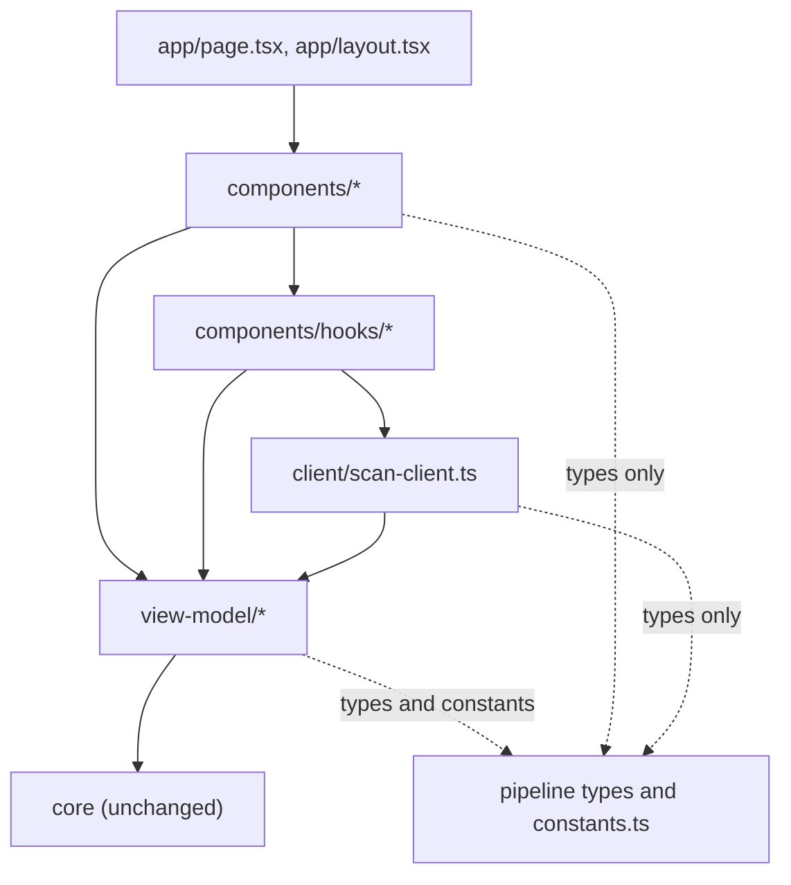
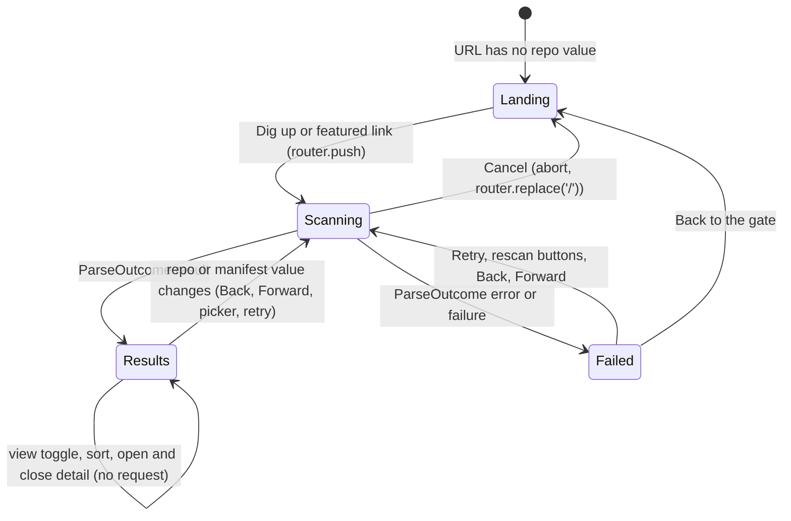
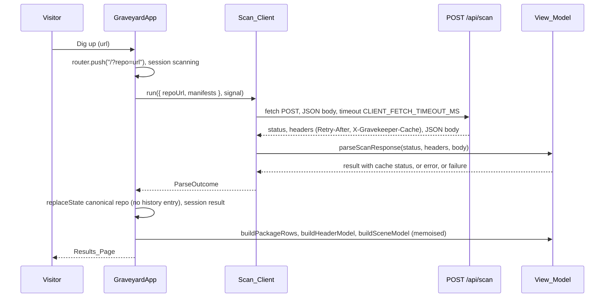

# Design Document: graveyard-ui

## Overview

The graveyard UI turns one `POST /api/scan` response into an interactive moonlit graveyard. A visitor pastes a public GitHub repository URL or picks a featured repository. The browser sends the request, shows an honest scanning screen, and then shows tombstones (buried DEAD packages), overgrown graves (forgotten DEAD packages), ghosts (HAUNTED), restless ghosts (HAUNTED packages that are also archived or deprecated, drawn as a ghost over its own tombstone), lanterns (ALIVE) and unmarked graves (not assessed), with a header, an accessible table, a detail panel, "Caretaker's notes" and themed error screens. This design implements `.kiro/specs/graveyard-ui/requirements.md` (Requirements 1 to 22, DI-1 to DI-31, DG-1 to DG-21, Open questions 1 to 16, all answered and accepted). Section references such as "R7.15" mean Requirement 7, criterion 15.

The UI is a consumer of `/core`, `/pipeline` and `/adapters`, which stay unchanged except for one additive field, `AdvisoryEntry.excluded` (D12, "Pipeline change: advisory exclusion kind", Requirement 22), implemented by one explicit pipeline task with tests. It reads the Scan_Result as extended by `.kiro/specs/scan-accuracy`: `ScanDependency.advisories`, `versionBasis` `resolved`, the `X-Gravekeeper-Cache` header, `details.candidates` in two errors, the note code `range-unresolved`, and the core exports `uniquePackages`, `mergeClassifications` and `compareClassifications`.

### Design principles

1. **Pure view-model, thin components.** Every decision about data (counts, grave types, labels, order, links, error wording, sort, layout) is a pure function in `/view-model`. Components render a model and forward events. A component never branches on Scan_Result data (R6.4).
2. **Core decides, the UI displays.** One Merged_Classification per package comes from `uniquePackages` (R6.8). The only rules the UI adds are presentation rules: Strongest_Reason priority (R7.4), Grave_Type (R7.15), Glow_Level (R7.7), scene order (R7.9).
3. **Total functions at the boundary.** `parseScanResponse` validates and narrows every response. After it, the view-model works on typed data and never throws (R6.6, R14).
4. **One state, the URL.** `repo`, `manifest` and `view` live in the query string. The scan, the Back button, reload and sharing all follow from it (R3).
5. **Plain messages are never rewritten.** Themed copy wraps a plain message in its own element (R15.6, R13.12).
6. **Cheap by construction.** One memoised view-model per result, one sprite sheet, one tooltip, event delegation, CSS-only animation, code-split secondary views (R17).
7. **Accessibility is a structural property.** Native `button`, `table`, `fieldset` and `time` elements are used wherever one exists. Status is always text plus drawing (R16.3).

### Key design decisions

| ID | Decision | Rationale |
|---|---|---|
| D1 | `app/page.tsx` is a synchronous Server Component that renders the static shell and one `<Suspense>` around a client component, `GraveyardApp`. `GraveyardApp` reads the query with `useSearchParams` and fetches `/api/scan` from the browser. | Open question 3. `searchParams` as a page prop is a request-time API that makes the page dynamic, while `useSearchParams` under `Suspense` keeps the shell prerendered (guides `page.md`, `use-search-params.md`). Cancel, elapsed-time stages and header reading need the browser. The Vitest guide says Vitest cannot run async Server Components, so a synchronous page keeps tests simple. |
| D2 | URL changes that must not rescan (`view`, canonical `repo`) use `window.history.replaceState`. New scans use `router.push`. Cancel uses `router.replace('/')`. | The SPA guide says Next integrates `pushState` and `replaceState` into `useSearchParams`. `router.push` adds the history entry that R3.7 requires and `router.replace` adds none (guide `use-router.md`). |
| D3 | The request identity is `requestKey = JSON.stringify([repoValue, manifests])`. A held result carries `requestKey` and `canonicalKey`. The scan effect does nothing when the current key equals either. | After R3.4 replaces `repo` with the Canonical_Repo_URL, `useSearchParams` reports a new value. Without `canonicalKey` that would trigger a second scan. |
| D4 | The Scene is a container of `<button>` elements placed by CSS custom properties, each with an inline `<svg><use href></svg>` that points into one sprite sheet. There is no per-plot React state, no per-plot handler and no SVG filter. | Native buttons give role, name, Enter and Space, focus ring and Testing Library queries for free. 300 plots cost about 1,200 DOM nodes (R17.1). |
| D5 | The Detail_Panel is a custom modal (`role="dialog"`, `aria-modal="true"`, `inert` on the page behind it, a small focus-trap hook) and not the native `<dialog>` element. | R10.1 states the ARIA attributes and the trap. jsdom (the Vitest DOM environment of the Next.js Vitest guide) is believed not to implement `showModal` (to be re-checked at task time, RK6), and a native dialog would then need a polyfill in every component test. A custom modal avoids the question. |
| D6 | The Scan_Client lives in `/client` (browser I/O, framework-free). Hooks live in `/components/hooks`. The View_Model has no I/O. | `structure.md` has no home for browser I/O. A new `/client` directory gets its own architecture rule (see Architecture check). |
| D7 | Fonts: **IM Fell English SC** (display, OFL 1.1, weight 400, `latin` subset, import name `IM_Fell_English_SC`) and **Atkinson Hyperlegible** (readable sans, OFL 1.1, weights 400 and 700, `latin`, import name `Atkinson_Hyperlegible`), both through `next/font/google`. Pirata One is not used. The starter's Geist fonts are removed. | R15.3 and `ui-design.md` (one display face, one readable sans, OFL, `next/font`). The user replaced Pirata One by IM Fell English SC in the final revision. Both names exist in `node_modules/next/dist/compiled/@next/font/dist/google/font-data.json` of the installed Next.js 16.4.6 and the licence of IM Fell English SC is verified (section "Font licence evidence"). `adjustFontFallback` defaults to `true` for Google fonts (guide `font.md`), which limits layout shift (R17.6). The font has one weight, so headings must not use `font-weight` above 400 (a synthesised bold would be applied otherwise). |
| D12 | Advisory groups need the new pipeline field `AdvisoryEntry.excluded: 'withdrawn' \| 'informational' \| null`. The view-model derives informational entries from the note ids when the field is absent, and shows the rest of such a result under "Not classified". | R10.16, R22, DG-21. No Scan_Result field says which entries are withdrawn (checked in `pipeline/mapping`), so a derivation is impossible for withdrawn entries. The field is the smallest addition (one value per entry, from the `AdvisoryRecord` that `assembleFacts` already holds). The scan cache can still hold results from before the change, hence the absent-field fallback. |
| D13 | Restless ghost is a sixth `PlotKind` with status word "haunted, buried". Its kind is a pure function of the merged status and the ruleId set (`plotKindOf`), next to `graveTypeOf`. It counts in H and not in B. It has no Grave_Type and no Resurrect_Slot. | User decision (R7.20, R5.2). Keeping the Grave_Type `null` for every HAUNTED package preserves B + F = DEAD and the merged status stays the single source of "haunted" counts. |
| D8 | The Content-Security-Policy is set once in `next.config.ts` `headers()` in the "Without Nonces" form of the CSP guide. | Open question 9. A nonce needs dynamic rendering of every page and SRI is experimental (guide `content-security-policy.md`). |
| D9 | Code splitting uses `next/dynamic` inside client components for `DetailPanel`, `ListView` and `ManifestPicker`. | Guide `lazy-loading.md`: automatic splitting is not supported when a Server Component imports a Client Component, so the dynamic imports sit in `GraveyardApp` and `ResultsPage`, which are client components (R17.7). |
| D10 | Property tests and component tests share one typed `ScanResult` builder and one fast-check arbitrary (`tests/support/ui/`). The arbitrary builds the result through the real core (`classify`, `summarize`) so that summaries are consistent. | R19.2 and R19.5. A hand-written summary could drift from core and hide a real mismatch. |
| D11 | Playwright runs against a production build (`next build`, `next start`). `POST /api/scan` is answered with `page.route`. Recorded-fixture results are generated by `scripts/export-scan-fixtures.ts`, which replays `tests/fixtures/*` through `runScan` with the wiring of `tests/pipeline/fixtures-scan.test.ts`. | R20.1. The dev server differs from production (Suspense behaviour in `use-search-params.md`, StrictMode double effects), and the budgets of R17 are production numbers. |

### Research summary and sources

Files read from `node_modules/next/dist/docs/` (Next.js 16.4.6, `AGENTS.md` requires this):

- `01-app/03-api-reference/03-file-conventions/page.md`: `searchParams` is a Promise. It is a request-time API and makes the page dynamic. Client pages can read it with `use`. A `PageProps` helper exists. Decision: the page does not read `searchParams`.
- `01-app/03-api-reference/04-functions/use-search-params.md`: `useSearchParams` is a Client Component hook. With a prerendered route the boundary up to the nearest `Suspense` is rendered on the client. The production build fails without a `Suspense` boundary. Layouts do not receive `searchParams`. Decision: one `Suspense` around `GraveyardApp`.
- `01-app/02-guides/single-page-applications.md`: native `pushState` and `replaceState` update `useSearchParams` consumers. `use(browser())` renders a component only in the browser and suspends to the nearest `Suspense` during prerendering. Decision: shallow routing for `view` and canonical `repo`. `use(browser())` is not used because the results never render during prerendering (they appear only after a fetch).
- `01-app/03-api-reference/04-functions/use-router.md`: `router.push` adds a history entry, `router.replace` does not, both take `{ scroll }`, and untrusted `javascript:` URLs must never reach them. Decision: the router only receives URLs built by `buildUrl` (same-origin path and query).
- `01-app/01-getting-started/05-server-and-client-components.md`: `"use client"` marks a boundary and everything it imports joins the client bundle, props passed to Client Components must be serialisable. Decision: `'use client'` only on `graveyard-app.tsx` (the boundary), so the shared view-model and component files do not need the directive.
- `01-app/02-guides/lazy-loading.md`: `next/dynamic` composes `React.lazy` and `Suspense`. `ssr: false` only works inside a Client Component. Decision: D9.
- `01-app/01-getting-started/13-fonts.md` and `01-app/03-api-reference/02-components/font.md`: `next/font` self-hosts Google fonts at build time, fonts apply from the root layout, `variable` creates a CSS variable, `adjustFontFallback` defaults to `true` for Google fonts. Decision: D7.
- `01-app/01-getting-started/14-metadata-and-og-images.md`: static `metadata` object export. Decision: `app/layout.tsx` exports `metadata` with Gravekeeper's title and description (R15.8).
- `01-app/01-getting-started/15-route-handlers.md`: `POST` Route Handlers are never cached. Decision: the client calls `/api/scan` with plain `fetch` and the response is never stored by Next.js (the route also sends `Cache-Control: no-store`).
- `01-app/03-api-reference/05-config/01-next-config-js/cacheComponents.md`: `cacheComponents: true` (already set in `next.config.ts`) prerenders a static shell and uses React `<Activity>` to keep hidden routes mounted, with effects cleaned up when a route is hidden. Decision: the app has one route, so `Activity` does not apply, and the scan effect still aborts on cleanup.
- `01-app/02-guides/content-security-policy.md`: nonce policies need dynamic rendering through `proxy.ts`, the "Without Nonces" form sets the header in `next.config` `headers()`, SRI is experimental. Decision: D8.
- `01-app/02-guides/testing/vitest.md` and `01-app/02-guides/testing/playwright.md`: manual setup with `vitest`, `@vitejs/plugin-react`, `jsdom`, `@testing-library/react`, `@testing-library/dom`, `vite-tsconfig-paths`. Playwright E2E with a `webServer`. Vitest does not support async Server Components. Decision: dependencies of the Testing Strategy.

Live checks (2026-11-19, PowerShell `Invoke-WebRequest`):

- `https://pypi.org/project/flask-script/` answers 200 and `https://crates.io/crates/serde` answers 200 to a browser-like GET.
- `https://www.npmjs.com/package/request` answers 403 to scripted clients, so the npm link pattern is not confirmed by a request (RK1).
- `https://osv.dev/vulnerability/GHSA-fjxv-7rqg-78g4` answers 200. Advisory links use the `url` of each Advisory_Entry, so no OSV pattern is built by the UI.
- Contrast ratios of the palette below were computed with the WCAG 2.2 relative-luminance formula on the same date.

Repository facts checked: `.next/server/app/index.html` and `page_client-reference-manifest.js` exist after a build (used by the bundle check), `next.config.ts` has `cacheComponents: true` and `partialPrefetching: true`, `vitest.config.mts` includes only `tests/**/*.test.ts` in a `node` environment, `scripts/architecture/rules.ts` holds the layer rules, and `tests/support/arbitraries/` has core arbitraries that the UI arbitrary reuses.

### Font licence evidence (D7, R15.3)

Checked on 2026-11-19, before the font was added to any file:

1. **Availability in the installed Next.js.** `node_modules/next/dist/compiled/@next/font/dist/google/font-data.json` (Next.js 16.4.6) has the key `"IM Fell English SC"` with `weights: ["400"]`, `styles: ["normal"]`, `subsets: ["latin"]`. It has `"Atkinson Hyperlegible"` with weights 400 and 700, styles normal and italic, subsets `latin` and `latin-ext`. `next/font/google` therefore accepts `IM_Fell_English_SC({ subsets: ['latin'], weight: '400' })`. The file also lists the other nine IM Fell families, so the SC variant is the only one with the small-capitals form that was asked for.
2. **Licence metadata of the Google Fonts repository.** `https://raw.githubusercontent.com/google/fonts/main/ofl/imfellenglishsc/METADATA.pb` states `name: "IM Fell English SC"`, `designer: "Igino Marini"`, `license: "OFL"`, `category: "SERIF"`, `date_added: "2010-05-17"`, one font file of weight 400 and the copyright line "(c) 2007 Igino Marini ... With Reserved Font Name IM FELL English SC". The font sits in the `ofl/` directory of the repository, which holds only OFL fonts.
3. **Licence text.** `https://raw.githubusercontent.com/google/fonts/main/ofl/imfellenglishsc/OFL.txt` begins "Copyright (c) 2010, Igino Marini" and "This Font Software is licensed under the SIL Open Font License, Version 1.1", followed by the full licence text. The licence permits use, bundling and redistribution with software, free of charge, and requires that each redistributed copy carries the copyright notice and the licence text (condition 2). It forbids selling the font by itself and forbids using the Reserved Font Name for a Modified Version (condition 3).
4. **Consequences for this repository.** (a) `next/font/google` downloads the font files at build time and serves them from the same origin without modification, so the Reserved Font Name restriction (Modified Versions only) does not apply. (b) Condition 2 asks for the notice and the licence text to accompany redistributed copies. The design therefore adds a small committed file `docs/font-licences.md` (task 9.1) that names the two fonts, their designers (Igino Marini for IM Fell English SC, the Braille Institute of America and Applied Design Works for Atkinson Hyperlegible, whose `METADATA.pb` at `https://raw.githubusercontent.com/google/fonts/main/ofl/atkinsonhyperlegible/METADATA.pb` also states `license: "OFL"` and the copyright "Copyright 2020 Braille Institute of America, Inc.", checked the same day), the licence name and the two source URLs, and a footer link or text "Fonts: SIL Open Font License 1.1" on the landing page that points to that file's content in the repository. (c) The CSP value `font-src 'self'` stays correct because the files are self-hosted.
5. **Steering wording.** `ui-design.md` says "one gothic display face". IM Fell English SC is a 17th-century old-style face, not blackletter. The user chose it, so task 9.1 changes that one sentence of `ui-design.md` to "one period display face". No other steering sentence changes.

Pirata One is removed from the design and from the layout test list (`tests/ui/layout.test.ts` allows exactly `IM_Fell_English_SC` and `Atkinson_Hyperlegible`).

---

## Architecture

### Module layout

```
app/
  layout.tsx                    root layout: next/font (IM Fell English SC, Atkinson Hyperlegible), metadata, lang="en", SiteHeader, main, SiteFooter
  page.tsx                      sync Server Component: <Suspense fallback={<GateFallback/>}><GraveyardApp/></Suspense>
  globals.css                   Tailwind import, design tokens (@theme), fog and motion CSS, reduced-motion rules
  api/scan/route.ts             unchanged
view-model/                     PURE. No React, no next/*, no DOM, no clock, no random, no fetch
  index.ts                      public barrel
  constants.ts                  every constant of the requirements Constants table that has Home "view-model"
  types.ts                      all view-model types (see Data Models)
  parse-response.ts             parseScanResponse, parseRetryAfter, parseCacheStatus
  narrow.ts                     narrowFacts, narrowAdvisories, narrowVersionBasis (total)
  grave-type.ts                 graveTypeOf, plotKindOf, statusWordOf
  advisory-groups.ts            buildAdvisoryGroups (R10.16)
  reasons.ts                    REASON_PRIORITY, strongestReason, shortForm, epitaphOf, statusWordOf
  glow.ts                       glowOf, maxSeverityOf
  package-rows.ts               buildPackageRows (calls core uniquePackages), scene order comparator
  scene.ts                      buildSceneModel, sceneHeight, hashKey
  scene-nav.ts                  nextFocus
  table.ts                      buildTableModel
  header.ts                     buildHeaderModel, formatAge
  detail.ts                     buildDetailModel, versionLine
  notes.ts                      buildNotesModel, NOTE_SECTIONS
  errors.ts                     buildErrorModel, retryRemainingMs
  picker.ts                     buildPickerModel
  stages.ts                     SCAN_STAGES, stageAt, stageStates
  urls.ts                       parseUrlState, buildUrl, canonicalRepoUrl, encodeManifests, decodeManifests, registryLink, sourceRepoLink, advisoryLink
  format-fact.ts                formatFact
client/                         browser I/O, framework-free
  scan-client.ts                createScanClient({ fetchImpl, setTimer, clearTimer, now }): runScan(request, signal) -> ParseOutcome | { kind: 'aborted' }
components/                     React. One component per file, PascalCase names, kebab-case files, no default exports
  graveyard-app.tsx             'use client'. Owns URL state, scan state machine, dynamic imports
  landing-page.tsx, repo-form.tsx, legend.tsx, featured-graveyards.tsx, gate-fallback.tsx
  scanning-screen.tsx, stage-list.tsx
  results-page.tsx, results-header.tsx, grade-line.tsx, view-toggle.tsx, cache-note.tsx
  scene.tsx, scene-plot.tsx, scene-sprites.tsx, scene-tooltip.tsx, fog-layer.tsx
  list-view.tsx (lazy), detail-panel.tsx (lazy), advisory-groups.tsx, resurrect-slot.tsx, manifest-picker.tsx (lazy)
  caretakers-notes.tsx, note-group-section.tsx, source-status-list.tsx, cap-banner.tsx, empty-graveyard.tsx
  error-screen.tsx, retry-button.tsx, back-to-gate.tsx
  site-header.tsx, site-footer.tsx, skip-link.tsx, external-link.tsx
  hooks/
    use-scan.ts                 scan effect, abort on cleanup, requestKey and canonicalKey (D3)
    use-elapsed.ts              stage timers
    use-reduced-motion.ts       matchMedia('(prefers-reduced-motion: reduce)')
    use-container-width.ts      ResizeObserver, layout effect
    use-countdown.ts            one timer per second while a cooldown runs
    use-focus-trap.ts           Tab trap, Escape, focus return, inert background
    use-url-state.ts            reads useSearchParams, writes with router.push, router.replace, history.replaceState
scripts/
  export-scan-fixtures.ts       replays tests/fixtures/* into tests/e2e/.generated/*.json (gitignored)
  check-client-js-budget.ts     static gzip budget gate (see JS budget)
  architecture/                 extended with view-model, client and components rules
tests/
  ui/                           Testing Library tests (jsdom) and view-model property tests
  support/ui/                   scan-result-builder.ts, scan-result-arbitrary.ts
  e2e/                          Playwright specs, playwright.config.ts at the repository root
docs/screenshots/               SCREENSHOT_DIR
```

File names follow the existing rule `^[a-z0-9]+(-[a-z0-9]+)*\.tsx?$`. Next.js route files (`page.tsx`, `layout.tsx`, `route.ts`) are the only default exports.

### Dependency direction



Forbidden edges, enforced by the architecture check (see below): `view-model` to `react`, `react-dom`, `next`, `adapters`, `components`, `client`, `app`, and to `pipeline` other than `import type` and `pipeline/constants.ts`; `components` and `client` to `adapters` and to `pipeline` runtime code (types and `constants.ts` only); `core`, `pipeline` and `adapters` to `view-model`, `client` and `components`.

### Scan state machine



The state is derived from the URL plus one `ScanSession` held in a reducer:

```ts
type ScanSession =
  | { phase: 'idle' }
  | { phase: 'scanning'; requestKey: string; startedAtMs: number }
  | { phase: 'result'; requestKey: string; canonicalKey: string; result: ParsedScanResult; cache: CacheStatus }
  | { phase: 'failed'; requestKey: string; failure: ErrorModel; arrivedAtMs: number };
```

`useScan(urlState)` runs one effect keyed by `requestKey`. It does nothing when the held session already has that `requestKey` or `canonicalKey` (D3). Otherwise it creates an `AbortController`, sets `scanning`, calls `scanClient.run`, and aborts in the cleanup function. A second activation with the same key finds the session `scanning` for that key and sends nothing (R3.9). A Back or Forward to a different key re-runs the effect, so the cleanup aborts the old request first (R3.8). StrictMode in `next dev` runs the effect twice, so the first request is aborted and a second is sent. This affects development only, and the Playwright suite runs the production build (D11).

### Scan sequence



### How the Architecture check is extended (R6.5)

`scripts/architecture/rules.ts` gets new rules. Each rule has a unit test with an inline violating snippet in `tests/architecture/architecture.test.ts`, like the existing rules.

| Rule id | Implements | Files | Check |
|---|---|---|---|
| `view-model-import-not-allowed` | R6.1, R6.5 | `view-model/**` | imports resolve only to `core/index.ts`, `view-model/**`, `pipeline/constants.ts`, or are `import type` of `pipeline/**`. No `react`, `react-dom`, `next`, `next/*`, `adapters`, `components`, `client`, `app`. |
| `view-model-forbidden-api` | R6.2, R6.5 | `view-model/**` | no `Date.now`, zero-argument `new Date()` or `Date()`, `Math.random`, `performance.now`, `fetch`, `window`, `document`, `localStorage`, `process.env`, `setTimeout`, `setInterval` |
| `client-import-not-allowed` | D6 | `client/**` | imports only `view-model/**` and `import type` of `core` and `pipeline/**`. No `react`, no `next`, no `adapters`, no `components` |
| `components-import-pipeline-runtime` | R6.5 | `components/**` | `pipeline/**` only through `import type` (and `pipeline/constants.ts` is not needed) |
| `components-no-core-runtime` | R6.4 | `components/**` | no runtime import of `core` (components get everything from the view-model) |
| `view-model-uses-core-merge` | R6.8 | `view-model/package-rows.ts` | the file imports `uniquePackages` from `core` and contains neither of the identifiers `STATUS_RANK` and `classificationTieKey`, which are the names core uses for its merge order |
| `no-default-export` (extended) | steering `structure.md` | `view-model/**`, `client/**`, `components/**` | no `export default` or `export =`. `app/**/page.tsx`, `layout.tsx`, `route.ts` are exempt |
| `file-name-style` (extended) | steering | `view-model/**`, `client/**`, `components/**` | name matches the kebab-case pattern |
| `no-inner-html` | R21.1 | `app/**`, `components/**`, `client/**`, `view-model/**` | no `dangerouslySetInnerHTML`, `innerHTML`, `outerHTML`, `insertAdjacentHTML`, `document.write` |
| `no-literal-colour` | R15.2 | `components/**`, `app/**/*.tsx` | no hex colour literal, `rgb(`, `hsl(` in a string or template. Colours come from tokens in `app/globals.css` |
| `no-fixture-import` | R2.5 | `app/**`, `components/**`, `client/**`, `view-model/**` | no import from `tests/**` or a path containing `fixtures` |

`no-inner-html` and `no-literal-colour` scan identifiers and string literals with the existing TypeScript-AST helpers (`globals.ts`). `view-model-uses-core-merge` is a guard and not a proof. The proof of R6.8 is property P8, which compares the rows with `uniquePackages`.

### Next.js integration

- `app/layout.tsx`: `export const metadata` with title "Gravekeeper" and a description. `<html lang="en">` with the two font CSS variables. The body holds `SiteHeader` (`<header>` with the wordmark as a link, not a heading), `<main id="main">` and `SiteFooter` (`<footer>`). Each screen renders exactly one `h1` inside `main`.
- `app/page.tsx` is synchronous and exports no `searchParams` prop. It renders `<Suspense fallback={<GateFallback />}><GraveyardApp /></Suspense>`. `GateFallback` is static markup (the `h1`, the pitch and a reserved block of the form's height) so that the prerendered shell is meaningful without JavaScript and layout shift at hydration stays small.
- `GraveyardApp` is the only `'use client'` entry. It reads `useSearchParams()`, parses it with `parseUrlState`, and holds the `ScanSession` reducer. It imports `DetailPanel`, `ListView` and `ManifestPicker` with `next/dynamic`.
- `next.config.ts` keeps `cacheComponents`, `partialPrefetching` and the Tailwind turbopack rule, and adds `headers()` with the CSP of R21.6.
- `useSearchParams` is used once, in `use-url-state.ts`. Event handlers that only need the URL read `window.location` (guide `use-search-params.md` and the SPA guide recommend this to avoid prerender impact).

---

## Components and Interfaces

### View-model functions

```ts
// parse-response.ts
export function parseScanResponse(status: number, headers: HeaderReader, body: unknown): ParseOutcome;
export function parseRetryAfter(value: string | null): number | null;      // 1..86400 or null (R14.6)
export function parseCacheStatus(value: string | null): CacheStatus;       // hit | miss | unknown (R14.9)

// package-rows.ts
export function buildPackageRows(result: ParsedScanResult): readonly PackageRow[];   // scene order

// scene.ts
export function columnsFor(containerWidthPx: number): number;               // clamp(floor(w / PLOT_CELL_WIDTH_PX), 2, 20) (R8.1)
export function buildSceneModel(rows: readonly PackageRow[], columns: number): SceneModel;
export function sceneHeight(plotCount: number, columns: number): number;     // rows * PLOT_CELL_HEIGHT_PX + 2 * SCENE_PADDING_PX (R8.3)

// scene-nav.ts
export function nextFocus(scene: SceneModel, current: number, move: FocusMove): number;

// table.ts
export function buildTableModel(rows: readonly PackageRow[], sort: TableSort | null): TableModel;

// header.ts
export function buildHeaderModel(result: ParsedScanResult, rows: readonly PackageRow[]): HeaderModel;
export function formatAge(asOfIso: string, nowMs: number): string;          // "scanned 3 hours ago" (R3.10)

// detail.ts
export function buildDetailModel(result: ParsedScanResult, rows: readonly PackageRow[], key: PackageKeyString): DetailModel | null;

// notes.ts
export function buildNotesModel(result: ParsedScanResult): NotesModel;

// errors.ts
export function buildErrorModel(input: ErrorInput): ErrorModel;
export function retryRemainingMs(cooldownSeconds: number, elapsedMs: number): number;

// picker.ts
export function buildPickerModel(candidates: readonly string[], selected: readonly string[], repoValue: string): PickerModel;

// stages.ts
export function stageAt(elapsedMs: number): number;                          // 0..3 (R4.12)
export function stageStates(elapsedMs: number): readonly StageState[];       // "done" | "in progress" | "waiting"

// urls.ts
export function parseUrlState(search: string): UrlState;
export function buildUrl(state: UrlState): string;                           // "/?repo=...&manifest=...&view=list", "/" when empty
export function canonicalRepoUrl(repo: ParsedScanResult['repo']): string;    // DG-8
export function buildRequestBody(state: UrlState): ScanRequestBody;          // { repoUrl, manifests? } and nothing else (R3.3)
export function encodeManifests(paths: readonly string[]): string;           // repeated manifest= pairs
export function decodeManifests(search: string): readonly string[];
export function registryLink(ecosystem: Ecosystem, name: string): string | null;       // DG-4
export function sourceRepoLink(sourceRepo: unknown): string | null;                    // DG-5, R21.3
export function advisoryLink(url: unknown): string | null;                              // R21.3

// format-fact.ts
export function formatFact(field: HealthFactField, value: unknown): string;            // R10.4, R10.14
```

### Scan_Client (`client/scan-client.ts`)

```ts
export interface ScanClientDeps {
  readonly fetchImpl: typeof fetch;
  readonly setTimer: (fn: () => void, ms: number) => unknown;
  readonly clearTimer: (handle: unknown) => void;
}
export type ScanClientOutcome = ParseOutcome | { readonly kind: 'aborted' };
export function createScanClient(deps: ScanClientDeps): {
  run(request: ScanRequestBody, signal: AbortSignal): Promise<ScanClientOutcome>;
};
```

`run` posts `JSON.stringify(request)` with `Content-Type: application/json`, `credentials: 'omit'` and `cache: 'no-store'` to the same-origin path `/api/scan` (R21.5). It starts one timer for `CLIENT_FETCH_TIMEOUT_MS`. The timer aborts an internal controller linked to the caller's signal. A rejected fetch maps to `network-failure` when neither the caller nor the timer aborted, to `timeout` when the timer aborted, and to `aborted` when the caller aborted. A body that is not JSON maps to `parseScanResponse(status, headers, undefined)`, which returns `malformed-response`. The function never throws.

### Components

| Component | Props (all serialisable models, no raw Scan_Result data) | Behaviour |
|---|---|---|
| `GraveyardApp` | none | Reads URL state, owns the session reducer, renders one screen, owns the open-detail key. Loads `DetailPanel`, `ListView`, `ManifestPicker` lazily. |
| `LandingPage`, `RepoForm`, `Legend`, `FeaturedGraveyards` | `initialValue`, `onSubmit(value)`, legend and featured models from `constants.ts` | R1, R2. The form shows the empty-input message in a polite live region and moves focus to the input (R1.5). Featured entries are `<a href>` elements (R2.4). |
| `ScanningScreen`, `StageList` | `stages: StageState[]`, `slowNotice: boolean`, `reducedMotion`, `onCancel` | R4. The Cancel button is first in tab order. One polite live region announces a Stage change once. |
| `ResultsPage` | `header: HeaderModel`, `scene`, `viewName`, `cache`, handlers | Composes header, toggle, Scene or ListView, CaretakersNotes, cap banner, empty state, picker. |
| `ResultsHeader`, `GradeLine`, `CacheNote` | `HeaderModel`, `ageText`, `cache` | R5. `time` element with `dateTime`. Grade scale is a closed `<details>` (R5.6). |
| `Scene`, `ScenePlot`, `SceneSprites`, `SceneTooltip`, `FogLayer` | `SceneModel`, `onOpen(key)`, `reducedMotion` | R8, R9. See Scene rendering. |
| `ListView` | `TableModel`, `onSort(column)`, `onOpen(key)` | R18. Native `table`, sort buttons with `aria-sort`. |
| `DetailPanel` | `DetailModel`, `onClose` | R10. Custom modal, `useFocusTrap`, link list through `ExternalLink`. Contains `ResurrectSlot` when `detail.resurrect` is true. |
| `ResurrectSlot` | `{ packageKey: string; displayName: string }` | R12. Inert placeholder in its own file. |
| `CaretakersNotes`, `NoteGroupSection`, `SourceStatusList`, `CapBanner`, `EmptyGraveyard` | `NotesModel` and parts | R11. |
| `ErrorScreen`, `RetryButton`, `BackToGate` | `ErrorModel`, `onAction(id)` | R13. Focus moves to the `h1` on display. `RetryButton` uses `useCountdown`. |
| `ManifestPicker` | `PickerModel`, `onScan(paths)` | R11.11, R13.15. Used by the Results_Page and by two Error_Screens. |
| `ExternalLink` | `{ href: string; label: string }` | `target="_blank"`, `rel="noopener noreferrer"`, shows the host as text (R10.11). Renders plain text when `href` is null. |

Components import view-model values only through `view-model/index.ts` and never import `core` at runtime (rule `components-no-core-runtime`).

### Screen list

| ID | Screen | State and entry | Components | Screenshot names (`SCREENSHOT_DIR`, per viewport) |
|---|---|---|---|---|
| S1 | Landing | `/` | `LandingPage`, `RepoForm`, `Legend`, `FeaturedGraveyards` | `landing-default-<viewport>.png`, `landing-empty-input-<viewport>.png` |
| S2 | Scanning (four stages) | `/?repo=...` while a request is in flight | `ScanningScreen`, `StageList` | `scanning-stage1-<viewport>.png` to `scanning-stage4-<viewport>.png` |
| S3 | Results, Scene view | `/?repo=...` with `view` absent or `scene` | `ResultsPage`, `ResultsHeader`, `Scene`, `CaretakersNotes` | `results-scene-<fixture>-<viewport>.png` for `request`, `canopy`, `zoxide` |
| S4 | Results, List view | `view=list` | `ListView` (lazy) | `results-list-<fixture>-<viewport>.png` |
| S5 | Detail panel | modal over S3 or S4 | `DetailPanel`, `ResurrectSlot` | `detail-tombstone-`, `detail-overgrown-`, `detail-ghost-`, `detail-restless-`, `detail-lantern-`, `detail-unmarked-<viewport>.png` |
| S6 | Caretaker's notes | section of S3 and S4 | `CaretakersNotes`, `SourceStatusList`, `CapBanner` | `notes-<fixture>-<viewport>.png`, `notes-degraded-<viewport>.png` (synthetic partial and failed sources) |
| S7 | Empty graveyard | `no-manifests` note or no manifests | `EmptyGraveyard` | `results-empty-<viewport>.png` |
| S8 | Manifest picker | `no-root-manifest` note | `ManifestPicker` | `picker-results-<viewport>.png` |
| S9 | Error: `invalid-url` | HTTP 400, one variant per `details.part` | `ErrorScreen`, `RepoForm` | `error-invalid-url-<part>-<viewport>.png` |
| S10 | Error: `repo-not-found` | HTTP 404 | `ErrorScreen` | `error-repo-not-found-<viewport>.png` |
| S11 | Error: `branch-not-found` | HTTP 404 | `ErrorScreen` | `error-branch-not-found-<viewport>.png` |
| S12 | Error: `too-many-manifests` | HTTP 400, with and without candidates | `ErrorScreen`, `ManifestPicker` | `error-too-many-manifests-<viewport>.png` |
| S13 | Error: `manifest-not-found` | HTTP 404, with and without candidates | `ErrorScreen`, `ManifestPicker` | `error-manifest-not-found-<viewport>.png` |
| S14 | Error: `upstream-unavailable` | HTTP 503 with countdown, HTTP 502 without | `ErrorScreen`, `RetryButton` | `error-upstream-503-<viewport>.png`, `error-upstream-502-<viewport>.png` |
| S15 | Error: `deadline-exceeded` | HTTP 504 | `ErrorScreen` | `error-deadline-exceeded-<viewport>.png` |
| S16 | Error: `internal-error` | HTTP 500 | `ErrorScreen` | `error-internal-error-<viewport>.png` |
| S17 | Error: `invalid-request` | HTTP 400, 405, 413, 415, one variant per `details.reason` | `ErrorScreen` | `error-invalid-request-<reason>-<viewport>.png` |
| S18 | Client failure: `network-failure`, `timeout`, `malformed-response` | no valid response | `ErrorScreen` | `error-network-failure-`, `error-timeout-`, `error-malformed-response-<viewport>.png` |

Viewports are `desktop` (1280x800) and `mobile` (390x844). S9 to S18 are the "every Error_Screen" set of R16.10 and R20.5.

### Scene rendering and performance

The Scene is one `div` (`role="group"`, `aria-label` "Graveyard scene, N packages. Use the arrow keys to move between graves") with `position: relative` and a width and height set from the Scene_Model before the plots render. Layers, back to front:

1. `FogLayer`: two `div` elements with a large CSS gradient background, `aria-hidden="true"`, animated with `transform` and `opacity` only.
2. Plots: one `<button>` per Plot, `position: absolute; left: 0; top: 0; transform: translate(var(--x), var(--y))`, with `--x`, `--y`, `--w`, `--h` and `--glow` set as inline custom properties. Each button holds `<svg aria-hidden="true"><use href="#plot-<kind>" /></svg>` and one `<span>` label. The visible label is the name cut to `EPITAPH_MAX_CHARS`. The full text is in `aria-label` (R7.6) and in the tooltip.
3. `SceneSprites`: one hidden-by-size `<svg width="0" height="0" aria-hidden="true">` with a `<symbol>` per kind (`plot-tombstone`, `plot-overgrown`, `plot-ghost`, `plot-restless` (the tombstone shape with the ghost shape drifting over it, built from the same two sub-shapes through nested `<use>` so that the art is drawn once), `plot-lantern`, `plot-unmarked`) and flat variants (`plot-<kind>-flat`) for the simplified form. Glow is a radial-gradient fill inside the symbol and the glow level scales its opacity through `--glow`. No SVG filter and no blur is used.

How the Scene stays smooth with `SCENE_MAX_PLOTS` (300) plots:

1. **Layout is arithmetic, computed once.** `buildSceneModel` is O(n) with a hash per plot. It runs when the rows or the column count change, and never on hover, focus, selection or panel state.
2. **One memoised model per result.** `useMemo` keys: `buildPackageRows(result)` on the result object, `buildSceneModel(rows, columns)` on `[rows, columns]`. The `plots` array and each `PlotModel` keep their identity between renders.
3. **No per-plot state or handler.** `ScenePlot` is `React.memo` with the `PlotModel` as its only prop. Click, hover, focus and key events use one delegated handler on the container that reads `data-index` from `event.target.closest('[data-index]')`. The tooltip is one `SceneTooltip` that holds the hovered index in one state variable. Roving `tabindex` is moved by setting the attribute on two DOM nodes through a ref, so a focus move re-renders nothing. Opening and closing the Detail_Panel changes state in `GraveyardApp` only, and the memoised Scene receives the same props (R17.5).
4. **Cheap nodes.** Each plot is four nodes (button, svg, use, span). The sprite sheet exists once. There are no filters, no masks and no per-plot gradients.
5. **CSS-only motion, compositor properties only.** Fog drift, ghost drift and the pulse of ghosts, restless ghosts and lanterns are CSS keyframes on `transform` and `opacity` (R17.4). Each animation has a delay from the plot's hash so that plots do not move in step. `@media (prefers-reduced-motion: reduce)` in `globals.css` sets `animation: none` and `transition: none` on the Scene and the fog, and the static glow strength still follows `--glow` (R8.7). `useReducedMotion` is used only for the Scanning screen's text variant.
6. **Simplified form above 300 plots.** When `plots.length > SCENE_MAX_PLOTS`, the container gets `data-simplified="true"`. The CSS then uses the `-flat` symbols, drops animation and drops the label shadow (R8.9). Every plot is still rendered, so the table, keyboard and counts are unchanged.
7. **Reserved space.** The container's `width` and `height` come from the model. Its height is `sceneHeight(n, columns)`, so no plot arrival moves other content (R17.3). The column count comes from `useContainerWidth`, which measures in a layout effect before the first paint of the results, and the results mount only after the fetch, so there is no server markup to mismatch.
8. **Code split.** The List view, the Detail panel and the picker are separate chunks and are not loaded for the first view of the Results_Page (R17.7).
9. **Measured, with a decision rule.** The render budget `SCENE_RENDER_BUDGET_MS` (100) is measured in Playwright (see Testing Strategy). If the median exceeds the budget at task time, the contingency is applied in this order and the measurement repeated: (a) group plots into row bands (`div` per row with `content-visibility: auto` and `contain-intrinsic-size`), (b) render rows in windows with an `IntersectionObserver` and keep the table as the complete listing. The first contingency changes only `scene.tsx`, because `PlotModel.row` already exists.

### Scene interaction details

- Tooltip (R9.1 to R9.4): shown on `pointerover` and `focusin` from the delegated handler, hidden on `pointerout` and `focusout` unless the pointer is over the tooltip, and on Escape with focus kept on the plot. The tooltip is `role="tooltip"`, referenced by `aria-describedby` on the focused plot, and stays while the pointer moves onto it.
- Keyboard (R9.6): one tab stop. Arrow keys, Home and End call `nextFocus(scene, current, move)` and move DOM focus. Enter and Space are the native button behaviour and call `onOpen(key)`.
- Skip link (R9.8): `SkipLink` before the Scene moves focus to the view toggle.

### Design tokens (R15.2)

`app/globals.css` defines the tokens in a Tailwind `@theme` block so that utilities exist, and components use only token-backed utilities or `var(--token)`.

| Token | Value | Use | Contrast on `--color-night` (computed 2026-11-19) |
|---|---|---|---|
| `--color-night` | `#0b1020` | page background | n/a |
| `--color-night-raised` | `#151c31` | panels | n/a |
| `--color-bone` | `#ece6d8` | text | 15.22 (13.58 on raised) |
| `--color-bone-muted` | `#b4b8c4` | secondary text | 9.55 (8.53 on raised) |
| `--color-amber` | `#f2b24c` | lanterns, primary button | 10.14 (9.05 on raised) |
| `--color-spectral` | `#6fe3f2` | ghosts, glow | 12.57 (11.23 on raised) |
| `--color-stone` | `#9aa0aa` | tombstones | 7.20 (6.43 on raised) |
| `--color-moss` | `#86b073` | overgrown graves, accents | 7.64 (6.82 on raised) |
| `--color-focus` | `#ffd166` | focus ring | 13.13 (11.72 on raised) |
| `--color-moss-deep` | `#2f4a33` | decorative ivy shading only | 1.94, never conveys information |

All text and shape tokens exceed `TEXT_CONTRAST_MIN` (4.5) and `NONTEXT_CONTRAST_MIN` (3). A unit test (`tests/ui/tokens.test.ts`) parses `globals.css`, reads a declared list of foreground and background pairs, computes the ratios and fails below the minimums. axe checks the rendered result as well.

### Content-Security-Policy

`next.config.ts` adds one `headers()` entry for `/(.*)` with `default-src 'self'; script-src 'self' 'unsafe-inline'; style-src 'self' 'unsafe-inline'; font-src 'self'; img-src 'self' data:; connect-src 'self'; object-src 'none'; base-uri 'self'; form-action 'self'; frame-ancestors 'none'`. In development `'unsafe-eval'` is added, as the guide states React needs it there. The residual risk is `'unsafe-inline'` for scripts (RK2).


---

## Data Models

### Constants (`view-model/constants.ts`)

Every constant of the requirements Constants table with Home "view-model" is exported here with the value given there. This design adds three layout and wording constants that R8 refers to without naming them.

| Constant | Value | Meaning |
|---|---|---|
| `SCENE_PADDING_PX` | 16 | Padding on each side of the Scene (R8.3 "fixed padding"). |
| `PLOT_BOX_WIDTH_PX` | `PLOT_CELL_WIDTH_PX - 2 * PLOT_JITTER_MAX_PX` = 80 | Width of one Plot box. |
| `PLOT_BOX_HEIGHT_PX` | `PLOT_CELL_HEIGHT_PX - 2 * PLOT_JITTER_MAX_PX` = 104 | Height of one Plot box. |
| `REASON_PRIORITY` | `7.2, 8.1, 8.2, 8.3, 8.4, 10.7, 10.8, 10.6, 6.3, 11.2` | R7.4. |
| `LINK_HOSTS` | `www.npmjs.com`, `pypi.org`, `crates.io`, `github.com`, `osv.dev` | R21.7. The configured `repo.host` is added by `canonicalRepoUrl`. |

`SCAN_MAX_MANIFESTS` and `SCAN_MAX_DEPENDENCIES` are imported from `pipeline/constants.ts` (pure values). A unit test asserts the five consistency rules of the requirements, `PLOT_BOX_WIDTH_PX > 0`, and `SCENE_MAX_PLOTS === SCAN_MAX_DEPENDENCIES`.

### Types (`view-model/types.ts`)

These are the view-model types. They import `Classification`, `Reason`, `Ecosystem`, `Scope`, `Severity`, `SourceKind`, `Grade`, `HealthFactField` from `core/index.ts` and `ScanResult`, `ScanErrorBody` from `pipeline` as `import type`.

```ts
import type {
  Classification, Ecosystem, Grade, HealthFactField, Reason, Scope, Severity, SourceKind,
} from '../core';
import type { ScanErrorBody, ScanResult } from '../pipeline';

// ---- identity and vocabulary ----------------------------------------------------------------
/** JSON.stringify([ecosystem, name, sourceKind]), the same encoding core uses for Package_Key. */
export type PackageKeyString = string;
export type GraveType = 'buried' | 'forgotten';
export type PlotKind = 'tombstone' | 'overgrown' | 'ghost' | 'restless' | 'lantern' | 'unmarked';
/** One word per PlotKind, one to one (R7.6). */
export type StatusWord =
  | 'dead, buried' | 'dead, forgotten' | 'haunted' | 'haunted, buried' | 'alive' | 'not assessed';
export type UnassessedCause = 'git' | 'path' | 'cap-skipped' | 'no-health-data';
export type VersionBasis = 'pinned' | 'resolved' | 'default' | null;
export type CacheStatus = 'hit' | 'miss' | 'unknown';
export type GlowLevel = 1 | 2 | 3 | 4;
export type ViewName = 'scene' | 'list';
export type SourceName = keyof ScanResult['sources'];
export type SourceStatusWord = 'ok' | 'partial' | 'failed';
export type ClientFailureKind = 'network-failure' | 'timeout' | 'malformed-response';
/** The API entry. After Requirement 22 it has `excluded`; a result cached earlier may lack it. */
export type AdvisoryEntry = ScanResult['dependencies'][number]['advisories'][number];
/** Parsed classification of one advisory (R14.5, DG-21). */
export type AdvisoryExclusion = 'counted' | 'informational' | 'withdrawn' | 'unknown';
export interface ParsedAdvisory {
  readonly id: string;
  readonly aliases: readonly string[];
  readonly severity: Severity | null;
  readonly url: string;
  readonly exclusion: AdvisoryExclusion;
}

// ---- response boundary (R14) ------------------------------------------------------------------
/** Same shape as the Fetch API Headers.get, so a Headers instance satisfies it. */
export interface HeaderReader { get(name: string): string | null }

/** The seven facts after narrowing: a valid value or null (the Unknown_Value). */
export interface NarrowedFacts {
  readonly daysSinceLastRelease: number | null;
  readonly daysSinceLastCommit: number | null;
  readonly archived: boolean | null;
  readonly deprecated: boolean | null;
  readonly openVulnerabilityCount: number | null;
  readonly maxSeverity: Severity | null;
  readonly maintainerCount: number | null;
}
export type ParsedDependency =
  Omit<ScanResult['dependencies'][number], 'facts' | 'versionBasis' | 'advisories'> & {
    readonly facts: NarrowedFacts;
    readonly versionBasis: VersionBasis;
    readonly advisories: readonly ParsedAdvisory[];
  };
export interface ParsedScanResult extends Omit<ScanResult, 'dependencies'> {
  readonly dependencies: readonly ParsedDependency[];
}
export interface ClientFailure { readonly kind: ClientFailureKind }
export type ParseOutcome =
  | { readonly kind: 'result'; readonly result: ParsedScanResult; readonly cache: CacheStatus }
  | { readonly kind: 'error'; readonly status: number; readonly error: ScanErrorBody; readonly retryAfterSeconds: number | null }
  | { readonly kind: 'failure'; readonly failure: ClientFailure };

// ---- URL state (R3, R18.1) ---------------------------------------------------------------------
export interface UrlState {
  /** The raw `repo` value as typed or as canonicalised. null when absent or empty. */
  readonly repo: string | null;
  readonly manifests: readonly string[];
  readonly view: ViewName;
}
/** Exactly the two fields the Scan_API accepts from the UI (R3.3). */
export interface ScanRequestBody {
  readonly repoUrl: string;
  readonly manifests?: readonly string[];
}

// ---- package rows (R7) ---------------------------------------------------------------------------
export interface PackageRow {
  readonly key: PackageKeyString;
  /** Identity (normalised) name. */
  readonly name: string;
  /** pypi: rawName of the first entry in manifest order. Otherwise equal to `name` (R7.8). */
  readonly displayName: string;
  readonly ecosystem: Ecosystem;
  readonly sourceKind: SourceKind;
  readonly scopes: readonly Scope[];
  readonly manifestPaths: readonly string[];
  readonly versionSpecs: readonly string[];
  readonly kind: PlotKind;
  /** Non-null only when kind is 'tombstone' or 'overgrown' (R7.15, R7.16). */
  readonly graveType: GraveType | null;
  readonly statusWord: StatusWord;
  /** null for an unmarked grave. Never shown as 0. */
  readonly score: number | null;
  readonly classification: Classification | null;
  readonly strongestReason: Reason | null;
  /** Short form of the strongest reason or the unassessed-cause label, without the package name. */
  readonly epitaphShort: string;
  /** Name, then the epitaph (R7.5, R7.19). */
  readonly epitaph: string;
  readonly unassessedCause: UnassessedCause | null;
  /** Non-null only for a ghost or a restless ghost (R7.7). */
  readonly glow: GlowLevel | null;
  readonly facts: NarrowedFacts;
  readonly lookupVersion: string | null;
  readonly versionBasis: VersionBasis;
  readonly advisories: readonly ParsedAdvisory[];
  /** `<name>, <ecosystem>, <status word>, <short reason or cause>` (R7.6). */
  readonly accessibleLabel: string;
}

// ---- scene (R8, R9) ------------------------------------------------------------------------------
export interface PlotModel {
  readonly key: PackageKeyString;
  readonly index: number;
  readonly row: number;
  readonly col: number;
  readonly kind: PlotKind;
  readonly graveType: GraveType | null;
  readonly glow: GlowLevel | null;
  /** Visible text: the display name cut to EPITAPH_MAX_CHARS with an ellipsis. */
  readonly label: string;
  readonly accessibleLabel: string;
  readonly tooltip: { readonly title: string; readonly lines: readonly string[] };
  readonly x: number;
  readonly y: number;
  readonly width: number;
  readonly height: number;
  /** Deterministic 0..1 value from the key hash, used for animation delay. */
  readonly phase: number;
}
export interface SceneModel {
  readonly columns: number;
  readonly rows: number;
  readonly width: number;
  readonly height: number;
  /** true when plots.length > SCENE_MAX_PLOTS (R8.9). */
  readonly simplified: boolean;
  readonly plots: readonly PlotModel[];
}
export type FocusMove = 'up' | 'down' | 'left' | 'right' | 'home' | 'end';

// ---- table (R18) ---------------------------------------------------------------------------------
export type TableColumnKey = 'name' | 'ecosystem' | 'status' | 'score' | 'reason' | 'scopes' | 'version';
export interface TableSort { readonly column: TableColumnKey; readonly direction: 'asc' | 'desc' }
export interface TableRowModel {
  readonly key: PackageKeyString;
  readonly name: string;
  readonly ecosystem: Ecosystem;
  readonly statusWord: StatusWord;
  readonly score: number | null;
  /** "not assessed" for an unmarked grave, otherwise the integer as text (R18.7). */
  readonly scoreText: string;
  readonly reasonText: string;
  readonly scopesText: string;
  readonly versionText: string;
}
export interface TableModel {
  readonly caption: string;
  readonly columns: readonly {
    readonly key: TableColumnKey;
    readonly label: string;
    readonly ariaSort: 'ascending' | 'descending' | 'none';
  }[];
  readonly rows: readonly TableRowModel[];
}

// ---- header (R5) -----------------------------------------------------------------------------------
export interface HeadlineModel {
  /** DEAD + HAUNTED of the assessed unique packages. */
  readonly n: number;
  /** summary.assessed */
  readonly m: number;
  /** DEAD packages with grave type 'buried'. A restless ghost is never counted here. */
  readonly buried: number;
  /** DEAD packages with grave type 'forgotten'. */
  readonly forgotten: number;
  /** summary.counts.HAUNTED: ghosts and restless ghosts. */
  readonly haunted: number;
  /** Built by `headlineText(n, m, buried, forgotten, haunted)` (R5.2), for example
   *  "31 of 40 dependencies are in the graveyard: 26 buried, 5 haunted." or
   *  "0 of 6 dependencies are in the graveyard." */
  readonly text: string;
}
export interface HeaderModel {
  readonly repoName: string;
  /** Canonical_Repo_URL (DG-8). Used to rewrite the query, never as a link target (R21.2). */
  readonly canonicalUrl: string;
  readonly shortSha: string;
  readonly fullSha: string;
  readonly branch: string;
  readonly notDefaultBranch: boolean;
  readonly asOfIso: string;
  readonly asOfText: string;
  /** null when summary.assessed is 0. */
  readonly headline: HeadlineModel | null;
  /** "No dependencies could be assessed" when headline is null. */
  readonly emptyText: string | null;
  readonly counts: {
    readonly alive: number; readonly haunted: number; readonly dead: number;
    readonly buried: number; readonly forgotten: number; readonly unassessed: number;
  };
  readonly grade: {
    readonly letter: Grade | null;
    readonly label: 'worst single risk';
    readonly explanation: string;
    readonly scale: readonly { readonly letter: Grade; readonly range: string }[];
  };
  /** "<entries> dependency entries across <manifests> manifests, <total> unique packages", or null (R5.7). */
  readonly entriesSentence: string | null;
}

// ---- detail (R10) ----------------------------------------------------------------------------------
export interface DetailModel {
  readonly key: PackageKeyString;
  readonly title: string;
  readonly statusWord: StatusWord;
  readonly scoreText: string;
  readonly unassessedLabel: string | null;
  readonly reasons: readonly {
    readonly ruleId: string;
    readonly message: string;        // plain message, verbatim (R10.3)
    readonly isMain: boolean;
  }[];
  /** Exactly seven entries in the order of HealthFacts (R10.4, R10.15). */
  readonly facts: readonly { readonly field: HealthFactField; readonly text: string }[];
  readonly versionLine: string;      // "<version> (pinned)", "(resolved from range)", "(latest)", or "not looked up"
  readonly versionSpecText: string;  // as written in the manifest
  readonly versionNotes: readonly string[];  // plain messages of pin-not-found, conflicting-pins, range-unresolved, no-default-version
  readonly scopes: readonly Scope[];
  readonly manifestPaths: readonly string[];
  readonly rawName: string | null;
  readonly notes: readonly { readonly group: string; readonly message: string }[];
  /** Labelled Advisory_Groups in this order, empty groups omitted, except "counted" when openVulnerabilityCount > 0 (R10.16). */
  readonly advisoryGroups: readonly {
    readonly exclusion: AdvisoryExclusion;
    readonly heading: string;           // "Counted as open", "Informational, not counted", "Withdrawn, not counted", "Not classified"
    readonly countText: string;         // "<k> listed", plus "<openVulnerabilityCount> counted" for the counted group
    readonly explanation: string | null; // alias sentence, "not part of the <n> open vulnerabilities", or the "does not say which are withdrawn" sentence
    readonly entries: readonly {
      readonly id: string;
      readonly aliases: readonly string[];
      readonly severityText: string;    // "HIGH" or "severity unknown"
      readonly href: string | null;     // null when the url fails the pattern (R21.3)
    }[];
  }[];
  /** "No advisory list is available for this version" when the list is empty and openVulnerabilityCount > 0 (R10.17), else null. */
  readonly advisoryEmptyText: string | null;
  readonly links: {
    readonly registry: string | null;
    readonly sourceRepo: string | null;
  };
  readonly resurrect: boolean;       // merged status DEAD (R10.13)
}

// ---- notes (R11) -----------------------------------------------------------------------------------
export interface NotesModel {
  readonly sources: readonly {
    readonly name: SourceName;
    readonly label: string;
    readonly status: SourceStatusWord;
    readonly symbol: string;             // distinct per status (R11.2)
    readonly alert: string | null;       // "<source name>: partial, some facts that depend on it are unknown"
  }[];
  readonly sections: readonly {
    readonly title: string;              // "The caretaker's own limits", "Missing records", ...
    readonly groups: readonly {
      readonly code: string;             // note code, or 'other' for the unknown-code section
      readonly heading: string;
      readonly count: number;
      readonly messages: readonly string[];    // plain messages in API order
      readonly previewCount: number;           // min(5, count), the rest behind "Show all" (R11.5)
    }[];
  }[];
  readonly capBanner: { readonly message: string; readonly skippedCount: number } | null;
  readonly empty: { readonly message: string } | null;
  readonly manifestWarnings: readonly { readonly path: string; readonly warnings: readonly string[] }[];
  readonly discoveryNote: string | null;
  readonly picker: PickerModel | null;
}

// ---- errors and picker (R13) -------------------------------------------------------------------------
export interface PickerModel {
  readonly candidates: readonly { readonly path: string; readonly checked: boolean; readonly disabled: boolean }[];
  readonly limit: number;                // SCAN_MAX_MANIFESTS
  /** URL for the current selection, or null while nothing is selected. */
  readonly scanUrl: string | null;
}
export type ErrorInput =
  | { readonly kind: 'api'; readonly status: number; readonly error: ScanErrorBody; readonly retryAfterSeconds: number | null; readonly submittedValue: string; readonly repoValue: string; readonly selectedManifests: readonly string[] }
  | { readonly kind: 'client'; readonly failure: ClientFailureKind; readonly submittedValue: string };
export type ErrorActionId =
  | 'edit-url' | 'retry' | 'scan-default-branch' | 'scan-root' | 'scan-selected' | 'back-to-gate';
export interface ErrorModel {
  readonly code: ScanErrorBody['code'] | ClientFailureKind;
  readonly heading: string;
  /** error.message exactly, or the fixed sentence of a Client_Failure (R13.8). */
  readonly plainMessage: string;
  readonly httpStatus: number | null;
  readonly hint: string | null;
  /** invalid-url: the named part; otherwise null. */
  readonly invalidPart: string | null;
  readonly actions: readonly { readonly id: ErrorActionId; readonly label: string }[];
  /** null when there is no Retry action; 0 when enabled at once; otherwise seconds until enabled (R13.4 to R13.8). */
  readonly retryCooldownSeconds: number | null;
  readonly picker: PickerModel | null;
  /** URL of the "Scan the default branch" action, or null. */
  readonly defaultBranchUrl: string | null;
  readonly rootScanUrl: string | null;
}

// ---- scanning (R4) -----------------------------------------------------------------------------------
export type StageState = { readonly id: 1 | 2 | 3 | 4; readonly label: string; readonly state: 'done' | 'in progress' | 'waiting' };
```

### Merged classification and rows

`buildPackageRows` follows these steps. It is the only place that joins core output with scan fields.

1. `groups = uniquePackages(result.assessed)`. This is the core export of scan-accuracy Requirement 9. It returns one `UniquePackage` per Package_Key in first-seen order, with `classification` already merged by `mergeClassifications`. The view-model neither groups nor compares classifications itself.
2. Index `result.dependencies` by `JSON.stringify([ecosystem, name, sourceKind])` into arrays of entries in API order (the array index matches `assessed`, pipeline R18, criterion 3).
3. For each group: `entries` = its dependency entries. `facts`, `lookupVersion`, `versionBasis` and `advisories` come from the first entry (they are equal for every entry of one Lookup_Target, pipeline R18, criterion 12). `manifestPaths` is the sorted distinct `manifestPath` values, `versionSpecs` the distinct `versionSpec` values in API order, `scopes` comes from the group.
4. `kind`, `graveType`, `statusWord`: `plotKindOf(classification)` (next section). It gives `unmarked` for `null`, `lantern` for ALIVE, `ghost` or `restless` for HAUNTED, and `tombstone` (buried) or `overgrown` (forgotten) for DEAD. `graveType` comes from `graveTypeOf` and is `null` for every kind except `tombstone` and `overgrown`. `statusWord` is the one-to-one word of the kind: "dead, buried", "dead, forgotten", "haunted", "haunted, buried", "alive", "not assessed". The epitaph of a `restless` row appends ", also archived", ", also deprecated" or ", also archived and deprecated" to the `7.2` short form (R7.20).
5. `unassessedCause` (DG-10): `git` or `path` from `sourceKind`; for a registry package without classification, `cap-skipped` when `(ecosystem, name)` is in `result.capped.skipped`, otherwise `no-health-data`.
6. `glow` for a ghost or a restless ghost: the highest non-null `severity` over `advisories` of all entries, then, if none, the highest `facts.maxSeverity` over all entries, then `DEFAULT_SEVERITY` (`MEDIUM`). The mapping is `GLOW_LEVELS` (R7.7).
7. `strongestReason`: the first entry of `REASON_PRIORITY` whose `ruleId` occurs in `classification.reasons`; when none occurs (a ruleId outside the closed set), `reasons[0]`; `null` without a classification.
8. Sort by the scene order of R7.9: status rank (`ghost` and `restless` 0, `tombstone` and `overgrown` 1, `lantern` 2, `unmarked` 3), then score descending (`null` last), then ecosystem, then name, then, when ecosystem and name are equal, `sourceKind`, compared by Unicode code point (`compareCodePoints` re-implemented in `view-model/internal`, parity-tested with `core/internal/compare`). The row key is (ecosystem, name, sourceKind), so this final tiebreak makes the order total and the scene does not depend on input order (P16, R8.2, R8.13). Property 16 found this: two packages with the same ecosystem and name but different `sourceKind` (for example `registry` and `git`) were left in input order.

Step 8 is a presentation order of classifications that are already chosen. It is not a merge (R6.8).

### Grave type (R7.15)

```ts
export function graveTypeOf(c: Classification | null): GraveType | null {
  if (c === null || c.status !== 'DEAD') return null;                       // R7.16: HAUNTED, ALIVE, unassessed
  const ids = new Set(c.reasons.map((r) => r.ruleId));
  return ids.has('8.1') || ids.has('8.2') ? 'buried' : 'forgotten';        // 8.3 only, or no 8.x (never produced by core)
}
```

The plot kind adds the restless ghost (R7.20, D13). Both functions read only the status and the set of ruleIds:

```ts
export function plotKindOf(c: Classification | null): PlotKind {
  if (c === null) return 'unmarked';
  if (c.status === 'ALIVE') return 'lantern';
  const ids = new Set(c.reasons.map((r) => r.ruleId));
  if (c.status === 'HAUNTED') return ids.has('8.1') || ids.has('8.2') ? 'restless' : 'ghost';  // 8.3 alone stays a ghost
  return graveTypeOf(c) === 'buried' ? 'tombstone' : 'overgrown';                                // DEAD
}
```

`statusWordOf(kind)` is a total map of the six kinds. A restless ghost has no Grave_Type, so it is in neither B nor F, and it is in H because `summary.counts.HAUNTED` counts it. The headline text is one pure function:

```ts
export function headlineText(n: number, m: number, b: number, f: number, h: number): string {
  const parts = [[b, 'buried'], [f, 'forgotten'], [h, 'haunted']]
    .filter(([count]) => (count as number) > 0)
    .map(([count, word]) => `${count} ${word}`);
  return `${n} of ${m} dependencies are in the graveyard${parts.length > 0 ? `: ${parts.join(', ')}` : ''}.`;
}
```

`buildHeaderModel` returns `headline: null` and the "No dependencies could be assessed" sentence when `m` is 0, and calls `headlineText(b + f + h, m, b, f, h)` otherwise, with `b` and `f` counted from the rows and `h` read from `summary.counts.HAUNTED`. The property P5 compares the result with an independent oracle in the test (`string template per case`, not the same function).

Core guarantees a DEAD classification contains at least one of `8.1`, `8.2`, `8.3` (`abandoned` is exactly `archived`, `deprecated` or release-abandoned, each with its own reason). The fallback `forgotten` for a DEAD value without any of them keeps the function total and keeps `B + F = DEAD`. An unmaintained advisory sets `deprecated` in the pipeline, so core adds `8.2` and the package is `buried`. The Detail_Panel shows the `unmaintained-advisory` note beside the reasons.

### Advisory groups and the data gap (R10.16 to R10.19, R22, DG-21)

**What the data says (checked in the source on 2026-11-19).** `AdvisoryEntry` is `{ id, aliases, severity, url }` (`pipeline/mapping/types.ts`). `buildAdvisoryEntries` (`pipeline/mapping/advisories.ts`) lists one entry per OSV id and drops the record flags. `assembleFacts` (`pipeline/mapping/assemble.ts`) holds an `AdvisoryRecord` with `withdrawn`, `informational` and `unmaintained` for every fetched id. `aggregateAdvisories` (`osv-advisory.ts`) skips withdrawn records first, then excludes informational records from the count, groups the rest by shared ids and aliases, and adds every unfetched id as its own vulnerability. Notes: `informational-advisory-excluded` lists the non-withdrawn informational ids, `unmaintained-advisory` (cargo only) a subset. **No note and no field lists withdrawn ids.**

| Entry kind | Identifiable from the current Scan_Result? | Source |
|---|---|---|
| Informational (not withdrawn) | Yes | `details.ids` of the note `informational-advisory-excluded` of the same package |
| Withdrawn | **No** (data gap) | nowhere |
| Counted | Only by exclusion of the two kinds above, so withdrawn entries cannot be told from counted ones | |

**Resolution.** One additive field, `excluded: 'withdrawn' | 'informational' | null`, on each entry (R22), set in `buildAdvisoryEntries` from the record: `withdrawn` wins, then `informational`, else `null`; an id without a record gets `null` (it is counted as an unfetched id). It is an explicit pipeline task with tests (tasks 3.1 to 3.4). It changes no count, note or score. The recorded fixtures replay through the changed pipeline, so no re-recording is needed (the fixture sets hold upstream bodies, not Scan_Results). `tests/pipeline/**` expectations that compare an `advisories` entry by deep equality gain the field.

**Fallback for results without the field.** The scan cache (`pipeline/scan/scan-cache`) can hold Scan_Results written before the change. `parseScanResponse` narrows an absent or invalid `excluded` to `unknown` (never to `counted`). `buildAdvisoryGroups` then uses the note ids for informational entries and puts every other `unknown` entry in "Not classified" with the sentence "This scan result does not say which of these advisories are withdrawn". No guess is shown as a fact (R15.7).

```ts
// view-model/advisory-groups.ts
export function buildAdvisoryGroups(
  advisories: readonly ParsedAdvisory[],
  openVulnerabilityCount: number | null,
  informationalIdsFromNotes: ReadonlySet<string>,
): readonly AdvisoryGroupModel[];
```

Steps: (1) effective exclusion of each entry = its `exclusion`, except that an `unknown` entry whose id is in `informationalIdsFromNotes` becomes `informational`; (2) bucket the entries by effective exclusion, keeping the API order inside each bucket; (3) emit the groups in the order counted, informational, withdrawn, unknown, omitting empty groups except `counted` when `openVulnerabilityCount > 0` (then it shows "0 listed" and the no-list sentence logic of R10.17 applies when the whole list is empty); (4) texts: counted heading "Counted as open", count text "<k> listed, <openVulnerabilityCount> counted" and the sentence "Advisories that are aliases of each other count once"; informational "Informational, not counted", withdrawn "Withdrawn, not counted", each with "<k> listed" and "not part of the <openVulnerabilityCount> open vulnerabilities"; unknown "Not classified" with "<k> listed" and the withdrawn sentence. `openVulnerabilityCount` `null` is written "unknown". The number of counted entries is at least `openVulnerabilityCount` for any consistent pipeline result (alias groups only merge, unfetched ids count one each), which is why "<k> listed, <n> counted" never reads as a contradiction.

**Pipeline change: advisory exclusion kind (R22).** Files touched: `pipeline/mapping/types.ts` (type), `pipeline/mapping/advisories.ts` (`buildAdvisoryEntries`), and tests under `tests/pipeline/mapping/` and `tests/pipeline/scan/`. `docs/property-traceability.md` gets the new property row. The scan-accuracy requirements 6.x are not edited. Property P34 covers it.

### Layout algorithm (R8.1 to R8.3, R8.11, R8.12)

```ts
export function columnsFor(containerWidthPx: number): number {
  const raw = Math.floor(containerWidthPx / PLOT_CELL_WIDTH_PX);
  return Math.min(SCENE_MAX_COLUMNS, Math.max(SCENE_MIN_COLUMNS, Number.isFinite(raw) ? raw : SCENE_MIN_COLUMNS));
}

export function hashKey(key: string): number {                              // FNV-1a, 32 bit, over UTF-16 code units
  let h = 0x811c9dc5;
  for (let i = 0; i < key.length; i++) { h ^= key.charCodeAt(i); h = Math.imul(h, 0x01000193); }
  return h >>> 0;
}

export function buildSceneModel(rows: readonly PackageRow[], columns: number): SceneModel {
  const cols = clampColumns(columns);
  const plots = rows.map((row, i) => {
    const r = Math.floor(i / cols), c = i % cols;
    const h = hashKey(row.key);
    const jx = (h % (2 * PLOT_JITTER_MAX_PX + 1)) - PLOT_JITTER_MAX_PX;                    // -8..8
    const jy = ((h >>> 8) % (2 * PLOT_JITTER_MAX_PX + 1)) - PLOT_JITTER_MAX_PX;            // -8..8
    return {
      /* ... */
      x: SCENE_PADDING_PX + c * PLOT_CELL_WIDTH_PX + PLOT_JITTER_MAX_PX + jx,              // in [cell, cell + 2J]
      y: SCENE_PADDING_PX + r * PLOT_CELL_HEIGHT_PX + PLOT_JITTER_MAX_PX + jy,
      width: PLOT_BOX_WIDTH_PX, height: PLOT_BOX_HEIGHT_PX,                                // 80 x 104
      phase: (h >>> 16) / 65535,
    };
  });
  const rowCount = Math.ceil(rows.length / cols);
  return {
    columns: cols, rows: rowCount,
    width: cols * PLOT_CELL_WIDTH_PX + 2 * SCENE_PADDING_PX,
    height: sceneHeight(rows.length, cols),
    simplified: rows.length > SCENE_MAX_PLOTS, plots,
  };
}
```

Why the properties hold by construction. A Plot's x lies in `[cellX, cellX + 2J]` and its right edge in `[cellX + W - 2J, cellX + W]` with `W = 96` and `J = 8`, because the box is `W - 2J` wide. The same holds for y. Every box therefore lies inside its own cell, and cells do not overlap, so boxes do not overlap (P14). Every cell lies inside `[SCENE_PADDING_PX, width - SCENE_PADDING_PX]`, so boxes lie inside the Scene (P15). Position depends on the index in the already sorted row list and on a hash of the key, and the row list does not depend on the order of `dependencies` because `uniquePackages` groups by key and the scene order sorts totally (ecosystem, name and `sourceKind` break every tie, and the key is unique), so rotating the input gives an equal model (P16). The hash uses code units and `Math.imul`, so it is deterministic across engines.

### Keyboard navigation (R9.6, R9.9)

```ts
export function nextFocus(scene: SceneModel, current: number, move: FocusMove): number {
  const n = scene.plots.length, cols = scene.columns;
  if (n === 0) return -1;                                   // no plot: callers render no Scene, the property generator uses n >= 1
  const i = Math.min(Math.max(current, 0), n - 1);
  const row = Math.floor(i / cols), col = i % cols;
  switch (move) {
    case 'left':  return col > 0 ? i - 1 : i;
    case 'right': return col < cols - 1 && i + 1 < n ? i + 1 : i;
    case 'up':    return i - cols >= 0 ? i - cols : i;
    case 'down':  return i + cols < n ? i + cols : i;
    case 'home':  return row * cols;
    case 'end':   return Math.min(row * cols + cols - 1, n - 1);
  }
}
```

### Table sort (R18.4, R18.5, R18.11)

Sort keys: `name` (display name, code point), `ecosystem` (code point), `status` (the status rank of the scene order, then the status word (code-point order)), `score` (number, `null` last in both directions), `reason` (`epitaphShort`, code point), `scopes` (joined `SCOPE_ORDER` text, code point), `version` (`lookupVersion` text with `null` last). The tiebreaker is always the scene order (the row's index in `buildPackageRows`), applied in ascending order whatever the direction, which makes the sort stable and idempotent. The status word is the finer key: it separates a ghost ("haunted") from a restless ghost ("haunted, buried"), which share a rank and both have a null grave type, and for DEAD rows it gives the same order as grave type (buried before forgotten). No sort given means scene order.

### Notes model (R11)

1. Section mapping is a constant table `NOTE_SECTIONS` from the requirement (R11.7). The code `range-unresolved` belongs to "Missing records". Section order is fixed. Within a section the groups follow the code order of the table. Within a group the messages keep the order of `result.notes`.
2. A note with a code outside the table goes to section "Other notes", group code `other`, so every note lands in exactly one group (P22).
3. Source rows: the six names in the fixed order, label, status from `result.sources`, symbol per status (`✓` ok, `◐` partial, `✕` failed, plus the status word), and an alert line for `partial` and `failed` (R11.3).
4. Per-package notes for the Detail_Panel (DG-14) are the notes whose `details.ecosystem` and `details.name` equal the package. Notes without those keys are repository-level.
5. The picker for `no-root-manifest` uses `discovery.candidates` (path, format, size). The picker of an Error_Screen has paths only. Both use `PickerModel` and the same component.

### Error model (R13)

| Code | Heading | Actions (in order) | `retryCooldownSeconds` |
|---|---|---|---|
| `invalid-url` | That is not a grave we can find | `edit-url`, `back-to-gate` | null |
| `repo-not-found` | No such graveyard | `edit-url`, `back-to-gate` | null |
| `branch-not-found` | That branch has no graves | `scan-default-branch`, `edit-url`, `back-to-gate` | null |
| `too-many-manifests` | Too many plots at once | `scan-selected` (picker), `scan-root`, `back-to-gate` | null |
| `manifest-not-found` | That manifest is not here | `scan-selected` (picker), `scan-root`, `back-to-gate` | null |
| `upstream-unavailable` with `Retry-After` | The gates are shut for now | `retry`, `back-to-gate` | the header value |
| `upstream-unavailable` without it | The gates are shut for now | `retry`, `back-to-gate` | `RETRY_FALLBACK_COOLDOWN_SECONDS` |
| `deadline-exceeded`, `internal-error` | The night ran out, The gravedigger tripped | `retry`, `back-to-gate` | `RETRY_FALLBACK_COOLDOWN_SECONDS` |
| `invalid-request` | The request was not understood | `retry`, `back-to-gate` | `RETRY_FALLBACK_COOLDOWN_SECONDS` |
| `network-failure`, `timeout`, `malformed-response` | The road is washed out, The night ran out, The records are garbled | `retry`, `back-to-gate` | 0 |

`retryRemainingMs(s, t) = Math.max(0, s * 1000 - t)`. It is non-increasing in `t`, never negative and 0 once `t >= s * 1000` (P25). `useCountdown` calls it once per second from a timer and announces the end once in a polite live region. `scan-default-branch` rebuilds the repository URL without `/tree/<branch>` (R13.2). The `scan-selected` and `scan-root` URLs come from `buildUrl`.

### Link construction (R21)

```ts
registryLink('npm', '@types/node')    // https://www.npmjs.com/package/@types/node  (each segment encoded, '@' kept)
registryLink('pypi', 'flask-script')  // https://pypi.org/project/flask-script/
registryLink('cargo', 'serde')        // https://crates.io/crates/serde
sourceRepoLink('github.com/o/r')      // https://github.com/o/r   only when it matches ^github\.com/[A-Za-z0-9_.-]+/[A-Za-z0-9_.-]+$
advisoryLink(url)                     // url itself, only when it matches ^https://osv\.dev/vulnerability/[A-Za-z0-9._:%-]+$
```

Each function returns `null` for any other input, and the caller renders text without a link (R21.4). Package names are encoded with `encodeURIComponent` per path segment. For npm scoped names the leading `@` stays literal (`@types%2Fnode` is not used, the registry's own pages use `@types/node`).

---

## JS budget enforcement (R17.2, R20.9)

`CLIENT_JS_BUDGET_BYTES` (256000, gzip) is enforced twice, because Turbopack build output does not print per-route sizes in this version and the two checks fail differently.

1. **Measured, authoritative (Playwright, `tests/e2e/js-budget.spec.ts`).** Against `next start`, the test loads `/?repo=<featured url>` with the mocked scan, waits for the Results_Page (Scene view, no panel opened), and sums over every `response` whose URL ends in `.js` the size of `zlib.gzipSync(await response.body(), { level: 9 })`. It fails with a message that names `CLIENT_JS_BUDGET_BYTES`, the measured total and the largest five chunks. Lazy chunks (list, detail, picker) are not part of the sum because they are not requested before they are needed (R17.7).
2. **Static gate (`npm run check:bundle`, `scripts/check-client-js-budget.ts`).** After `next build` it reads `.next/server/app/index.html`, collects every `<script src>` and `<link rel="preload" as="script">` URL, adds the chunk files that `.next/server/app/page_client-reference-manifest.js` lists for the modules that `graveyard-app.tsx` imports statically, de-duplicates by file, and sums their gzip sizes. It exits 1 above the budget and names the constant. The script is a quick lower-bound gate for local use and for the CI step right after the build. Task 1 of the implementation compares its total with the Playwright total on the empty page and records the difference, and the Playwright number stays the one that counts.

Both read the constant from `view-model/constants.ts` (the script imports it with `tsx`). Open question 13 allows one outcome: if the measured baseline of the empty Next.js page already exceeds the budget, the constant is changed in `constants.ts` with the reason in a comment and in this document, never skipped.

---

## Correctness Properties

*A property is a characteristic or behavior that should hold true across all valid executions of a system-essentially, a formal statement about what the system should do. Properties serve as the bridge between human-readable specifications and machine-verifiable correctness guarantees.*

Testing with generated inputs applies to the view-model (pure functions over a large structured input space). It does not apply to React rendering, CSS, the Playwright flows, performance budgets or accessibility scans. Those use example-based tests, as the Testing Strategy states.

**Reflection on redundancy.** The prework found 36 PBT criteria (33 in the first revision, plus the restless-ghost criterion R7.21, the advisory-group criterion R10.19 and the pipeline criterion R22.7). Each was checked against the others for redundancy:

- P4 (header numbers equal the summary) and P5 (B + F = DEAD, N relation, headline text) share one generator but test different functions and different failure modes, so both stay. P5 does not imply P4, because P4 also covers M and the status counts.
- P13 (`B + F = DEAD` over rows) and P5 (the same fact seen through the Header_Model) test `buildPackageRows` and `buildHeaderModel` separately, so a defect in either is located. Both stay.
- P8 (kinds and counts against the summary and `uniquePackages`) subsumes the "kind equals status" part of P7, but P7 is the key-set property and P8 the classification property. Both stay.
- P12 (grave type is a function of the ruleId set) is a single-classification property and P13 is a whole-result property. P13 cannot detect a Classification-level mistake that cancels out in counts, so P12 stays.
- P31 (table and scene agree) is a cross-model consistency property and is not implied by P30 or P14 to P17.
- P2 and P26 both use the manifest codec, P26 through `buildPickerModel`. P26 additionally checks list order and the selection cap, so it stays.

- P13 (graves and ghosts partition the packages, including restless ghosts) and P8 (kinds and counts against the summary) overlap on the counts. P8 compares every row with `uniquePackages` and P13 checks the Grave_Type and restless rules on the whole result, so both stay. P12 states the kind function for one classification, P13 the consequence for a whole result.
- P21 (advisory groups) and P34 (the pipeline field) are separated by the layer: P21 tests the view-model over every mix of `excluded` values including an absent field, P34 tests that the pipeline sets the field correctly. Neither implies the other.

No property was removed. P34 is new. Each property below has exactly one property-based test.

### Property 1: Canonical URL round trip

*For any* scan repository `{ host, owner, repo, branch, defaultBranch }`, building the Canonical_Repo_URL, writing it as the `repo` query value, reading the query back with `parseUrlState` and building the request body SHALL give a `repoUrl` equal to the Canonical_Repo_URL.

**Validates: Requirements 3.11**

### Property 2: Manifest query round trip

*For any* list of strings (including empty strings, `&`, `=`, `%`, `+`, `#`, spaces and non-ASCII characters), `decodeManifests(encodeManifests(list))` SHALL equal the list in the same order.

**Validates: Requirements 3.12**

### Property 3: Stage selection is monotone and follows the start times

*For any* non-negative elapsed time `t`, `stageAt(t)` SHALL be an integer in 0..3 equal to the index of the last `SCAN_STAGE_START_MS` entry that is at most `t`, and *for any* `a <= b`, `stageAt(a) <= stageAt(b)`.

**Validates: Requirements 4.13**

### Property 4: Header numbers equal the summary numbers

*For any* valid Scan_Result, the Header_Model SHALL have N equal to `summary.counts.DEAD + summary.counts.HAUNTED`, M equal to `summary.assessed`, `summary.counts.ALIVE + summary.counts.HAUNTED + summary.counts.DEAD` equal to M, and the shown status counts equal to `summary.counts`.

**Validates: Requirements 5.9**

### Property 5: Buried plus forgotten plus haunted equals the headline total, and the headline text matches

*For any* valid Scan_Result (including results where B, F or H is 0 in every combination, results with N = 0 and results with restless ghosts) with `summary.assessed` above 0, the Header_Model SHALL satisfy B + F = `summary.counts.DEAD`, H = `summary.counts.HAUNTED`, N = B + F + H, B, F and H non-negative integers, restless ghosts counted in H and not in B, and a Headline text equal to the text that an independent oracle builds from N, M, B, F and H: `"<N> of <M> dependencies are in the graveyard"`, then `": "` and the parts `"<B> buried"`, `"<F> forgotten"`, `"<H> haunted"` with count above 0 joined by `", "` when at least one part exists, then `"."`.

**Validates: Requirements 5.10**

### Property 6: Model values are JSON-safe

*For any* valid Scan_Result, the values returned by `buildSceneModel`, `buildTableModel`, `buildHeaderModel` and `buildNotesModel` SHALL survive `JSON.parse(JSON.stringify(v))` unchanged and SHALL contain no `undefined`, `NaN` or infinite number at any depth.

**Validates: Requirements 6.7**

### Property 7: One row per package key

*For any* valid Scan_Result (including repeated Package_Keys across scopes and manifests), every Package_Key of `dependencies` SHALL appear in exactly one Package_Row, no other Package_Row SHALL exist, and the row count SHALL equal `summary.total`.

**Validates: Requirements 7.1, 7.10**

### Property 8: Kinds and counts follow the core merge

*For any* valid Scan_Result, every Package_Row SHALL have the kind given by its status and the ruleId set (`plotKindOf`), its classification SHALL equal that of the same key in `uniquePackages(result.assessed)`, the number of tombstones plus overgrown graves SHALL equal `summary.counts.DEAD`, the number of ghosts plus restless ghosts `summary.counts.HAUNTED`, the number of lanterns `summary.counts.ALIVE`, and the number of unmarked graves `summary.unassessed`.

**Validates: Requirements 7.2, 7.11**

### Property 9: Strongest reason selection

*For any* classification with a non-empty `reasons` list, the Strongest_Reason SHALL be an element of `reasons`, SHALL not have ruleId `6.3` or `11.2` when another reason exists, and, for status DEAD, SHALL have a ruleId in `8.1`, `8.2`, `8.3`.

The DEAD clause relies on core's status precedence: `statusOf` in `core/classifier/status.ts` makes any vulnerable package (reason `7.2`) HAUNTED, so a DEAD classification never carries `7.2`, which `REASON_PRIORITY` would otherwise pick first. Test generators for this property must therefore not produce DEAD classifications with `7.2`.

**Validates: Requirements 7.4, 7.12**

### Property 10: Accessible labels

*For any* valid Scan_Result, every Package_Row accessible label SHALL be non-empty, SHALL contain the package name and its status word (one of the six words, with "haunted, buried" for a restless ghost, so that a ghost label and a restless ghost label differ), and SHALL be unique in the result or differ from every equal label only after the ecosystem.

**Validates: Requirements 7.6, 7.13**

### Property 11: Glow level is monotone in severity

*For any* severities `a` not higher than `b`, `GLOW_LEVELS[a] <= GLOW_LEVELS[b]`, and *for any* list of advisory severities the Glow_Level SHALL equal the level of the highest non-null severity, falling back to `facts.maxSeverity` and then to `MEDIUM`.

**Validates: Requirements 7.7, 7.14**

### Property 12: Grave type and plot kind are functions of status and rule ids

*For any* classification or `null` (every status, every subset and every order of ruleIds, including the empty subset), the Grave_Type and the PlotKind SHALL be equal for two classifications with the same status and the same set of ruleIds. The Grave_Type SHALL be `null` exactly when the status is not DEAD, `buried` exactly when the status is DEAD and the set contains `8.1` or `8.2`, and `forgotten` for every other DEAD classification. The PlotKind SHALL be `restless` exactly when the status is HAUNTED and the set contains `8.1` or `8.2`, `ghost` for every other HAUNTED classification, `tombstone` for `buried`, `overgrown` for `forgotten`, `lantern` for ALIVE and `unmarked` for `null`, and `statusWordOf` SHALL map the six kinds to six distinct words.

**Validates: Requirements 7.15, 7.16, 7.17**

### Property 13: Graves partition the dead packages and restless ghosts are haunted

*For any* valid Scan_Result, the number of rows with Grave_Type `buried` plus the number with Grave_Type `forgotten` SHALL equal `summary.counts.DEAD`, the number of ghost rows plus restless rows SHALL equal `summary.counts.HAUNTED`, and no row of kind ghost, restless, lantern or unmarked SHALL have a Grave_Type, including a ghost whose reasons contain `8.1`, `8.2` or `8.3`. Every restless row SHALL have status HAUNTED in `uniquePackages(result.assessed)`, a reason with ruleId `8.1` or `8.2`, a non-null Glow_Level and the status word "haunted, buried", and every HAUNTED row with such a reason SHALL be restless.

**Validates: Requirements 7.15, 7.16, 7.18, 7.20, 7.21**

### Property 14: Plots do not overlap

*For any* valid Scan_Result (up to 1000 rows) and column count from 2 to 20, the rectangles of any two distinct Plots SHALL have an empty intersection.

**Validates: Requirements 8.11**

### Property 15: Plots lie inside the scene

*For any* valid Scan_Result (up to 1000 rows) and column count from 2 to 20, every Plot rectangle SHALL lie inside `[0, width] x [0, height]` of the Scene_Model and `height` SHALL equal `rows * PLOT_CELL_HEIGHT_PX + 2 * SCENE_PADDING_PX`.

**Validates: Requirements 8.3, 8.12**

### Property 16: Scene is deterministic and independent of input order

*For any* valid Scan_Result and column count, building the Scene_Model twice SHALL give deeply equal values, and building it from the same result with `dependencies` and `assessed` rotated together by any offset SHALL give an equal Scene_Model.

**Validates: Requirements 8.2, 8.13**

### Property 17: Every row appears once with a label

*For any* valid Scan_Result and column count, every Package_Row SHALL appear in the Scene_Model exactly once and every Plot SHALL have a non-empty label that contains the package name (or its cut form ending in an ellipsis).

**Validates: Requirements 8.14**

### Property 18: Keyboard navigation stays on the grid

*For any* Scene_Model with at least one Plot, current index and move in {up, down, left, right, home, end}, `nextFocus` SHALL return an index of an existing Plot, SHALL return the current index when no Plot exists in that direction, and `right` followed by `left` from a Plot with a right neighbour SHALL return the same Plot.

**Validates: Requirements 9.6, 9.9**

### Property 19: Fact formatting

*For any* fact field and any value (including `null`, `undefined`, `0`, `false`, negative numbers, `NaN`, non-integers and strings), `formatFact` SHALL return "unknown" for every Unknown_Value and a non-empty string other than "unknown" for every valid value, "0 days" for the number 0 of a day field and "no" for `false`.

**Validates: Requirements 10.4, 10.14**

### Property 20: Detail contains every reason and fact

*For any* Package_Row with a classification, the Detail_Model SHALL contain every reason message verbatim and in order, SHALL mark exactly one reason as main, and SHALL contain each of the seven fact names exactly once.

**Validates: Requirements 10.3, 10.15**

### Property 21: Detail lists every advisory once, in its labelled group

*For any* Package_Row with advisories (including hostile ids, aliases and urls, every mix of `excluded` values and an absent `excluded`), the Detail_Model SHALL list every Advisory_Entry in exactly one Advisory_Group, in the order of the API inside the group, with `id` unchanged and `href` equal to the `url` when the `url` matches the pattern of R21.3 and `null` otherwise, and the group sizes SHALL add up to the number of entries. WHEN every entry has an `excluded` value, each entry SHALL be in the group that its value names and there SHALL be no "Not classified" group. WHEN an entry has no `excluded` value, it SHALL be in "Informational, not counted" if its id is named by the `informational-advisory-excluded` note of the package and in "Not classified" otherwise.

**Validates: Requirements 10.16, 10.18, 10.19**

### Property 22: Every note lands in exactly one group

*For any* valid Scan_Result with notes of known and unknown codes, every Scan_Note SHALL appear in exactly one Note_Group, the sum of the group counts SHALL equal `notes.length`, and each plain `message` SHALL appear in the Notes_Model verbatim.

**Validates: Requirements 11.4, 11.7, 11.8, 11.14**

### Property 23: Sources are listed once each

*For any* valid Scan_Result, the Notes_Model source list SHALL contain exactly the six sources once each in the fixed order, with the status taken from `sources`.

**Validates: Requirements 11.2, 11.15**

### Property 24: Error model is total and keeps the plain message

*For any* Scan_Error (every code, every `details` shape of `ScanErrorBody`, arbitrary `message` strings, every HTTP status of `ApiStatus`, `Retry-After` absent or any non-negative integer or arbitrary string), `buildErrorModel` SHALL return a non-empty heading, a plain message equal to `error.message` exactly, at least one action, and a cooldown that is `null` or a non-negative integer.

**Validates: Requirements 13.1, 13.2, 13.13**

### Property 25: Retry countdown

*For any* integer `s` from 0 to 86400 and elapsed times `t` from 0 to `s * 1000 + 10000`, `retryRemainingMs(s, t)` SHALL be non-increasing in `t`, never negative, equal to 0 for `t >= s * 1000`, and Retry SHALL be enabled exactly when it is 0.

**Validates: Requirements 13.4, 13.14**

### Property 26: Picker lists candidates and encodes the selection

*For any* candidate list (any length, any strings, duplicates, hostile characters) and any selection of at most `SCAN_MAX_MANIFESTS` paths, `buildPickerModel` SHALL list every candidate once in the given order, SHALL disable unchecked boxes once the limit is reached, and the URL built for the selection SHALL decode to the selected paths in the order of the candidate list.

**Validates: Requirements 11.11, 13.15, 13.17**

### Property 27: Response parsing is total

*For any* JSON value (arbitrary, including deeply nested values, huge strings, wrong types and missing keys) and any status code, `parseScanResponse` SHALL return exactly one of a result, an error or a failure, and SHALL NOT throw.

**Validates: Requirements 14.1, 14.2, 14.3, 14.4, 14.7**

### Property 28: Valid results round trip through the boundary

*For any* valid Scan_Result, `parseScanResponse(200, headers, JSON.parse(JSON.stringify(result)))` SHALL return a result equal to the input after fact narrowing, and narrowing SHALL leave every valid fact value, every Advisory_Entry and every valid Version_Basis unchanged.

**Validates: Requirements 14.5, 14.8**

### Property 29: Cache status mapping

*For any* header value (any string, absent, mixed case, with whitespace) on an HTTP 200 result, `parseScanResponse` SHALL return the Cache_Status `hit` exactly when the value equals `hit`, `miss` exactly when it equals `miss`, `unknown` otherwise, and the returned Scan_Result SHALL be identical for every header value.

**Validates: Requirements 14.9, 14.10**

### Property 30: Sorted table is an ordered permutation

*For any* valid Scan_Result, sortable column and direction, the sorted rows of the Table_Model SHALL be a permutation of the unsorted rows, ordered non-decreasingly (or non-increasingly for `desc`) by that column's sort key, with rows whose key is `null` after all other rows.

**Validates: Requirements 18.4, 18.5, 18.9**

### Property 31: Table and scene agree

*For any* valid Scan_Result, the set of Package_Keys of the Table_Model SHALL equal that of the Scene_Model, and each row's status word and score SHALL equal those of the matching Plot's Package_Row.

**Validates: Requirements 18.10**

### Property 32: Sorting is idempotent

*For any* valid Scan_Result, column and direction, building the Table_Model from the rows of a Table_Model built with the same sort SHALL give the same row order as building it once.

**Validates: Requirements 18.11**

### Property 33: Built links are safe

*For any* package name, ecosystem, manifest path, `sourceRepo` string and advisory `url` (including `javascript:` and `data:` prefixes, quotes, angle brackets, `%` sequences, newlines and very long strings), every link built by the view-model SHALL be `null` or a string that starts with `https://` and whose host is one of `LINK_HOSTS` or the `repo.host` of the Scan_Result.

**Validates: Requirements 21.3, 21.4, 21.7**

### Property 34: Advisory exclusion kind agrees with the counted vulnerabilities (pipeline)

*For any* set of advisory records (any mix of withdrawn, informational, unmaintained and counted records, with aliases) and any set of unfetched ids, the `excluded` value of each Advisory_Entry SHALL be `'withdrawn'` when its record is withdrawn, `'informational'` when its record is informational and not withdrawn, and `null` otherwise (including an entry without a record). The entries with `excluded` equal to `null` SHALL number at least `openVulnerabilityCount`, the ids of the entries with `excluded` equal to `'informational'` SHALL equal the ids of the note `informational-advisory-excluded` (and no such note exists when there are none), and the list of entries (order, ids, aliases, severities, urls) and every count and note SHALL be identical to the output without the field.

**Validates: Requirements 22.1, 22.2, 22.3, 22.4, 22.5, 22.7**

---

## Error Handling

| Situation | Handling |
|---|---|
| The API answers with a Scan_Error (HTTP 400, 404, 405, 413, 415, 500, 502, 503, 504) | `parseScanResponse` returns `error`. `buildErrorModel` maps it. `ErrorScreen` shows heading, plain message, code, HTTP status and actions (R13). |
| `fetch` rejects (offline, DNS, CORS, reset) | `network-failure`. Retry enabled at once (R13.8). |
| No answer within `CLIENT_FETCH_TIMEOUT_MS` (30 s) | The client's timer aborts the request. `timeout`. This is longer than `SCAN_DEADLINE_MS + SCAN_RESPONSE_MARGIN_MS` (26.5 s), so the server's `deadline-exceeded` normally arrives first. |
| The body is not JSON, or has the wrong shape, or the status and the body disagree (200 with an error body, non-200 with a result) | `malformed-response` (R14.2 to R14.4). The raw body is never shown. |
| A fact has the wrong type | The fact becomes an Unknown_Value and shows as "unknown" (R14.5). The row stays. |
| `advisories` is missing on one dependency | The whole response is `malformed-response`, because the contract (scan-accuracy criterion 6.1) says the field is always present. A present but partly invalid entry is dropped (R14.5). |
| `versionBasis` has an unknown value | It becomes `null` and the Detail_Panel shows "not looked up". |
| An unknown note code | It goes to "Other notes" with its plain message (R11.8). |
| `excluded` is absent or invalid on an advisory entry (a result from the scan cache written before R22) | The entry is kept with exclusion `unknown`. The response is NOT `malformed-response`. Informational ids named by the note go to "Informational, not counted", the rest to "Not classified" with the sentence that the result does not say which are withdrawn (R10.19, DG-21). |
| A hostile string (name, path, message, advisory id) | Rendered as a React text node only. Link targets pass a pattern check or the link is dropped (R21). |
| `Retry-After` is absent, zero, negative, non-numeric or above 86400 | `parseRetryAfter` returns `null`. A 503 then uses `RETRY_FALLBACK_COOLDOWN_SECONDS` (R13.5, R14.6). |
| The user starts a new scan while one runs (Back, Forward, picker) | The effect cleanup aborts the old request. A result that arrives for an aborted request is dropped, because the client returns `aborted` and the reducer ignores outcomes whose `requestKey` is not the current one (R3.8). |
| Double activation of "Dig up" | The second activation finds the same `requestKey` and sends nothing (R3.9). |
| A scan returns more than `SCENE_MAX_PLOTS` rows | Simplified rendering, all plots kept (R8.9). |
| A result has zero manifests or the `no-manifests` note | `EmptyGraveyard` with the plain note message. No Scene (R11.10). |
| `prefers-reduced-motion: reduce` | Static Scanning screen, no animation in the Scene, same information (R4.10, R8.7). |
| A render error in a component | Not handled by a custom boundary (no requirement asks for one). Next.js shows its default error page. The view-model is total and the response is validated, which keeps this path for programming errors only (RK3). |
| The Detail_Panel or List chunk fails to load | `next/dynamic` shows a text fallback "Loading..." and React rethrows after a chunk error. The Scene stays usable because the chunk is not required for the Scene (R17.7). |

The view-model never throws. Each builder wraps nothing in `try`; totality comes from validated input types and from guarded array and string handling. The property tests P6 and P27 check it.

---

## Testing Strategy

### Approach

Unit tests, property tests, component tests and end-to-end tests are complementary. The Correctness Properties above apply to `/view-model`. Everything that renders or measures in a browser uses examples.

### Property tests (Vitest and fast-check)

- Library: fast-check 4 (already a dev dependency). No property-based framework is written from scratch.
- Files: `tests/ui/view-model/<module>.property.test.ts`, or `<module>-<topic>.property.test.ts` when a module has several properties, so that every property task writes its own file (steering naming rule). The property test for P34 is `tests/pipeline/mapping/advisory-exclusion.property.test.ts`.
- Each property is one test with `numRuns` of at least `PBT_MIN_RUNS` (100), taken from the existing `tests/support/fc-config.ts` (`FC_NUM_RUNS` raises it).
- Each test has the tag comment `// Feature: graveyard-ui, Property <n>: <title>` and a `// Validates: Requirements x.y` line, as in the existing specs, so `docs/property-traceability.md` can list them.
- Generators (`tests/support/ui/scan-result-arbitrary.ts`) build a `ScanResult` through the real core: facts arbitraries from `tests/support/arbitraries/facts.ts`, `classify` for each entry, `summarize` for the summary. They cover HAUNTED without severity, advisories with and without `aliases` and `severity`, all four Version_Basis values and `null`, DEAD packages with every combination of `8.1`, `8.2`, `8.3`, HAUNTED packages that also carry `8.x` reasons, git and path packages, cap-skipped packages, repeated Package_Keys across scopes and manifests, pypi names with `rawName`, every note code and unknown codes, partial and failed sources, and up to 300 rows (up to 1000 for P14 to P17).
- Builders (`tests/support/ui/scan-result-builder.ts`): typed functions that return a value satisfying `ScanResult` for each state that the Recorded_Fixtures lack (DG-17): unassessed items of each cause, `capped.skipped`, `partial` and `failed` sources, `no-manifests`, `no-root-manifest`, `range-unresolved`, a HAUNTED package without severity, a forgotten and a buried grave, a 300-package result, a 301-package result.

### Unit tests (Vitest, node environment)

- Constants consistency rules (R19.7) and `SCENE_MAX_PLOTS === SCAN_MAX_DEPENDENCIES`.
- Tables: Reason short forms, unassessed cause labels, error headings and actions, note sections, version lines for the four bases.
- Recorded fixtures replayed through the view-model (R19.6): for `request__request`, `revmic__canopy`, `ajeetdsouza__zoxide`, N, M, B and F computed independently from `summary` and from the ruleIds of `uniquePackages(result.assessed)`, `B + F === summary.counts.DEAD`, and row counts 40, 6, 20.
- `tests/ui/tokens.test.ts`: contrast of the declared token pairs (R16.2).
- `tests/ui/source-rules.test.ts`: no `dangerouslySetInnerHTML` or `innerHTML`, no hex colour in components, no import from `tests/**` in shipped code (the same rules the architecture check enforces, tested on inline snippets).
- `tests/ui/layout.test.ts`: reads `app/layout.tsx` and asserts exactly one display font and one body font imported from `next/font/google`, both from the OFL list (`IM_Fell_English_SC`, `Atkinson_Hyperlegible`), `lang="en"`, and `metadata.title` not equal to the starter text (R15.3, R15.8).
- `tests/ui/csp.test.ts`: loads `next.config.ts` and asserts the header value of R21.6.
- Architecture rules of the table above, each with a violating snippet and a clean snippet.

### Component tests (Testing Library, jsdom)

- Files: `tests/ui/components/*.test.tsx` with the docblock `// @vitest-environment jsdom`, or a Vitest project for `tests/ui/components/**` with `environment: 'jsdom'`, whichever works with the installed Vitest 4 at task time. `vitest.config.mts` is extended to include `tests/**/*.test.{ts,tsx}`, add `@vitejs/plugin-react` and `vite-tsconfig-paths` (as in the Next.js Vitest guide), and keep `setupFiles: ['tests/support/offline-fetch.ts']`. `npx vitest --run` runs everything (R19.8).
- Queries are `getByRole`, `getByLabelText`, `getByText`. No CSS class queries (R19.4). `@testing-library/user-event` drives keyboard and pointer input.
- Coverage (R19.3): LandingPage (input, button, empty-input message with `aria-describedby` and focus, legend of six entries, featured links as anchors), ScanningScreen (stage states at given elapsed times with fake timers, one live announcement per Stage change, Cancel first in tab order, reduced-motion variant), ResultsHeader (headline text, grave split, grade line, scale disclosure, cache note only for `hit`), Scene (one tab stop, arrow keys, Home and End, Enter and Space open, tooltip on hover and focus, Escape, labels), ListView (sorting, `aria-sort`, "not assessed" and "unknown" cells), DetailPanel (focus moves in, Tab trap, Escape, focus returns, "unknown" text, version lines, advisories list, Resurrect_Slot only for DEAD), CaretakersNotes (groups, "Show all", source symbols, alert lines, cap banner, picker), one test for each of the 9 API error codes and the 3 client failures (heading, plain message present and unchanged, actions, countdown with fake timers), ManifestPicker (limit, disabled button, URL).
- A fake Scan_Client and a fake router are injected through `GraveyardApp` props (default values wire the real ones), which keeps component tests free of module mocking.
- `scene-render.test.tsx` renders 300 and 301 plots, asserts the node count per plot, `data-simplified`, and that re-rendering with an unchanged `SceneModel` does not re-render `ScenePlot` (render counter through a test-only wrapper, R17.5).

### End-to-end tests (Playwright)

- Config: `playwright.config.ts` at the repository root. Projects `desktop` (1280x800) and `mobile` (390x844), Chromium only. `webServer`: `npm run build && npm run start -- -p 3100` with `reuseExistingServer` off in CI. The suite always runs against the production build (D11).
- Mocking: every test installs `page.route('**/api/scan', ...)`. Recorded-fixture bodies come from `tests/e2e/.generated/scan-<fixture>.json`, written by `npm run e2e:fixtures` (`tsx scripts/export-scan-fixtures.ts`), which replays `tests/fixtures/*` with the wiring of `tests/pipeline/fixtures-scan.test.ts` and writes the three Scan_Results. The same script writes the synthetic 300-package and 301-package results from the builders. Errors and client failures are fabricated bodies (`route.fulfill`, `route.abort('failed')`, a never-answered route for `timeout` with the Playwright clock). Nothing reaches a real upstream host (R20.1). The generated files are gitignored.
- Flows (R20.2 to R20.4): landing; typing a URL and Dig up; each featured link; scanning with a delayed mock (stage text changes with the Playwright clock, Cancel returns to `/`); results for each fixture in Scene and List view; detail panel by mouse and keyboard; reload gives the same result; Back and Forward between two results; picker rescan with `manifest` values; every API error code and variant (`invalid-url` parts, `invalid-request` reasons, 503 with `Retry-After` and countdown, 502 without); the three client failures.
- Reduced motion: each flow of the list above runs once with `reducedMotion: 'reduce'`, and the Scene test asserts `document.getAnimations()` returns no running CSS animation inside the Scene (R20.6).
- Accessibility (R16.10, R20.5): `@axe-core/playwright` `AxeBuilder` with tags `wcag2a`, `wcag2aa`, `wcag21a`, `wcag21aa`, `wcag22aa`, run on S1, S2, S3, S4 and S5 for each recorded fixture, S7, S8, and every error state S9 to S18. Any violation fails the test. A shared helper `expectNoA11yViolations(page)` prints rule id and node target.
- Layout shift (R17.3, R20.7): `page.addInitScript` installs a `PerformanceObserver` for `layout-shift` entries without recent input. After the results render, the sum must not exceed `RESULTS_CLS_MAX` (0.01). Run on each recorded fixture and on the 300-package result.
- Render budget (R17.1, R20.8): a CDP session sets `Emulation.setCPUThrottlingRate` to `SCENE_PERF_CPU_THROTTLE`. A tiny inert hook (`scene-perf.ts`, active only when `window.__GK_PERF__ === true`, set by `addInitScript`) calls `performance.mark('gk-model-ready')` when `GraveyardApp` receives the result and, in the Scene's layout effect, `requestAnimationFrame(() => performance.measure('gk-scene', 'gk-model-ready'))`. The test loads the 300-package result `SCENE_PERF_RUNS` (5) times and asserts that the median is at most `SCENE_RENDER_BUDGET_MS` (100). The hook does nothing in normal use.
- JS budget: see "JS budget enforcement" (R17.2, R20.9).
- Screenshots (R20.10, R20.11): `tests/e2e/screenshots.spec.ts` saves every screen of the Screen list into `docs/screenshots/<screen>-<variant>-<viewport>.png`. It uses `reducedMotion: 'reduce'`, `page.clock.install({ time: '2026-11-19T12:00:00Z' })` for a fixed time, `await page.evaluate(() => document.fonts.ready)`, and `page.screenshot({ path, animations: 'disabled' })`, which overwrites an earlier file of the same name. The images are committed.

### CI

`.github/workflows/ci.yml` keeps its current steps and adds, after `npx vitest --run`: `npm run build`, `npm run check:bundle`, `npx playwright install --with-deps chromium`, `npm run e2e:fixtures`, `npx playwright test`. The Playwright HTML report and the screenshots folder are uploaded as artifacts. A new package script set: `"check:bundle"`, `"e2e:fixtures"`, `"test:e2e": "npm run e2e:fixtures && playwright test"`.

### Dependencies to add (exact pins chosen at task time with `npm view`, recorded without `^`)

| Package | Kind | Purpose |
|---|---|---|
| `@testing-library/react` | devDependency | Component rendering (Next.js Vitest guide) |
| `@testing-library/dom` | devDependency | Peer of Testing Library React (guide) |
| `@testing-library/user-event` | devDependency | Keyboard and pointer input in component tests |
| `jsdom` | devDependency | DOM environment for Vitest (guide). `happy-dom` is the alternative, not chosen because the guide uses jsdom |
| `@vitejs/plugin-react` | devDependency | JSX transform in Vitest (guide) |
| `vite-tsconfig-paths` | devDependency | Resolve the `@/` alias in Vitest (guide) |
| `@playwright/test` | devDependency | End-to-end tests and the Chromium download |
| `@axe-core/playwright` | devDependency | axe scans in Playwright. Its `axe-core` dependency must include the `wcag22aa` tag (checked at task time) |

No runtime dependency is added. `fast-check`, `vitest`, `tailwindcss`, `typescript` and `tsx` are already present. Gzip measurement uses Node's `zlib`. The existing dependency tests (`tests/packages.test.ts`) keep checking exact pins and are updated for the new packages.

### Requirements coverage map

| Requirement | Main verification |
|---|---|
| 1, 2 | Component tests of LandingPage, FeaturedGraveyards. Playwright landing and featured flows. |
| 3 | P1, P2. Component tests with fake client and router. Playwright reload, Back and Forward. |
| 4 | P3. Component tests with fake timers. Playwright delayed mock and screenshots. |
| 5 | P4, P5. Header component tests. Fixture replay unit test. |
| 6 | P6. Architecture rules and their tests. |
| 7 | P7 to P13. Table unit tests. |
| 8, 9 | P14 to P18. Scene component tests. Playwright render budget. |
| 10 | P19 to P21. DetailPanel component tests (advisory groups, restless ghost). |
| 11 | P22, P23, P26. CaretakersNotes component tests. |
| 12 | ResurrectSlot component test (DEAD only, inert, markup attributes). |
| 13 | P24, P25, P26. One component test per error code. Playwright error flows and axe. |
| 14 | P27 to P29. |
| 15 | Token, layout and source-rule unit tests. Screenshots for review. |
| 16 | Token contrast test, keyboard component tests, axe in Playwright. |
| 17 | Render budget, CLS, JS budget, code-split check in Playwright. |
| 18 | P30 to P32. ListView component tests. |
| 22 | P34. Pipeline unit and property tests. |
| 19, 20 | The suites themselves. |
| 21 | P33. Source-rule and CSP tests. |

---

## Risks and open items

| ID | Risk | Mitigation |
|---|---|---|
| RK1 | The npm registry page pattern could not be confirmed by a request (HTTP 403 to scripted clients, 2026-11-19). | The pattern is the canonical npm page form and the visitor opens it in a browser. A wrong link would show a 404 page, not break the app. A Playwright check only asserts the `href`, not the response. |
| RK2 | The CSP has `'unsafe-inline'` for scripts and styles (Open question 9). | React text rendering plus the `innerHTML` ban (R21.1, rule `no-inner-html`) are the main defence. A later move to nonces or SRI is a change in `next.config.ts` and `layout.tsx` only. |
| RK3 | No custom error boundary for render exceptions. | The view-model is total, the response is validated, and no requirement asks for a boundary. Adding `app/error.tsx` later is additive. |
| RK4 | 300 animated plots may cost compositor time. | Only ghosts, restless ghosts and lanterns animate, only `transform` and `opacity`, with staggered delays. If frame time suffers on the target laptop, the contingency of "Scene rendering and performance" item 9 and a cap on animated plots apply, with a measurement before and after. |
| RK5 | The static bundle gate depends on Next.js build internals (`index.html`, `page_client-reference-manifest.js`). | The Playwright measurement is authoritative. A failing static gate after a Next.js upgrade is fixed in one script. |
| RK6 | jsdom does not implement `HTMLDialogElement.showModal` (to be re-checked against the installed jsdom at task time). | D5 uses a custom modal, so the question does not matter for the tests. |
| RK7 | The `vitest` `projects` or docblock mechanism for the jsdom environment depends on the installed Vitest 4 API. | The docblock `// @vitest-environment jsdom` is the fallback and needs no configuration API. |
| RK8 | The pipeline gains the field `excluded` (R22), although this spec is otherwise a consumer. Scan results cached before the change lack the field. | The change is additive and listed as its own group with tests (tasks 3.1 to 3.4). The UI treats an absent field as `unknown` and shows the "Not classified" group, so it works with old and new results (R10.19). The scan-accuracy and scan-pipeline task lists are not edited. |

If a gap in the requirements shows up while the tasks are written, this design can return to the requirements phase. None was found while writing it.
