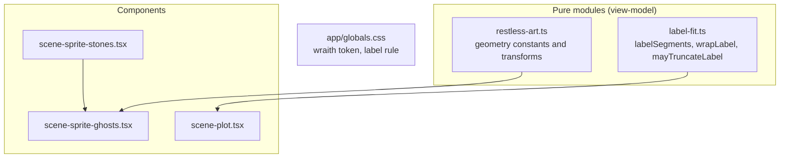

# Design Document

## Overview

This design closes five leftover items for Gravekeeper. Each item is a small, separate change and is committed on its own (Requirement 5.1).

The header wordmark stays visible on every page, including the landing page (Requirement 5.10). This design therefore makes no change to `site-header.tsx`, `landing-page.tsx`, `gate-fallback.tsx` or the header CSS.

| Item | Change | Main files |
| --- | --- | --- |
| Restless ghost | Full-size stone, ghost at 70% of the current wisp scale, offset to the upper right, new red-violet token | `view-model/restless-art.ts`, `components/scene-sprite-ghosts.tsx`, `app/globals.css` |
| Grave labels | No ellipsis, hyphen wrapping, clipped second line, SVG `<title>` with the full name when a label can be cut | `app/globals.css`, `components/scene-plot.tsx`, new `view-model/label-fit.ts` |
| Spec and test leftovers | Number fixes in two spec files, BOM removal, flake investigation | `.kiro/specs/*/design.md`, `tests/e2e/above-fold.spec.ts` |
| CI, deploy, log | Verification commands and `KIRO_LOG.md` entries | `.github/workflows`, `KIRO_LOG.md` |
| Screenshots | A deterministic Playwright spec for the uuid grave and the landing hero | `tests/e2e/polish-leftovers-report.spec.ts`, `docs/screenshots/polish/` |

Findings from reading the code that shape the design:

- **Label geometry is already fixed.** `.gk-plot-label` is `var(--w)` wide and `LABEL_BAND_HEIGHT_PX` (28) tall, with 12 px text on a 14 px line (`view-model/constants.ts`). The measured label rectangle (`getBoundingClientRect`) is the box, not the text. The above-fold budget (390x700 label bottom 696.6, at most 700) therefore does not depend on how the text wraps. The design keeps the box and the font unchanged, so the budget, CLS and the 320 px reflow stay as they are, and `above-fold.spec.ts` needs no budget change.
- **The ellipsis comes from `-webkit-line-clamp`.** That property always draws an ellipsis. The fix removes it and clips with a fixed height.
- **Hyphens are already break opportunities.** Browsers break after a hyphen-minus before they break inside a word, and the rule `overflow-wrap: anywhere` is only used when a single segment is too wide. The CSS therefore needs no markup change to wrap at hyphens. A pure model of that wrapping (`wrapLabel`) decides when a name may not fit, which drives the `<title>`.
- **`STONE_TOPS.slab` is 70 in the code.** The art-polish design still says 62 and 80.
- **`tests/e2e/above-fold.spec.ts` starts with the bytes EF BB BF** (a BOM).
- **Existing polish PNGs** (`landing-*.png`, `results-request-*.png`) belong to art-polish. The new screenshots use new file names so those files are not overwritten.

## Architecture



No new client JavaScript state is added. The new pure module is a few dozen lines, so the bundle limit of 256,000 bytes gzip is not at risk (checked by `npm run check:bundle` and `tests/e2e/js-budget.spec.ts`).

## Components and Interfaces

### 1. Distinct restless ghost (Requirement 1)

#### Arrangement

All numbers are in the `0 0 80 104` symbol space.

- **Stone**: drawn at full size, so the `<g data-part="stone">` has no `transform` and contains `<use href="#shape-stone-<variant>"/>`. Every variant (`rounded`, `cross`, `obelisk`, `slab`) uses its own shape, and the cross is the same cross as the buried one (1.1 to 1.3).
- **Ghost scale**: `RESTLESS_GHOST_SCALE = 0.595`, which is 0.70 times the current 0.85. The requirement tolerance is 2 percentage points, so the accepted ratio to 0.85 is 0.68 to 0.72. The wisp is about 20 units wide and 56 units tall (1.4).
- **Ghost offset**: the wisp centre x is moved to `RESTLESS_GHOST_CENTRE_X = 62`, so the ghost spans about x 52 to 72. This leaves the central column of the stone (x 34 to 46, where the carvings are) uncovered (1.5).
- **Ghost vertical position**: the tail overlaps the stone top by `RESTLESS_RISE_OVERLAP = 8` units, so the ghost looks like it rises out of the stone, but the top is never higher than `-RESTLESS_MAX_OVERFLOW_PX` (-14, the existing limit that `overflow="visible"` was made for):

  `ghostTop(v) = max(-14, STONE_TOPS[v] + 8 - ghostHeight)` with `ghostHeight = (100 - 6) * 0.595 = 55.93`.

- **No glow ellipse** for the restless ghost. The shared glow gradient is cyan, and a cyan glow would work against the tint. This also removes a gradient fill from every restless plot, which helps the 100 ms render budget (1.10).

Resulting numbers (computed from the constants, to be re-checked by the property):

| Variant | Stone box (x, y) | Ghost box (x 51.9 to 72.1) | Ghost top | Overlap of stone box |
| --- | --- | --- | --- | --- |
| rounded | 16 to 64, 19 to 98 | y -14 to 41.9 | -14 | about 7% |
| cross | 18 to 62, 24 to 96 | y -14 to 41.9 | -14 | about 6% |
| obelisk | 14 to 66, 6 to 96 | y -14 to 41.9 | -14 | about 11% |
| slab | 6 to 74, 70 to 94 | y 22.1 to 78.0 | 22.1 | about 10% |

The overlap limit is `RESTLESS_MAX_OVERLAP = 0.25`.

#### Module changes: `view-model/restless-art.ts`

Removed: `RESTLESS_STONE_SCALE`, `RESTLESS_STONE_FOOT`, `restlessStoneTransform`. The old arrangement is replaced, so keeping them would leave dead code.

```ts
export const GHOST_BASE_BOX = { top: 6, bottom: 100, left: 26, right: 60, eyeBottom: 31, centreX: 43 } as const;
export const RESTLESS_GHOST_SCALE = 0.595;            // 0.70 * 0.85
export const RESTLESS_GHOST_REFERENCE_SCALE = 0.85;   // the former scale, used by the property
export const RESTLESS_GHOST_CENTRE_X = 62;
export const RESTLESS_RISE_OVERLAP = 8;
export const RESTLESS_MAX_OVERFLOW_PX = 14;
export const RESTLESS_MAX_OVERLAP = 0.25;
export const STONE_TOPS = { rounded: 19, cross: 24, obelisk: 6, slab: 70 } as const;
export const STONE_BOXES: Readonly<Record<RestlessVariant, Box>> = {
  rounded: { left: 16, right: 64, top: 19, bottom: 98 },
  cross:   { left: 18, right: 62, top: 24, bottom: 96 },
  obelisk: { left: 14, right: 66, top: 6,  bottom: 96 },
  slab:    { left: 6,  right: 74, top: 70, bottom: 94 },
};

export interface Box { left: number; right: number; top: number; bottom: number }
export function restlessGhostTransform(variant: RestlessVariant): string;   // per variant now
export function restlessGeometry(variant: RestlessVariant): {
  ghostBox: Box; stoneBox: Box; eyeBottom: number; overlapRatio: number; centralColumnClear: boolean;
};
```

`restlessGhostTransform(variant)` returns `translate(tx ty) scale(s)` with `tx = 62 - 43 * s` and `ty = ghostTop(variant) - 6 * s`, using the existing `num()` rounding. `overlapRatio` is `area(ghostBox ∩ stoneBox) / area(stoneBox)`. `centralColumnClear` is `ghostBox.left > 46`.

The wisp box numbers `left` and `right` use control points, like the existing `pathYs` helper in the test does for y. The stone boxes are written from the final drawings, and the property recomputes the stone top and extent from the rendered paths (see Testing Strategy).

#### Tint: new token and new shapes

New token in `app/globals.css`:

```css
--color-wraith: #d27ab5; /* restless ghost tint (red-violet), non-text graphic: contrast 3 or more on night, ground, ground-moss, grass, sky-low */
```

The value is a starting point. The tokens test (below) decides whether it is accepted; if a check fails, adjust lightness and keep the hue between 300 and 340 degrees.

`GhostDefs` gains, next to the existing cyan shapes:

- `linearGradient#ghost-body-gradient-restless`: same stops as the cyan gradient but `var(--color-wraith)` and lower opacities (0.75, 0.35, 0), which gives the "faint" look.
- `g#shape-ghost-wisp-restless` and `g#shape-ghost-wisp-restless-flat`: same `WISP_PATH` and eyes, filled with the new gradient or flat `--color-wraith` at 0.7.

`GhostSymbols` restless symbols use these shapes and the new transform, without the glow `<use>`:

```tsx
<symbol id={symbolIdOf("restless", v, flat)} viewBox={VIEW_BOX} overflow="visible">
  <g style={DEPTH_STYLE}>
    <g data-part="stone"><use href={`#shape-stone-${v}`} /></g>
    <g data-part="wisp" transform={restlessGhostTransform(v)}>
      <use href={flat ? "#shape-ghost-wisp-restless-flat" : "#shape-ghost-wisp-restless"} />
    </g>
  </g>
</symbol>
```

The haunted ghost keeps `--color-spectral`, so restless and haunted markup differ in both structure (stone present, small ghost) and colour (1.6, 1.7).

#### Greyscale and contrast

- **Greyscale (1.8)**: the restless sprite has a full stone and a small ghost; the haunted sprite has a large ghost and no stone; so their silhouettes differ. The tint also differs in luminance from spectral (about 0.31 against 0.65 relative luminance). The existing test "restless, plain ghost and plain tombstone symbols have pairwise different markup" keeps passing and gains a luminance check in the tokens test.
- **Contrast**: the ghost is a non-text graphic. The tokens test checks `wraith` against `night`, `night-raised`, `ground`, `ground-moss`, `grass` and `sky-low` at 3:1 (WCAG 1.4.11). It also checks the hue distance to `spectral` (at least 90 degrees) and the relative luminance difference (at least 0.1).
- **Axe (1.9)**: the sprites stay `aria-hidden` inside the plot `<svg>`, so no accessibility name changes.
- **Reduced motion (5.9)**: `.gk-plot[data-kind="restless"] .gk-plot-art` animation is already disabled by the `prefers-reduced-motion` block. No CSS change; the test asserts that `animation-name` is `none` for a restless plot.

### 2. Non-truncating grave labels (Requirement 2)

#### CSS

Replace the `.gk-plot-label` rule body (position, width and colour stay):

```css
.gk-plot-label {
  position: absolute;
  left: 0;
  top: 100%;
  display: block;                  /* was -webkit-box: removing it drops -webkit-line-clamp */
  width: var(--w, 80px);
  height: var(--label-band-h, 28px);   /* exactly 2 * 14 px */
  overflow: hidden;
  text-overflow: clip;             /* explicit: no ellipsis */
  overflow-wrap: anywhere;         /* last resort for one very long segment */
  word-break: normal;
  white-space: normal;
  /* color, font-size (12px), line-height (14px), text-align, pointer-events, text-shadow unchanged */
}
```

How the clip works, exactly: the box is `2 * line-height` tall and `overflow: hidden`, so the third line starts at y = 28 and is not painted. The second line is never cut sideways, because a segment wider than the box is broken by `overflow-wrap: anywhere` instead. No ellipsis is drawn at any point. `--label-lines` is no longer read by CSS; the variable stays on `.gk-scene` (it is written by `scene.tsx`) so no other file changes, and the unused custom property is removed in a later cleanup if wanted (not in scope).

Hyphen wrapping uses the browser's own break rule, so the DOM does not change and the existing element-count assertions (`1 + plot.querySelectorAll("*").length === 4` in `scene-stage.test.tsx` and `scene-render.test.tsx`) stay valid for plots without a title. The alternative of inserting `<wbr>` or U+200B after hyphens was rejected: `<wbr>` adds elements per hyphen, and U+200B changes `textContent` (copy and paste, text matching in tests) for no gain in Chromium, Firefox or Safari.

Budget and typography (2.8 to 2.11):

| Item | Value | Why it holds |
| --- | --- | --- |
| Label box | `var(--w)` x 28 px, `top: 100%` | Unchanged, so the first-row label bottom (696.6 at 390x700) and the row 2 visibility (at least 40 px at 1440x760 and 1280x720) do not move. `above-fold.spec.ts` keeps its budget values. |
| Font size | 12 px (`LABEL_FONT_SIZE_PX`) | At least 11 px. |
| Colour | `--color-bone` | Already tested at 4.5 or more on night, ground, ground-moss, grass and the fog composites. |
| Layout shift, reflow | No geometry change | CLS stays at its current value, 320 px reflow unchanged. |

#### Pure model: `view-model/label-fit.ts`

```ts
export const LABEL_CHAR_WIDTH_PX = 7.2;   // 0.6 em of the 12 px label font: a high estimate for lowercase package names

/** Splits after every "-" or "/". The segments joined give the input back. */
export function labelSegments(name: string): string[];

/** Greedy line fill by segments. A segment longer than `capacity` is cut into chunks of `capacity` characters (the model of overflow-wrap: anywhere). */
export function wrapLabel(name: string, capacity: number): string[];

/** True when the model needs more than LABEL_MAX_LINES lines for a box of `widthPx`. */
export function mayTruncateLabel(name: string, widthPx: number): boolean;
// capacity = max(1, floor(widthPx / LABEL_CHAR_WIDTH_PX)); result = wrapLabel(name, capacity).length > LABEL_MAX_LINES
```

Examples at the minimum plot width of 80 px (capacity 11): `browserify-istanbul` gives `["browserify-", "istanbul"]` (2 lines, no title). `karma-phantomjs-launcher` gives `["karma-", "phantomjs-", "launcher"]` (3 lines, second line kept, third clipped, title added).

The estimate is an approximation of the browser layout. The e2e test closes the gap (see Testing Strategy): for every plot in the request fixture whose label is clipped in Chromium, the model must have returned true. If a case fails, `LABEL_CHAR_WIDTH_PX` is raised. Over-inclusion is harmless, because the title only repeats the full name.

#### Full name: SVG `<title>` and accessible name (2.5 to 2.7)

`ScenePlot` renders a `<title>` as the first child of the plot `<svg>` when `mayTruncateLabel(plot.label, plot.width)` is true:

```tsx
<svg className="gk-plot-art" aria-hidden="true" focusable="false">
  {truncatable ? <title>{plot.label}</title> : null}
  <use href={...} />
</svg>
```

Decision on `<title>` versus the `title` attribute: the requirement says "a `<title>` element". In HTML, a `<title>` element belongs in `<head>`, and React 19 hoists a `<title>` rendered in a component into the document head, so an HTML `<title>` inside the button would change the page title. It only has the meaning "text for this graphic" inside SVG. The SVG `<title>` is therefore the form that matches the requirement. A `title` attribute on the button was rejected as the main mechanism for two reasons: it does not match the wording, and the app already has a hover tooltip (`.gk-tooltip`) for the full detail. The label span has `pointer-events: none`, and the SVG also has `pointer-events: none`, so the SVG `<title>` is not a hover tooltip. Its job is to keep the full name in the DOM text of the graphic. The accessible name needs no change: `aria-label={plot.accessibleLabel}` is `"<displayName>, <ecosystem>, <status>, <epitaph>"` (`view-model/package-rows.ts:147`), so it already starts with the full display name, and `aria-hidden` on the SVG keeps the title out of the accessibility tree, so the name is not read twice.

Consequence for existing tests: for plots with a title the element count is 5, not 4. The two element-count tests are changed to count the plot's elements minus an optional `svg > title`.

### 3. Spec and test leftovers (Requirement 3)

**Spec ledger fixes in `.kiro/specs/art-polish/design.md`**

| Line (current) | Change |
| --- | --- |
| 153 | "slab 80 (the Ledger_Stone top is y 62 in its shape)" becomes "slab 84 (the Ledger_Stone top is y 70 in its shape)" |
| 179 | "`STONE_TOPS.slab` is 62 ... `98 - (98 - 62) * 0.5 = 80`" becomes "`STONE_TOPS.slab` is 70 ... `98 - (98 - 70) * 0.5 = 84`" |

Requirement 3.2 asks for 84 even though this spec makes the restless stone full size. The art-polish document records the art-polish arrangement, so it keeps the half-size numbers and receives one added sentence under the restless section: "Superseded by `.kiro/specs/polish-leftovers/design.md` (full-size stone, smaller ghost)". Line 21 (`translate(24 -2) scale(0.62)`) is part of the same history and stays. The line 173 outline text (`M6 96 V66 ...`) is also older than the code (`M6 94 V86 L18 70 H62 L74 86 V94 Z`); it is not in the requirements and is left alone, but it is listed in the task report.

**Reference scan counts (3.3).** The audit command, run from the repository root:

```powershell
Select-String -Path .kiro/specs/*/design.md -Pattern 'request/request|\d+ (buried|forgotten|haunted|alive)|grade [A-F]\b|score 60'
```

The reading done for this design found one stale count: `graveyard-ui/design.md:638` has the example headline `"31 of 40 dependencies are in the graveyard: 26 buried, 5 haunted."`. The Reference_Scan splits the 26 dead into 6 buried and 20 forgotten, and has 9 alive, grade D and uuid score 60. The fix is to read `headlineText` in `view-model` (and its test) and write the example exactly as the function formats 6 buried, 20 forgotten and 5 haunted, so the doc cannot drift from the code. Other `request/request` mentions (`scan-pipeline`, `resurrect`, `resurrect-upgrade`, `session-14-ops`) have no scan counts and are unchanged. The implementer re-runs the audit after the edit and records that no other hit has a conflicting number.

**BOM (3.4).** Remove the first three bytes:

```powershell
$p = "tests/e2e/above-fold.spec.ts"; $b = [IO.File]::ReadAllBytes($p)
if ($b[0] -eq 0xEF -and $b[1] -eq 0xBB -and $b[2] -eq 0xBF) { [IO.File]::WriteAllBytes($p, $b[3..($b.Length-1)]) }
```

A small unit test (`tests/ui/repo-hygiene.test.ts`) reads the first three bytes of each file in `tests/e2e/*.ts` and expects none to be EF BB BF.

**Flaky test investigation (3.5 to 3.8).**

1. Run the full suite repeatedly with the JSON reporter. Run it in the background and read the files afterwards, because ten runs take longer than the 120 s command timeout:

   ```powershell
   1..10 | ForEach-Object { npx vitest --run --reporter=json --outputFile="test-results/flake/full-$_.json" }
   ```

2. Find failing files and tests:

   ```powershell
   Get-ChildItem test-results/flake/full-*.json | ForEach-Object {
     $j = Get-Content $_ -Raw | ConvertFrom-Json
     foreach ($f in $j.testResults) { foreach ($a in $f.assertionResults) { if ($a.status -eq 'failed') { "$($f.name)`t$($a.fullName)" } } }
   } | Group-Object | Sort-Object Count -Descending
   ```

3. Run the most frequent failing file 20 times in isolation and count passes and failures:

   ```powershell
   1..20 | ForEach-Object { npx vitest --run <file> --reporter=json --outputFile="test-results/flake/file-$_.json" }
   ```

   If the file never fails alone, the cause is shared state or load (parallel files, timers, module-level state); repeat with `--no-file-parallelism` and with `--sequence.shuffle` to separate the two.
4. Record the failing test name, the root cause (including the fast-check seed from the failure message if the test is a property) and the failure rate in `KIRO_LOG.md`.
5. Fix the cause, or quarantine: change `it(` to `it.skip(` and add a comment directly above it: `// QUARANTINE (polish-leftovers): <root cause>. Failure rate <x>/<n>. Owner and follow-up: <text>.` Also list it in `KIRO_LOG.md`.
6. If fixed, the file passes 20 consecutive runs, and the full suite once more.

### 4. CI, deploy and log (Requirement 4)

| Step | Command (no token is ever echoed) |
| --- | --- |
| CI on the starting commit | `gh run list --commit 5117bb5 --json name,status,conclusion,headSha` |
| Push each item, check CI | `git push`, then `gh run list --branch <branch> --limit 5 --json name,status,conclusion,headSha` until each new commit is `completed` with `success` |
| Redeploy | The project's existing path to https://gravekeeper-chi.vercel.app. The implementer checks for `.vercel/`, `vercel.json` and `.github/workflows/*.yml` first: if a workflow or the Git integration deploys on push, the push is the redeploy; otherwise use the Vercel CLI that is already configured. This design does not add a deployment path. |
| Verify | `npm run verify:deploy` (it targets https://gravekeeper-chi.vercel.app). Copy the result lines into the log. |
| Log | `KIRO_LOG.md` exists, so append a section "polish-leftovers" with the items, commit hashes, flake root cause, CI status and verifier result. |

Secrets: commands that need GitHub access rely on the already authenticated `gh` session. No command prints `gh auth token`. Before committing the log, search it for `ghp_`, `github_pat_` and `Bearer `.

### 5. Polish screenshots (Requirements 4.7, 4.8, 5.8)

New file `tests/e2e/polish-leftovers-report.spec.ts`, modelled on `polish-report.spec.ts` and `resurrect-report.spec.ts`:

- Gate: runs only when `POLISH_LEFTOVERS_REPORT=1` is set and the project is `desktop`. A normal `playwright test` writes nothing.
- Output: `docs/screenshots/polish/leftovers-landing-hero-1440x760.png` and `docs/screenshots/polish/leftovers-uuid-grave-1440x760.png`. The existing four polish PNGs and `docs/screenshots/m1`, `m2`, `m3` are not touched (checked with `git diff --stat -- docs/screenshots`).
- Determinism: fixed 1440x760 viewport, `deviceScaleFactor: 1`, `reducedMotion: "reduce"`, `/api/scan` mocked with the `request` fixture, `document.fonts.ready` awaited, mouse moved to (0, 0), `animations: "disabled"`, `caret: "hide"`.
- Landing hero: open `/` and capture the viewport.
- uuid grave: open the request fixture result, find `button.gk-plot[aria-label^="uuid,"]`, scroll it to the centre with `evaluate(el => el.scrollIntoView({ block: "center" }))`, wait for two animation frames, then capture a clip made of the plot box and its label, grown by 32 px on each side and limited to the viewport.
- Self-check of determinism: the spec takes each screenshot twice into buffers and expects them to be byte-equal before it writes the file.

## Data Models

No stored data changes. The types that change:

- `restless-art.ts` exports `Box`, `STONE_BOXES` and a per-variant `restlessGhostTransform`.
- `label-fit.ts` is new and has no types beyond `string[]`, `number` and `boolean`.
- `PlotModel` is unchanged. `ScenePlot` derives `truncatable` from `plot.label` and `plot.width`.

## Error Handling

| Situation | Behaviour |
| --- | --- |
| Name with no hyphen and wider than the box | `overflow-wrap: anywhere` breaks it; the second line is clipped by the fixed height. No horizontal overflow. |
| Empty label | `wrapLabel("", n)` returns `[]` (0 lines), `mayTruncateLabel` is false, no title. |
| `widthPx` below one character | `capacity` is clamped to 1, so the function terminates. |
| Unknown restless variant | `restlessGeometry` is called only with the four `SPRITE_VARIANTS.restless` values (typed `RestlessVariant`). |
| Token fails a contrast check | The tokens test fails; adjust `--color-wraith` lightness. |
| Flake never reproduces in 10 full runs | Run 10 more with `--sequence.shuffle`; if it still does not reproduce, record the evidence and the seeds and leave the test running, with a note in the log. |
| CI red after a push | Fix on the same item with a new commit, never amend. |
| Screenshot buffers differ between two captures | The spec fails and nothing is written. |

## Testing Strategy

**Property-based tests** (fast-check, `cfg()` from `tests/support/fc-config`, at least 100 runs, tag format `Feature: polish-leftovers, Property N: ...`):

- Rewritten `tests/ui/view-model/restless-art.property.test.ts` (keeps the id AP-P3, new header: "The restless ghost rises beside a full-size stone"). It recomputes stone top and horizontal extent from the rendered paths (the existing `pathYs` helper plus an x equivalent), and the ghost transform from the rendered `transform` attribute.
- New `tests/ui/view-model/label-fit.property.test.ts` for Properties 3 and 4.
- New property in the `ScenePlot` render test for Property 5.
- Extended `tests/ui/tokens.test.ts` for Property 2.

**Example-based unit tests**

- `sprites-ghosts.test.tsx`: the restless symbol has a stone group without `transform`, a wisp group with the helper transform, no glow `<use>`, and the restless markup differs from the haunted markup (it contains `--color-wraith` and not `--color-spectral`; the haunted symbol is the reverse).
- `sprites-greyscale.test.tsx`: the pairwise-different markup test keeps passing with the new symbols.
- `label-fit` examples: `browserify-istanbul` and `karma-phantomjs-launcher` at 80 px.
- `ScenePlot`: `karma-phantomjs-launcher` has an `svg > title` with the full name and an `aria-label` that starts with it.
- CSS text tests (read `globals.css`): `.gk-plot-label` has no `line-clamp`, no `-webkit-box`, has `text-overflow: clip`; `--color-wraith` exists.
- `repo-hygiene.test.ts`: no BOM in `tests/e2e/*.ts`.

**E2E (existing projects, fixtures mocked)**

- Labels: `browserify-istanbul` shows two line rectangles broken after the hyphen (via `Range.getClientRects`); computed `text-overflow` is `clip`; computed font size is at least 11 px; for every plot where `label.scrollHeight > label.clientHeight`, the plot SVG has a `<title>` equal to the name (this is the check on `LABEL_CHAR_WIDTH_PX`).
- Existing specs stay as they are: `above-fold.spec.ts` (budget values unchanged), the CLS and reflow specs, axe specs, `js-budget.spec.ts`, `scene-perf.spec.ts`.

**Deep run.** After all items are committed, run `npm run test:deep -- <changed property test files>` once, without setting `FC_NUM_RUNS` in the shell (Requirements 5.2, 5.3).

**Commit plan** (each commit after its related tests pass): 1 restless ghost, 2 labels, 3 art-polish and graveyard-ui design fixes, 4 BOM, 5 flake fix or quarantine, 6 screenshots spec and images, 7 `KIRO_LOG.md`. The orchestrator makes the commits and pushes.

## Correctness Properties

*A property is a characteristic or behavior that should hold true across all valid executions of a system-essentially, a formal statement about what the system should do. Properties serve as the bridge between human-readable specifications and machine-verifiable correctness guarantees.*

Reflection on redundancy: criteria 1.1 to 1.5 and 6.4 all describe one rendered arrangement, so they are merged into the first property. The wrapping model, the title rendering and the no-clip guarantee stay separate because each fails for a different reason. The CSS, document, process and external-service criteria are covered by example, smoke and integration tests, not by properties.

### Property 1: Restless arrangement

For any restless variant `v` in `SPRITE_VARIANTS.restless` and for both the full and the flat symbol, the rendered symbol SHALL have a stone group with no scale transform that references `#shape-stone-<v>` before the wisp group; the wisp scale taken from the rendered `transform` SHALL be between 0.68 and 0.72 times 0.85; the ghost box top SHALL be at least `-RESTLESS_MAX_OVERFLOW_PX`; the area of the ghost box inside the stone box (recomputed from the rendered stone paths) SHALL be at most `RESTLESS_MAX_OVERLAP` of the stone box area; and the ghost box SHALL not cover the central stone column (ghost left edge greater than 46).

**Validates: Requirements 1.1, 1.2, 1.3, 1.4, 1.5, 5.4**

### Property 2: Restless tint is distinct and visible

For any background token in `night`, `night-raised`, `ground`, `ground-moss`, `grass` and `sky-low`, the contrast ratio of `--color-wraith` against it SHALL be at least 3, and for the pair (`--color-wraith`, `--color-spectral`) the hue difference SHALL be at least 90 degrees and the relative luminance difference SHALL be at least 0.1.

**Validates: Requirements 1.6, 1.8**

### Property 3: Label wrapping preserves the name and breaks only at hyphens

For any package name made of letters, digits, `-`, `_`, `.`, `@` and `/` (no whitespace), and any capacity of 1 or more, `wrapLabel(name, capacity)` SHALL satisfy all of: the lines joined give back `name`; no line is longer than `capacity`; and for any two adjacent lines, the first either ends with `-` or `/`, or has exactly `capacity` characters (a forced cut of a segment wider than the box).

**Validates: Requirements 2.1, 2.2**

### Property 4: The full name is in the graphic's title exactly when the label may be cut

For any package name and any plot width, `ScenePlot` SHALL render an `svg > title` whose text equals the full name if and only if `mayTruncateLabel(name, width)` is true, and in both cases the button `aria-label` SHALL start with the full name.

**Validates: Requirements 2.5, 2.6, 2.7**

### Property 5: Labels that fit the model are never clipped

For any package name and plot width where `mayTruncateLabel(name, width)` is false, `wrapLabel` with the capacity for that width SHALL return at most `LABEL_MAX_LINES` lines, so no second-line clipping is needed.

**Validates: Requirements 2.2, 2.3, 2.4**
