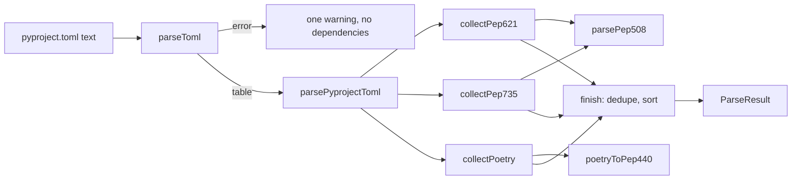

# Design Document: pyproject

## Overview

This design implements `.kiro/specs/pyproject/requirements.md` (Requirements 1 to 15). It adds `pyproject.toml` as a manifest format. The work is a new Core parser with two small helpers (a PEP 508 entry reader and a Poetry constraint translator), a four-line change in the Pipeline (name list, cache key, message, cache validator), a fixture and a live report. It reads the finished specs and cites them by number ("core 4.8", "pipeline R7", "accuracy 3.2").

### Facts the design starts from

Read from the repository before this design was written:

- `core/model/types.ts`: `ManifestFormat` is `'package.json' | 'requirements.txt' | 'Cargo.toml'`. `Dependency` has `name`, `rawName`, `ecosystem`, `versionSpec`, `scope`, `sourceKind` and nothing else. `Scope` is `runtime | dev | build | optional | peer`. `SourceKind` is `registry | git | path`.
- `core/formats/manifest-format.ts` holds three tables keyed by format (`MANIFEST_FORMATS`, `ECOSYSTEM_BY_FORMAT`, `SCOPES_BY_FORMAT`). `core/parsers/index.ts` holds `PARSERS`. `core/serializers/index.ts` holds `WRITERS` typed `Partial<Record<ManifestFormat, ...>>`, and already returns `unsupported-format` when a format has no writer.
- `core/parsers/cargo-toml.ts` is the pattern for a TOML parser: it calls `parseToml` (the only module that imports `smol-toml`, `core/parsers/toml-tree.ts`, pinned in `package.json` as `smol-toml` 1.9.1 and listed in `CORE_ALLOWED_PACKAGES`), reads with `Object.hasOwn` and `Object.entries`, ranks candidates as `[tableOrdinal, enumIndex]` and returns `RawParse` for `finish` (deduplicate by `(name, scope)`, sort by Dependency_Order, add one warning per duplicate).
- `core/parsers/requirements-txt.ts` and `core/formats/requirements-lexical.ts` hold the PEP 508 line grammar: `isNameToken`, `normalizePypiName`, `isRegistryRest`, `directReferenceKind`. A registry line with no specifier gets `versionSpec` `*`. Environment markers are cut at the first `;`.
- `pipeline/constants.ts`: `DISCOVERY_MANIFEST_NAMES` has three names, `CACHE_KEY_VERSION` is 2. `pipeline/scan/scan-cache.ts` validates `format` in `isScanResult` with a three-name check. `pipeline/scan/messages.ts` holds the `no-manifests` text. `pipeline/scan/stage-manifests.ts` derives the format from the last path segment and casts it, so a fourth name needs no change there. `pipeline/mapping/discovery.ts` and `selection.ts` take the name list from their limits argument.
- Version handling (accuracy 3): `chooseVersion` uses an `exactPin` first (`==<v>` and `===<v>` for `pypi`), then `resolveRange` with `pepRange`/`pepSatisfies` of `@renovatebot/pep440` (confined to `pipeline/mapping/range-pep440.ts`), then the default version. Only an empty `versionSpec` is "no Declared_Range". A `versionSpec` of `*` is therefore a Declared_Range, goes to `resolveRange`, and `pepRange('*')` is null (checked with `validRange('*')` in the installed 5.0.1), so today every `pypi` dependency with `*` falls back to the default version **with a `range-unresolved` note**. Requirement 10.5 asks for no note for `*`, so the design changes `chooseVersion` for `pypi` (see "Pipeline changes").
- The product text lists formats in `pipeline/scan/messages.ts` (`no-manifests`) and `.kiro/steering/product.md`. A text search of `app/`, `components/`, `view-model/` and `README.md` finds no list of formats in the landing copy, the legend or the how-it-decides copy.
- `docs/property-traceability.md` and `tests/ui/art-traceability.test.ts` define the traceability pattern. The art spec uses the tag `Property GA-P<n>` and titles that start with `GA-P<n>`. This spec uses `PY-P<n>`.
- `scripts/live-report.ts` already prints grade, counts, HAUNTED packages with advisory ids and severities, `versionBasis` counts, notes by code, duration and the cache header. It accepts repositories and `--out` as arguments. It lacks a title argument, a per-package option and a table of the manifests read.
- `KIRO_LOG.md` records that the live scan of `psf/requests` reported 0 dependencies because `pyproject.toml` was not supported. The current `psf/requests` `pyproject.toml` (fetched while writing this design) has `[project].dependencies` with four packages, `[project.optional-dependencies]` with `security` (empty), `socks` and `use_chardet_on_py3`, and `[dependency-groups]` with `test` and `typecheck`. The `test` group contains the self reference `requests[socks]`.

### Key design decisions

| # | Decision | Reason |
|---|---|---|
| D1 | No change to the `Dependency` model. The extra name and the group name are not stored. | Adding an optional field would flow into `Dependency_Set` comparison, `deepEqualKey`, the serializers, `ScanDependency` and `isScanResult` in the cache validator, and into every JSON fixture. The extra name is not needed to score a package. The name appears only in duplicate warnings, through the `where` label. |
| D2 | `[dependency-groups].<group>` maps to scope `dev` for every group name. | PEP 735 groups are never installed with the package. `dev` is the closest existing scope. `build` means build-time tools and is not used because `[build-system].requires` is out of scope. |
| D3 | `[project.optional-dependencies].<extra>` maps to `optional`. A Poetry main entry with `optional = true` maps to `optional`. Poetry group entries map to `dev` whatever `optional` says. | `optional` is the scope of "installed only on request". A Poetry group's `optional` flag says only whether the group is installed by default, which is still development use. |
| D4 | Poetry `||` (and `|`) alternatives are not translated. The dependency is kept with `versionSpec` `*` and a warning. | PEP 440 has no union and the resolver intersects the ranges of one package. Dropping the dependency would hide a package from the graveyard. `*` gives the default (latest) version, which is the existing fallback of accuracy 3.6. |
| D5 | A Poetry constraint that cannot be translated is also kept with `*` and a warning. | Same reason as D4. The warning tells the user the range was not honored. |
| D6 | A bare Poetry version (`1.2.3`) is `==1.2.3`, a pin. | This is Poetry semantics. `exactPin` then gives `versionBasis` `pinned`. |
| D7 | Wildcards translate to `==V.*`, not to a `>=,<` pair. | `==V.*` is the PEP 440 form and `pepRange` accepts it. It cannot drift from the caret rules. |
| D8 | When `requirements.txt` and `pyproject.toml` are both at the root, both are scanned. No precedence. | The existing rule selects all Root_Manifests (pipeline R5.1) with no precedence among `package.json`, `requirements.txt` and `Cargo.toml`. A new rule only for this pair would be a special case, and a repository often has a `requirements.txt` for deployment and a `pyproject.toml` for the library. Duplicates merge in the Summarizer, one Lookup_Target serves both, and an exact pin wins over a range. |
| D9 | Same package in a PEP 621 table and a Poetry table: one Dependency per `(name, scope)`; PEP 621 wins, then PEP 735, then Poetry; every discarded entry gives one duplicate warning. | Poetry 2 reads `[project]` first and uses `[tool.poetry.dependencies]` for extra information, so the standard table is the better source. `finish` already implements "first occurrence kept" and the warning. |
| D10 | Self references (`requests[socks]` in a group of the project `requests`) are skipped with a warning. | A project is not a registry dependency of itself. Looking it up would show the package under scan as its own dependency. |
| D11 | A PEP 508 reader is a new module and `requirements-txt.ts` is not changed. A property (PY-P8) checks that both agree. | Refactoring the requirements parser risks the existing core properties. A separate reader without line, comment and option handling is small, and the property catches drift. |
| D12 | The Poetry translator lives in `/core` (`core/formats/poetry-constraint.ts`). | It is pure, belongs to the parse step (the model carries PEP 440 text), and keeps `/pipeline` free of Poetry knowledge. |
| D13 | No production serializer. The round trip uses a test-only writer. | See "Round trip". |
| D14 | The `url` source of a Poetry entry maps to `sourceKind` `git`. | The model has no remote-archive kind. `git` and `path` are both unassessed with `non-registry-source`, so the scoring result is the same as for any other non-registry kind. |
| D15 | Fixture rule: the new set keeps `kind` `python`. When it has no archived or deprecated dependency, its metadata says `requiresFlaggedDependency: false` and the two checks of pipeline R23.2 and R23.4 are replaced by "ok and at least one dependency" for that set only. | `psf/requests` has only healthy dependencies as far as is known. The Probe decides. The rule of the three existing sets does not change. |
| D16 | The featured list changes only if the new repository is a Convincing_Graveyard (more DEAD plus HAUNTED; equal counts: worse grade). | `revmic/canopy` has ALIVE 1, HAUNTED 3, DEAD 2 and grade C (KIRO_LOG). A healthy library such as `psf/requests` is unlikely to beat it, and the report states the numbers. |

### Property namespace and traceability

Properties are `PY-P1` to `PY-P10`. Tags read `// Feature: pyproject, Property PY-P<n>`. Test titles start with `PY-P<n>`. One property per test file (the traceability test checks the title prefix against the first tag number of the file). `tests/ui/py-traceability.test.ts` enforces the rules (Requirement 15.1).

## Architecture

### Module layout (new and changed files)

| File | New or changed | Role |
|---|---|---|
| `core/model/types.ts` | changed | `ManifestFormat` gains `'pyproject.toml'`. |
| `core/formats/manifest-format.ts` | changed | `MANIFEST_FORMATS`, `ECOSYSTEM_BY_FORMAT` (`pypi`), `SCOPES_BY_FORMAT` (`runtime`, `dev`, `optional`). |
| `core/formats/poetry-constraint.ts` | new | `poetryToPep440`. Pure string scan, no regex with nested quantifiers. |
| `core/parsers/pep508.ts` | new | `parsePep508` reads one PEP 508 entry. Uses `requirements-lexical.ts`. |
| `core/parsers/pyproject-pep.ts` | new | Collectors for `[project]` and `[dependency-groups]`. |
| `core/parsers/pyproject-poetry.ts` | new | Collector for the three Poetry tables. |
| `core/parsers/pyproject-toml.ts` | new | `parsePyprojectToml`: TOML parse, table presence, calls the collectors, returns `RawParse`. |
| `core/parsers/index.ts` | changed | `PARSERS['pyproject.toml']`. |
| `core/serializers/index.ts` | unchanged | Already returns `unsupported-format` for a format without writer. A test pins this. |
| `pipeline/constants.ts` | changed | `DISCOVERY_MANIFEST_NAMES` and `CACHE_KEY_VERSION = 3`. |
| `pipeline/scan/messages.ts` | changed | `no-manifests` text. |
| `pipeline/scan/scan-cache.ts` | changed | `isManifestFormat` accepts the fourth name. |
| `pipeline/mapping/version-choose.ts` | changed | A `versionSpec` of `*` counts as no Declared_Range (see "Pipeline changes"). |
| `scripts/record-fixtures.ts`, `scripts/fixtures/fixture-set.ts` | changed | New repository, optional metadata field `requiresFlaggedDependency`. |
| `scripts/export-scan-fixtures.ts` | changed | Exports the new set. |
| `scripts/live-report.ts` | changed | `--title`, `--per-package`, table of manifests read. |
| `tests/support/oracles/poetry-reference.ts`, `pyproject-writer.ts` | new | Test oracles (Requirement 11). |
| `tests/support/arbitraries/pyproject.ts`, `poetry.ts` | new | Generators. |
| `.kiro/specs/scan-pipeline/requirements.md` | changed | One table cell (`no-manifests`). |
| `.kiro/steering/product.md` | changed | Format list. |

Nothing under `components/` changes except `components/featured-graveyards.tsx` when D16 selects a replacement. Nothing under `app/` changes.

### Data flow



### Table ranks

Candidates carry `rank = [tableOrdinal, groupIndex, entryIndex]`. `finish` compares ranks lexicographically (a proper prefix sorts first) and keeps the first candidate per `(name, scope)`.

| tableOrdinal | Table | groupIndex | Scope |
|---|---|---|---|
| 0 | `[project].dependencies` | 0 | `runtime` |
| 1 | `[project.optional-dependencies].<extra>` | index of the extra in key order | `optional` |
| 2 | `[dependency-groups].<group>` | index of the group in key order | `dev` |
| 3 | `[tool.poetry.dependencies]` | 0 | `runtime`, or `optional` for `optional = true` |
| 4 | `[tool.poetry.group.<name>.dependencies]` | index of the group in key order | `dev` |
| 5 | `[tool.poetry.dev-dependencies]` | 0 | `dev` |

`entryIndex` is the index of the array element, or the index of the key in `Object.entries`. For a Poetry multiple-constraint array, the element index is added as a fourth number, so the elements of one key stay together and in written order.

Because the scopes differ by table, a duplicate is possible inside one scope only for: two `runtime` tables (PEP 621 and Poetry main), several `optional` extras, several `dev` groups of either family. D9 follows from the rank order.

### Poetry translation table

Let `V` be numeric parts joined by `.`, `n` the number of parts, `inc(V, i)` the version whose part `i` is increased by one and whose later parts are 0, with exactly `n` parts.

| Poetry term | Condition on `V` | PEP 440 output | Example |
|---|---|---|---|
| `^V` | 1 to 3 parts; `i` is the index of the first non-zero part, or `n-1` when all parts are zero | `>=V,<inc(V, i)` | `^1.2.3` → `>=1.2.3,<2.0.0`; `^0.2.3` → `>=0.2.3,<0.3.0`; `^0.0.3` → `>=0.0.3,<0.0.4`; `^0` → `>=0,<1`; `^1.2` → `>=1.2,<2.0` |
| `~V` | 1 to 3 parts; `i` is 1 when `n >= 2`, otherwise 0 | `>=V,<inc(V, i)` | `~1.2.3` → `>=1.2.3,<1.3.0`; `~1.2` → `>=1.2,<1.3`; `~1` → `>=1,<2` |
| `V.*` | 1 to 3 parts before `.*` | `==V.*` | `1.*` → `==1.*` |
| `*` | none | no term (any version) | `*` → `*` |
| `V` (bare) | 1 to 4 parts | `==V` | `1.2.3` → `==1.2.3` |
| `>=V` `>V` `<=V` `<V` `==V` `!=V` | 1 to 4 parts | unchanged | `>= 1.2` → `>=1.2` |
| `==V.*` `!=V.*` | 1 to 3 parts before `.*` | unchanged | `!=1.2.*` |
| `~=V` | 2 to 4 parts | unchanged | `~=1.4.0` |
| any `|` or `||` | | outcome `alternatives` | `^1 || ^2` |
| anything else | | outcome `unsupported` | `^1.2.3rc1`, `v1`, `1.x`, `>=1.*`, empty term |

Rules around the table: terms are separated by `,` or whitespace; an operator token with no version attaches to the next token (`>= 1.2`); a part has one to nine digits (a longer part is `unsupported`, which keeps `inc` exact in a JavaScript number); the output joins terms with `,` and no spaces in the order written; `*` terms are dropped, and an empty term list gives `*`.

`inc` for the caret: the version `^0.0.3` has parts `[0,0,3]`; the first non-zero index is 2, so `inc` gives `[0,0,4]`. For `^0.0` parts `[0,0]` are all zero, so `i = 1` and `inc` gives `[0,1]`, which writes `<0.1`. For `^0` it gives `<1`.

### Round trip

The Core serializer exists so that tests can write a manifest and parse it again. `pyproject.toml` has no product use as an output, and two writer styles (PEP 621 and Poetry) in `/core` would be code exercised only by tests. `serializeManifest(deps, 'pyproject.toml')` therefore returns `unsupported-format`. The round trip property (PY-P2) runs through `tests/support/oracles/pyproject-writer.ts`:

1. Generate a Dependency list (names with separators and case, `versionSpec` as PEP 440 text, scopes in `runtime`, `dev`, `optional`, sourceKinds `registry`, `git`, `path`) with no repeated `(name, scope)`.
2. Write it as Pyproject_Text in the PEP 621 style, or in the Poetry style. The Poetry style writes a registry `versionSpec` as the string `">=1.2,<2"` form, which the Poetry_Translator passes through unchanged, `*` as `"*"`, and git and path as inline tables.
3. Parse with `parseManifest(text, 'pyproject.toml')`.
4. Compare `dependencies` with the input as Dependency_Sets (five fields) and compare `rawName` with the name as written.

The generated `versionSpec` values are restricted to forms that both styles represent: `*`, and comma-joined comparison terms (`>=`, `>`, `<=`, `<`, `==`, `!=`, `~=`) with numeric versions. In the PEP 621 style a spec such as `>=1.2,<2` is written after the name (`pkg>=1.2,<2`). A direct-reference spec has no whitespace followed by `;` or `#`.

## Components and Interfaces

### `core/formats/poetry-constraint.ts`

```ts
export type PoetryTranslation =
  | { readonly kind: 'ok'; readonly spec: string }      // '*' or comma-joined PEP 440 terms
  | { readonly kind: 'alternatives' }                    // contains | or ||
  | { readonly kind: 'unsupported' };

/** Requirement 6. Total: never throws. */
export function poetryToPep440(constraint: string): PoetryTranslation;
```

Algorithm (linear scans only):

1. `text = constraint.trim()`. Empty or `*` gives `{ ok, '*' }`.
2. If `text` contains `|`, return `alternatives`.
3. Split into tokens at commas and whitespace. An empty token between two commas, or a leading or trailing comma, gives `unsupported`. A token that is only an operator (`>=`, `>`, `<=`, `<`, `==`, `!=`, `~=`, `^`, `~`) joins the next token; with no next token the result is `unsupported`.
4. For each term: read the longest operator prefix among `~=`, `>=`, `<=`, `==`, `!=`, `^`, `~`, `>`, `<`. Parse the rest as `part ('.' part)* ('.*')?` with parts of 1 to 9 ASCII digits. Apply the table above. Any other shape is `unsupported`.
5. Join the produced terms with `,`. A `*` term produces nothing. If nothing was produced, the result is `*`.

### `core/parsers/pep508.ts`

```ts
export type Pep508Result =
  | { readonly kind: 'ok'; readonly rawName: string; readonly versionSpec: string; readonly sourceKind: SourceKind }
  | { readonly kind: 'cannot-parse' }
  | { readonly kind: 'backslash' };

/** Requirement 3.4 to 3.6, 3.8. Total: never throws. */
export function parsePep508(entry: string): Pep508Result;
```

The steps are those of `parseRequirementsTxt` for one trimmed line without comment stripping, line continuation and option lines: name token, optional `[extras]` skipped, then `@ <target>` (with the marker cut at whitespace followed by `;`) or a registry rest cut at the first `;`. A bare `git+...#egg=name` reference is `cannot-parse` (PEP 508 requires `name @`). An empty registry rest gives `*`.

### `core/parsers/pyproject-pep.ts`

```ts
export interface Collector { readonly candidates: Candidate[]; readonly warnings: string[] }
export interface PyprojectContext { readonly projectName: string | null } // normalized

/** Requirement 3. Reads [project].dependencies and [project.optional-dependencies]. */
export function collectPep621(project: unknown, ctx: PyprojectContext, out: Collector): void;
/** Requirement 4. Reads [dependency-groups]. */
export function collectPep735(groups: unknown, ctx: PyprojectContext, out: Collector): void;
```

Both read with `Object.hasOwn` and `Object.entries` (so `__proto__` is an ordinary key) and use the shared helper that turns one array element into a candidate or a warning. A lone surrogate in a name or a spec is skipped with a warning, as `cargo-toml.ts` does (the name token rule already rejects non-ASCII names; the spec check covers the rest).

### `core/parsers/pyproject-poetry.ts`

```ts
/** Requirements 5 and 6. Reads the three Poetry tables. */
export function collectPoetry(poetry: unknown, out: Collector): void;
```

`interpretEntry(key, value)` returns one or more entries (array form) or a warning, each entry being `{ versionSpec, sourceKind, optional }`. It calls `poetryToPep440` for registry entries and adds the warning of criteria 6.7 and 6.8 when the outcome is `alternatives` or `unsupported`.

### `core/parsers/pyproject-toml.ts`

```ts
/** Requirements 2, 3, 4, 5 and 8. Never throws. */
export function parsePyprojectToml(text: string): RawParse;
```

Steps: `parseToml(text)`; on error return one warning (criterion 2.1, same shape as `cargo-toml.ts`). Read `[project].name` (string, normalized) for the Self_Reference test. Compute Dependency_Table_Present. Run `collectPep621`, `collectPep735`, `collectPoetry` in that order into one `Collector`. If Dependency_Table_Present is false, add the warning of criterion 2.2. Return `{ candidates, warnings }`.

### Pipeline changes

- `DISCOVERY_MANIFEST_NAMES = ['package.json', 'requirements.txt', 'pyproject.toml', 'Cargo.toml']`, `CACHE_KEY_VERSION = 3`.
- `isManifestFormat` in `scan-cache.ts` accepts `'pyproject.toml'`.
- `no-manifests` text: `No package.json, requirements.txt, pyproject.toml or Cargo.toml was found in this repository.`
- `chooseVersion` (`pipeline/mapping/version-choose.ts`): the loop that collects Declared_Ranges treats a `versionSpec` that equals `*` after `trim` like an empty one (no Declared_Range). Without this a `*` would fall to `resolveRange`, where `pepRange('*')` is null, and add a `range-unresolved` note for every unconstrained dependency. For `npm` and `cargo`, `*` is a valid range today and resolves to the highest stable version; to leave that behavior unchanged the rule applies to the ecosystem `pypi` only. Requirement 10.5 states the outcome. The existing `requirements.txt` parser already writes `*` for an unconstrained line, so the same rule also stops `range-unresolved` notes for those lines. Accuracy 3.1 says "no Declared_Range gives the default version and no note", so this is the behavior that criterion already describes for unconstrained dependencies.
- `selection.ts`, `discovery.ts`, `stage-manifests.ts`, `stage-discovery.ts` and `assemble-result.ts` need no change; the picker (`view-model/picker.ts`) takes paths and formats from the note details.

### Fixture and live-report scripts

- `scripts/record-fixtures.ts`: `REPOS` gains `{ kind: 'python', owner, repo, requiresFlagged?: boolean }` for the chosen repository. The metadata gets `requiresFlaggedDependency: false` only when the Probe says so. `replayCheck` reads the flag from the spec.
- `scripts/fixtures/fixture-set.ts`: `FixtureMetadata` gets the optional boolean `requiresFlaggedDependency`.
- `scripts/export-scan-fixtures.ts`: `RECORDED` gains `{ dir: '<owner>__<repo>', file: 'scan-<name>.json' }`.
- `scripts/live-report.ts`: arguments `--title "<text>"` (default `Scan accuracy live report`), `--per-package <owner/repo>` (default `request/request`), and a new section "Manifests read" (path, format, dependency count) per repository, taken from `result.manifests`. Existing output stays.

## Data Models

No model type changes. The new text and constants:

### Warning texts

| Criterion | Text (quoted values are bounded to 60 code points) |
|---|---|
| 2.1 | `pyproject.toml is not valid TOML: <message>[ (line <n>)]` |
| 2.2 | `pyproject.toml has no dependency tables ([project], [dependency-groups] or [tool.poetry]); no dependencies were read.` |
| 2.3 | `pyproject.toml: [project] declares its dependencies as dynamic; they cannot be read from this file.` |
| 2.4 | `pyproject.toml table [<path>] is not a <list or table>; it was skipped.` |
| 3.6 | `pyproject.toml table [<path>]: cannot parse requirement "<text>".` and `pyproject.toml table [<path>]: requirement contains a backslash and was skipped: "<text>".` |
| 3.7 | `pyproject.toml table [<path>]: "<name>" refers to this project itself and was skipped.` |
| 4.2 | `pyproject.toml table [dependency-groups.<group>]: include-group "<name>" was skipped; groups are not resolved.` |
| 4.3 | `pyproject.toml table [dependency-groups.<group>]: entry <index> is not a requirement string or an include-group table; it was skipped.` |
| 5.9 | `pyproject.toml table [<path>]: value of "<key>" is not a constraint string, a table or an array of tables; the entry was skipped.` |
| 5.10 | `pyproject.toml table [<path>]: entry "<key>" is not a valid package name; it was skipped.` |
| 6.7 | `pyproject.toml table [<path>]: constraint "<text>" of "<name>" uses || alternatives that PEP 440 cannot express; the package is checked at any version.` |
| 6.8 | `pyproject.toml table [<path>]: constraint "<text>" of "<name>" could not be translated to a PEP 440 range; the package is checked at any version.` |
| 8.3 | From `finish`: `<table>: duplicate dependency "<name>" in scope "<scope>"; the first occurrence was kept.` |

`<path>` is the dotted table path, for example `project.optional-dependencies.socks`, `dependency-groups.test` or `tool.poetry.group.dev.dependencies`. A message contains no em dash. A warning is one line.

### Constants

`DISCOVERY_MANIFEST_NAMES` (four names) and `CACHE_KEY_VERSION` (3), as in the requirements. No core constant changes.

### Fixture metadata

`metadata.json` of the new set: `{ "kind": "python", "canonicalRepoUrl": "https://github.com/<owner>/<repo>", "recordedAt": ..., "asOf": ..., "manifestPaths": ["pyproject.toml"], "recorderVersion": "record-fixtures/1" }` plus `"requiresFlaggedDependency": false` when criterion 12.4 applies.


## Correctness Properties

*A property is a characteristic or behavior that should hold true across all valid executions of a system-essentially, a formal statement about what the system should do. Properties serve as the bridge between human-readable specifications and machine-verifiable correctness guarantees.*

Reflection done before writing the list: every testable criterion of the prework is either covered by one of the ten properties below or is an example, edge case, integration or smoke check. PY-P3 and PY-P10 look alike but test different code (the translator alone, and the translator plus `resolveRange`). PY-P6 and PY-P2 both read scopes, but PY-P6 isolates the table-to-scope map over every table kind, which the round trip cannot do for the Poetry `optional` rule and the group names. No property subsumes another.

### Property 1: Parsing never throws (PY-P1)

*For any* string, and *for any* TOML-shaped text built from random tables, nested arrays, numbers, dates, hostile keys (`__proto__`, `constructor`), lone surrogates and values of the wrong type in every Pyproject_Table, `parseManifest(text, 'pyproject.toml')` returns a ParseResult whose dependencies are Dependency values with ecosystem `pypi` and whose warnings are single-line strings, and does not throw.

**Validates: Requirements 2.1, 2.2, 2.4, 2.6, 2.7**

### Property 2: The normalized set round-trips through a pyproject writer (PY-P2)

*For any* generated Dependency list without repeated `(name, scope)` whose scopes are in `supportedScopes('pyproject.toml')`, writing it with the test-only Pyproject_Writer in the PEP 621 style, or in the Poetry style, and parsing the text with `parseManifest(text, 'pyproject.toml')` returns a dependency list equal to the input in `name`, `ecosystem`, `versionSpec`, `scope` and `sourceKind`, with `rawName` equal to the name as written.

**Validates: Requirements 8.9, 5.5, 5.7, 3.1, 3.2, 4.1**

### Property 3: Poetry translation accepts exactly the versions Poetry accepts (PY-P3)

*For any* generated parseable Poetry_Constraint (terms of the kinds `^`, `~`, wildcard, bare, comparison and `~=`, joined by comma, by space or by comma and space, with versions of the allowed lengths) and *for any* generated release version of one to four numeric parts, the PEP 440 text returned by `poetryToPep440`, evaluated by the test's own PEP 440 term evaluator, accepts the version if and only if the Poetry_Reference accepts it.

**Validates: Requirements 6.1, 6.2, 6.3, 6.4, 6.5, 6.6, 6.10**

### Property 4: Output is deterministic, sorted and free of repeated keys (PY-P4)

*For any* generated Pyproject_Text, two calls return deeply equal results, the dependency list is sorted by Dependency_Order with no repeated Dependency_Key, the input text is not changed, and, when the entries inside each table have distinct names, every permutation of the entries inside the tables returns the same dependency list.

**Validates: Requirements 8.2, 8.3, 8.5, 8.6, 8.7**

### Property 5: Names are PEP 503 normalized and rawName is kept (PY-P5)

*For any* generated package name made of letters of both cases, digits and separator runs of `-`, `_` and `.`, placed in any Pyproject_Table (as a PEP 508 name or as a Poetry key), every returned Dependency for it has `name` equal to `normalizePypiName(rawName)`, `rawName` equal to the written name, and ecosystem `pypi`.

**Validates: Requirements 7.1, 7.2, 7.3, 7.4**

### Property 6: Scope mapping is total (PY-P6)

*For any* generated file with entries in any combination of the six Pyproject_Table kinds (any extra name, any group name, Poetry entries with and without `optional = true`), every returned Dependency has exactly the scope that the table of Requirement 8.1 assigns to the table of its entry, and that scope is in `supportedScopes('pyproject.toml')`.

**Validates: Requirements 8.1, 8.8, 3.1, 3.2, 4.1, 5.1, 5.2, 5.3**

### Property 7: include-group entries are skipped with one warning and never resolved (PY-P7)

*For any* generated set of dependency groups containing Include_Entries (including entries that name a missing group, the group itself or a cycle), the dependencies returned equal the dependencies returned for the same input with every Include_Entry removed, and the warnings returned contain exactly one more warning of the form of Requirement 4.2 for each Include_Entry removed.

**Validates: Requirements 4.2, 4.4, 4.5**

### Property 8: PEP 508 entries agree with the requirements.txt grammar (PY-P8)

*For any* generated registry, git or path requirement text without whitespace followed by `#` and not starting with `-`, the dependency produced by the Pyproject_Parser from a PEP 621 `dependencies` array holding the text has the same `name`, `rawName`, `versionSpec` and `sourceKind` as the dependency produced by `parseManifest(text, 'requirements.txt')`, and the text is skipped by one parser if and only if it is skipped by the other.

**Validates: Requirements 3.4, 3.5, 3.9**

### Property 9: Discovery and root selection treat pyproject.toml like every manifest (PY-P9)

*For any* generated tree with entries named `package.json`, `requirements.txt`, `pyproject.toml`, `Cargo.toml` and other names at generated depths, inside and outside the skip directories, `discoverManifests` lists exactly the blobs with a manifest name outside the skip directories and within the depth limit, each with `format` equal to its file name, and `selectManifests` with no request selects exactly the paths without `/` in ascending code point order, so that a root `pyproject.toml` and a root `requirements.txt` are both selected.

**Validates: Requirements 9.1, 9.2, 9.3, 9.8**

### Property 10: Translated ranges resolve to the highest accepted version (PY-P10)

*For any* generated parseable Poetry_Constraint and *for any* generated list of version strings (stable releases, prereleases and junk), `resolveRange('pypi', [translated], versions)` returns the highest stable listed version that the Poetry_Reference accepts, or the unresolved outcome when no stable listed version is accepted.

**Validates: Requirements 6.11, 10.4**

## Error Handling

| Situation | Behavior |
|---|---|
| Invalid TOML | One warning, no dependencies (2.1). |
| Valid TOML, no dependency tables | One warning, no dependencies (2.2). |
| `dynamic` dependencies | One warning (2.3). |
| A table of the wrong type | The table is skipped, one warning (2.4). |
| A non-string, unparseable or backslash entry | The entry is skipped, one warning each (3.6, 4.3). |
| Self reference | Skipped, one warning (3.7). |
| `include-group` | Skipped, one warning each (4.2). |
| Poetry value or key of the wrong type, invalid name | Entry skipped, one warning (5.9, 5.10). |
| Poetry `||` alternatives, untranslatable constraint | Dependency kept with `*`, one warning (6.7, 6.8). |
| Duplicate `(name, scope)` | First by Table_Rank kept, one warning each (8.3). |
| Text longer than `MAX_MANIFEST_LENGTH` | Existing warning, nothing parsed (1.8). |
| Any other exception inside the parser | The existing `guard` in `parseManifest` returns one warning with the error name only (core 4.7). |
| `serializeManifest` called with `pyproject.toml` | `unsupported-format` error (1.7). |
| Fetch failure or oversize `pyproject.toml` | The existing notes `manifest-fetch-failed` and `manifest-too-large`. |
| Recorder replay finds no flagged dependency | Recording fails and the old set stays, unless the metadata flag of D15 is set. |
| Live report text contains the token | The script aborts without writing (existing guard). |

A warning never contains the file text outside quoted, bounded fragments, and never a stack trace.

## Testing Strategy

### Approach

PBT applies: the parser, the PEP 508 reader and the Poetry translator are pure functions over a large input space, and discovery and root selection are pure Mappers. PBT does not apply to the recorded fixture, the live report, the picker markup and the end-to-end flow, which use example, integration and e2e tests.

- Library: `fast-check` (already a dev dependency). Every property runs at least 100 iterations through `cfg()` from `tests/support/fc-config.ts` (`FC_NUM_RUNS` is read from the environment of the process only; nobody sets it in the shell). The report task runs `npm run test:deep -- <files>` (1000 runs).
- One property per file; the tag comment, the `// Validates:` line and the title prefix `PY-P<n>` follow Requirement 11.4.
- Tag format: `// Feature: pyproject, Property PY-P<n>: <title>`.

### Test plan by layer

| Layer | File | Content |
|---|---|---|
| Core, formats | `tests/core/formats/poetry-constraint.test.ts` | Table of all examples of Requirement 6 and the rejected forms. |
| Core, formats | `tests/core/formats/poetry-constraint.property.test.ts` | PY-P3. |
| Core, parsers | `tests/core/parsers/pep508.test.ts`, `pep508.property.test.ts` | Examples; PY-P8. |
| Core, parsers | `tests/core/parsers/pyproject-pep.test.ts`, `pyproject-poetry.test.ts`, `pyproject-toml.test.ts` | Examples of Requirements 2 to 8, the two sample files (`tests/fixtures/sample-pyproject.toml`, `sample-poetry-pyproject.toml`), warnings text. |
| Core, parsers | `pyproject-never-throws.property.test.ts` (PY-P1), `pyproject-roundtrip.property.test.ts` (PY-P2), `pyproject-determinism.property.test.ts` (PY-P4), `pyproject-names.property.test.ts` (PY-P5), `pyproject-scopes.property.test.ts` (PY-P6), `pyproject-include-group.property.test.ts` (PY-P7) | One property each. |
| Core, other | `tests/core/formats/formats.test.ts`, `tests/core/serializers/serialize-manifest.test.ts`, `tests/core/parsers/parse-manifest.test.ts` | Updated format lists; `unsupported-format` for the new format. |
| Pipeline | `tests/pipeline/mapping/pyproject-discovery.property.test.ts` (PY-P9), `tests/pipeline/mapping/poetry-resolve.property.test.ts` (PY-P10) | Mapper properties. |
| Pipeline | `tests/pipeline/mapping/discovery.test.ts`, `selection.test.ts`, `version-choose.test.ts`, `tests/pipeline/constants.test.ts`, `tests/pipeline/scan/stage-manifests.test.ts`, `notes.test.ts`, the scan-cache tests | Updated name lists, `*` for pypi, key version, message text. |
| Pipeline | `tests/pipeline/scan/run-scan-pyproject.test.ts` | Scripted scan of a repository with root `pyproject.toml` and `requirements.txt` (one Lookup_Target, a pin wins over a range, warnings reach `manifests[].warnings`, caret range resolved, git entry unassessed). |
| Fixtures | `tests/pipeline/fixtures-scan.test.ts`, `fixtures-coverage.test.ts`, `tests/ui/view-model/fixtures-replay.test.ts`, `tests/ui/export-scan-fixtures.test.ts` | New set replayed twice, row count, export. |
| e2e | `tests/e2e/pyproject.spec.ts` | Mocked route with the exported body; results page, detail panel and warnings. |
| Traceability | `tests/ui/py-traceability.test.ts` | Pattern of `art-traceability.test.ts`. |

The oracles `tests/support/oracles/poetry-reference.ts` and `pyproject-writer.ts` and the arbitraries `tests/support/arbitraries/poetry.ts` and `pyproject.ts` are shared by several properties.

### The Poetry reference

The Poetry_Reference is written independently of the translator. It reads a structured constraint (a list of terms, each with its kind and numeric parts), not text, so it shares no parsing code with the translator. For a release version `v` and a term it computes, with zero padding to the longer length:

- caret `^X`: `v >= X` and `v[0..p] == X[0..p]`, where `p` is the index of the first non-zero part of `X` (the last part when all are zero);
- tilde `~X`: `v >= X` and `v[0..q] == X[0..q]`, where `q` is 1 when `X` has two or more parts and 0 otherwise;
- wildcard `X.*`: `v[0..len(X)-1] == X`;
- bare `X`, `==X`: `v == X`; `!=X`: `v != X`; `>=`, `>`, `<=`, `<`: tuple comparison;
- `~=X`: `v >= X` and `v[0..len(X)-2] == X[0..len(X)-2]`.

A constraint accepts `v` when every term does. The PEP 440 evaluator in the test splits the translated text at `,` and evaluates `>=`, `>`, `<=`, `<`, `==`, `==V.*`, `!=`, `!=V.*` and `~=` by padded tuple comparison. It does not use `@renovatebot/pep440`, so the architecture rule that confines that package to `range-pep440.ts` is not touched. PY-P10 does use the real resolver, through `resolveRange`, and so checks the translator output against the real PEP 440 implementation.

Generated versions use parts in `0..5` so that boundaries (`2.0.0`, `1.3`, `0.0.4`) are hit often. Prerelease and post-release versions are outside PY-P3, because the Poetry_Reference defines release semantics only; PY-P10 includes prereleases in the version list and expects them to be ignored (accuracy 3.3).

### Fixture and live check procedure

1. Probe: `GRAVEKEEPER_LIVE_TESTS=1 npm run live:report -- psf/requests revmic/canopy --out docs/pyproject-probe.md --title "pyproject probe"` with the token in the process environment only (the orchestrator provides it; it is never printed).
2. Choose the repository by Requirement 12.2 and read from the probe whether any dependency has `archived` or `deprecated` true (the report lists HAUNTED packages and per-package results; the recorder replay check is the final authority).
3. Record: `GRAVEKEEPER_LIVE_TESTS=1 npm run fixtures:record`. The recorder rejects an oversize set or a failed replay check and leaves the old sets unchanged.
4. Compare with `revmic/canopy` by Requirement 13.1 and decide the featured list by D16.
5. Report: `npm run live:report -- <owner/repo> --out docs/pyproject-report.md --title "pyproject live report" --per-package <owner/repo>`, then append the sections of Requirement 14.3 and 14.4.

### Test updates that pyproject legitimately causes

- Core: tests that list the three manifest formats (`formats.test.ts`, `serialize-manifest*.test.ts`, `parse-manifest*.test.ts`, `public-api.test.ts` if it lists the union, the arbitraries and oracles in `tests/support` that enumerate formats). Found with a text search of `tests/core` and `tests/support` for `Cargo.toml` and `ManifestFormat`.
- Pipeline: `tests/pipeline/constants.test.ts` (name list and key version), `tests/pipeline/scan/notes.test.ts` (the messages table is read from the Pipeline spec; the cell changes in the same task), any test that builds the key prefix with `CACHE_KEY_VERSION`, `tests/pipeline/mapping/version-choose*.test.ts` and `tests/pipeline/mapping/version-select.property.test.ts` for the `*` rule, and the discovery and selection tests and generators that list the three names.
- e2e support: the mock body text of `no-manifests` in `tests/e2e/support/bodies.ts` and `tests/e2e/notes.spec.ts`.
- Featured list: only when D16 selects a replacement (`tests/ui/view-model/constants.test.ts`, `tests/ui/components/landing-page.test.tsx`, `graveyard-app.test.tsx`, `tests/e2e/landing.spec.ts`, `tests/e2e/live-scan.spec.ts`, `tests/live/smoke-scan.live.test.ts`).

The art, the palette and the header layout are untouched, so graveyard-ui P14 to P16 and the graveyard-art properties need no change.

### Risks

| Risk | Handling |
|---|---|
| `psf/requests` has no flagged dependency, so the recorder rejects it | D15: metadata flag for that set only; the three existing sets keep the rule. |
| The `*` change in `chooseVersion` breaks an existing property whose generator produces `*` for `pypi` | The task that changes it updates the affected tests and keeps their tags. |
| Hostile TOML (huge arrays, deep nesting) slows the parser | The manifest is capped at `MAX_MANIFEST_LENGTH`, the collectors are linear, and the translator uses single scans. |
| The Poetry translation drifts from Poetry | PY-P3 against the independent reference, and the examples of Requirement 6 as a table test. |
| Live probe or recording fails on rate limits | The recorder reports the failure and keeps the old sets; the task is re-run by the orchestrator. |
