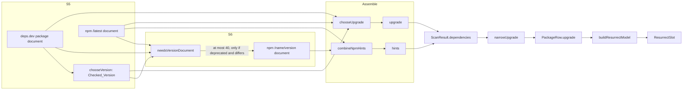

# Design Document

## Overview

This design adds three small things to the `resurrect` feature: a per-version npm notice, an "Upgrade to <version>" section, and a human `source` link next to a machine `evidence` URL in the curated list. It reuses the existing hint pipeline, the existing mapping helpers and the existing command builder. It adds one request type (the npm document of one version), one optional scan field (`upgrade`), one core function (`isStrictVersion`) and one data field (`evidence`).

### Facts the design starts from (checked in the code and the fixtures)

- `adapters/npm/npm-source.ts` has one method, `getLatest`, which fetches `GET https://registry.npmjs.org/<name>/latest` (L1 cache only). Stage S5 (`pipeline/scan/stage-registries.ts`) starts it for every npm target in parallel with the deps.dev package document.
- The Checked_Version is chosen in stage S6 (`stage-versions.ts`, `chooseVersion`) and again, purely, in `assembleFacts`. It is stored as `lookupVersion` with `versionBasis`.
- The deps.dev package document (EF-1) lists every version with `isDefault`, `isDeprecated` and `deprecatedReason`. In the `request/request` fixture, `uuid` lists `0.0.1` as deprecated with the reason "Please upgrade to version 7 or higher...", and `rimraf` lists `1.0.0` as deprecated with "Rimraf versions prior to v4 are no longer supported". `mapDepsDevPackage` already reads `isDeprecated` of the Checked_Version into the fact `deprecated`, but that fact can also be true because of an npm `/latest` notice or a RustSec advisory, so it cannot be used to decide on a version-level action.
- The PyPI adapter fetches the per-version JSON of the Checked_Version only (`/pypi/<name>/<version>/json`), and the crates.io adapter fetches the owners only. Neither returns a version list. For all three ecosystems the version list, the default version and the per-version deprecation flag come from deps.dev only.
- OSV is queried for the Checked_Version only. The advisories of the default version are never fetched.
- Version ordering helpers already exist in `pipeline/mapping`: `semverCompare` (`range-semver.ts`) and `pepCompare` (`range-pep440.ts`).
- The recorded set `tests/fixtures/request__request` holds 40 npm documents, all of the form `registry.npmjs.org/<name>/latest`. It holds no per-version document. A replay of the changed pipeline would end with "replay missed a request" (`scripts/fixtures`), so the set must be recorded again (decision D9).
- `scripts/live-report.ts` collapses every npm path with a second segment to `/{package}/{version}`, so `/latest` and a version document would be counted in one row (decision D8).
- There is no per-scan request budget for npm other than the 25-second scan deadline, the npm concurrency limit of 8 and the dependency cap of 300. The design therefore adds its own cap (decision D6).

### Key design decisions

| # | Decision | Reason |
|---|---|---|
| D1 | "The checked version is deprecated" is read from the deps.dev package document (`isDeprecated` of the entry of the Checked_Version), by a new pure function `versionDeprecated`. | The document is already fetched in S5 and before S6 decides. No packument fetch is needed, and the decision costs no request. The existing `facts.deprecated` is not used because it also reflects the `/latest` document and RustSec advisories. |
| D2 | The extra npm request belongs to stage S6, after `chooseVersion`. | The Checked_Version is unknown in S5. S6 already holds the PyPI per-version request for the same reason. |
| D3 | A Version_Hint replaces the `/latest` hint. When it is missing, the `/latest` hint behaves as before. | The slot describes the checked version. If both documents say "deprecated", the texts are normally the same notice. A second hint would add noise and break the rule "at most one `deprecation-notice` for an npm target". The `/latest` document stays the fallback when the extra request fails. |
| D4 | The upgrade is offered only when the Checked_Version has `isDeprecated` true. HAUNTED packages with advisories get no upgrade. | OSV is queried for the Checked_Version only. A claim that the default version is free of those advisories would be an unsupported claim. An extra OSV query would be a new request type and a new failure path, which the brief excludes ("if already knowable"). |
| D5 | The target of the upgrade is the deps.dev default version, checked against the version list, its own `isDeprecated`, the npm `/latest` document (npm only) and the ecosystem comparator. | The registry's own notion of the version that a plain install gets. A comparator is needed because the default can lag behind a pinned pre-release or a yanked line; `semverCompare` and `pepCompare` exist, so no new ordering code is written. |
| D6 | At most `NPM_VERSION_DOCS_MAX` = 40 version documents per scan, chosen in ascending code point order of the name. | Keeps the worst case (300 deprecated targets) at 40 extra requests, deterministic and independent of timing. Targets over the cap fall back to the `/latest` hint. No note is added; the slot degrades to the pre-existing behavior. |
| D7 | The Version_Document request is a normal `npm` Work_Unit. | A failed request then makes the `npm` source partial, which is honest, and the existing deadline, retry and limiter rules apply without special cases. |
| D8 | The request report separates `/{package}/latest` from `/{package}/{version}`. | The brief requires the extra request to be counted. Without the split the two rows merge. |
| D9 | Re-record `request/request` only. The other three sets stay byte-identical. | Adding the two or more missing responses by hand would forge recorded data and would need keys that the recorder generates. The recorder has no "add one response" mode (`--only supplementary` or `--only <owner/repo>`). Re-recording one repository records exactly the requests the changed pipeline sends, with the real documents of `uuid@3.4.0` and the checked version of `rimraf`. The cost is that the other recorded facts of that set (as-of date, days since release, advisory lists) move, and the assertions that mention them are updated to the new recorded values. No other set sends an npm version request, so no other set changes. |
| D10 | Strict version validation lives in Core (`core/versions/strict-version.ts`), used by the Pipeline (URL and plan) and by the view-model (narrowing and commands). | Core is the one layer both may import. One definition prevents the two layers from disagreeing about what a safe version is. |
| D11 | `upgrade` is an optional scan-dependency field `{version, basis: "registry-default"}`, omitted when null. | Additive: old cached results, fixtures and e2e bodies stay valid; deep-equality tests of dependencies without an upgrade stay green. `basis` names where the version came from and leaves room for other bases without a new field. |
| D12 | The fallback paragraph is suppressed when an Upgrade_Section exists. | The fallback says no recommended replacement is on record. An upgrade is a recommendation from the registry, so both together would contradict. |
| D13 | PEP 621 form: change the entry to `<name>>=<version>`, run `pip install "<name>>=<version>"`. requirements.txt form: `<name>==<version>` and `pip install "<name>==<version>"`. | A requirements file conventionally pins; a project's `dependencies` list declares a range, and `>=` states the one fact the registry supports (this version or newer). The double quotes are fixed template text, needed because `>` is a shell redirect. |
| D14 | The upgrade commands keep the scope flags of `resurrect` (`--save-dev`, `--save-optional`, `--save-peer`, `--dev`, `--build`, `--optional`). | Without them `npm install name@v` would move a dev dependency into `dependencies`. |
| D15 | `evidence` is required for every curated entry. `source` is a Human_Page and may not be a Machine_Endpoint. | Every entry was checked against a page in the `resurrect` Source_Check, so every entry has evidence. A required field makes the rule testable. A rule on `source` host prevents a regression to a JSON link. |
| D16 | The live test checks that the evidence is reachable and contains at least one `to` name. | A case-insensitive search is cheap, works for JSON, HTML and Markdown evidence, and detects a page that moved or lost the replacement. It does not prove the sentence still reads as a recommendation, which only the Source_Check can. |
| D17 | The report is a new file `docs/resurrect-upgrade-report.md`. The curated tables stay in `docs/resurrect-report.md` and are updated there by one task. | `resurrect-report.md` documents a finished spec; a new file keeps this spec's evidence in one place and avoids rewriting a report that other work links to. |

### Property namespace and traceability

Properties are numbered RU-P1 to RU-P8 and tagged `// Feature: resurrect-upgrade, Property RU-P<n>: <title>`. `tests/ui/ru-traceability.test.ts` follows the pattern of `tests/ui/rs-traceability.test.ts`. The properties RS-P1 to RS-P12 of the `resurrect` spec stay as they are.

## Architecture

### Module layout (new and changed files)

| File | Change | Layer |
|---|---|---|
| `core/versions/strict-version.ts`, `core/index.ts` | new: `isStrictVersion`; export | core |
| `pipeline/constants.ts` | `CACHE_KEY_VERSION` 5; new `NPM_VERSION_DOCS_MAX` 40 | pipeline |
| `pipeline/ports/npm-source.ts`, `adapters/npm/npm-source.ts` | `getVersion(name, version, ctx)` | port, adapter |
| `pipeline/mapping/version-doc-plan.ts` | new: `versionDeprecated`, `latestVersionOf`, `needsVersionDocument` | pipeline |
| `pipeline/mapping/upgrade.ts` | new: `chooseUpgrade` | pipeline |
| `pipeline/mapping/hints.ts` | new export `combineNpmHints` | pipeline |
| `pipeline/mapping/types.ts`, `pipeline/mapping/index.ts` | `RawTargetInputs.npmVersion?`, `AssembledFacts.upgrade`, `UpgradeSuggestion`; exports | pipeline |
| `pipeline/mapping/assemble.ts` | use the combiner; call `chooseUpgrade` | pipeline |
| `pipeline/scan/stage-versions.ts` | start the capped Version_Document requests; new unit key; new result map | pipeline |
| `pipeline/scan/run-scan.ts` | pass the npm source and the S5 `npmLatest` map to S6; fill `npmVersion` | pipeline |
| `pipeline/scan/assemble-result.ts`, `pipeline/scan/types.ts` | carry `upgrade` per dependency | pipeline |
| `pipeline/scan/scan-cache.ts` | validate `upgrade` | pipeline |
| `scripts/live-report.ts` | split the npm endpoint pattern | scripts |
| `view-model/narrow.ts`, `parse-response.ts`, `types.ts`, `package-rows.ts` | `narrowUpgrade`; `upgrade` on dependency and row; model types | view-model |
| `view-model/resurrect-commands.ts` | new `buildUpgradeBlocks` | view-model |
| `view-model/resurrect.ts` | build the Upgrade_Section; suppress the fallback | view-model |
| `view-model/resurrections.ts` | six keys, `evidence`, Machine_Endpoint rule | view-model |
| `components/resurrect-slot.tsx` | render the Upgrade_Section | components |
| `data/resurrections.json` | add `evidence`, set `source` to the human page | data |
| `tests/live/resurrections.live.test.ts` | evidence checks | tests |
| `tests/e2e/resurrect.spec.ts`, `tests/e2e/resurrect-report.spec.ts` | upgrade cases; report text | tests |
| `tests/fixtures/request__request/**` | re-recorded | fixtures |
| `docs/resurrect-upgrade-report.md`, `docs/resurrect-report.md`, `docs/property-traceability.md`, `docs/screenshots/resurrect/*.png` | report, tables, traceability, screenshots | docs |

No change to `app/globals.css` is planned. The Upgrade_Section reuses the existing classes of the slot (`gk-resurrect-label`, `gk-resurrect-text`, `gk-resurrect-block`, `gk-resurrect-commands`, `gk-resurrect-block-heading`, `gk-resurrect-lead`). If a task finds that a new class is unavoidable, it adds one delimited block that uses existing custom properties only.

### Data flow



### Slot layout (order is part of the contract)

1. Heading "Resurrect" (level 3).
2. Urgent sentence, restless ghosts only.
3. Upgrade_Section: label "From the registry", title "Upgrade to <version>", one sentence, one command block per (origin, scope) with a Copy_Button.
4. One block per hint (label, text, link).
5. "From the caretaker's list": per entry the why sentence, the `source` link, per Alternative a command block.
6. Fallback paragraph, only when sections 3, 4 and 5 are all empty.
7. The Copy_Status live region (always in the DOM).

## Components and Interfaces

### `core/versions/strict-version.ts`

`isStrictVersion(ecosystem: unknown, version: unknown): boolean`. Total. Rejects non-strings, strings longer than 64 code points (checked first, so the patterns run on bounded input) and every ecosystem other than the three. Patterns (linear, no nested quantifiers over overlapping classes):

| Ecosystem | Pattern |
|---|---|
| npm, cargo | `^(0\|[1-9][0-9]*)\.(0\|[1-9][0-9]*)\.(0\|[1-9][0-9]*)(-[0-9A-Za-z-]+(\.[0-9A-Za-z-]+)*)?$` |
| pypi | `^[0-9]+(\.[0-9]+)*((a\|b\|rc)[0-9]+)?(\.post[0-9]+)?(\.dev[0-9]+)?$` |

The accepted alphabet is letters, digits, `.` and `-`, so no shell metacharacter, no quote, no `@`, `+`, `!`, `=`, `<`, `>` or space can pass. Epoch (`1!`), local versions (`+`) and semver build metadata (`+`) are rejected on purpose: they would add characters that this spec does not need and the registry default does not use.

### `pipeline/mapping/version-doc-plan.ts`

- `versionDeprecated(depsdevBody: unknown, version: string | null): boolean` reads `versions[]` with `readOwn`, finds the entry whose `versionKey.version` equals `version`, and returns true only when its `isDeprecated` is the boolean `true`. Total.
- `latestVersionOf(latestBody: unknown, depsdevDefault: string | null): string | null` returns the non-empty string `version` of the `/latest` body, else `depsdevDefault`, else null.
- `needsVersionDocument(input: {ecosystem, depsdevBody, selected, latestBody}): boolean` is true exactly when the ecosystem is `npm`, `selected` is a string that passes `isStrictVersion('npm', selected)`, `versionDeprecated` is true, and `selected` differs from `latestVersionOf(...)` (an unknown latest counts as different). Pure and total; it reads the default version through `readDepsDevVersions`.

The cap is applied by the stage, not by the function, so the function stays a pure predicate (RU-P1).

### `pipeline/mapping/upgrade.ts`

`chooseUpgrade(input: {ecosystem, depsdevBody, selected, latestBody}): UpgradeSuggestion | null`.

1. `selected` must be a non-empty string and `versionDeprecated(depsdevBody, selected)` must be true; else null.
2. `readDepsDevVersions` gives the list and the default version. The default must be a non-empty string that is in the list; else null.
3. The default entry must not have `isDeprecated === true`; else null.
4. For npm: if `readOwn(latestBody, 'version') === default` and `normalizeHintText(readOwn(latestBody, 'deprecated'))` is not null, return null.
5. The ecosystem comparator (`semverCompare` for npm and cargo, `pepCompare` for PyPI) must rank the default strictly above `selected`; when either string does not parse (`semverVersion` null, `pepVersion` null), return null.
6. Return `{version: default, basis: 'registry-default'}`.

The function reads each field with `readOwn` inside try/catch and never throws. It does not depend on the order of `versions[]`: `isDefault` picks the first default entry in the existing reader, and the property RU-P3 shuffles the list; documents with two default entries are not a valid input and the first in document order wins, as in `readDepsDevVersions`. The property generator never produces two defaults.

### `pipeline/mapping/hints.ts` (addition)

`combineNpmHints(versionBody: unknown | undefined, latestBody: unknown | undefined): UpstreamHint[]`: `v = npmDeprecationHint(versionBody)` when the body exists; if `v.length > 0` return `v`; else return `npmDeprecationHint(latestBody)` when it exists, else `[]`. It never returns more than one hint and never throws.

### `pipeline/mapping/assemble.ts`

`RawTargetInputs` gains the optional `npmVersion?: Fetched<unknown>`, so every existing literal stays valid. For `ecosystem === 'npm'`, `hints = combineNpmHints(bodyOf(raw.npmVersion), bodyOf(raw.npmLatest))` replaces the current `npmDeprecationHint` call (only when one of the two bodies exists). After `selection` is known and the deps.dev body is ok, `upgrade = chooseUpgrade({...})`. `AssembledFacts` gains `upgrade: UpgradeSuggestion | null`.

### `pipeline/scan/stage-versions.ts`

- `VersionStageInput.sources` adds `'npm'`; the input adds `npmLatest: ReadonlyMap<string, RunResult>` (the S5 map).
- After the selections are built, the stage builds the list of npm items: for each npm target with `selection.selected !== null` and an ok deps.dev result, call `needsVersionDocument`; sort the names by `compareCodePoints`; keep the first `NPM_VERSION_DOCS_MAX`.
- Each kept item runs `runner.runUnit('npm', versionUnitKeys.npmVersion(name, version), () => sources.npm.getVersion(name, version, ctx))` inside the existing `Promise.all`, so it runs concurrently with the deps.dev, OSV and PyPI calls of S6 and is limited by the npm limiter.
- `versionUnitKeys.npmVersion(name, version)` is `npmversion:<name>:<version>`.
- `VersionStageResult.npmVersions: ReadonlyMap<string, Fetched<unknown>>` holds the results, keyed by `targetKey`.
- `run-scan.ts` passes `sources.npm` and `registries.npmLatest`, and fills `npmVersion` of `RawTargetInputs` from `versions?.npmVersions`.

### `pipeline/scan/assemble-result.ts`, `types.ts`, `scan-cache.ts`

`TargetOutcome` carries `upgrade`; each dependency of the target gets `upgrade` set only when non-null (object spread, so the key is absent otherwise). `ScanDependency.upgrade?: {version: string; basis: 'registry-default'}`. `isScanResult` accepts `undefined` or a record with exactly the keys `version` (non-empty string, at most 64 code points) and `basis` (`'registry-default'`).

### `adapters/npm/npm-source.ts`

`getVersion(name, version, ctx)` builds `${NPM_REGISTRY_URL}/${encodeURIComponent(name)}/${encodeURIComponent(version)}` and uses the same request shape as `getLatest` (`notFound: 'absent'`, `ttlSeconds: UPSTREAM_CACHE_TTL_SECONDS`, `storeWhen: 'always'`, `l2Kind: null`). The URL differs per version, so the L1 key differs.

### `scripts/live-report.ts`

In `patternOf` for `npm`: when the segment after the name is exactly `latest`, return `/{package}/latest`; for any other second segment, return `/{package}/{version}`. The summary table then shows both rows and the cold-scan request count of the extra request.

### `view-model/narrow.ts`, `parse-response.ts`, `types.ts`, `package-rows.ts`

`narrowUpgrade(value, ecosystem, lookupVersion): ParsedUpgrade | null` returns null for anything but a record with exactly `version` and `basis`, with `basis === 'registry-default'`, `isStrictVersion(ecosystem, version)` true and `version !== lookupVersion`. `parse-response.ts` sets `upgrade` on each dependency (null when absent). `PackageRow.upgrade` is the first non-null upgrade of the row's dependency entries in manifest order. `ParsedUpgrade` is `{version: string; basis: 'registry-default'}`.

### `view-model/resurrect-commands.ts` (addition)

`buildUpgradeBlocks(input: {origins, scopes, name, version}): readonly ResurrectBlock[]` with the templates:

| Variant | Lead | Lines |
|---|---|---|
| npm | none | `npm install [flag ]<name>@<version>` |
| pip (requirements.txt) | "Change the line for `<name>` in `<path>` to `<name>==<version>`, then run:" | `pip install "<name>==<version>"` |
| poetry | none, with the Poetry group note | `poetry add <name>@<version>` |
| pep621 | "Change the entry for `<name>` in the dependencies of `<path>` to `<name>>=<version>`, then run:" | `pip install "<name>>=<version>"` |
| cargo | none | `cargo add [flag ]<name>@<version>` |

The block grouping, headings (`mixed` gives the Poetry and PEP 621 blocks with the tool headings), de-duplication and `copyText` (lines joined by `\n`) reuse the code of `buildCommandBlocks`; the shared parts are factored into local helpers of the same file. `copyLabel` is `Copy commands to upgrade <name>`. A block is built only when `isCommandSafe(ecosystemOf(origin), name)` and `isStrictVersion(ecosystemOf(origin), version)` are true.

### `view-model/resurrect.ts`

`buildResurrectModel` adds `upgrade: ResurrectUpgrade | null` to the model. It is non-null when `row.upgrade !== null` and the version passes `isStrictVersion(row.ecosystem, version)` (checked again, so a model built from an injected row is safe). The model fields are the label "From the registry", the title `Upgrade to <version>`, the sentence of Requirement 6.1, the version, and the blocks from `buildUpgradeBlocks`. The fallback is built only when `hints`, `suggestions` and `upgrade` are all empty.

### `view-model/resurrections.ts`

`ENTRY_KEYS` gains `evidence`. `toEntry` requires `isHttpsUrl(evidence)` and `isHttpsUrl(source)` and `!isMachineEndpoint(source)`. `isMachineEndpoint(url)` is true for host `registry.npmjs.org`, `api.osv.dev`, `api.deps.dev`, for host `pypi.org` with a path that starts `/pypi/` and ends `/json`, and for host `crates.io` with a path that starts `/api/`. `CuratedEntry` gains `evidence: string`. The model uses `source` only.

### `components/resurrect-slot.tsx`

Renders `model.upgrade` between the urgent sentence and the hints: a `div.gk-resurrect-upgrade` with the label paragraph, a title paragraph, the sentence, and the same block markup as an Alternative block (heading, lead, `pre`, note, Copy_Button). The copy handler takes the name for the status text from the block's label data: the model carries `copyName` on each block (the `to` name for an Alternative, the package name for an upgrade), so the component does not parse labels.

### `tests/live/resurrections.live.test.ts`

Adds one case per entry: GET `evidence` with redirects (at most 3), status 200, body prefix of 1 MiB contains a `to` name case-insensitively. The existing target checks are unchanged. Requests run one case after the other (the file runs sequentially), so at most one request is in flight, within the limit of 4.

## Data Models

### UpgradeSuggestion (scan dependency)

```json
{ "version": "11.1.0", "basis": "registry-default" }
```

Stored as the optional key `upgrade` of each `ScanDependency` of the target, omitted when null.

### ParsedUpgrade (client)

`{ version: string; basis: 'registry-default' }`, after `narrowUpgrade`.

### ResurrectModel additions

| Field | Type | Meaning |
|---|---|---|
| `upgrade` | `ResurrectUpgrade \| null` | The Upgrade_Section, or null. |
| `ResurrectUpgrade.label` | `"From the registry"` | Fixed. |
| `ResurrectUpgrade.title` | string | `Upgrade to <version>`. |
| `ResurrectUpgrade.sentence` | string | "The registry lists this newer version as its default and does not mark it deprecated." |
| `ResurrectUpgrade.version` | string | A Strict_Version. |
| `ResurrectUpgrade.blocks` | `ResurrectBlock[]` | One per (origin, scope); may be empty. |
| `ResurrectBlock.copyName` | string | Name used in the Copy_Status text. New field on every block; the existing builder sets it to the `to` name. |

### Curated_Entry (`data/resurrections.json`)

```json
{ "ecosystem": "npm", "from": "istanbul", "to": ["nyc"],
  "why": "The npm deprecation message of istanbul says the module is no longer maintained and suggests installing nyc.",
  "source": "https://www.npmjs.com/package/istanbul",
  "evidence": "https://registry.npmjs.org/istanbul/latest" }
```

Migration rule for the one data task: `evidence` is the current `source` of the entry; `source` is the registry Human_Page of `from` when the current source is a Machine_Endpoint, and the current source otherwise (README, issue, advisory page, documentation page). No other field changes.

### Constants

| Constant | Value | File |
|---|---|---|
| `CACHE_KEY_VERSION` | 5 | `pipeline/constants.ts` |
| `NPM_VERSION_DOCS_MAX` | 40 | `pipeline/constants.ts` |
| `STRICT_VERSION_MAX_LENGTH` | 64 | `core/versions/strict-version.ts` (a module-local constant of Core, which has no constants file) |

### What the slot shows for the named packages (expected, to be confirmed by the Report)

| Package | Checked version | Hint | Upgrade |
|---|---|---|---|
| `uuid` (request/request) | 3.4.0 (resolved from the declared range) | The deprecation text of `uuid@3.4.0` | Upgrade to the deps.dev default, with the npm command |
| `rimraf` (request/request) | The newest 2.x or 3.x version that satisfies the declared range | The deprecation text of that version ("Rimraf versions prior to v4 are no longer supported" or the notice of that version) | Upgrade to the deps.dev default, with the npm command |
| `har-validator` | The latest version, itself deprecated | The `/latest` notice, unchanged ("this library is no longer supported") | None: the default is deprecated and not higher |
| `request` (synthetic row) | 2.88.2, the latest, itself deprecated | The `/latest` notice, unchanged | None |

The Report states the real values after the re-recording; the table is the design's expectation, not a claim.

## Correctness Properties

*A property is a characteristic or behavior that should hold true across all valid executions of a system-essentially, a formal statement about what the system should do. Properties serve as the bridge between human-readable specifications and machine-verifiable correctness guarantees.*

Reflection done before writing: the "no request" cases of Requirement 1 are the negative side of the same predicate as the "fetch" case, so they form one property (RU-P1). The hint rules of Requirement 2 collapse into one combiner property (RU-P2). The positive and negative upgrade criteria of Requirement 4, the comparator choice and the order independence form one chooser property (RU-P3), which is the separate property the brief asks for next to RS-P5. The command templates of Requirement 6 and the version alphabet of Requirement 5.5 form one grammar property (RU-P4), because the second is what makes the first safe. Narrowing, ordering, the stored-result round trip and the curated schema are four more properties. Criteria classified as example, smoke or integration in the prework get the unit, component, live, end-to-end or process checks listed in the Testing Strategy.

### Property 1: A version document is requested exactly for a deprecated, differing, strict npm version (RU-P1)

For all ecosystems, deps.dev package bodies (including bodies with throwing getters, non-boolean `isDeprecated`, missing default and shuffled `versions[]`), selected versions (including null, strings with shell metacharacters and strings of more than 64 code points) and `/latest` bodies (including absent), `needsVersionDocument` returns true if and only if the ecosystem is `npm`, the selected version passes `isStrictVersion('npm', ...)`, its entry in the deps.dev body has `isDeprecated === true`, and it differs from `latestVersionOf(latest, default)`; it never throws and returns the same value for every ordering of `versions[]`.

**Validates: Requirements 1.1, 1.2, 1.3, 1.4**

### Property 2: Hint combination prefers the version notice and stays bounded (RU-P2)

For all version bodies and `/latest` bodies (objects, arrays, primitives, absent values, `deprecated` of any type, throwing getters), `combineNpmHints` never throws, returns at most one hint of kind `deprecation-notice` and at most HINTS_MAX_PER_PACKAGE hints, returns the normalized `deprecated` text of the version body with `sourceUrl` null when that text is non-null, and otherwise returns exactly what `npmDeprecationHint` returns for the `/latest` body.

**Validates: Requirements 2.1, 2.2, 2.4, 2.5**

### Property 3: An upgrade is offered only to an existing, healthy, higher default version of a deprecated checked version (RU-P3)

For all deps.dev package bodies with generated versions (valid semantic versions for npm and cargo, valid PEP 440 versions for PyPI, and unparsable strings), generated `isDefault` and `isDeprecated` flags, generated checked versions (listed or not) and generated `/latest` bodies, `chooseUpgrade` returns a suggestion if and only if the checked version is listed with `isDeprecated === true`, the default version is listed and does not have `isDeprecated === true`, the ecosystem comparator ranks the default strictly above the checked version, and (npm only) the `/latest` body does not carry a non-empty `deprecated` string for that same default version; the suggestion then equals `{version: default, basis: "registry-default"}`, its version is never equal to the checked version, and the result does not depend on the order of `versions[]` and never throws.

**Validates: Requirements 4.1, 4.2, 4.3, 4.4, 4.6**

### Property 4: Strict versions are shell-safe and upgrade commands follow the fixed grammar (RU-P4)

For all strings, `isStrictVersion` accepts a string only if it consists of letters, digits, `.` and `-`; and for all origins (every format, every Pyproject_Tool value and absence), scopes, names and versions (including names and versions with spaces, quotes, `;`, `$`, backticks, `!`, `+`, newlines and Unicode), every block of `buildUpgradeBlocks` has lines that split on single spaces into tokens that are each a Fixed_Word, `<name>@<version>`, or a double-quoted `<name>==<version>` or `<name>>=<version>` whose name and version passed Command_Safe and `isStrictVersion`, starts with the verb of its template, and has a `copyText` equal to its lines joined by line breaks; when the name is not Command_Safe or the version is not strict, no block exists.

**Validates: Requirements 5.5, 6.3, 6.4, 6.5, 6.6, 6.8, 6.10, 6.11, 6.15**

### Property 5: Client narrowing of the upgrade is total, valid and idempotent (RU-P5)

For all JSON values in the `upgrade` position of a dependency (including absent, arrays, extra keys, unknown `basis`, versions with metacharacters or of more than 64 code points, and a version equal to the `lookupVersion`) and all three ecosystems, `narrowUpgrade` never throws, returns null or a record with exactly the keys `version` and `basis`, whose version passes `isStrictVersion` for the ecosystem and differs from the `lookupVersion`, and returns a value equal to its own output when applied to that output.

**Validates: Requirements 5.6, 5.7**

### Property 6: Section order is fixed and an upgrade suppresses the fallback (RU-P6)

For all rows that have a slot, with all combinations of an upgrade (valid, with a version that is not strict, or absent), zero or more hints and zero or more curated entries, the sections of the Resurrect_Model are a subsequence of urgent, upgrade, hints, suggestions, fallback in that order; `upgrade` is non-null exactly when the row carries a strict upgrade; and `fallback` is non-null exactly when there is no upgrade, no hint and no suggestion.

**Validates: Requirements 6.2, 6.11, 6.12**

### Property 7: Scan results with upgrades survive JSON and the validator (RU-P7)

For all scan results assembled from generated dependency lists, with `upgrade` absent or present on any dependency, serializing to JSON and parsing again gives a value equal to the original that `isScanResult` accepts; and for all such results with one `upgrade` replaced by a malformed value (not a record, a missing key, an extra key, a non-string or empty version, a version of more than 64 code points, a `basis` other than `registry-default`), `isScanResult` rejects the result.

**Validates: Requirements 5.2, 5.3, 5.8**

### Property 8: The curated loader enforces the six-key schema and links only the human page (RU-P8)

For all raw entry lists (valid entries and entries with a missing or extra key, an `evidence` or `source` that is not a string, not https, has credentials, or a `source` that is a Machine_Endpoint), `loadCurated` never throws, keeps exactly the entries that pass, and every kept entry has an https `source` that is not a Machine_Endpoint and an https `evidence`; and for all kept lists and rows, no `href` of the Resurrect_Model equals the `evidence` of an entry unless that URL is also the `source` of the same entry.

**Validates: Requirements 7.1, 7.2, 7.3, 7.6, 7.7**

## Error Handling

| Situation | Behavior |
|---|---|
| The deps.dev package document is missing or has no entry for the Checked_Version | `needsVersionDocument` is false, `chooseUpgrade` is null. No request, no upgrade. |
| The Checked_Version fails `isStrictVersion` | No Version_Document request (a hostile version never reaches a URL). No upgrade for it. |
| The Version_Document answers 404, fails, is not JSON or is cut off by the deadline | The unit is recorded as for any other npm request (the `npm` source may be partial). The hint falls back to the `/latest` document. The upgrade is unaffected. |
| The Version_Document has no `deprecated` string | The `/latest` hint is used. |
| More than NPM_VERSION_DOCS_MAX targets need a document | The first 40 names (code point order) get one; the others use the `/latest` hint. No note. |
| `/latest` is unavailable | `latestVersionOf` falls back to the deps.dev default, then to unknown, which counts as differing. The upgrade rule for npm skips the `/latest` check. |
| deps.dev has not yet flagged a version that npm marks deprecated | The `/latest` check of `chooseUpgrade` (same version as the default) prevents an upgrade to a deprecated version. |
| The upgrade version is not a Strict_Version at the client | `narrowUpgrade` returns null. No section, no command. |
| The package name is not Command_Safe | The Upgrade_Section keeps its title and sentence, with no command block. |
| A stored result has a malformed `upgrade` | `isScanResult` rejects it. The Scan_Cache treats it as a miss and rescans. |
| A curated entry lacks `evidence`, or its `source` is a Machine_Endpoint | The loader drops the entry. The data test fails in CI, so such an entry cannot ship. |
| The evidence page moved or no longer names a replacement | The live contract test fails. The orchestrator replaces the URL or drops the entry. |
| Clipboard missing or rejected | The Copy_Status shows the existing failure sentence. |

## Testing Strategy

### Approach

Property-based tests (fast-check, `cfg()` from `tests/support/fc-config.ts`, minimum 100 runs, one property per file, tag `// Feature: resurrect-upgrade, Property RU-P<n>: <title>`, titles starting `RU-P<n>`) cover the pure functions: the predicate, the combiner, the chooser, the version validator, the command builder, the narrowing, the model order, the stored-result validator and the curated loader. Unit tests cover the adapter, the stage wiring with scripted sources, the request counts, the fixture replay and the component. End-to-end tests with axe cover the browser. The live contract test covers evidence pages. PBT is not used for the adapter, the stage wiring, the request report, the CSS or the live registries (integration and example tests there).

### Test plan by layer

| Layer | Unit and component tests | Properties |
|---|---|---|
| Core | `tests/core/versions/strict-version.test.ts` (accepted and rejected tables), `tests/core/public-api.test.ts` | none (alphabet is covered by RU-P4) |
| Constants | `tests/pipeline/constants.test.ts` (5, `NPM_VERSION_DOCS_MAX`) | none |
| Port and adapter | `tests/adapters/npm-source.test.ts` (URL, scoped name, cache policy), `tests/pipeline/ports.test.ts`, `tests/adapters/composition.test.ts` | none |
| Plan | `tests/pipeline/mapping/version-doc-plan.test.ts` (uuid-like, rimraf-like, latest equal, unknown latest) | RU-P1 |
| Combiner | `tests/pipeline/mapping/hints-combine.test.ts` | RU-P2 |
| Chooser | `tests/pipeline/mapping/upgrade.test.ts` (npm, PyPI, cargo examples, HAUNTED without deprecation gives none) | RU-P3 |
| Assembly | `tests/pipeline/mapping/assemble-upgrade.test.ts` | none |
| Stage | `tests/pipeline/scan/run-scan-version-docs.test.ts` (request counts of Requirement 3.4, failure paths, order after S5, source status) | none |
| Validator | `tests/pipeline/scan/scan-cache-upgrade.test.ts` | RU-P7 |
| Client boundary | `tests/ui/view-model/narrow-upgrade.test.ts` | RU-P5 |
| Commands | `tests/ui/view-model/resurrect-upgrade-commands.test.ts` (every template, scope flags, mixed, several manifests) | RU-P4 |
| Model | `tests/ui/view-model/resurrect-upgrade.test.ts` (texts, labels, suppression, coexistence with curated) | RU-P6 |
| Curated | `tests/ui/view-model/resurrections.test.ts`, `resurrections-data.test.ts` | RU-P8 |
| Component | `tests/ui/components/resurrect-slot.test.tsx` (Upgrade_Section, copy label and status) | none |
| Report script | `tests/scripts/live-report-pattern.test.ts` (pattern split) | none |
| Fixtures | `tests/pipeline/resurrect-upgrade-fixtures.test.ts` (replay of the re-recorded set) | none |
| Live | `tests/live/resurrections.live.test.ts` (evidence cases) | none |
| End-to-end | `tests/e2e/resurrect.spec.ts` (uuid, rimraf, har-validator, axe) | none |
| Report | `tests/e2e/resurrect-report.spec.ts` (`RS_REPORT=1`) | none |

### Test updates that this spec legitimately causes

| Test | Change | Reason |
|---|---|---|
| `tests/pipeline/constants.test.ts` | `CACHE_KEY_VERSION` 4 to 5; new constant in the expected lists | Requirement 3.1 |
| Every stub `NpmSource` (found with a search for `getLatest` under `tests/`: `cache-header.property.test.ts`, `handle-scan-request.test.ts`, `handle-scan-request.property.test.ts`, `advisories.property.test.ts`, `composition.test.ts`, `ports.test.ts`, and others) | Add `getVersion` | Requirement 3.2 |
| Pipeline tests that deep-equal a dependency entry of a replayed or scripted scan | `upgrade` appears where the checked version is deprecated and a healthy higher default exists | Requirement 4.7 |
| `tests/ui/view-model/resurrections.test.ts`, `resurrections-data.test.ts`, `resurrections.property.test.ts` (RS-P10) | Entries need `evidence`; five keys become six | Requirement 7 |
| `tests/ui/view-model/resurrect*.test.ts` and `tests/ui/components/resurrect-slot.test.tsx` that build or deep-equal a `ResurrectModel` or `ResurrectBlock` | Add `upgrade: null` and `copyName` | Requirement 6 |
| `tests/ui/view-model/package-rows*.test.ts`, `detail.test.ts` | Rows carry `upgrade: null` | Requirement 5.6 |
| Tests of the `request/request` replay (`fixtures-scan.test.ts`, `resurrect-fixtures.test.ts`, `fixtures-replay.test.ts`, e2e fixtures, `tests/e2e/resurrect.spec.ts` uuid case) | New recorded values; `uuid` now shows a hint and an upgrade, not the buried paragraph | Requirement 9.1, 9.3 |
| `tests/e2e/resurrect-report.spec.ts` | Slot texts for `rimraf` and `uuid` | Requirement 9.6 |

The assertions of the `request/request` set that mention recorded facts (as-of date, ages, advisory counts) are updated to the newly recorded values, and each change is listed in the Report with its reason. Every other test stays unchanged and green.

### Fixture plan (Requirement 9)

1. Run `$env:GRAVEKEEPER_LIVE_TESTS='1'; $env:GITHUB_TOKEN=(gh auth token); npm run fixtures:record -- --only request/request` in one command. The token is never printed.
2. Check `git status` and `git diff --stat`: only `tests/fixtures/request__request/**` changes. If any other path under `tests/fixtures` changes, revert it.
3. Check that the index has `registry.npmjs.org/uuid/<checked version>` and the same for `rimraf`.
4. Run the replay tests, fix only assertions that mention recorded facts of this set, run `npm run e2e:fixtures`.

### Property test configuration

Minimum 100 iterations per property (`cfg()`), deep runs by `npm run test:deep -- <file>`, `FC_NUM_RUNS` never set in the shell. Each property is one test file with one `describe`, tagged as above. `tests/ui/ru-traceability.test.ts` checks the tags (property count 8). No property test needs a DOM.

### Risks

| # | Risk | Mitigation |
|---|---|---|
| R1 | deps.dev may report PyPI yanked versions or crates.io yanked versions differently (as `isDeprecated` or not at all). | The upgrade is offered only when deps.dev says `isDeprecated`; when it does not, there is no upgrade and the slot behaves as before. The Report lists the ecosystems for which an example was found. |
| R2 | deps.dev can lag behind npm. | The `/latest` check of the chooser stops an upgrade to a version npm marks deprecated. A checked version that npm deprecated but deps.dev has not flagged gets neither hint nor upgrade. |
| R3 | The deps.dev default version can be a pre-release when a package has only pre-releases. | `isStrictVersion` allows semver pre-releases, and the comparator ranks them correctly; the command installs exactly that version. |
| R4 | The Version_Document of a very old version can be large (some packuments are megabytes, a version document is not). | `MAX_RESPONSE_BYTES` (5 MB) applies to every npm request. |
| R5 | Re-recording `request/request` moves other recorded facts of that set. | Only assertions that mention such facts are updated; the diff of the set is limited to that directory; the Report lists every changed assertion. |
| R6 | The 40-request cap is arbitrary. | It bounds the worst case at 40 extra requests per scan, deterministic by name. The value is one constant. |
| R7 | The deps.dev `deprecatedReason` already holds the deprecation text for free. | The brief requires the npm document as the source of the text. The reason text could be a later fallback; it is not used here. |
| R8 | `source` pages that are server-rendered clients (for example `pypi.org/project/<name>/`) answer a bot challenge, so a live check of `source` would fail. | The live test fetches `evidence`, not `source`. For PyPI entries the evidence is `pypi.org/pypi/<name>/json`. |
| R9 | The Evidence name search can pass on a page that mentions the name without recommending it. | Accepted: the Source_Check of the `resurrect` spec stays the check of meaning; the live test only detects pages that moved or no longer name the replacement. |
| R10 | The data file grows by about 4 KB with `evidence`, in the lazy detail bundle. | Task `check:bundle` and the js-budget spec run after the change. |
