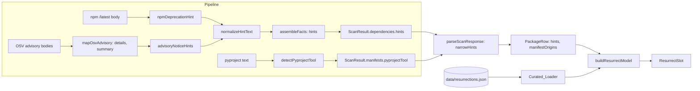

# Design Document: resurrect

## Overview

The Resurrect slot of the Detail_Panel stops being a placeholder. For every DEAD package and every restless ghost it shows, in this order: an urgent sentence (restless only), the upstream hints that the scan collected, the curated suggestions with copyable commands, and when none of these exist one honest paragraph. Every word is either a fixed template, an upstream text shown as plain text, a field of a curated entry whose source URL states the recommendation, or a fact of the scan. No language model and no request from the slot.

### Facts the design starts from

These were read from the repository while writing this document.

| Fact | Where | Consequence |
|---|---|---|
| The slot exists as a disabled placeholder; `DetailModel.resurrect` is a boolean that is true only for status DEAD. | `components/resurrect-slot.tsx`, `view-model/detail.ts` line 137, `components/detail-panel.tsx` line 185 | The boolean becomes `ResurrectModel \| null`. The placeholder tests (`tests/ui/components/resurrect-slot.test.tsx`, `detail-panel.test.tsx` lines 264 to 289, `tests/ui/view-model/detail.test.ts` lines 104 to 118) change legitimately. |
| A restless ghost is a HAUNTED classification with reason 8.1 or 8.2 (`view-model/grave-type.ts`). A forgotten package is DEAD with neither reason. | `view-model/grave-type.ts` | "Restless" is `row.kind === 'restless'`. "Buried" is DEAD with 8.1 or 8.2. |
| npm facts: the `deprecated` flag of the selected version comes from deps.dev (`isDeprecated`). The npm registry document `GET /{name}/latest` is already fetched for every npm target (`RawTargetInputs.npmLatest`, used for maintainers) and holds the `deprecated` string of the latest version. | `adapters/npm/npm-source.ts`, `pipeline/mapping/maintainers.ts`, `assemble.ts` | The hint reads the string from the document already fetched. No new request, no new budget. A notice that exists only on an older version document is not available (Decision D3). |
| Cargo facts: `mapOsvAdvisory` already reads `affected[].database_specific.informational`; `aggregateAdvisories` collects `unmaintainedIds`; the OSV body (with `details` and `summary`) is already fetched for every advisory id. | `pipeline/mapping/osv-advisory.ts`, `assemble.ts` lines 130 to 136 | `AdvisoryRecord` gains `details` and `summary`; the hint is built in `assembleFacts` from the same records. |
| `ScanDependency` holds `advisories` per Lookup_Target. `isScanResult` checks dependencies with a non-strict record test, but `facts` with exactly seven keys. `ScanManifestEntry` has `path`, `format`, `warnings`. | `pipeline/scan/types.ts`, `pipeline/scan/scan-cache.ts` | `hints` is an additive optional field next to `advisories`; the validator accepts absence and checks presence. `pyprojectTool` is an additive optional field of the manifest entry. |
| The client does not trust the server body: `parseResult` in `view-model/parse-response.ts` requires `advisories` as an array and narrows it (`narrowAdvisories`). | `view-model/parse-response.ts`, `narrow.ts` | A `narrowHints` function joins the boundary and treats absence as `[]`. |
| `CACHE_KEY_VERSION` is 3. Tests that pin it: `tests/pipeline/constants.test.ts` line 213 ("equals 3"). Others import the constant. | `pipeline/constants.ts`, `tests/pipeline/*` | One test changes to 4. |
| The Dependency model records no table of origin. A `pyproject.toml` entry from `[tool.poetry.dependencies]` and one from `[project].dependencies` have the same fields. `ScanResult.manifests[]` gives the format per path; `ScanDependency.manifestPath` gives the path. | `core/model/types.ts`, `pipeline/scan/types.ts` | Decision D5 (tool detection per manifest). |
| The existing `/api/scan` mock fixtures: `tests/e2e/.generated/scan-request.json` (request/request), `scan-zoxide.json`, `scan-synthetic-restless.json`. In `scan-request.json`: `har-validator` DEAD 8.2,8.4,10.8 (buried); `phantomjs-prebuilt` DEAD 8.1,8.2,8.3,10.8 (buried); `aws-sign2` DEAD 8.3,10.8 (forgotten); `uuid` HAUNTED 7.2,8.2 (restless); `rimraf` DEAD 8.2,10.8 (buried, notice not on latest); `request` itself is not a dependency of the repository `request/request`. | Exported scans | The e2e test and the report use these packages. |

### Recorded fixtures: what they hold (checked for this design)

The recorded sets under `tests/fixtures/` hold the upstream bodies that the pipeline replays.

| Set | npm `deprecated` strings in `/latest` bodies | RustSec details |
|---|---|---|
| `request__request` | 4: `har-validator` ("this library is no longer supported"), `phantomjs-prebuilt` ("this package is now deprecated"), `karma-phantomjs-launcher` ("PhantomJS development have stopped, use puppeteer or similar"), `codecov` (a URL to a Codecov deprecation plan) | none |
| `psf__requests`, `revmic__canopy` | none | none |
| `ajeetdsouza__zoxide` | none (cargo) | 4 files mention RustSec; the advisory `RUSTSEC-2025-0141` ("Bincode is unmaintained", informational `unmaintained`) has a `details` text with a heading and a Markdown list of links to `wincode`, `postcard`, `bitcode` and `rkyv` |

Consequence: no fixture needs re-recording. Replaying the sets through the changed pipeline yields the hints, and re-exporting the scans (`npm run e2e:fixtures`) puts them into the e2e bodies. The `bincode` text is also a natural test of "Markdown links in a hint are never clickable".

### Key design decisions

| # | Decision | Reason |
|---|---|---|
| D1 | Hints live on `ScanDependency.hints`, an optional field next to `advisories`, always emitted by the pipeline (empty list when none). | Same granularity as advisories (per Lookup_Target); additive, so the validator, fixtures and e2e bodies stay valid. |
| D2 | `deprecation-notice` has `sourceUrl: null`. The Resurrect_Model offers the registry page link built by `registryLink`. | The pipeline then builds no package URL, and the one URL builder stays in the view-model. A hint record that says "no source URL" is honest: the notice belongs to the registry document, and the registry page is where it can be read. |
| D3 | The npm hint reads the `/latest` document only. | It is already fetched. Reading the per-version document would add a request per deprecated package and a new failure path. Consequence: `uuid@3.4.0` (deprecated on its own version document, not on `latest`) has no hint, and the slot shows the buried fallback paragraph. The brief's idea of an upgrade hint from the notice is therefore not available for `uuid`, and no upgrade text is invented. Risk R3 records it. |
| D4 | `uuid` is not in the Curated_List. | A package is never its own replacement. The data test forbids a `to` that is a `from` of the same ecosystem and a `to` equal to its own `from`; the runtime builder drops such an Alternative again. |
| D5 | A new Core function `detectPyprojectTool(text)` and an optional `pyprojectTool` field on `ScanManifestEntry` tell Poetry from PEP 621 per manifest. Unknown or `mixed` shows both command variants. | The Dependency model has no origin field and must not get one (pyproject spec decision). Detection per manifest is a pure function over text that the pipeline already holds, adds no package (the TOML reader is `core/parsers/toml-tree.ts`) and degrades safely: old results without the field show both variants. Per-dependency precision in a mixed file is not needed because `mixed` shows both. Alternatives rejected: guessing from version-spec text (Poetry constraints are translated to PEP 440, so the form is lost); adding `origin` to Dependency (changes the model of three specs). |
| D6 | PEP 621 projects get "replace the entry, then `pip install <to>`", not `uv` or `pdm` commands. | The tool of a PEP 621 project is not recorded and cannot be known. A fixed template that is true for any PEP 621 project is the honest choice. |
| D7 | Hint text is normalized to one line of plain text, at most 600 code points with an ellipsis, Markdown and URLs left as literal characters. | Whitespace collapse makes the block safe to render in one text node. Leaving Markdown alone is the only way to "invent nothing"; a bullet list becomes one run-on line, and the cap cuts long advisories (the `bincode` text is cut near its list). |
| D8 | Curated `from` matching uses normalized names: PEP 503 for PyPI, lower-case with `_` as `-` for crates, exact for npm. | Registry rules: PyPI and crates.io treat these spellings as the same name; npm names are unique as written. The scan already stores PyPI names normalized, so the PyPI rule costs nothing. |
| D9 | The curated list is a JSON file imported by the view-model, not fetched. | No request from the slot (graveyard-ui 12.3 stays). The detail model is built only in the lazy detail path, so the file (about 8 KB) is not in the initial bundle; task 9.4 measures it with `check:bundle`. |
| D10 | The Resurrect_Model contains every string the component shows. The component computes nothing but copy state. | Properties then test the view-model without a DOM. |
| D11 | Command flags: npm gets `--save-dev`, `--save-optional`, `--save-peer` for the scopes `dev`, `optional`, `peer`; cargo gets `--dev`, `--build`, `--optional`. Poetry and pip get no scope flag. | These flags are unambiguous. Poetry group names are not recorded (every group is scope `dev`), so Poetry gets a fixed sentence about `--group` instead of a guessed group. |
| D12 | The fallback paragraph for unverified repositories is labelled "(listed by the package, not verified)". | The only source of a repository link is the `source-repo-unverified` note, which carries the repository that the registry metadata claims. |

### Property namespace and traceability

Properties are numbered RS-P1 to RS-P12 and tagged `// Feature: resurrect, Property RS-P<n>: <title>`. `tests/ui/rs-traceability.test.ts` follows the pattern of `tests/ui/py-traceability.test.ts`.

## Architecture

### Module layout (new and changed files)

| File | Change | Layer |
|---|---|---|
| `pipeline/constants.ts` | `CACHE_KEY_VERSION` 4; new `HINT_TEXT_MAX_LENGTH` 600, `HINTS_MAX_PER_PACKAGE` 3 | pipeline |
| `pipeline/mapping/hint-text.ts` | new: `normalizeHintText` | pipeline |
| `pipeline/mapping/hints.ts` | new: `npmDeprecationHint`, `advisoryNoticeHints` | pipeline |
| `pipeline/mapping/osv-advisory.ts` | `AdvisoryRecord` gets `details` and `summary` (strings or null) | pipeline |
| `pipeline/mapping/types.ts` | `UpstreamHint`, `AdvisoryRecord` fields, `AssembledFacts.hints` | pipeline |
| `pipeline/mapping/assemble.ts` | build hints; return them | pipeline |
| `pipeline/scan/assemble-result.ts`, `pipeline/scan/types.ts` | carry `hints` per dependency; carry `pyprojectTool` per manifest | pipeline |
| `pipeline/scan/stage-manifests.ts` | call `detectPyprojectTool` for `pyproject.toml` | pipeline |
| `pipeline/scan/scan-cache.ts` | validator accepts and checks `hints` and `pyprojectTool` | pipeline |
| `core/parsers/pyproject-tool.ts`, `core/index.ts` (export) | new: `detectPyprojectTool` | core |
| `data/resurrections.json` | new: the Curated_List | data |
| `view-model/resurrect-names.ts` | new: Name_Rules, normalization, Command_Safe | view-model |
| `view-model/resurrections.ts` | new: Curated_Loader | view-model |
| `view-model/resurrect-commands.ts` | new: Command_Builder | view-model |
| `view-model/resurrect.ts` | new: `buildResurrectModel` | view-model |
| `view-model/narrow.ts`, `parse-response.ts` | `narrowHints`, wiring | view-model |
| `view-model/types.ts`, `package-rows.ts`, `detail.ts` | types, row fields (`hints`, `manifestOrigins`), `resurrect` field | view-model |
| `components/resurrect-slot.tsx`, `components/detail-panel.tsx` | render the model; copy buttons | components |
| `app/globals.css` | one delimited block, existing tokens only | styles |
| `tests/live/resurrections.live.test.ts` | new live contract test | tests |
| `tests/e2e/resurrect.spec.ts`, `tests/e2e/resurrect-report.spec.ts` | new | tests |

### Data flow



### Slot layout (order is part of the contract)

1. Heading "Resurrect" (level 3).
2. Urgent sentence, restless ghosts only.
3. One block per hint: label, text, one link.
4. "From the caretaker's list": per entry the why sentence, the source link, and per Alternative a command block with a Copy_Button.
5. Fallback paragraph with links, only when sections 3 and 4 are both empty.
6. The Copy_Status live region (always in the DOM, visually near the buttons).

## Components and Interfaces

### `pipeline/mapping/hint-text.ts`

`normalizeHintText(value: unknown): string | null`. Steps, each linear:

1. Non-string gives null.
2. Replace every code point that is a C0 control, C1 control, line or paragraph separator (U+2028, U+2029), bidirectional control (U+202A to U+202E, U+2066 to U+2069, U+200E, U+200F) or a lone surrogate by a space. Tab and line breaks are among the C0 controls, so they become spaces and runs collapse in the next step.
3. Collapse runs of whitespace (Unicode `White_Space`) to one space, trim.
4. Empty gives null.
5. Count code points. At most HINT_TEXT_MAX_LENGTH: return. Otherwise keep the first HINT_TEXT_MAX_LENGTH minus 1 code points, trim trailing spaces, append `…`. The result has at most the bound; it has exactly the bound when the cut falls on a non-space, which a unit test pins.

### `pipeline/mapping/hints.ts`

- `npmDeprecationHint(latestBody: unknown): UpstreamHint[]`: `readOwn(body, 'deprecated')`; if a string, normalize; one hint `{kind:'deprecation-notice', text, sourceUrl:null}` or `[]`. Wrapped in try/catch; total.
- `advisoryNoticeHints(records: readonly AdvisoryRecord[]): UpstreamHint[]`: only non-withdrawn records with `unmaintained`, ids ascending by `compareCodePoints`, text from `normalizeHintText(details) ?? normalizeHintText(summary)`, `sourceUrl: advisoryUrl(id)`, at most HINTS_MAX_PER_PACKAGE. Total.

`assembleFacts` calls them: npm when `bodyOf(raw.npmLatest)` exists and ecosystem is npm; cargo when ecosystem is cargo and the same loop that builds `records` ran. PyPI returns `[]`. `AssembledFacts` gets `hints: readonly UpstreamHint[]`.

### `pipeline/mapping/osv-advisory.ts`

`mapOsvAdvisory` adds `details` and `summary` to `AdvisoryRecord`: the own string value of the body field, or null. The raw strings are not normalized here; the normalizer runs once, in `hints.ts`. Existing property tests of `mapOsvAdvisory` compare chosen fields; the two new fields are additive.

Finding from checkpoint 2 (compact L2 entry): scan-pipeline Property 71 (`tests/adapters/l2-entries.property.test.ts`, "OSV advisory: Mapper output is equal on compact and full text", scan-pipeline R19.31) failed with the counterexample `{"summary":"","id":"a"}` (seed 433693239). Cause: `mapOsvAdvisory` now reads `details` and `summary`, but `compactOsvAdvisory` in `pipeline/ports/l2-entries.ts` keeps only the fields that the mapper read before, so a compact L2 cache entry loses both and a cached cargo scan would lose the RustSec advisory hint (Requirement 3.8). Fix: `compactOsvAdvisory` keeps the own string fields `summary` and `details` (any other type is dropped, as for the other kept fields), and the compact shape test is updated. Property 71 stays unchanged and must pass, also under `npm run test:deep`. Task 1.11 does this.

### `pipeline/scan/*`

- `ScanDependency.hints?: readonly UpstreamHint[]`. `assemble-result.ts` sets `hints: outcome.hints` (and `[]` for the all-null and unlooked paths).
- `ScanManifestEntry.pyprojectTool?: 'poetry' | 'pep621' | 'mixed'`. `stage-manifests.ts` calls `detectPyprojectTool(fetched.body)` when the format is `pyproject.toml` and stores a non-null result; `assemble-result.ts` copies it into the manifest entry (key omitted when absent, so existing manifest entries stay byte-identical).
- `isScanResult`: for each dependency, `hints` undefined or an array of valid hints (`isHint`: exactly keys `kind`, `text`, `sourceUrl`; kind in the two; text a string of at most HINT_TEXT_MAX_LENGTH code points; `sourceUrl` string or null). For each manifest, `pyprojectTool` undefined or one of the three values.

### `core/parsers/pyproject-tool.ts`

`detectPyprojectTool(text: string): 'poetry' | 'pep621' | 'mixed' | null`. Parses with the same TOML reader as the parser (`toml-tree.ts`), looks only at table presence: Poetry kinds are `tool.poetry.dependencies`, `tool.poetry.group.<g>.dependencies`, `tool.poetry.dev-dependencies`; PEP kinds are `project.dependencies`, `project.optional-dependencies`, `dependency-groups`. A table counts when its key exists as an own property with an object (or for `project.dependencies` an array) value that holds at least one entry; an empty table does not count, so a Poetry project with an empty `[project]` stub is `poetry`. Invalid TOML and over-long text give null. Reads use `Object.hasOwn`. `npm run check:core` applies.

### `view-model/resurrect-names.ts`

| Function | Rule |
|---|---|
| `isValidName(ecosystem, name)` | npm: `^(?:@[a-z0-9][a-z0-9._-]*\/)?[a-z0-9][a-z0-9._-]*$`, at most 214 characters. pypi: `^[a-z0-9]+(?:-[a-z0-9]+)*$`. cargo: `^[A-Za-z][A-Za-z0-9_-]{0,63}$`. Used for curated data. |
| `isCommandSafe(ecosystem, name)` | Used for the names that come from a scan. npm: `^(?:@[A-Za-z0-9][A-Za-z0-9._-]*\/)?[A-Za-z0-9][A-Za-z0-9._-]*$`; pypi: PEP 503 normalized form; cargo: the cargo pattern. Excludes `~`, a leading `-` and spaces, so a name cannot be an option or expand in a shell. |
| `normalizeName(ecosystem, name)` | pypi: lower-case and runs of `-`, `_`, `.` to one `-`; cargo: lower-case and `_` to `-`; npm: unchanged. |
| `isValidatedName(ecosystem, name)` | `isValidName` (curated) or `isCommandSafe` (scan names), both together for commands: a command uses a name only when `isCommandSafe` holds. |

The patterns avoid nested quantifiers (linear time).

### `view-model/resurrections.ts` (Curated_Loader)

Imports `data/resurrections.json` (`resolveJsonModule` is on in `tsconfig.json`). `loadCurated(raw)` validates each entry (schema, name rules, https, `why`, 1 to 4 distinct `to` names) and drops the failures; the module-level list is `loadCurated(imported)`. `lookupCurated(ecosystem, name)` returns the entry whose normalized `from` equals the normalized name, or null; the index is a `Map` keyed by `ecosystem + '\u0000' + normalizedFrom`. Pure and total.

### `view-model/resurrect-commands.ts` (Command_Builder)

`buildCommands(input): CommandBlock | null` where input is `{origin, scopes, from, to}`. Output is `{lines: string[], note: string | null, lead: string | null}`. Templates (the only places that hold Fixed_Words):

| Origin | Lead sentence | Lines | Note |
|---|---|---|---|
| `package.json` | none | `npm uninstall <from>`; `npm install [flag] <to>` | none |
| `requirements.txt` | "Replace the line for `<from>` in `<path>` with `<to>`, then run:" | `pip install <to>` | none |
| `pyproject.toml`, poetry | none | `poetry remove <from>`; `poetry add <to>` | "Add --group <group> to the poetry add line if the old package was in a dependency group." |
| `pyproject.toml`, pep621 | "Replace the entry for `<from>` in the dependencies of `<path>` with `<to>`, then run:" | `pip install <to>` | none |
| `Cargo.toml` | none | `cargo remove <from>`; `cargo add [flag] <to>` | none |

For `pyproject.toml` with tool `mixed` or unknown the model holds two blocks, "If this project uses Poetry" and "If this project uses another tool (PEP 621)". The lead sentences are text only; the names in them are shown in `code` elements by the component (the model carries them as segments, so the component never parses strings). The builder returns null when `from` or `to` fails `isCommandSafe`.

### `view-model/resurrect.ts`

`buildResurrectModel(row, result, curated): ResurrectModel | null`, called from `buildDetailModel`.

1. Return null unless the row's classification is DEAD or `row.kind === 'restless'`.
2. `urgent`: for restless, "This package has N open vulnerabilities, so moving off it is urgent." (N from `facts.openVulnerabilityCount` when a finite integer of at least 1; singular for 1; otherwise "This package is haunted by open vulnerabilities, so moving off it is urgent.").
3. `hints`: `row.hints` (already narrowed), each with its label and link: `advisory-notice` link from `advisoryLink(sourceUrl)` labelled "Read the advisory"; `deprecation-notice` link `registryLink` labelled "Read it on the registry page".
4. `suggestions`: `lookupCurated(row.ecosystem, row.name)`, then Alternatives filtered by `normalizeName(to) !== normalizeName(row.name)`; the entry is dropped when none remain. For each Alternative: why, source link (`https` guaranteed by the loader), and command blocks per distinct (origin, scope): `row.manifestOrigins` joined with `row.scopes`.
5. `fallback`: only when `hints` and `suggestions` are both empty. Kind `buried` for DEAD with 8.1 or 8.2, and for restless; kind `forgotten` otherwise. Text from the fixed templates of Requirement 9.6 and 9.7 with the reason words from the classification ("archived", "deprecated", "archived and deprecated"). Links: registry link, then repository and issues links from `sourceRepoLink`.
6. Everything is built from the inputs only: no clock, no random, no I/O.

### `view-model/narrow.ts`, `parse-response.ts`

`narrowHints(value: unknown): readonly ParsedHint[]`: non-arrays give `[]`; each entry must be a record with `kind` one of the two, `text` a string that is non-empty, at most HINT_TEXT_MAX_LENGTH code points and free of the characters that `normalizeHintText` removes (this is a check, not a re-normalization: a text that fails is dropped, because a text that the server would not produce is not trusted); `link` computed as in the model (null on mismatch); at most HINTS_MAX_PER_PACKAGE entries kept. `parseResult` does not require `hints`.

### `view-model/types.ts`, `package-rows.ts`, `detail.ts`

- `ParsedHint = {kind, text, sourceUrl}` and `ParsedDependency.hints: readonly ParsedHint[]`.
- `PackageRow.hints` and `PackageRow.manifestOrigins: readonly ManifestOrigin[]`, built in `package-rows.ts` from the dependency entries that make up the row (manifest path, format from `result.manifests`, tool). When the row merges several dependency entries, hints are taken from the first entry in manifest order that has any (they are equal for the same Lookup_Target).
- `DetailModel.resurrect: ResurrectModel | null` replaces the boolean.

### `components/resurrect-slot.tsx`

Props: `{model: ResurrectModel}`. Renders `section[data-slot="resurrect"]` with `aria-labelledby`, `data-package-key` and `data-display-name` as today (the old `data-placeholder` is removed). Structure: urgent `p`, hint blocks (`figure`-free: a `div` with a label `p` and a text `p`), suggestions, fallback, Copy_Status `p[role="status"]`. Commands are shown in `pre > code` with the lines joined by line breaks; the Copy_Button copies `lines.join('\n')`. Copy state is local (`useState`), the timer is a `setTimeout` cleared on unmount. External links use `ExternalLink`. The slot uses class names from the new CSS block only.

`navigator.clipboard.writeText` is called in the click handler; absence of the API or a rejected promise gives the failure text.

### Style block

One block in `app/globals.css`, introduced by a comment `/* resurrect slot */`, using only existing custom properties for color, spacing, border and font. No new custom property, no animation, no media query.

## Data Models

### UpstreamHint

| Field | Type | Rule |
|---|---|---|
| `kind` | `'deprecation-notice' \| 'advisory-notice'` | closed set |
| `text` | string | output of `normalizeHintText`, non-empty, at most 600 code points |
| `sourceUrl` | string \| null | null for `deprecation-notice`; `advisoryUrl(id)` for `advisory-notice` |

### Scan_Result additions

| Where | Field | Optional |
|---|---|---|
| `dependencies[]` | `hints: UpstreamHint[]` | yes in the type; the pipeline always sets it |
| `manifests[]` | `pyprojectTool: 'poetry' \| 'pep621' \| 'mixed'` | yes; set only for `pyproject.toml` with a detected tool |

### Curated_Entry (`data/resurrections.json`)

```json
{
  "entries": [
    {
      "ecosystem": "npm",
      "from": "request",
      "to": ["got"],
      "why": "The maintainers of request deprecated it and point to alternatives.",
      "source": "https://github.com/request/request/issues/3142"
    }
  ]
}
```

(An illustration of the shape. The real entries are written by task 5.2 and verified by task 6.1.)

### ResurrectModel

| Field | Type |
|---|---|
| `heading` | `"Resurrect"` |
| `urgent` | string \| null |
| `hints` | list of `{label, text, link: {href, label} \| null}` |
| `suggestions` | list of `{label: "From the caretaker's list", why, source: {href, label}, alternatives: list of {name, blocks}}` |
| `fallback` | `{kind: 'buried' \| 'forgotten', paragraph, links: list of {label, href}} \| null` |

`blocks` is a list of `{heading: string \| null, lead: segments \| null, lines: string[], note: string \| null, copyLabel: string, copyText: string}`; `copyText` is `lines.join('\n')` and `copyLabel` is "Copy commands for <to>".

### Constants

| Name | Value | File |
|---|---|---|
| `CACHE_KEY_VERSION` | 4 | `pipeline/constants.ts` |
| `HINT_TEXT_MAX_LENGTH` | 600 | `pipeline/constants.ts` |
| `HINTS_MAX_PER_PACKAGE` | 3 | `pipeline/constants.ts` |
| `COPY_STATUS_RESET_MS` | 3000 | `view-model/constants.ts` |
| `CURATED_MAX_ALTERNATIVES` | 4 | `view-model/constants.ts` |
| `CURATED_WHY_MAX_LENGTH` | 200 | `view-model/constants.ts` |

### Curated candidates (to be verified by the Source_Check)

The list below is the starting set (44 candidates). The sources are the pages that the author expects to state the recommendation; none is trusted until task 6.1 fetched it. Entries that fail are dropped and reported. The `to` names also face the Live_Contract_Test.

| Eco | from | to | Expected source |
|---|---|---|---|
| npm | request | got, axios, node-fetch | github.com/request/request/issues/3142 and /3143 |
| npm | request-promise | got, axios | github.com/request/request-promise README |
| npm | request-promise-native | got, axios | github.com/request/request-promise-native README |
| npm | har-validator | (none known; kept only if its README or notice names a successor) | github.com/ahmadnassri/node-har-validator |
| npm | phantomjs-prebuilt | puppeteer, playwright | npm notice and github.com/Medium/phantomjs |
| npm | phantomjs | puppeteer, playwright | github.com/ariya/phantomjs (archive notice) |
| npm | karma-phantomjs-launcher | karma-chrome-launcher | github.com/karma-runner/karma-phantomjs-launcher |
| npm | node-uuid | uuid | github.com/uuidjs/uuid or the old node-uuid README |
| npm | babel-eslint | @babel/eslint-parser | github.com/babel/babel-eslint README |
| npm | tslint | eslint, typescript-eslint | github.com/palantir/tslint/issues/4534 |
| npm | node-sass | sass | github.com/sass/node-sass README |
| npm | istanbul | nyc | github.com/gotwarlost/istanbul README |
| npm | coffee-script | coffeescript | github.com/jashkenas/coffeescript |
| npm | jade | pug | github.com/pugjs/pug/issues/2184 |
| npm | hoek | @hapi/hoek | github.com/hapijs/hoek |
| npm | protractor | playwright, cypress | github.com/angular/protractor README |
| npm | gulp-util | fancy-log, plugin-error, vinyl | gulpjs.com blog post on gulp-util deprecation |
| npm | uglify-es | terser | github.com/mishoo/UglifyJS README |
| npm | moment | luxon, dayjs, date-fns | momentjs.com/docs project status |
| pypi | pycrypto | pycryptodome | pycryptodome.org docs |
| pypi | nose | nose2, pytest | nose.readthedocs.io |
| pypi | pep8 | pycodestyle | github.com/PyCQA/pycodestyle README |
| pypi | distribute | setuptools | pypi.org/project/distribute |
| pypi | sklearn | scikit-learn | pypi.org/project/sklearn |
| pypi | oauth2client | google-auth, google-auth-oauthlib | github.com/googleapis/oauth2client README |
| pypi | beautifulsoup | beautifulsoup4 | crummy.com/software/BeautifulSoup |
| pypi | tensorflow-gpu | tensorflow | pypi.org/project/tensorflow-gpu |
| pypi | pil | pillow | pypi.org/project/PIL |
| pypi | mysql-python | mysqlclient | github.com/PyMySQL/mysqlclient README |
| cargo | bincode | wincode, postcard, bitcode, rkyv | rustsec.org/advisories/RUSTSEC-2025-0141 (confirmed by the fixture text) |
| cargo | failure | thiserror, anyhow | rustsec.org/advisories/RUSTSEC-2020-0036 |
| cargo | structopt | clap | github.com/TeXitoi/structopt README |
| cargo | tempdir | tempfile | rustsec.org/advisories/RUSTSEC-2018-0017 |
| cargo | dotenv | dotenvy | rustsec.org/advisories/RUSTSEC-2021-0141 |
| cargo | ansi_term | nu-ansi-term, owo-colors | rustsec.org/advisories/RUSTSEC-2021-0139 |
| cargo | net2 | socket2 | rustsec.org/advisories/RUSTSEC-2020-0016 |
| cargo | serde_cbor | ciborium, minicbor | rustsec.org/advisories/RUSTSEC-2021-0127 |
| cargo | tui | ratatui | rustsec.org/advisories/RUSTSEC-2023-0049 |
| cargo | memmap | memmap2 | rustsec.org/advisories/RUSTSEC-2020-0077 |
| cargo | proc-macro-error | proc-macro-error2 | rustsec.org/advisories/RUSTSEC-2024-0370 |
| cargo | instant | web-time | rustsec.org/advisories/RUSTSEC-2024-0384 |
| cargo | yaml-rust | yaml-rust2 | rustsec.org/advisories/RUSTSEC-2024-0320 |
| cargo | fxhash | rustc-hash | rustsec.org/advisories/RUSTSEC-2025-0057 |

Not curated, and why: `uuid` (a package is never its own replacement, D4), `codecov` (the successor is a service, not a package), `rimraf`, `mkdirp`, `left-pad` (the replacement is a language or Node feature, not a package name), `lazy_static` and `atty` (no unmaintained advisory with a package replacement that the author could confirm). `har-validator` stays a candidate because the brief names it; it is dropped when no source states a successor, and the report says so.

## Correctness Properties

*A property is a characteristic or behavior that should hold true across all valid executions of a system-essentially, a formal statement about what the system should do. Properties serve as the bridge between human-readable specifications and machine-verifiable correctness guarantees.*

Reflection done before writing: the criteria of Requirement 1 collapse into one normalizer property (RS-P6); the extraction criteria of Requirements 2 and 3 into one totality-and-shape property (RS-P8); the command criteria of Requirement 10 and the copy equality of 11.7 into one grammar property (RS-P4); determinism (10.11) stays separate because it covers the whole model (RS-P1); the "never own replacement" rule (7.7) stays separate from "names are validated" (RS-P3) because it holds for names that are valid. Criteria classified as example, smoke or integration in the prework get unit, component, live or end-to-end tests, listed in the Testing Strategy.

### Property 1: The Resurrect_Model is deterministic (RS-P1)

For all package rows, scan results and curated lists, building the Resurrect_Model twice gives deeply equal values, and permuting the order in which the rows of the scan are listed does not change the model of a given row.

**Validates: Requirements 10.11**

### Property 2: The slot exists exactly for DEAD packages and restless ghosts (RS-P2)

For all package rows of every plot kind (tombstone, overgrown, ghost, restless, lantern, unmarked) and every classification, the Resurrect_Model is non-null if and only if the classification status is DEAD or the plot kind is `restless`.

**Validates: Requirements 9.1, 9.2**

### Property 3: Every suggested name is validated (RS-P3)

For all rows and for all curated lists (including lists with hostile names that were injected after loading), every Alternative name in the Resurrect_Model passes `isValidName` for the ecosystem of the row, and a block carries Command_Lines only if its `from` and `to` names pass `isCommandSafe`.

**Validates: Requirements 7.2, 7.6, 10.1, 10.10**

### Property 4: Commands contain only Fixed_Words and Validated_Names, and the copy text equals the lines (RS-P4)

For all origins (every format, every Pyproject_Tool value and absence), scopes and name pairs, every Command_Line splits on single spaces into tokens that are each a Fixed_Word or one of the two Validated_Names, starts with the verb of its template, contains no character outside letters, digits, `.`, `_`, `-`, `@`, `/` and the single space, and the `copyText` of the block equals its lines joined by line breaks; when a name is not command-safe, the block has no Command_Line.

**Validates: Requirements 10.2, 10.3, 10.4, 10.5, 10.6, 10.7, 10.9, 10.10, 11.7**

### Property 5: A package is never suggested as its own replacement (RS-P5)

For all rows and for all curated lists, including lists that hold an entry whose `to` contains the `from` name, a differently spelled form of it (case, separators), or the name of the row, no Alternative in the Resurrect_Model has the same normalized name as the row.

**Validates: Requirements 7.7**

### Property 6: Hint text is bounded, plain and stable (RS-P6)

For all inputs (strings with controls, bidirectional controls, line breaks, lone surrogates, long runs, URLs and Markdown, and non-string values), the result of `normalizeHintText` is null or a string that is trimmed, has at most HINT_TEXT_MAX_LENGTH code points, contains no control, bidirectional control or line-break character and no run of two spaces, ends with `…` only when the normalized input was longer than the bound, equals the normalized input otherwise, and is unchanged when normalized again.

**Validates: Requirements 1.1, 1.2, 1.3, 1.4, 1.5, 1.6**

### Property 7: Links come only from validated builders, never from hint text (RS-P7)

For all rows with arbitrary hints (texts that hold URLs, Markdown links, HTML and `javascript:` strings; `sourceUrl` values that are valid, invalid or not strings) and all curated lists, every `href` in the Resurrect_Model is produced by `registryLink`, `advisoryLink`, `sourceRepoLink` (with `/issues` appended) or is the `source` of a curated entry that passed the https rule, begins with `https://`, and no `href` contains a Hint_Text.

**Validates: Requirements 12.2, 4.9, 4.10**

### Property 8: Hint extraction is total and well-shaped (RS-P8)

For all values given as an npm latest-version body (including arrays, primitives, objects with getters that throw and objects with non-string `deprecated`) and for all lists of advisory records (withdrawn or not, unmaintained or not, with or without details and summary, with arbitrary ids), the extractors never throw, and the result is a list of at most HINTS_MAX_PER_PACKAGE hints whose kinds are valid, whose texts are non-empty and satisfy RS-P6, whose `sourceUrl` is null for `deprecation-notice` and `advisoryUrl(id)` for `advisory-notice`; the npm extractor returns exactly one hint when `deprecated` is a string that is non-empty after normalization and none otherwise; the advisory extractor returns one hint per distinct non-withdrawn unmaintained id that has text, in ascending code point order of the ids.

**Validates: Requirements 2.1, 2.2, 2.3, 3.1, 3.2, 3.3, 3.4, 3.5, 3.7**

### Property 9: Client narrowing of hints is total, valid and idempotent (RS-P9)

For all values in the `hints` position of a dependency (any JSON value, including absent), `narrowHints` never throws, returns a list of valid hints (known kind, non-empty text within the bound with no forbidden character, link either null or from the validator of its kind), returns the empty list for a non-array, keeps at most HINTS_MAX_PER_PACKAGE entries, keeps the relative order of the valid entries, and returns a list equal to its own output when applied to that output.

**Validates: Requirements 4.7, 4.8**

### Property 10: Curated lookup is invariant under equivalent spellings (RS-P10)

For all curated lists and all ecosystems, looking up any equivalent spelling of an entry's `from` name (PyPI: case and runs of `-`, `_` and `.`; crates: case and `-` versus `_`; npm: the exact name) returns the same entry as the normalized name, and looking up a name whose normalized form is not a `from` returns null.

**Validates: Requirements 7.4, 7.5**

### Property 11: Section order is fixed and the fallback is exclusive (RS-P11)

For all rows that have a slot, with all combinations of zero or more hints and zero or more curated entries, the list of sections of the Resurrect_Model is a subsequence of urgent, hints, suggestions, fallback in that order; `urgent` is present exactly for restless rows; `fallback` is present exactly when there are no hints and no suggestions; the fallback kind is `forgotten` only for a DEAD row without the reasons 8.1 and 8.2; and no fallback paragraph contains a package name from the curated list.

**Validates: Requirements 9.3, 9.4, 9.6, 9.7, 9.11**

### Property 12: Scan results with hints survive JSON and the validator (RS-P12)

For all scan results that the pipeline assembles from generated dependency lists with generated hints and manifest tools, serializing to JSON and parsing again gives a value equal to the original that `isScanResult` accepts; and for all results with one hint or one `pyprojectTool` value replaced by a malformed one (wrong kind, extra key, missing key, over-long text, non-string text, non-string non-null `sourceUrl`, unknown tool), `isScanResult` rejects the result.

**Validates: Requirements 4.5, 4.6, 5.5**

## Error Handling

| Situation | Behavior |
|---|---|
| `/latest` body is missing, not an object, or `deprecated` has a non-string type | No hint. The scan result is otherwise unchanged. |
| An advisory body throws on read | That advisory gives no hint; the other advisories are processed. The existing `advisory-details-incomplete` rules are unchanged. |
| An advisory has `unmaintained` but no text | No hint. The package still has `unmaintained-advisory` note and the reason 8.2 (existing behavior); the slot uses the curated entry or the buried fallback. |
| `detectPyprojectTool` meets invalid TOML | Returns null; the manifest entry has no `pyprojectTool`; the slot shows both Python command variants. |
| A stored scan result has a malformed hint | `isScanResult` rejects it; the Scan_Cache treats it as a miss and rescans. |
| A response from `/api/scan` has malformed hints | `narrowHints` drops them; the slot is built from the rest. The page does not show an error. |
| The Curated_List has an invalid entry | The loader drops it silently at load; the unit test of the file fails in CI, so a bad entry cannot ship. |
| A scan name fails `isCommandSafe` | The suggestions still show (why, source) but no command block; no command is built. |
| Clipboard API missing or rejected | Copy_Status shows the failure sentence of Requirement 11.3; nothing else changes. |
| `registryLink` or `sourceRepoLink` returns null | The link is omitted; the sentence that introduced it is omitted too (no dangling "see below"). |
| Hint text contains a URL, Markdown or markup | Shown as literal characters in one text node. |

## Testing Strategy

### Approach

Property-based tests (fast-check, `cfg()` from `tests/support/fc-config.ts`, minimum 100 runs, one property per file, tag `// Feature: resurrect, Property RS-P<n>: <title>`, title starting `RS-P<n>`) cover the pure layers: the normalizer, the extractors, the client narrowing, the curated lookup, the command builder, the model builder and the validator. Unit tests cover templates, texts and wiring. Component tests (jsdom, Testing Library) cover rendering, copy and the absence of requests. End-to-end tests with axe cover the browser. A live contract test covers the curated targets. No property test is written for the live registries, the CSS, or the Copy_Button's use of the clipboard (those are example or integration tests).

### Test plan by layer

| Layer | Unit and component tests | Properties |
|---|---|---|
| Constants | `tests/pipeline/constants.test.ts` (version 4, the two new constants) | none |
| Normalizer | `tests/pipeline/mapping/hint-text.test.ts` (bincode text, exact length at the cut, Markdown and HTML kept as characters) | RS-P6 |
| Extractors | `tests/pipeline/mapping/hints.test.ts` (har-validator body, advisory with details only, summary only, withdrawn, three advisories) | RS-P8 |
| Assembly | `tests/pipeline/mapping/assemble-hints.test.ts` (npm hint only for npm; cargo hint only for cargo; pypi none; uuid-like row without hint) | none |
| Validator | `tests/pipeline/scan/scan-cache-hints.test.ts` | RS-P12 |
| Pyproject tool | `tests/core/parsers/pyproject-tool.test.ts` (samples `sample-pyproject.toml`, `sample-poetry-pyproject.toml`, mixed text, empty, invalid) | none |
| Names and data | `tests/ui/view-model/resurrect-names.test.ts`, `tests/ui/view-model/resurrections-data.test.ts` | RS-P10 |
| Client boundary | `tests/ui/view-model/narrow-hints.test.ts` | RS-P9 |
| Commands | `tests/ui/view-model/resurrect-commands.test.ts` (every template) | RS-P4 |
| Model | `tests/ui/view-model/resurrect.test.ts` (texts, labels, urgent sentence, fallback kinds, hint and entry combinations, request/request rows) | RS-P1, RS-P2, RS-P3, RS-P5, RS-P7, RS-P11 |
| Detail model | update `tests/ui/view-model/detail.test.ts` (the `resurrect` field) | none |
| Component | rewrite `tests/ui/components/resurrect-slot.test.tsx`, update `detail-panel.test.tsx` | none |
| Live | `tests/live/resurrections.live.test.ts`, listed in `tests/live/live-gating.test.ts` expectations | none |
| End-to-end | `tests/e2e/resurrect.spec.ts` with axe | none |
| Report | `tests/e2e/resurrect-report.spec.ts` (gated by `RS_REPORT=1`) | none |

### Test updates that this spec legitimately causes

| Test | Change | Reason |
|---|---|---|
| `tests/pipeline/constants.test.ts` ("CACHE_KEY_VERSION equals 3") | equals 4 | Requirement 4.1 |
| `tests/ui/view-model/detail.test.ts` lines 104 to 118 | `resurrect` is a model or null, not a boolean; restless gives a model | Requirement 9.1 |
| `tests/ui/components/resurrect-slot.test.tsx` | placeholder tests replaced | Requirement 9.12 |
| `tests/ui/components/detail-panel.test.tsx` lines 264 to 289 | slot for restless; no "Resurrect" button | Requirements 9.1, 9.12 |
| Pipeline tests that deep-equal a dependency entry or a manifest entry | `hints` (and for `pyproject.toml`, `pyprojectTool`) appear | Requirements 4.2, 5.4 |
| `tests/ui/view-model/fixtures-replay.test.ts` and e2e fixtures | re-exported scans carry `hints` | Requirement 4.2 |

Every other test stays unchanged and green.

### Live contract procedure (Requirement 8)

1. Source_Check (orchestrator-only task 6.1): for each candidate, fetch the `source` URL with the fetch tool; keep the entry when the page text names the replacement (or states the deprecation and names the successor); otherwise drop it and write the reason. The result is written to `data/resurrections.json` and to the "Curated list" section of `docs/resurrect-report.md`.
2. Live contract run (orchestrator-only task 6.2): `GRAVEKEEPER_LIVE_TESTS=1` with `GITHUB_TOKEN` from `gh auth token` inside the command, never printed. Checks per registry as in Requirement 8.2 to 8.4. A failing `to` name is removed from its entry (the entry is removed when none remains), the run is repeated, and the removals are written to the report.

The exact checks per registry, and why:

| Registry | Check | Why |
|---|---|---|
| npm | `GET /<name>` is 200 and has `dist-tags.latest`; `versions[latest].deprecated` is absent; repository (if GitHub) is not archived | npm marks deprecation per version; the latest version is what a user installs. npm has no archived flag, so the repository is the only archive signal. |
| PyPI | `/pypi/<name>/json` is 200; `info.yanked` is false; no `Development Status :: 7 - Inactive`; Simple JSON `project-status.status` is `active` when present | PyPI has yank, an Inactive classifier and (PEP 792) a project status. |
| crates.io | `/api/v1/crates/<name>` is 200; newest non-yanked version exists; OSV has no non-withdrawn `unmaintained` advisory for it; repository (if GitHub) is not archived | The same signals that the scan itself uses to bury a crate. |

### Property test configuration

Minimum 100 iterations per property (`cfg()`), deep runs by `npm run test:deep -- <file>`, and `FC_NUM_RUNS` never set in the shell. Each property is one test file with one `describe`, tagged as above; `tests/ui/rs-traceability.test.ts` checks the tags. Property tests that need a DOM do not exist; RS-P1 to RS-P5, RS-P7, RS-P10 and RS-P11 run on view-model values.

### Risks

| # | Risk | Mitigation |
|---|---|---|
| R1 | A curated source page changes or disappears after the Source_Check. | The report records the check date; the data test checks the https shape only. A later live check is possible with the same procedure. |
| R2 | A `to` package becomes deprecated or archived. | The Live_Contract_Test is the early warning; it is not part of the default CI run. |
| R3 | `uuid` old majors (and `rimraf` before v4) have a notice only on the per-version document, so the slot shows the fallback paragraph, not the notice. | Accepted (D3). The fallback is honest. A later spec can add a per-version fetch with its own budget. |
| R4 | The 600-code-point bound cuts a long advisory (bincode) before its list of alternatives. | The curated entry for bincode covers the alternatives; the advisory link is shown. |
| R5 | The detection of the Pyproject_Tool is wrong for an unusual file. | `mixed` and null show both variants, and the lead sentence names the tool, so a wrong guess cannot occur silently. |
| R6 | The JSON import enlarges the client bundle. | Task 9.4 runs `check:bundle` and the js-budget e2e; the file loads only in the detail path. |
| R7 | The hint on a Restless_Ghost may describe the latest release while the user is on an older version. | The label says "the package's deprecation notice"; the text is shown as upstream wrote it. |
| R8 | `request` is not a dependency of `request/request`, so the report cannot show it from the real scan. | The report states it and uses a labelled synthetic row (Requirement 16.2). |
| R9 | Cached scans and L2 entries under version 3 are orphaned. | Expected and harmless: they expire by TTL. |
