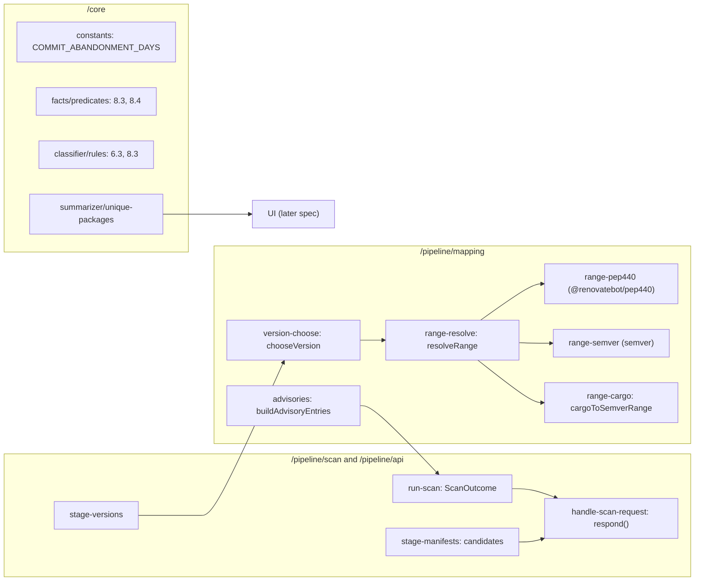

# Design Document: scan-accuracy

## Overview

This design implements `.kiro/specs/scan-accuracy/requirements.md`. It touches three layers that already exist: `/core` (classifier thresholds, one Reason text, three exported functions), `/pipeline` (version resolution, advisory entries, scan outcome and cache header, candidates in two errors) and the architecture checker in `scripts/architecture`. No new upstream request is added.

### Design principles

1. **One rule, one place.** The commit threshold lives in one predicate file of `/core`. The version choice lives in one function, `chooseVersion`. The merge of classifications lives in one function that the Summarizer and the UI both call.
2. **The libraries are fenced.** `semver` and `@renovatebot/pep440` are imported by two wrapper files only. A wrapper catches every library exception, so the Mappers stay total (pipeline R13.10).
3. **The body does not know about the cache.** A cache hit is reported out of band: a field of the `runScan` outcome and one response header. The Scan_Result and the stored cache entry are unchanged in shape, so pipeline Property 68 keeps its meaning.
4. **Fall back, never fail.** A range that cannot be used gives the default version and a note. It never gives an error and never blocks a scan.

### Key design decisions

| ID | Decision | Rationale |
|---|---|---|
| S1 | `COMMIT_ABANDONMENT_DAYS` is a new constant (730) and `STALE_DAYS` stays at 365 for release staleness only. | A project with commits in the last two years but no release for two years is dormant, not dead (user decision 1). Keeping 8.3 and 8.4 exclusive keeps core Properties 15 and 16 simple. |
| S2 | `maxSeverity` is dropped from the `6.3` list when `openVulnerabilityCount` is a Valid_Fact equal to 0. The rule computes a reportable list from `unknownFields`. | A severity does not exist without a vulnerability (user decision 2). `normalizeFacts` and `unknownFields` stay as they are, so every other rule is untouched. |
| S3 | The Resolved_Version is the highest non-prerelease version that satisfies all Declared_Ranges of the target. Several distinct ranges are intersected. | Order independence (pipeline P15) needs a symmetric rule. A union or "first range wins" is not symmetric. |
| S4 | A target with an Exact_Pin never resolves a range, even when the pin is not found. | Keeps pipeline R7.4, R7.5 and R7.12 unchanged and keeps the meaning of `pin-not-found`. |
| S5 | Candidates are filtered by a strict grammar (the regex of pipeline R7.2 for `npm` and `cargo`, PEP 440 `parse` for `pypi`). A version string with a leading `v` or `=` is not a candidate. | `semver.valid` accepts `v1.2.3` and strips build metadata, so equality with its own output would drop valid crates versions such as `1.0.0+build`. The regex plus `semver.parse` accepts build metadata and rejects non-canonical text. |
| S6 | `range-unresolved` details hold `ranges` (raw manifest text, cut to `RANGE_MAX_LENGTH` code points). The message names the package only. | The range is not request input, but it is untrusted manifest text, and style rule 7 of the messages section allows only validated values. The UI can show `ranges` as plain text if it wants to. |
| S7 | `advisories` lists every distinct OSV id, including withdrawn and informational advisories. | User decision 4: the list length equals the OSV id count. `openVulnerabilityCount` keeps its own rules, so it can be lower. A consumer that wants "counted" advisories must use the count. |
| S8 | `runScan` returns `{ result, fromCache }`. The header is written by `respond()` only for status 200. | User decision 5. Error responses are produced before or without a cache lookup, so they have no cache state to report. |
| S9 | `details.candidates` is the Discovery_Result path list (at most `DISCOVERY_MAX_MANIFESTS`). | User decision 6. The list is already computed before either error is raised. |
| S10 | `uniquePackages` is extracted from the Summarizer and exported with `mergeClassifications` and `compareClassifications`. | User decision 7. The UI must not re-implement rule 12.22. |

## Research and evidence

Checked on 2026-11-19 with `npm view` and the npm downloads API from this workspace (Node v26.4.0, npm registry).

### PEP 440 library for PyPI ranges

| Package | Result of `npm view` | Verdict |
|---|---|---|
| `@renovatebot/pep440` | latest `6.0.0` (modified 2026-10-28), `5.0.1` published 2026-09-04, licence `Apache-2.0` (the tarball also ships `LICENSE.BSD`), repository `github.com/renovatebot/pep440` (not archived, last commit 2026-11-19), no `dependencies`, bundled `index.d.ts`, 17 files, 4,349,278 downloads in the last week | Chosen |
| `pep440`, `pep440-js`, `python-pep440`, `pep440-ts`, `@trycua/pep440` | `npm error 404 Not Found` for each | Do not exist on the registry |
| web search "PEP 440 version specifier library npm JavaScript TypeScript maxSatisfying" | returned only Python material (PEP 440 text, `packaging`) and a checker tool (`KaoruNishikawa/PEP440-Checker`), no other JavaScript library | No competitor found |

Version choice. `6.0.0` has `engines.node >= 24.10.0`. `5.0.1` has `^22.11.0 || >=24.10.0` and the CI workflow runs Node 22 (`.github/workflows/ci.yml`, `node-version: 22`). The project pins `5.0.1`. The upgrade to `6.0.0` is a separate change that needs Node 24 in CI and in the Vercel project settings.

Behaviour was checked in a scratch directory with `@renovatebot/pep440@5.0.1` and `semver@7.8.6`:

- The export list is `RANGE_PATTERN, clean, compare, eq, explain, filter, ge, gt, gte, inc, le, lt, lte, major, maxSatisfying, minSatisfying, minor, ne, neq, parse, patch, rcompare, satisfies, valid, validRange`.
- `parse('1.5.0a1')` gives `{ epoch: 0, release: [1,5,0], pre: ['a',1], post: null, dev: null, local: null }`, `parse('2.1.0.dev1')` gives `dev: ['dev',1]`, `parse('2.2.post1')` gives `post: ['post',1]`, and `parse('junk')` gives `null`. The wrapper therefore treats `pre !== null || dev !== null` as a Prerelease.
- `validRange` accepts `>=1.4,<2`, `~=1.4.0`, `==1.*` and `!=1.4.5,>=1.0`, and rejects `badrange` and `*`.
- `satisfies('1.5.0a1', '>=1.0')` is false and `satisfies('1.0', '==1.0.0')` is true.

### semver for npm and Cargo

`semver` 7.8.6: licence ISC, no `dependencies`, `engines.node >= 10`, modified 2026-11-02, 1,215,071,117 downloads in the last week. It ships no types, so `@types/semver` 7.8.0 is a development dependency. The package refuses range strings longer than 256 characters (`validRange` returns null), which is the value of `RANGE_MAX_LENGTH`. Checked outputs of `validRange`: `>1.2` gives `>=1.3.0`, `<=1.2` gives `<1.3.0-0`, `~1` gives `>=1.0.0 <2.0.0-0`, `^0.0.3` gives `>=0.0.3 <0.0.4-0`, `=1.2` gives `>=1.2.0 <1.3.0-0`, `1.*` gives `>=1.0.0 <2.0.0-0`, `> 1.2` (a space after the operator) gives `>=1.3.0`. The `-0` suffixes only exclude prereleases of the upper bound and do not matter because Version_Candidates are never prereleases.

### Pinning

`package.json` gets `"semver": "7.8.6"`, `"@renovatebot/pep440": "5.0.1"` and `"@types/semver": "7.8.0"`, each without `^` or `~`. A unit test reads `package.json`, asserts all three are exact, and asserts the installed `semver` and `@renovatebot/pep440` have no `dependencies` and no `scripts.install` or `gypfile`.

## Architecture



Sequence changes in the scan (pipeline "Scan sequence"): the step `selectVersion per target` becomes `chooseVersion per target`. The OSV, deps.dev version and PyPI requests that follow use the Selected_Version, whichever basis chose it. The assembly step adds `buildAdvisoryEntries`.

## Components and Interfaces

### Core

`core/model/constants.ts`: `COMMIT_ABANDONMENT_DAYS: 730` is added to `CONSTANTS` and to the destructured named exports and to `ConstantsShape`. The consistency test of core criterion 10.21 gains the two rules of the requirements.

`core/facts/predicates.ts` (Requirements 1.2, 1.3):

```ts
// Requirement 8.3 (changed by scan-accuracy: COMMIT_ABANDONMENT_DAYS replaces STALE_DAYS)
export const isReleaseAbandoned = (f: NormalizedFacts): boolean =>
  f.daysSinceLastRelease !== null && f.daysSinceLastRelease >= ABANDONMENT_DAYS &&
  (f.daysSinceLastCommit === null || f.daysSinceLastCommit >= COMMIT_ABANDONMENT_DAYS);
// Requirement 8.4
export const isDormant = (f: NormalizedFacts): boolean =>
  f.daysSinceLastRelease !== null && f.daysSinceLastRelease >= ABANDONMENT_DAYS &&
  f.daysSinceLastCommit !== null && f.daysSinceLastCommit < COMMIT_ABANDONMENT_DAYS;
```

`isStaleRelease` keeps `STALE_DAYS`. The rule file `release-abandoned.ts` writes `daysSinceLastCommit is 800, at least COMMIT_ABANDONMENT_DAYS (730), so the package is abandoned` and, for a null commit age, `daysSinceLastCommit is unknown and assumed to show no recent activity`. The message stays at most 200 characters (core criterion 11.4).

`core/classifier/rules/unknown-facts.ts` (Requirements 2.1 to 2.7):

```ts
// Requirement 6.3 (changed by scan-accuracy)
const reportable = [...new Set(f.unknownFields)].filter(
  (name) => !(name === 'maxSeverity' && f.openVulnerabilityCount === 0),
);
if (reportable.length === 0) return null;
const text = reportable.length === 1
  ? `This health fact is unknown and adds no risk points: ${reportable[0]}`
  : `These health facts are unknown and add no risk points: ${listNames(reportable)}`;
return { ruleId: '6.3', message: sentence(text), facts: [] };
```

`sentence()` appends the period. `openVulnerabilityCount === 0` is read from the normalized facts, where it is non-null only for a Valid_Fact, so a negative, fractional or non-number count does not trigger the exception. The pipeline needs no other change for 11.2: when the reportable list is empty and no rule fires, the existing fallback adds the `11.2` Reason.

`core/summarizer/unique-packages.ts` (Requirement 9): `uniquePackages(items)` is `groupAssessed(items).map(...)` taken out of `summarizeUnguarded`, wrapped by `guard` (fallback `[]`). `core/index.ts` adds `export { uniquePackages } from './summarizer/unique-packages'` and `export { mergeClassifications, compareClassifications } from './summarizer/merge'`.

### Range wrappers (`pipeline/mapping`)

```ts
// range-semver.ts: the only file that imports 'semver'. Every function catches and returns null/false.
export function semverRange(range: string): string | null;           // semver.validRange, null on any error
export function semverVersion(v: string): string | null;            // strict grammar regex first, then semver.parse; null if not a candidate
export function semverIsPrerelease(v: string): boolean;
export function semverCompare(a: string, b: string): number;
export function semverSatisfies(v: string, range: string): boolean;

// range-pep440.ts: the only file that imports '@renovatebot/pep440'.
export function pepRange(range: string): string | null;              // validRange(range) ? range : null
export function pepVersion(v: string): { isPrerelease: boolean } | null;   // parse(v); isPrerelease = pre !== null || dev !== null
export function pepCompare(a: string, b: string): number;
export function pepSatisfies(v: string, range: string): boolean;
```

### `cargoToSemverRange` (`range-cargo.ts`, Requirement 4)

The file starts with this table as a block comment. `V` is a version of one to three decimal parts (`MAJOR`, `MAJOR.MINOR`, `MAJOR.MINOR.PATCH`, no leading zeros), and a prerelease or build suffix only after a full triple.

| Cargo part | semver comparator | Example (Cargo to semver, and what it selects) |
|---|---|---|
| `V` (no operator) | `^V` | `1.2.3` to `^1.2.3` (`>=1.2.3 <2.0.0`); `0.2` to `^0.2` (`>=0.2.0 <0.3.0`); `0.0.3` to `^0.0.3` (only `0.0.3`) |
| `^V` | `^V` | `^1.2` to `^1.2` (`>=1.2.0 <2.0.0`) |
| `~V` | `~V` | `~1.2.3` to `~1.2.3` (`>=1.2.3 <1.3.0`); `~1` to `~1` (`>=1.0.0 <2.0.0`) |
| `=V` | `=V` | `=1.2` to `=1.2` (`>=1.2.0 <1.3.0`) |
| `>V`, `>=V`, `<V`, `<=V` | same | `>1.2` (`>=1.3.0`); `<=1.2` (`<1.3.0`) |
| `*` | `*` | any version |
| `1.*`, `1.2.*` (no operator) | same | `1.*` (`>=1.0.0 <2.0.0`) |
| `A, B` (comma) | `A B` (space is AND) | `>=1.2, <1.5` to `>=1.2 <1.5` |

Steps: split at `,`; trim each part; reject an empty part; strip whitespace between the operator and the version with the pattern `^(\^|~|=|<=|>=|<|>)?\s*(.+)$`; match the version against the strict grammar; apply the table; join with one space. A part that has a wildcard together with an operator other than `=`, a leading `v`, `x` or `X` as wildcard, a hyphen range or `||` is rejected (returns null). The result is passed to `semverRange`, which gives the final null check. A part with a prerelease (`^1.0.0-beta.1`) is accepted, and since candidates are never prereleases, such a range selects stable versions only.

### `resolveRange` and `chooseVersion`

```ts
// range-resolve.ts (Requirements 3.2 to 3.7)
export type RangeOutcome = { readonly kind: 'resolved'; readonly version: string } | { readonly kind: 'unresolved' };
export function resolveRange(ecosystem: Ecosystem, ranges: readonly string[], versions: readonly string[]): RangeOutcome;
```

Algorithm: (1) `ranges` is non-empty, distinct and trimmed (the caller guarantees it); a range longer than `RANGE_MAX_LENGTH` gives `unresolved`. (2) `compiled = ranges.map(toRange)` with `toRange` per ecosystem (`semverRange`; `cargoToSemverRange` then `semverRange`; `pepRange`); any null gives `unresolved`. (3) Candidates are the distinct entries of `versions` that are valid and not Prerelease. (4) Scan candidates in list order and keep the first one that no later satisfying candidate beats under strict `compare(v, best) > 0`; so equal versions keep the first listed. (5) No candidate gives `unresolved`.

```ts
// version-choose.ts (Requirements 3.1, 3.6 to 3.9)
export function chooseVersion(
  ecosystem: unknown, specs: readonly unknown[], versions: readonly string[], defaultVersion: string | null,
): VersionSelection;
```

Steps: collect `pins = specs.map(s => exactPin(s, ecosystem))` without nulls. When `pins` is not empty, return `selectVersion(pins, versions, defaultVersion)` (R7.4, R7.5, R7.12 unchanged). Otherwise `ranges` is the sorted distinct set of the trimmed non-empty string specs. When `ranges` is empty return `selectVersion([], versions, defaultVersion)` (default, no range note). Otherwise call `resolveRange`; on `resolved` return `{ selected, basis: 'resolved', notes: [] }`; on `unresolved` return the default selection with the note `{ code: 'range-unresolved', ranges: cut }` first, where `cut` takes the first `RANGE_MAX_LENGTH` code points of each range and keeps ascending code point order. An `ecosystem` that is not `npm`, `cargo` or `pypi` gives `unresolved` for any range (total function). The caller `stage-versions.ts` passes `LookupTarget.versionSpecs`. `mapDepsDevPackage` continues to return `versions` and `defaultVersion`.

### Advisory entries (`pipeline/mapping/advisories.ts`, Requirement 6)

```ts
export function advisoryUrl(id: string): string;      // ADVISORY_URL_PREFIX + encode(id)
export function buildAdvisoryEntries(
  ids: readonly string[],                              // OsvQueryResult.ids of the target, possibly with duplicates
  records: ReadonlyMap<string, AdvisoryRecord>,        // fetched and mapped advisories by id
): readonly AdvisoryEntry[];
```

`encode(id)` converts the id to UTF-8 and percent-encodes every byte outside `A-Z a-z 0-9 . _ : -` with uppercase hex. This is `encodeURIComponent` without its allowances for `! ~ * ' ( )` and with `:` allowed. A lone surrogate in an id is encoded as U+FFFD bytes (`%EF%BF%BD`), because `encodeURIComponent` throws on it; the function never throws. For an id in the normal alphabet the `url` is `https://osv.dev/vulnerability/<id>`. `buildAdvisoryEntries` takes the distinct non-empty ids, sorts them with `compareCodePoints`, and for each id looks up its record. With a record: `aliases = distinct non-empty string aliases of the record, except the id, sorted`, `severity = record.severity`. Without a record (not fetched, 404, deadline, cap, or an unusable body): `aliases = []`, `severity = null`. `assembleFacts` returns the list in `AssembledFacts.advisories`, from the same `queryResult.ids` and `advisories` map it already uses for the counts (D17 of the pipeline design). A target with no usable query result, no Selected_Version or no ids gets `[]`. The orchestrator copies the list to every Dependency of the target, and to `[]` for unassessed ones, in `assemble-result.ts`.

`AdvisoryRecord` gains no field: it already carries `id`, `aliases` and `severity`.

### Scan outcome, header and route (Requirement 7)

`run-scan.ts` returns `ok({ result, fromCache })`. The Scan_Cache hit branch returns `fromCache: true`, every other path (fresh scan, margin path) returns `false`. The cache stores `result` only. `handle-scan-request.ts` maps the outcome to `ApiResponse` with `cache: 'hit' | 'miss'` for status 200 and `cache: null` for every error. `respond()` writes `[CACHE_STATUS_HEADER]: cache` when `cache !== null`. `route.ts` copies `ApiResponse.headers` into the `Response` unchanged, so it still contains no scan logic (R21.10). The `HEAD` handler returns the same headers with an empty body, so a `HEAD` request answered 405 carries no cache header, consistent with criterion 7.4.

### Manifest candidates in errors (Requirement 8)

`selectManifests` receives `candidates` already. Its error type changes to `{ kind: 'too-many-manifests'; limit: number; candidates: readonly string[] } | { kind: 'manifest-not-found'; path: string; candidates: readonly string[] }`, with `candidates = discovery.candidates.map(c => c.path)` in discovery order. `scan-error.ts` copies it into `details`. The `details` allow-list in `validate-request`-side checks and in the route test (P64) gains `candidates`.

### Architecture rules (`scripts/architecture/rules.ts`, Requirement 5)

`mapping-import-not-allowed` keeps forbidding packages in `pipeline/mapping`, except that a package import is not reported when the importing file is `pipeline/mapping/range-semver.ts` importing `semver`, or `pipeline/mapping/range-pep440.ts` importing `@renovatebot/pep440`. A new rule `range-package-not-allowed` (kind `import`, applies to every checked file) reports any import whose specifier is `semver`, `semver/*`, `@renovatebot/pep440` or `@renovatebot/pep440/*` from a file other than its one allowed wrapper. A new file rule `range-package-version-exact` reads `package.json` through the CLI (not through `checkArchitecture`, which stays pure over its file list) and reports a version that matches `^[~^<>=*]` or `x`. The rule list in `RuleId` and the property generator of the architecture test gain the two ids. Package names are constants of `scripts/architecture/rules.ts` (`RANGE_PACKAGE_WRAPPERS`), not of `pipeline/constants.ts`.

### Constants

`pipeline/constants.ts` adds `RANGE_MAX_LENGTH`, `ADVISORY_URL_PREFIX` and `CACHE_STATUS_HEADER`, and sets `CACHE_KEY_VERSION` to 2. The pipeline requirements table lists them, so the constants test (names in both directions) passes after the test file's embedded name list is updated.

### Messages

One new row in the requirements table and in `pipeline/scan/messages.ts`: `range-unresolved`, `The version range declared for {name} could not be matched to a published release, so the latest release was checked instead.` It has one sentence, ends with a period, has no U+2014, no spooky wording, no number and interpolates only `{name}`. `NOTE_CODES`, `ALLOWED_KEYS` of `notes.test.ts` (`range-unresolved`: `ecosystem`, `name`, `ranges`) and the table parser of the completeness test are updated. A helper `rangeUnresolvedNote(ecosystem, name, ranges)` in `notes.ts` builds the note with `details` keys in code point order.

## Data Models

```ts
export type VersionBasis = 'pinned' | 'resolved' | 'default';
export interface AdvisoryEntry { readonly id: string; readonly aliases: readonly string[]; readonly severity: Severity | null; readonly url: string }
export interface ScanDependency {
  readonly dependency: Dependency; readonly manifestPath: string;
  readonly lookupVersion: string | null; readonly versionBasis: VersionBasis | null;
  readonly facts: RawHealthFacts; readonly advisories: readonly AdvisoryEntry[];
}
export interface ScanOutcome { readonly result: ScanResult; readonly fromCache: boolean }
// ScanNote.code gains 'range-unresolved' with details { ecosystem, name, ranges: string[] }
// too-many-manifests details: { limit: number; candidates: string[] }; manifest-not-found details: { path: string; candidates: string[] }
```

Sizes. An Advisory_Entry is about 100 to 200 bytes of JSON. A Lookup_Target with 20 advisories costs about 3 KB, repeated for each Dependency of that target. A scan that exceeds `L2_MAX_SCAN_BYTES` (1,000,000 bytes) is kept in L1 only, as before (pipeline R19.28). `OSV_MAX_ADVISORY_DETAILS` (500) limits fetched details, not the number of listed ids, so a target with hundreds of ids lists them all.

## Correctness Properties

*A property is a characteristic or behavior that should hold true across all valid executions of a system-essentially, a formal statement about what the system should do. Properties serve as the bridge between human-readable specifications and machine-verifiable correctness guarantees.*

Reflection. The prework gave 25 PROPERTY items. Merged: 1.2, 1.3 and 1.8 into P1; 2.1 to 2.5, 2.8 and 2.9 into P2 (the reportable set and its exact text are one oracle); 3.2 and 3.13 into P3; 3.3, 3.4 and 3.14 into P4; 3.8, 3.9 and 3.15 into P5; 4.9 and 4.10 into P6; 3.6, 3.7, 3.16 and 4.11 into P7; 11.3 and 11.5 into P8; 6.1 to 6.8, 6.13 to 6.15 and 10.2 into P10 (with pipeline P58); 7.1 to 7.4, 7.7 and 7.8 into P11; 9.2, 9.5 and 9.6 into P12. Every property below tests code of this project, runs on pure functions or on the scripted fake runtime, and is cheap.

### Property 1: Abandoned and dormant follow the commit threshold

*For any* raw facts value, `abandoned` is true if and only if `archived` is true, or `deprecated` is true, or `daysSinceLastRelease` is a Valid_Fact at least `ABANDONMENT_DAYS` and `daysSinceLastCommit` is a Valid_Fact at least `COMMIT_ABANDONMENT_DAYS` or an Unknown_Fact; `dormant` is true if and only if `daysSinceLastRelease` is a Valid_Fact at least `ABANDONMENT_DAYS` and `daysSinceLastCommit` is a Valid_Fact less than `COMMIT_ABANDONMENT_DAYS`; and the Reasons never contain `8.3` and `8.4` together. The generator biases day counts to 364, 365, 366, 729, 730, 731 and null.

**Validates: Requirements 1.2, 1.3, 1.5, 1.8**

### Property 2: Unreportable severity and the exact text of the unknown-facts Reason

*For any* raw facts value, let `U` be the set of Unknown_Facts by the oracle and `V` be `U` without `maxSeverity` when `openVulnerabilityCount` is a Valid_Fact equal to 0. When `V` is non-empty the Reasons contain exactly one `6.3` Reason whose `message` equals `This health fact is unknown and adds no risk points: <name>.` for one name and `These health facts are unknown and add no risk points: <names>.` for two or more (names in field order, joined `a and b` or `a, b and c`); when `V` is empty there is no `6.3` Reason. The message is at most 200 characters.

**Validates: Requirements 2.1, 2.2, 2.3, 2.4, 2.5, 2.8, 2.9**

### Property 3: The resolved version is listed and satisfies every range

*For any* ecosystem, version list (stable versions, prereleases and invalid strings) and satisfiable non-empty set of Declared_Ranges, `resolveRange` returns `resolved` with a version that is an element of the list and satisfies every Declared_Range.

**Validates: Requirements 3.2, 3.13**

### Property 4: The resolved version is the highest non-prerelease match

*For any* ecosystem, version list and set of Declared_Ranges for which `resolveRange` returns `resolved`, the version is not a Prerelease, and no listed valid non-prerelease version that satisfies every Declared_Range compares higher. For simple numeric ranges (`>=a.b.c <d.e.f`) the expected maximum is also computed by an independent integer comparison that does not call the library.

**Validates: Requirements 3.3, 3.4, 3.14**

### Property 5: Version choice does not depend on spec order

*For any* ecosystem, list of `versionSpec` values (exact pins, ranges, empty strings, arbitrary strings) and any permutation of it, `chooseVersion` returns the same Selected_Version, Version_Basis and notes; and WHEN the list holds at least one Exact_Pin the Version_Basis is `pinned` or `default`, never `resolved`.

**Validates: Requirements 3.8, 3.9, 3.15**

### Property 6: Cargo mapping is caret by default and an intersection for commas

*For any* Cargo version `X` of one to three parts and any version list, `resolveRange('cargo', [X], list)` equals `resolveRange('cargo', ['^' + X], list)`. *For any* list of valid Cargo comparators and any permutation of it, the result of the comma-joined requirement satisfies each comparator alone and does not depend on the order.

**Validates: Requirements 4.9, 4.10**

### Property 7: Resolution is total and falls back with one note

*For any* string (including empty, whitespace-only, longer than `RANGE_MAX_LENGTH`, and arbitrary Unicode) used as `versionSpec` in any ecosystem, `cargoToSemverRange` and `chooseVersion` do not throw. When the outcome is unresolved, the selection has Version_Basis `default` (or null with `no-default-version`), exactly one `range-unresolved` note, and `ranges` in ascending code point order with each element at most `RANGE_MAX_LENGTH` code points.

**Validates: Requirements 3.6, 3.7, 3.16, 4.11**

### Property 8: The unresolved-range message contains no range text

*For any* generated Declared_Range (including U+2014, request-like text and `{name}`-like text) and package name, the rendered `range-unresolved` message equals the table text with only `{name}` replaced, contains none of the Declared_Range text, and contains no U+2014 character.

**Validates: Requirements 11.3, 11.5**

### Property 9: Candidates equal the discovered manifest paths

*For any* tree, and any `manifests` list that triggers `too-many-manifests` or `manifest-not-found`, the error has `details.candidates` equal to the `path` list of the Discovery_Result of the same tree, with at most `DISCOVERY_MAX_MANIFESTS` entries, and no other `details` field besides `limit` or `path`.

**Validates: Requirements 8.1, 8.2, 8.3, 8.6**

### Property 10: Advisory entries mirror the OSV ids

*For any* OSV query result (ids with duplicates, empty strings and non-strings), advisory records and fetch outcomes, `advisories` has one entry for each distinct non-empty string id, sorted ascending and pairwise distinct; each `url` equals `ADVISORY_URL_PREFIX` plus the percent-encoded id (`decodeURIComponent` of the suffix returns the id and the suffix has no `/`, `?` or `#`, also for ids with `%`, spaces and non-ASCII characters); an id without a mapped record has `severity` null and `aliases` `[]`; `aliases` never contain the id itself; and the list is `[]` when the target has no Selected_Version, no usable query result or is not looked up. Every Dependency of one Lookup_Target has an equal list.

**Validates: Requirements 6.1, 6.2, 6.3, 6.4, 6.5, 6.6, 6.7, 6.8, 6.9, 6.10, 6.13, 6.14, 6.15**

### Property 11: The cache header is present on 200 only and never changes the body

*For any* generated request and scripted outcome, `handleScanRequest` returns the header named by `CACHE_STATUS_HEADER` if and only if the status is 200, with the value `hit` if and only if the Scan_Outcome has `fromCache` true. *For any* request spelling variant of one repository, the body of a Scan_Cache hit equals, as JSON text, the body of a fresh scan with empty caches at the cached `asOf`, and neither contains the text `fromCache`.

**Validates: Requirements 7.1, 7.2, 7.3, 7.4, 7.7, 7.8**

### Property 12: Exported merge functions agree with the Summarizer

*For any* list of Assessed_Dependencies, `uniquePackages(items).length` equals `summarize(items).total`, and the Merged_Classification of each Unique_Package equals the one `summarize` ranks for it. *For any* non-empty list of Classifications, `mergeClassifications(list)` is a member of the list and `compareClassifications(merged, other)` is at most 0 for every `other` in the list.

**Validates: Requirements 9.2, 9.5, 9.6**

## Error Handling

| Situation | Behaviour |
|---|---|
| A `versionSpec` that is not a string or is empty after trimming | Ignored for range resolution (no note). |
| A Declared_Range longer than `RANGE_MAX_LENGTH`, unparseable, or matching no Version_Candidate | Default version, `versionBasis` `default`, one `range-unresolved` note. If there is no default version either, `no-default-version` is added (pipeline R7.8). |
| A library throws | The wrapper returns null or false. The outcome is `unresolved`. |
| An advisory id that cannot be percent-encoded as UTF-16 (lone surrogate) | Encoded as `%EF%BF%BD`. |
| OSV detail missing, 404, failed or cut | The entry stays in `advisories` with `severity` null and `aliases` `[]`; counts follow pipeline R9.9. |
| The cache lookup fails or L2 is down | Treated as a miss (`fromCache` false, header `miss`), pipeline R19.25. |
| Any error response | No cache header. |
| `details.candidates` when discovery failed | The errors `too-many-manifests` and `manifest-not-found` are raised only after discovery succeeded, so the list is always defined. |
| A stale Scan_Cache or L2 entry of version 1 | Never read, because `CACHE_KEY_VERSION` is 2. |

## Testing Strategy

### Dual approach

Property-based testing applies: the classifier, the resolver, the Cargo mapper, the advisory builder, the handler and the merge functions are pure or deterministic under the fake runtime, and their input spaces are large. It does not apply to the `package.json` pin check, the table rows and the live reports, which use unit, smoke or manual tests. Every property uses `fast-check` through `cfg()` from `tests/support/fc-config.ts` (at least 100 runs), carries `// Feature: scan-accuracy, Property <n>: <title>` and `// Validates: Requirements <x.y>`, and its test title starts with `P<n>`.

### Files

```
tests/
  core/classifier/commit-threshold.property.test.ts       P1
  core/classifier/unknown-facts.test.ts, .property.test.ts P2
  core/summarizer/unique-packages.test.ts, .property.test.ts P12
  pipeline/mapping/range-resolve.test.ts, .property.test.ts P3, P4, P5, P7
  pipeline/mapping/range-cargo.test.ts, .property.test.ts   P6, P7 (one example per table row)
  pipeline/mapping/advisories.test.ts, .property.test.ts    P10
  pipeline/scan/notes.test.ts, messages.property.test.ts    P8 (range-unresolved row, completeness)
  pipeline/scan/stage-manifests.test.ts, run-scan.property.test.ts   P9
  pipeline/api/handle-scan-request.property.test.ts         P11 (header, body equality)
  pipeline/scan/cache-replay.property.test.ts               P11 (spelling variants against fresh scans)
  architecture/architecture.test.ts, .property.test.ts      range-package rules
  packages.test.ts                                          exact pins, no runtime dependencies (R5.1, R5.2, R5.6)
```

### Existing tests to update

Core: the classifier example tests and the oracle (`facts-oracle.ts`: `dormant`, `abandoned` and the reportable set), core Properties 14, 15, 16, 24, the day-boundary arbitraries, `constants.test.ts`. Pipeline: `version-select.test.ts` and `version-select.property.test.ts` (P14, P15), `assemble.test.ts` and `assemble.property.test.ts`, `mapper-registry.test.ts` and `tests/support/mapper-registry.ts` (every new export of `pipeline/mapping/index.ts` registered with a validator), `assemble-result.test.ts` and `run-scan.property.test.ts` (P57, P58), `handle-scan-request.property.test.ts` (P64), `run-scan-cache.test.ts` and `cache-replay.property.test.ts` (P68), `notes.test.ts` (completeness test that parses the User-facing messages table), `constants.test.ts` (names list, `CACHE_KEY_VERSION` rule), the fixture tests, `docs/property-traceability.md`.

### Fixtures

Version-specific requests depend on the Selected_Version. For ranged dependencies the Resolved_Version replaces the default version, so the recorded requests for the deps.dev version document, the OSV query and the PyPI per-version document change. Task 7.1 re-records the three Fixture_Sets with `npm run fixtures:record` (it needs `GRAVEKEEPER_LIVE_TESTS=1`, network access and a `GITHUB_TOKEN`; the orchestrator supplies the token from the user-approved `gh` CLI). The recorder stores bodies byte-exact, so no mapper test data changes. After recording, `fixtures-coverage.test.ts`, `fixtures-scan.test.ts`, `fixtures-hygiene.test.ts` and `fixtures-size.test.ts` must pass unchanged.

### Live report

The last task scans `expressjs/express`, `psf/requests` and `BurntSushi/ripgrep` cold (empty caches, the real network) and reports the request-by-request table and the three results.

### CI

`npm run typecheck`, `npm run lint`, `npm run check:core`, `npm run check:architecture` and `npx vitest --run`, as in the other specs.
