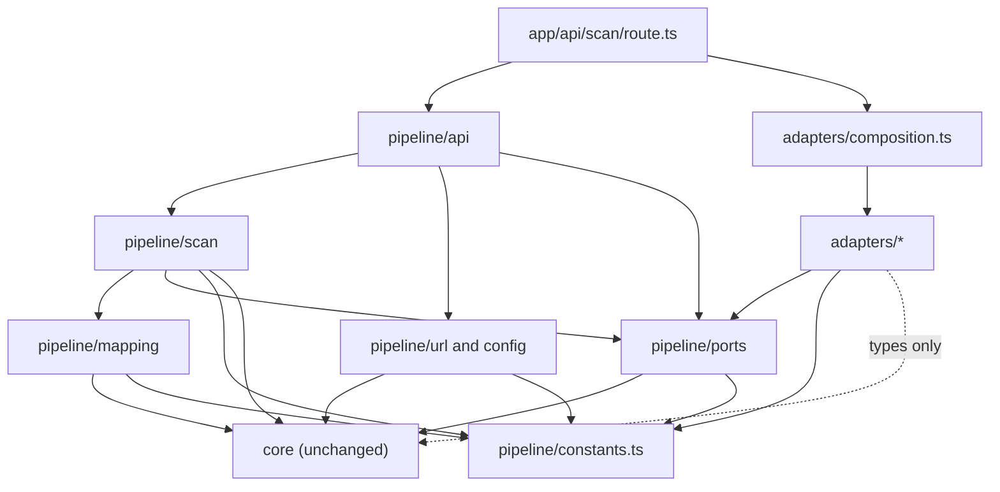
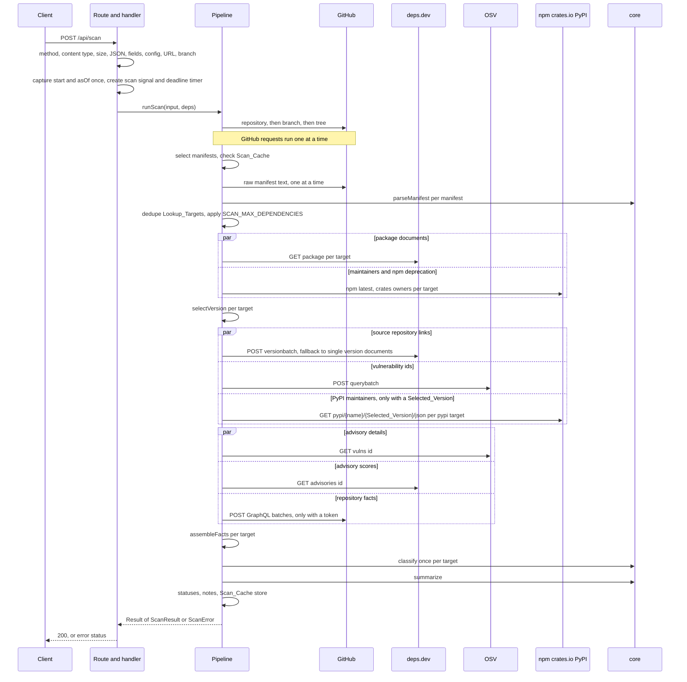

# Design Document: scan-pipeline

## Overview

The scan pipeline turns one public GitHub repository URL into one typed `Scan_Result`. It resolves the repository and the commit, discovers and parses manifests, gathers health facts for every registry dependency, classifies each dependency with the unchanged `/core`, summarizes the repository, and returns the result through `POST /api/scan`. This design implements `.kiro/specs/scan-pipeline/requirements.md` (Requirements 1 to 23, Endpoint_Fact_Map EF-1 to EF-25, Open Questions 1 to 33). Section references such as "R9.6" mean Requirement 9, criterion 6.

### Design principles

1. **Ports and adapters, with pure mapping in the middle.** All HTTP lives in `/adapters` behind `<Name>Source` ports declared in `/pipeline/ports`. Everything that interprets upstream JSON is a pure function in `/pipeline/mapping` that takes `unknown` and `asOf` and returns plain data.
2. **Total functions at every trust boundary.** Upstream bodies, manifests and request bodies are hostile. Mappers read own properties only, return `null` for anything missing or mistyped, and never throw. Adapters never throw: every failure is a value (`WorkUnitOutcome`).
3. **One clock, one deadline, one signal.** Time, timers and randomness are injected. Each scan owns one `AbortController` that the injected timer fires at `SCAN_DEADLINE_MS`. Every request, retry, backoff and slot wait is bound to it.
4. **Partial results beat errors.** After the three discovery requests succeed, no upstream failure produces a `Scan_Error`. Unfinished facts become `null` and the source status becomes `partial` or `failed`.
5. **Secrets cannot reach a sink by construction.** The token is read in one file, is held only by the GitHub authorizer inside the HTTP client, and is scrubbed from every body before the body is cached, mapped or logged.
6. **Caches sit behind one `CacheStore` port.** The in-memory LRU (L1) satisfies R19 exactly and serves every entry kind. The Vercel Runtime Cache (L2) is on by default and holds only three compact entry kinds (complete Scan_Results, advisory entries by advisory id, crates.io owners per crate). Every L2 failure is a miss and never changes a result.

### Key design decisions

| ID | Decision | Rationale |
|---|---|---|
| D1 | Request validation, response formatting and the margin race live in `/pipeline/api` as `handleScanRequest`. `app/api/scan/route.ts` only adapts `Request` to `Response` and wires production dependencies. | R21.10 keeps the route thin. The pure handler is testable without Next (P64, P65). |
| D2 | The HTTP client owns retries, timeouts, `Retry-After`, concurrency slots, size cap, redirects, token placement and secret scrubbing. Source adapters only build requests and parse JSON. | One place implements R15, R16.8, R20.2, R20.3. |
| D3 | Caching is a decorator around the HTTP client (`CachingHttpClient`), not logic in each adapter. | R19.14: a hit must skip the limiter, leave the budget unchanged and count as `ok`. |
| D4 | `CacheStore` is an async port with a JSON value type. L1 is an in-memory LRU. L2 is the Vercel Runtime Cache, enabled by default (`GRAVEKEEPER_RUNTIME_CACHE` `on`), for three entry kinds only (R19.19, R19.20). | Vercel function instances do not share memory (see Cache Design). |
| D5 | An unparsable 2xx body of a JSON endpoint is a `failed` Work_Unit with reason `http-error`. A 404 that means "absent" is `ok`. | The requirements leave the status of an unparsable 2xx body open except for R4.11. This is the uniform reading of R3.10, R4.11, R8.8 and R11.12. |
| D6 | `compareCodePoints` and `guard` are re-implemented in `/pipeline` (parity-tested against `/core/internal`). | R22.3 forbids changing `/core`, and `/core/index.ts` does not export these helpers. Deep imports of `core/internal/*` would couple the pipeline to private files. |
| D7 | Same-origin redirects are followed (GET only, at most `REDIRECT_MAX_HOPS` = 3 per Attempt, in the same slot, under the same `REQUEST_TIMEOUT_MS`). A cross-origin redirect or a chain longer than `REDIRECT_MAX_HOPS` fails the Work_Unit as `http-error` without a retry. `Authorization` never reaches a different origin. | Decided in OQ32 (R15.9, R15.19 to R15.21, R20.3). One function (`resolveRedirect`) isolates it. |
| D8 | The architecture test is a new `scripts/architecture` checker with its own CLI and CI step, not an extension of `check-core-purity`. | The existing checker forbids `adapters`, `app`, `components` only and has no `pipeline` rule. R22.3 does not forbid editing `scripts/`, but a separate checker keeps core purity rules unchanged. |
| D9 | `maxDuration` is the literal `30` in `route.ts`, equal to `ROUTE_MAX_DURATION_SECONDS`. | R21.16, confirmed in session 10. It must exceed `SCAN_DEADLINE_MS + SCAN_RESPONSE_MARGIN_MS` = 26.5 s. A test reads the literal from source text and compares it with the constant. |
| D10 | Tests of orchestrator behaviour use the real HTTP client with a scripted `fetch` and a fake clock and timer. Tests of orchestration logic above the client use scripted Source_Ports. | Retry, timeout and deadline properties (P42 to P49) need the real attempt loop. |
| D11 | The Scan_Cache key is `(CACHE_KEY_VERSION, Web_Host, canonical owner, canonical repo, branch, defaultBranch, Commit_SHA, sorted manifest paths)`. Canonical spelling comes from the REST `full_name` and is never lowercased. A hit returns the stored Scan_Result unchanged. There is no "patch repo on hit" step. The repository and branch requests run on every scan, hit or miss. | R19.5, R19.6, R3.13, R18.1, OQ33. The stored `repo` object equals the `repo` object of a fresh scan, so a hit equals a fresh scan (P62, P68). |
| D12 | Cache entry compaction lives in `pipeline/ports/l2-entries.ts`, a pure file that adapters may import (R22.9 allows `/pipeline/ports` and `constants.ts`). It exports `compactOsvAdvisory`, `compactDepsDevAdvisory` and `compactCratesOwners`, each taking a body text and returning a smaller JSON text of the same shape. The Mappers read compact text and full text with the same result (P71). | `adapters` may not import `pipeline/mapping`, and the `CachingHttpClient` has to compact before it writes (R19.27). |
| D13 | Fixture bodies are recorded byte-exact and are never trimmed. The three fixture repositories are chosen by measured size so that each Fixture_Set is at most `FIXTURE_SET_MAX_BYTES` (Fixture Recording and Replay, "The three fixture repositories"). The recorder refuses to write an oversized set. | R23.16. A trimmed body would no longer be what the upstream sent, and the measured sets fit without it. The earlier measurements used PyPI project documents (0.2 to 9 MB each); EF-22 now reads the per-version document, so this limit applies mainly to the recursive tree (OQ-D11, closed). |

### Research summary and sources

**Next.js 16.4.6** (breaking changes, per `AGENTS.md`). Files read from `node_modules/next/dist/docs/`:

- `01-app/01-getting-started/15-route-handlers.md`: Route Handlers use Web `Request` and `Response`. `POST` handlers are never cached. Supported methods are `GET`, `POST`, `PUT`, `PATCH`, `DELETE`, `HEAD`, `OPTIONS`. A route file cannot sit beside a `page` file at the same segment.
- `01-app/03-api-reference/03-file-conventions/route.md`: when `OPTIONS` is not defined Next implements it automatically. The design therefore exports all seven methods explicitly, so R21.13 can return its own JSON 405 with `Allow: POST` for each.
- `01-app/03-api-reference/03-file-conventions/02-route-segment-config/runtime.md`: `nodejs` is the default, `edge` is deprecated, and with Cache Components enabled the `runtime` export must be removed. `next.config.ts` sets `cacheComponents: true`, so `route.ts` has no `runtime` export (R21.11 is met by the default Node.js runtime, which provides `AbortSignal.any`, `fetch` streaming and `node:crypto`).
- `01-app/03-api-reference/03-file-conventions/02-route-segment-config/maxDuration.md`: `export const maxDuration = <seconds>` sets the execution limit and platforms may use it from the build output.
- `01-app/03-api-reference/04-functions/after.md`: `after(callback)` runs after the response, for up to the route's `maxDuration`, and on Vercel is backed by `waitUntil`. The design uses it for deferred L2 cache writes.
- `01-app/02-guides/migrating-to-cache-components.md`: with Cache Components, `dynamic`, `revalidate` and `fetchCache` segment exports error. `route.ts` exports none of them.

(The task text named `01-app/03-api-reference/02-route-segment-config/*.md`. In this installed version the files are under `03-file-conventions/02-route-segment-config/`.)

**Vercel facts researched on the design date.**

- [Runtime Cache](https://vercel.com/docs/caching/runtime-cache): regional, ephemeral cache usable from Vercel Functions with `getCache()` from `@vercel/functions`, `cache.get(key)` and `cache.set(key, value, { ttl, tags })`. It is isolated per environment (preview and production). On Hobby all projects of a team share one cache. Entries survive deployments when the app chooses the keys. Entries may be evicted before the TTL when storage is full. It is not for data that must be fresh on every request. Reads and writes are billed in units of 8 KB, rounded up for each operation, so a 1 KB entry costs one unit. The item size limit is 2 MB. On Hobby, usage beyond the monthly allotment pauses the cache for the rest of the period instead of billing.
- [Data Cache is moving to Runtime Cache](https://vercel.com/changelog/data-cache-is-moving-to-runtime-cache): Hobby teams get 1 million read units and 200,000 write units per month across all projects.
- `use cache: remote` entries are keyed by build in Next.js 16 and are not readable after a new deployment today (same Runtime Cache page). The design therefore uses `getCache()` with app-chosen keys and does not use `use cache`.
- [Vercel Functions limits](https://vercel.com/docs/functions/limitations): with Fluid compute the default and maximum duration on Hobby is 300 s. A `maxDuration` of 30 is below every plan limit. Without Fluid compute the Hobby limit is lower (not re-verified here, see Open Questions and Risks, RK6).

**Live checks of upstream shapes** (2026-11-17, PowerShell `Invoke-RestMethod` and `gh api graphql -F query=@file`; token never printed or stored):

- `POST https://api.deps.dev/v3alpha/versionbatch` accepts `system` in uppercase (`NPM`, `CARGO`), returns `responses[].request.versionKey` and `responses[].version.relatedProjects`, and an empty `nextPageToken` (EF-3).
- `GET https://api.deps.dev/v3/advisories/GHSA-w2j9-qh3j-4h63` returns 404 while OSV `GET /v1/vulns/GHSA-w2j9-qh3j-4h63` returns a `withdrawn` timestamp. This is the supplementary EF-8 fixture and also exercises the EF-25 404 path.
- GraphQL with a nonexistent `repository(owner, name)` alias returns HTTP 200 with `data.r2: null` and `errors[0].type` `NOT_FOUND`, `errors[0].path` `["r2"]` (EF-19). The `gh` CLI exits non-zero on such a body, so the recorder uses plain HTTP, not `gh`.

---

## Architecture

### Module layout

```
adapters/                           network + runtime wiring (may import pipeline/ports, pipeline/constants.ts, core types only)
  http/
    http-client.ts                  createHttpClient(): attempt loop, timeouts, retry, Retry-After, size cap, redirects, auth, scrubbing
    retry-policy.ts                 pure: backoffDelayMs, decideAfterAttempt, parseRetryAfter
    concurrency-limiter.ts          createConcurrencyLimiter(limit, minIntervalMs)
    body-reader.ts                  readBodyLimited(response, maxBytes, signal)
    caching-http-client.ts          CachingHttpClient decorator (L1 for every kind, L2 for the three L2 kinds, via CacheStore)
    redact.ts                       scrubSecrets(text, secrets)
  github/github-source.ts           GithubSource over HttpClient
  depsdev/depsdev-source.ts         DepsDevSource
  osv/osv-source.ts                 OsvSource
  npm/npm-source.ts                 NpmSource
  cratesio/cratesio-source.ts       CratesIoSource
  pypi/pypi-source.ts               PypiSource
  cache/
    memory-cache-store.ts           L1 LRU, injected Clock
    runtime-cache-store.ts          L2: Vercel Runtime Cache via @vercel/functions getCache(), bounded by L2_OPERATION_TIMEOUT_MS
    tiered-cache-store.ts           L1 in front of L2 (enabled by default, GRAVEKEEPER_RUNTIME_CACHE off disables it)
  runtime/
    token-reader.ts                 the ONLY file that contains `process.env.GITHUB_TOKEN`
    env.ts                          reads the other environment variables
    system-clock.ts, system-timer.ts, system-random.ts, console-logger.ts
  composition.ts                    createProductionDeps(): builds sources, caches, limiter policies
pipeline/
  constants.ts                      every constant of the requirements Constants table, and no other UPPER_SNAKE constant
  index.ts                          public entry: runScan, handleScanRequest, types
  ports/                            Source_Ports, HttpClient, Clock, Timer, RandomSource, Logger, ConcurrencyLimiter, CacheStore,
                                    request-key.ts (pure), l2-entries.ts (pure compact encoders of the three L2 entry kinds, D12)
  mapping/                          pure Mappers (imports only core, mapping siblings, constants.ts)
  url/                              parse-repo-url.ts, format-repo-url.ts
  config/                           github-config.ts (R2), config-messages.ts (the three fixed configuration messages, imported by github-config.ts and scan/messages.ts)
  scan/                             orchestrator: run-scan.ts, stages, ledger.ts, github-budget.ts, notes.ts, messages.ts (R20.14), source-status.ts,
                                    cache-keys.ts, scan-cache.ts (store rule of R19.5, R19.7, R19.22 and lookup of R19.6)
  api/                              validate-request.ts, handle-scan-request.ts, scan-error.ts, read-body.ts
  internal/                         result.ts (ok, err), safe.ts (guard)
app/api/scan/route.ts               the only file that imports adapters (R22.10)
scripts/architecture/               import extraction, resolver, rules, checker (new)
scripts/check-architecture.ts       CLI
scripts/record-fixtures.ts          Fixture_Recorder (flag-gated)
tests/pipeline, tests/adapters, tests/app, tests/live, tests/support, tests/fixtures
```

File names follow R22.8: lowercase ASCII letters and digits joined by single hyphens. There are no default exports (steering). `route.ts` uses named exports only: `POST`, `GET`, `HEAD`, `PUT`, `PATCH`, `DELETE`, `OPTIONS` and `maxDuration`.

### Dependency direction



Forbidden edges, enforced by the architecture test: `core` to anything; `mapping` to `adapters`, `ports`, `scan`, `api`, `app`, `components`, `node:*`; `adapters` to `mapping`, `scan`, `api`, `url`, `app`, `components`; `scan`, `api`, `url`, `ports`, `app` (except `route.ts`) and `components` to `adapters`; `ports` to anything except `core`, other ports files and `constants.ts`.

### Scan sequence

The diagram follows data dependencies. The two registry lookups with no prerequisite (npm, crates.io) start together with the deps.dev package requests. The PyPI request needs the Selected_Version (R12.5, EF-22), so it runs after the deps.dev package lookup and the version choice, together with the source-repository and vulnerability-id requests.



### Stage table

| Stage | Needs | Work_Units | Source limits | On deadline |
|---|---|---|---|---|
| S0 setup | none | none | none | none |
| S1 discovery | S0 | repository, branch, tree (EF-12, EF-13, EF-14) | github 1 | `deadline-exceeded` (R16.11) |
| S2 selection and Scan_Cache lookup | S1 | none (tree body from S1) | none | `deadline-exceeded` until selection is known |
| S3 manifest fetch and parse | S2 | raw text per manifest (EF-15), one at a time | github 1, no budget gate | rest become `manifest-fetch-failed` with reason `deadline` |
| S4 targets and cap | S3 | none | none | none |
| S5 package documents and registries | S4 | deps.dev package (EF-1), npm latest (EF-20), crates owners (EF-21) | depsdev 8, npm 8, cratesio 1 plus `CRATESIO_MIN_INTERVAL_MS` spacing. Owners are requested in the order of R12.14 (scope `runtime`, `build`, `dev`, `optional`, `peer`, then name), and an unexpired owners entry in L1 or L2 is answered without a request (R12.13) | `deadline` units, facts null. An owners lookup cut by the deadline makes `cratesio` `partial` (R17.4) and the Scan_Result cacheable for `PARTIAL_SCAN_TTL_SECONDS` when it is the only non-`ok` source (R19.22) |
| S6 version choice, source repos, vulnerability ids, PyPI maintainers | S5 | deps.dev versionbatch or version documents (EF-3, EF-2), OSV querybatch (EF-5), PyPI per-version document (EF-22, only for a pypi target with a Selected_Version; none otherwise, no Work_Unit, R12.16) | depsdev 8, osv 4, pypi 8 | same |
| S7 advisories | S6 (ids from querybatch) | OSV detail (EF-6), deps.dev advisory (EF-25), same id set (OQ28) | osv 4, depsdev 8 | same |
| S8 repository facts | S6 (source repos), token | GraphQL batches (EF-17) | github 1, budget gate | same, or `token-missing`, `budget` |
| S9 assemble | S5 to S8 settled | none | none | in-memory only (R16.12) |

S7 and S8 run concurrently. The `github` limiter is shared by S1, S3 and S8 (`CONCURRENCY_GITHUB` = 1), and S1 and S3 finish before S8 starts.

### How the Architecture_Test (R22) is implemented

A new checker, `scripts/architecture/`, parses source text with the TypeScript compiler API (`ts.createSourceFile`, never executing code), as `scripts/core-purity/check.ts` does. The existing core-purity checker stays unchanged. It forbids `adapters`, `app` and `components` in `/core`, and it has no `pipeline` rule, so `scripts/architecture` carries the full R22.4 and R22.7 rule.

- `imports.ts`: `extractImports(filePath, text): ImportRef[]` where `ImportRef = { specifier: string | null; line: number; kind: ImportKind }`. `ImportKind` is `import`, `import-type`, `export-from`, `import-equals-require`, `import-type-expression`, `dynamic-import`, `require-call` (R22.13). `specifier` is `null` when the argument is not a string literal, and the rule engine reports `non-literal-specifier` (R22.14). Syntax errors never throw: the TypeScript parser always returns a tree.
- `resolve.ts`: `resolveSpecifier(fromFile, specifier): { kind: 'project'; path: string } | { kind: 'package'; name: string }`. Relative specifiers and `@/` specifiers become project-root-relative POSIX paths. Directory membership is compared on whole segments (`pipeline/mapping` does not match `pipeline/mapping-extra`).
- `globals.ts`: `findForbiddenApi(text, names)` walks the AST for identifier references, `Date.now`, `Date["now"]`, `Math.random`, `performance.now`, `process.env`, zero-argument `new Date()` and `Date()` calls, and ignores property names, like `isPropertyNamePosition` in the core checker.
- `rules.ts`: a table of `LayerRule` objects, each with an id, a file predicate, an import predicate or API list, and the requirement it implements.
- `check.ts`: `checkArchitecture(files: readonly { path: string; text: string }[]): Violation[]` where `Violation = { file; line; rule }`. It is pure, so P66 runs it on generated inputs. `buildImportGraph` supports the transitive `'use client'` check.
- `scripts/check-architecture.ts`: the CLI. It walks `core`, `pipeline`, `adapters`, `app`, `components` for `.ts` and `.tsx`, prints `file:line rule message`, exits 1 on any violation.

| Rule id | Implements | Files | Check |
|---|---|---|---|
| `mapping-import-not-allowed` | R22.2, R13.1 | `pipeline/mapping/**` | imports resolve only to `core/**`, `pipeline/mapping/**`, `pipeline/constants.ts`, and no package |
| `mapping-forbidden-api` | R22.6, R13.2 | `pipeline/mapping/**` | no `fetch`, `fs`, `Date.now`, `Math.random`, `process.env`, `performance.now`, zero-argument `Date` use |
| `core-imports-upper-layer` | R22.4, R22.7 | `core/**` | no import of `pipeline`, `adapters`, `app`, `components` |
| `adapters-import-not-allowed` | R22.9 | `adapters/**` | no import of `pipeline/mapping`, `pipeline/scan`, `pipeline/api`, `pipeline/url`, `pipeline/config`, `pipeline/internal`, `app`, `components` |
| `layer-imports-adapters` | R22.10 | `core`, `pipeline`, `app`, `components` except `app/api/scan/route.ts` | no import of `adapters` |
| `ports-missing-interface` | R22.11 | `pipeline/ports/**` | exports interfaces named `GithubSource`, `DepsDevSource`, `OsvSource`, `NpmSource`, `CratesIoSource`, `PypiSource` |
| `ports-import-not-allowed` | R22.11 | `pipeline/ports/**` | imports only `core`, other `ports` files, `constants.ts` |
| `pipeline-forbidden-api` | R22.12 | `pipeline/**` | no `fetch`, `XMLHttpRequest`, `Date.now`, `Math.random`, `performance.now`, `setTimeout`, `setInterval`, zero-argument `Date`, no import of `http`, `https`, `http2`, `net`, `tls`, `dns`, `dgram` (with or without `node:`) |
| `file-name-style` | R22.8 | `pipeline/**`, `adapters/**` | name matches `^[a-z0-9]+(-[a-z0-9]+)*\.tsx?$` |
| `no-default-export` | R22.8 | `pipeline/**`, `adapters/**` | no `export default`, no `export =` |
| `token-reference-count` | R22.17 | all | at most one file contains `process.env.GITHUB_TOKEN` |
| `token-client-reachability` | R22.17, R20.1 | files starting with `'use client'` | the token file is not reachable through the import graph |
| `token-next-public` | R22.17, R20.10 | files containing `GITHUB_TOKEN` | no `NEXT_PUBLIC_` text |
| `adapters-forbidden-time-api` | R15.10 (design addition) | `adapters/**` except `adapters/runtime/system-*.ts` | no `Date.now`, `performance.now`, `Math.random`, `setTimeout`, `setInterval`, zero-argument `Date` |

Wiring (R22.16, "check:core style"):

- `package.json`: `"check:architecture": "tsx scripts/check-architecture.ts"`, `"check": "npm run check:core && npm run check:architecture"`, and `"prebuild": "npm run check"`.
- `.github/workflows/ci.yml`: a step `- run: npm run check:architecture` after `npm run check:core`, before `npx vitest --run`.
- `tests/architecture/architecture.test.ts` runs `checkArchitecture` on the real tree (expects zero violations) and on inline violating snippets (expects the exact rule and line), like `tests/core/purity.test.ts`.
- `.kiro/hooks/architecture-on-save.json`: `PostFileSave` on `(pipeline|adapters|app|core)/**/*.ts(x)`, command `node scripts/hooks/check-architecture-on-save.mjs`, modelled on `check-core-on-save.mjs`. The matcher of `run-related-tests-on-save.json` is extended to `tests/pipeline`, `tests/adapters`, `tests/app`, `tests/architecture`.


---

## Components and Interfaces

### Runtime ports (`pipeline/ports/runtime.ts`)

```ts
/** Injected_Clock: epoch milliseconds. The only time source of pipeline, adapters and caches (R15.10, R19.10). */
export type Clock = () => number;

/** Random value in [0, 1). The only randomness source (R15.6, R15.10). */
export type RandomSource = () => number;

export interface TimerHandle { readonly id: unknown }

export interface Timer {
  setTimeout(callback: () => void, ms: number): TimerHandle;
  clearTimeout(handle: TimerHandle): void;
  /** Resolves 'elapsed' after ms, or 'aborted' at once when the signal aborts first. Never rejects. */
  sleep(ms: number, signal: AbortSignal): Promise<'elapsed' | 'aborted'>;
}

/** R20.6: the only fields a log line can carry. `cache` names an operation of a Cache_Tier (code `l2-cache-error`, R19.25). */
export interface LogEntry {
  readonly source: SourceName | 'cache';
  readonly status: number | null;
  readonly durationMs: number;
  readonly code: string;
}
export interface Logger { log(entry: LogEntry): void }

/** R15.3: at most `limit` attempts in flight. A slot wait is abortable. */
export interface ConcurrencyLimiter {
  run<T>(task: () => Promise<T>, signal: AbortSignal): Promise<{ readonly acquired: true; readonly value: T } | { readonly acquired: false }>;
}

/** Runs deferred work (L2 writes) after the response, so no scan waits for an L2 write (R19.24). Production: Next.js `after()`. Tests: a collector. */
export interface Deferrer { defer(work: Promise<unknown>): void }
```

`SourceName` is `'github' | 'depsdev' | 'osv' | 'npm' | 'cratesio' | 'pypi'`, exported from `pipeline/ports/http.ts`. The system implementations (`adapters/runtime/system-*.ts`) are the only adapter files allowed to call `Date.now`, `setTimeout` or `Math.random`.

### HTTP port and Work_Unit outcome (`pipeline/ports/http.ts`)

```ts
export type SourceName = 'github' | 'depsdev' | 'osv' | 'npm' | 'cratesio' | 'pypi';

/** The nine Reason_Categories (R15.15, R17.9). */
export type ReasonCategory =
  | 'timeout' | 'network' | 'rate-limited' | 'http-error' | 'budget' | 'deadline'
  | 'token-missing' | 'prerequisite' | 'truncated';

/** The six categories an Adapter may report (R15.15). The Pipeline adds the other three. */
export type AdapterReason = Extract<ReasonCategory, 'timeout' | 'network' | 'rate-limited' | 'http-error' | 'budget' | 'deadline'>;

/** Lowercase names, allow-list only: content-type, retry-after, x-ratelimit-* (R23.7). */
export type SourceHeaders = Readonly<Record<string, string>>;

/** Per-attempt gate. GitHub budget implements it (R14.3, R15.17). Absent for raw content (R14.11). */
export interface AttemptGate {
  /** False when GitHub_Budget is known and below GITHUB_BUDGET_THRESHOLD. */
  allow(): boolean;
  /** Called with the headers of every attempt that received a response. */
  observe(headers: SourceHeaders): void;
}

/** The three entry kinds that may live in the L2_Cache besides complete Scan_Results (R19.20). */
export type L2Kind = 'osv-advisory' | 'depsdev-advisory' | 'crates-owners';

export interface CachePolicy {
  readonly ttlSeconds: number;              // UPSTREAM_CACHE_TTL_SECONDS, ADVISORY_CACHE_TTL_SECONDS or CRATES_OWNERS_TTL_SECONDS
  readonly extraKey: readonly string[];     // e.g. [commitSha, manifestPath] for raw content (R19.4)
  readonly storeWhen: 'always' | 'graphql-no-foreign-errors';  // R19.2 last clause
  readonly l2Kind: L2Kind | null;           // null: L1 only (every other upstream body, R19.20)
}

export interface HttpRequest {
  readonly source: SourceName;
  readonly method: 'GET' | 'POST';
  readonly url: string;                     // absolute https URL, built from validated parts
  readonly headers: Readonly<Record<string, string>>;  // never Authorization
  readonly body: string | null;             // serialized JSON, keys built in a fixed order
  readonly auth: 'none' | 'github';         // 'github': the client may add the token (R20.2)
  readonly notFound: 'absent' | 'failed';   // 404 meaning "absent" is ok (R17.6); OSV detail 404 is failed
  readonly cache: CachePolicy | null;       // null for repository and branch requests (R3.8)
  readonly gate: AttemptGate | null;
}

export interface RequestContext {
  readonly signal: AbortSignal;             // Scan_Deadline_Signal
  readonly deadlineAtMs: number;            // Scan_Start + SCAN_DEADLINE_MS on the injected clock
}

export type WorkUnitOutcome =
  | { readonly kind: 'ok'; readonly status: number; readonly bodyText: string;
      readonly headers: SourceHeaders; readonly attempts: number; readonly fromCache: boolean }
  | { readonly kind: 'absent'; readonly status: 404; readonly headers: SourceHeaders;
      readonly attempts: number; readonly fromCache: boolean }
  | { readonly kind: 'failed'; readonly reason: AdapterReason; readonly status: number | null;
      readonly headers: SourceHeaders | null; readonly attempts: number };

export interface HttpClient {
  /** One Work_Unit: all attempts, waits and the body read. Never throws and never rejects. */
  execute(request: HttpRequest, context: RequestContext): Promise<WorkUnitOutcome>;
}
```

`execute` guarantees: the returned promise settles no later than `context.deadlineAtMs` plus one timer tick, a `failed` outcome never carries body text, and no string field of any outcome contains the token (see Cache Design, "Token-leak coverage").

### Source ports (`pipeline/ports/*-source.ts`)

Every source method returns a `SourceResult`. Bodies are raw `unknown` (parsed JSON) or `string` (manifest text). Adapters contain no mapping.

```ts
export type SourceResult<T = unknown> =
  | { readonly kind: 'ok'; readonly status: number; readonly body: T; readonly headers: SourceHeaders; readonly fromCache: boolean }
  | { readonly kind: 'absent'; readonly headers: SourceHeaders; readonly fromCache: boolean }
  | { readonly kind: 'unparsable'; readonly status: number; readonly headers: SourceHeaders }   // 2xx, not JSON (D5)
  | { readonly kind: 'failed'; readonly reason: AdapterReason; readonly status: number | null; readonly headers: SourceHeaders | null };

export interface RepoCoordinates { readonly owner: string; readonly repo: string }

export interface GithubSource {
  /** True when a non-empty GITHUB_TOKEN is set. The token itself is never exposed (R20.1). */
  hasToken(): boolean;
  /** EF-12. GET {api}/repos/{owner}/{repo}. cache: null (R3.8). */
  getRepository(ref: RepoCoordinates, ctx: RequestContext, gate: AttemptGate): Promise<SourceResult>;
  /** EF-13. GET {api}/repos/{owner}/{repo}/branches/{branch}. cache: null. Branch is requested unchanged (R3.4). */
  getBranch(ref: RepoCoordinates, branch: string, ctx: RequestContext, gate: AttemptGate): Promise<SourceResult>;
  /** EF-14. GET {api}/repos/{owner}/{repo}/git/trees/{sha}?recursive=1. Cached, key includes sha (R19.4). */
  getTree(ref: RepoCoordinates, commitSha: string, ctx: RequestContext, gate: AttemptGate): Promise<SourceResult>;
  /** EF-15. Raw host for github.com (no gate, R14.11), blobs endpoint with gate for GHES (R2.6). */
  getManifestText(ref: RepoCoordinates, commitSha: string, path: string, treeEntrySha: string | null,
                  ctx: RequestContext, gate: AttemptGate): Promise<SourceResult<string>>;
  /** EF-17. POST {graphql}. `query` and `variables` come from buildRepositoriesQuery. Requires a token. */
  queryRepositories(query: string, variables: Readonly<Record<string, string>>,
                    ctx: RequestContext, gate: AttemptGate): Promise<SourceResult>;
}

export type DepsDevSystem = 'npm' | 'pypi' | 'cargo';
export interface VersionRequest { readonly system: DepsDevSystem; readonly name: string; readonly version: string }

export interface DepsDevSource {
  /** EF-1. GET /v3/systems/{system}/packages/{name}. 404 is absent. */
  getPackage(system: DepsDevSystem, name: string, ctx: RequestContext): Promise<SourceResult>;
  /** EF-2. GET .../packages/{name}/versions/{version}. */
  getVersion(system: DepsDevSystem, name: string, version: string, ctx: RequestContext): Promise<SourceResult>;
  /** EF-3. POST /v3alpha/versionbatch with at most DEPSDEV_BATCH_SIZE requests. System sent in uppercase. */
  getVersionBatch(requests: readonly VersionRequest[], ctx: RequestContext): Promise<SourceResult>;
  /** EF-25. GET /v3/advisories/{id}. 404 is absent. ADVISORY_CACHE_TTL_SECONDS, L2 kind `depsdev-advisory`. */
  getAdvisory(id: string, ctx: RequestContext): Promise<SourceResult>;
}

export type OsvEcosystem = 'npm' | 'PyPI' | 'crates.io';
export interface OsvQuery { readonly name: string; readonly ecosystem: OsvEcosystem; readonly version: string }

export interface OsvSource {
  /** EF-5. POST /v1/querybatch with at most OSV_BATCH_SIZE queries. */
  queryBatch(queries: readonly OsvQuery[], ctx: RequestContext): Promise<SourceResult>;
  /** EF-6. GET /v1/vulns/{id}. notFound 'failed' (R17.6), so a 404 is never stored (R19.17). ADVISORY_CACHE_TTL_SECONDS, L2 kind `osv-advisory`. */
  getVulnerability(id: string, ctx: RequestContext): Promise<SourceResult>;
}

export interface NpmSource {
  /** EF-20. GET https://registry.npmjs.org/{name}/latest. 404 is absent. */
  getLatest(name: string, ctx: RequestContext): Promise<SourceResult>;
}
export interface CratesIoSource {
  /** EF-21. GET https://crates.io/api/v1/crates/{name}/owners with User-Agent from GRAVEKEEPER_USER_AGENT.
   *  CRATES_OWNERS_TTL_SECONDS (604800), key holds `cratesio` and the crate name, L2 kind `crates-owners` (R12.13). */
  getOwners(name: string, ctx: RequestContext): Promise<SourceResult>;
}
export interface PypiSource {
  /** EF-22. GET https://pypi.org/pypi/{name}/{version}/json, `version` = the Selected_Version (R12.5).
   *  404 is absent. The orchestrator calls it only when the Selected_Version is set (R12.16). */
  getProject(name: string, version: string, ctx: RequestContext): Promise<SourceResult>;
}
```

The GitHub URLs are built from the validated `GithubConfig` (apiUrl, graphqlUrl, webHost) that the composition passes to `createGithubSource`. Path segments use `encodeURIComponent`. Scoped npm names and advisory ids use `encodeURIComponent` too; their encoding is Not verified in the Endpoint_Fact_Map and no test requires it (R23.13).

### HttpClient implementation (`adapters/http/http-client.ts`)

`createHttpClient(options)` takes `{ fetchImpl, clock, timer, random, logger, limiters, authorizer, secrets, userAgent }`.

- `fetchImpl: typeof fetch` is injectable so tests script responses and latency.
- `limiters: Record<SourceName, { concurrency: number; minIntervalMs: number }>` built from `CONCURRENCY_*` and `CRATESIO_MIN_INTERVAL_MS`.
- `authorizer: (url: URL) => string | null` returns `"Bearer " + token` only when the scheme is `https`, the host (case-insensitive) equals the host of the API URL or GraphQL URL, and a token is set (R20.2, R20.7). Nothing else can add `Authorization`.
- `secrets: () => readonly string[]` lists the values to scrub (the token, when set).

Work_Unit algorithm (`runWorkUnit`):

```ts
async function runWorkUnit(req, ctx): Promise<WorkUnitOutcome> {
  let attempts = 0, firstSentAt: number | null = null;   // the total timer starts at the first send (R15.1)
  for (;;) {
    if (ctx.signal.aborted) return failed('deadline');                              // R16.5 unstarted
    if (req.gate && !req.gate.allow()) return failed('budget');                     // R14.3, R15.17
    const slot = await limiters[req.source].run(() => attempt(), ctx.signal);       // spacing for cratesio (R15.16)
    if (!slot.acquired) return failed('deadline');                                  // aborted while waiting for a slot
    const result = slot.value;                                                      // see decideAfterAttempt
    attempts += 1;
    const decision = decideAfterAttempt({ attempts, result, now: clock(), firstSentAt, deadlineAtMs: ctx.deadlineAtMs, random });
    if (decision.kind !== 'retry') return toOutcome(decision, result, attempts);
    const slept = await timer.sleep(decision.waitMs, ctx.signal);                   // holds no slot (R15.3)
    if (slept === 'aborted') return failed('deadline');
  }
}
```

One attempt (`attempt`):

1. Compute the per-attempt budget `min(REQUEST_TIMEOUT_MS, REQUEST_TOTAL_TIMEOUT_MS - (now - firstSentAt))`. If it is not positive, return a `timeout` result without sending.
2. Create an `AbortController`, arm it with `timer.setTimeout(abort, budget)`, and compose `signal = AbortSignal.any([ctx.signal, attemptController.signal])`. The injected timer is used instead of `AbortSignal.timeout` so fake timers control it.
3. Build headers: request headers, `User-Agent`, and `Authorization` from the authorizer only when `req.auth === 'github'`.
4. `fetchImpl(url, { method, headers, body, signal, redirect: 'manual' })`.
5. On a status 301, 302, 303, 307 or 308 to a GET request: `resolveRedirect(firstUrl, currentUrl, location, hops)` returns `follow` or `refuse`. `follow` applies only when `Location` resolves to an absolute `http` or `https` URL with the same origin (scheme, host and port) as the first request and `hops < REDIRECT_MAX_HOPS`. The client then re-issues the GET inside the same Attempt, in the same slot, under the same attempt signal and `REQUEST_TIMEOUT_MS` bound, with the same headers. `Authorization` is recomputed for every hop by the authorizer (R20.2, R20.3), so it is present only when R20.2 permits it for that URL. `refuse` (a cross-origin target, a missing or non-absolute `Location`, or `hops` already at `REDIRECT_MAX_HOPS`) sends no request and forwards no header (R15.19, R15.20), and ends as `failed` `http-error` without retry. An Attempt therefore sends at most `REDIRECT_MAX_HOPS + 1` requests, all to the origin of the first (R15.21, P73). A redirect to a non-GET request is refused the same way.
6. Read headers into the allow-list (`content-type`, `retry-after`, `x-ratelimit-*`).
7. Read the body with `readBodyLimited(response, MAX_RESPONSE_BYTES, signal)`: stream chunks, count bytes, cancel the reader and discard everything at the first byte over the limit (R15.2). A body of exactly `MAX_RESPONSE_BYTES` is accepted.
8. Scrub: `bodyText = scrubSecrets(decoded, secrets())`.
9. `req.gate?.observe(headers)` for every attempt that got a response.
10. Always `timer.clearTimeout` the attempt timer and release the slot in `finally`.

An attempt result is one of `{ type: 'response', status, headers, bodyText }`, `{ type: 'network-error' }`, `{ type: 'timeout' }` (aborted by the attempt controller), `{ type: 'deadline' }` (aborted by the scan signal), `{ type: 'oversize' }` or `{ type: 'redirect-refused' }`. Cause is decided in this order: `ctx.signal.aborted` first, then the attempt controller.

`decideAfterAttempt` (pure, in `retry-policy.ts`) implements R15.4 to R15.8, R15.17 as a table:

| Attempt result | Rule | Decision |
|---|---|---|
| 2xx | R15.5 | done `ok` |
| 404 and `notFound: 'absent'` | R15.5 | done `absent` |
| 404 and `notFound: 'failed'` | R15.5 | fail `http-error` |
| 429, or GitHub 403 with `Retry-After` | R15.4, R15.7, R14.8 | retry when attempts < `RETRY_MAX_ATTEMPTS`, else fail `rate-limited` |
| 5xx, network error, timeout | R15.4 | retry when attempts < `RETRY_MAX_ATTEMPTS`, else fail `http-error`, `network`, `timeout` |
| 403 without `Retry-After`, other 4xx, 3xx refused (cross-origin target, no absolute `Location`, more than `REDIRECT_MAX_HOPS` hops), oversize | R15.5, R15.19, R15.20, R15.2 | fail `http-error` at once, no retry |
| scan abort | R16.5 | fail `deadline` |

When the decision is retry, the wait is computed first from `Retry-After` (R15.7, an integer number of seconds, honoured when at most `RETRY_AFTER_MAX_MS`) or else from `backoffDelayMs`. Then, in this order:

1. If `now + wait` is after `deadlineAtMs`, fail `deadline` at once, with no wait and no attempt (R15.6, R15.8).
2. Else if `Retry-After` exceeds `RETRY_AFTER_MAX_MS`, fail `rate-limited` at once (R15.8). A non-integer `Retry-After` is ignored and the backoff applies (R15.7).
3. Else if `now + wait` is after `firstSentAt + REQUEST_TOTAL_TIMEOUT_MS`, fail with the reason of the last attempt at once (R15.6, R15.8).
4. Else if the gate would block the next attempt, fail `budget` without waiting (R15.17). The check repeats at the top of the loop.

```ts
/** R15.6: floor(b + r * RETRY_JITTER_RATIO * b), b = min(RETRY_BASE_DELAY_MS * 2^(n-1), RETRY_MAX_DELAY_MS). */
export function backoffDelayMs(attemptsMade: number, r: number): number
/** R15.7: non-negative integer seconds only, else null. */
export function parseRetryAfter(value: string | undefined): number | null
```

### CachingHttpClient (`adapters/http/caching-http-client.ts`)

Wraps an `HttpClient`. For a request with `cache !== null`:

1. Build the key (see Cache Design). `store.get(key, { l2Kind: policy.l2Kind })`. The store reads L1, and on an L1 miss reads L2 only when `l2Kind` is not null and L2 is enabled (R19.23). A valid entry returns `{ kind: 'ok' | 'absent', fromCache: true, attempts: 0 }` without calling the inner client, so no limiter slot is used, the gate is not observed and GitHub_Budget does not change (R19.14).
2. On a miss, call the inner client. If the outcome is `ok` or `absent` and `storeWhen` allows it, store `{ status, bodyText }` with the policy TTL and the injected clock reading (R19.1). For a policy with `l2Kind` the stored `bodyText` is first reduced by the compact encoder of that kind (`compactOsvAdvisory`, `compactDepsDevAdvisory`, `compactCratesOwners`, R19.27), and the compact text goes to L1 and to L2. The L2 write is passed to the `Deferrer` and is bounded by `L2_OPERATION_TIMEOUT_MS` (R19.24). `failed` outcomes, oversize bodies and GraphQL answers with an `errors[].type` other than `NOT_FOUND` are never stored (R19.2, R15.2). An OSV detail 404 is a `failed` outcome and is never stored (R19.17). Headers are never stored.
3. A stored value is validated on read (`isCachedResponse`: `status` integer, `bodyText` string). Anything else is a miss. This matters for L2, which is outside the process.
4. The compact text is what later Mappers read on a hit. Because the compact encoders keep every member that a Mapper reads and keep each Mapper-visible edge case (see "Compact entries" in Cache Design), the facts of a hit equal the facts of a fresh fetch (P71).

### Cache port (`pipeline/ports/cache.ts`)

```ts
export type JsonValue = null | boolean | number | string | readonly JsonValue[] | { readonly [key: string]: JsonValue };

export interface CacheEntry { readonly value: JsonValue; readonly storedAtMs: number }

/** Which L2 entry kind a key belongs to. `scan` is a complete Scan_Result. `null` or absent: L1 only (R19.20). */
export type L2EntryKind = 'scan' | L2Kind;

export interface CacheStore {
  /** Returns only a live entry: 0 <= age < ttl. Never throws. A failure is a miss. */
  get(key: string, options?: { readonly signal?: AbortSignal; readonly l2Kind?: L2EntryKind | null }): Promise<CacheEntry | null>;
  /** Replaces the value, restarts the lifetime, evicts at most one LRU entry when full. Never throws.
   *  `storedAtMs` is kept when an L2 hit is promoted into L1 (R19.23). */
  set(key: string, value: JsonValue, ttlSeconds: number,
      options?: { readonly storedAtMs?: number; readonly l2Kind?: L2EntryKind | null }): Promise<void>;
}
```

`MemoryCacheStore` (L1) is a `Map` in insertion order used as an LRU: a successful `get` and every `set` move the key to the end, and a `set` of a new key at `CACHE_MAX_ENTRIES` deletes the first key (R19.9). It reads time only from the injected `Clock`, treats an entry as expired when `now < storedAtMs` or `now - storedAtMs >= ttl * 1000` (R19.10), and exposes `size()` for P60.

### Mappers (`pipeline/mapping`)

All Mappers take `unknown` plus separate scalar arguments (`asOf` as an ISO string), never mutate their arguments, read only own properties through one helper `readOwn(value, key)` (try/catch, `Object.hasOwn`), and never throw. Output types are plain data. The EF and criterion columns name what each implements.

```ts
export type IsoInstant = string;                       // YYYY-MM-DDTHH:mm:ss(.fff)?Z
export interface SourceRepo { readonly owner: string; readonly name: string }   // github.com/<owner>/<name>
export type Fetched<T> =
  | { readonly state: 'ok'; readonly body: T }
  | { readonly state: 'absent' }                       // HTTP 404 meaning "absent"
  | { readonly state: 'unavailable' };                 // failed, cancelled, not sent, unparsable
```

| Mapper | Signature | EF | Criteria |
|---|---|---|---|
| `compareCodePoints` | `(a: string, b: string) => number` | none | R5.1, R16.2, R18.4, R18.5 (D6) |
| `parseIsoInstant` | `(value: unknown) => number \| null` (epoch ms) | EF-1, EF-17 | R6.3, R6.5 |
| `dayCount` | `(date: unknown, asOf: string) => number \| null` | EF-1, EF-17 | R6.3 to R6.5, R6.8 |
| `exactPin` | `(versionSpec: unknown, ecosystem: unknown) => string \| null` | none | R7.1 to R7.3, R7.10 |
| `selectVersion` | `(pins: readonly string[], versions: readonly string[], defaultVersion: string \| null) => VersionSelection` | EF-1 | R7.4 to R7.8, R7.11 to R7.13 |
| `readDepsDevVersions` | `(body: unknown) => { defaultVersion: string \| null; versions: readonly string[] }` | EF-1 | R7.6, R8.4 |
| `mapDepsDevPackage` | `(body: unknown, selectedVersion: string \| null, asOf: string) => { daysSinceLastRelease: number \| null; deprecated: boolean \| null; defaultVersion: string \| null; versions: readonly string[] }` | EF-1 | R8.2 to R8.4 |
| `mapNpmLatest` | `(body: unknown) => { maintainerCount: number \| null; deprecated: boolean \| null }` | EF-20 | R12.1, R8.6 |
| `mapDepsDevVersion` | `(body: unknown, webHost: string) => SourceRepo \| null` | EF-2 | R8.7, R2.8 |
| `mapDepsDevVersionBatch` | `(body: unknown, requests: readonly VersionRequest[], webHost: string) => readonly BatchEntry[] \| null` | EF-3 | R8.8, R8.9, R8.16 |
| `mapOsvQueryBatch` | `(body: unknown, queryCount: number) => OsvBatchMapping` | EF-5, EF-11 | R9.2, R9.3, R9.11, R9.17, R9.19 |
| `planAdvisoryRequests` | `(ids: readonly string[], cap: number) => { requested: readonly string[]; unfetched: readonly string[] }` | EF-6 | R9.4, R9.20 |
| `mapDepsDevAdvisory` | `(body: unknown) => number \| null` (valid `cvss3Score` or null) | EF-25 | R10.14, R9.21 |
| `severityFromScore` | `(score: number) => Severity \| null` | EF-25 | R10.14 |
| `cvssV3BaseScore` | `(vector: unknown) => number \| null` | EF-7 | R10.1, R10.4 |
| `cvssSeverity` | `(vector: unknown) => Severity \| null` | EF-7 | R10.2 to R10.4 |
| `severityOf` | `(advisoryScore: number \| null, osvBody: unknown) => Severity \| null` | EF-7, EF-25 | R10.5 to R10.7 |
| `mapOsvAdvisory` | `(body: unknown, advisoryScore: number \| null) => AdvisoryRecord \| null` | EF-6 to EF-10 | R9.5 to R9.8 |
| `aggregateAdvisories` | `(records: readonly AdvisoryRecord[], unfetchedIds: readonly string[]) => VulnerabilityFacts` | EF-8, EF-9, EF-10 | R9.5 to R9.9, R9.12 to R9.14 |
| `buildRepositoriesQuery` | `(batch: readonly GraphqlAlias[]) => { query: string; variables: Record<string, string> }` | EF-17, EF-18 | R11.1 |
| `planGraphqlBatches` | `(repos: readonly SourceRepo[], batchSize: number) => readonly GraphqlBatch[]` | EF-17 | R11.1, R11.2, R11.14 |
| `mapGraphqlRepos` | `(body: unknown, batch: GraphqlBatch, asOf: string) => readonly GraphqlRepoResult[]` | EF-17, EF-19 | R11.3 to R11.6, R11.9, R11.12, R11.15 |
| `readGraphqlRateLimit` | `(body: unknown) => { remaining: number \| null; resetAt: IsoInstant \| null }` | EF-18 | R14.2, R14.4 |
| `readRestRateLimit` | `(headers: SourceHeaders) => { remaining: number \| null; resetAt: IsoInstant \| null }` | EF-16 | R14.2, R14.4, R3.7 |
| `mapCratesOwners` | `(body: unknown) => { maintainerCount: number \| null; lowerBound: boolean }` | EF-21 | R12.3, R12.4 |
| `mapPypiOwnership` | `(body: unknown) => { maintainerCount: number \| null }` | EF-22 | R12.5. Input is the per-version document `{ info, last_serial, ownership, urls, vulnerabilities }`; the mapper reads only `ownership` (shape unchanged: `organization` string or null, `roles[]` of `role` `Owner` or `Maintainer` and `user`). |
| `orderCratesLookups` | `(targets: readonly { name: string; scopes: readonly Scope[] }[]) => readonly string[]` | EF-21 | R12.14, R12.15 |
| `readRepository` | `(body: unknown, requestedBranch: string \| null) => Result<{ owner: string; repo: string; defaultBranch: string \| null; private: boolean }, 'invalid'>` | EF-12 | R3.2, R3.3, R3.9, R3.10, R3.12. `owner` and `repo` are the two parts of `full_name` split at its one `/`, in GitHub's spelling, never lowercased. A `full_name` that is missing, not a string or not of the form `<owner>/<repo>` is `invalid` for a non-private repository. |
| `readCommitSha` | `(body: unknown) => string \| null` | EF-13 | R3.6, R3.10 |
| `discoverManifests` | `(treeBody: unknown, limits: DiscoveryLimits) => Result<DiscoveryResult, 'invalid-tree'>` | EF-14 | R4.2 to R4.7, R4.11 |
| `selectManifests` | `(candidates: readonly ManifestCandidate[], requested: readonly string[], treePaths: ReadonlySet<string>, limits: SelectionLimits) => Result<SelectionResult, SelectionError>` | EF-14 | R5.1 to R5.5, R5.13 (R5.6 is removed: there is no cap on the default selection) |
| `assembleFacts` | `(raw: RawTargetInputs, asOf: string) => AssembledFacts` | EF-1, EF-5 to EF-10, EF-17, EF-20 to EF-22, EF-25 | R13.4, R13.14, R8.4, R8.6, R9.6 |

Supporting types (all in `pipeline/mapping/types.ts`):

```ts
export type VersionBasis = 'pinned' | 'default';
export interface VersionSelection {
  readonly selected: string | null;
  readonly basis: VersionBasis | null;
  readonly notes: readonly ({ code: 'pin-not-found'; pinned: string }
                          | { code: 'no-default-version' }
                          | { code: 'conflicting-pins'; pins: readonly string[] })[];
}
export type BatchEntry = { readonly found: false } | { readonly found: true; readonly sourceRepo: SourceRepo | null };
export type OsvQueryResult =
  | { readonly kind: 'invalid' }
  | { readonly kind: 'ids'; readonly ids: readonly string[]; readonly truncated: boolean };   // truncated: next_page_token (EF-11)
export type OsvBatchMapping =
  | { readonly kind: 'length-mismatch' }
  | { readonly kind: 'ok'; readonly results: readonly OsvQueryResult[] };
export interface AdvisoryRecord {
  readonly id: string;
  readonly aliases: readonly string[];
  readonly withdrawn: boolean;
  readonly informational: boolean;      // any affected[] entry with a string informational value
  readonly unmaintained: boolean;       // any affected[] entry with informational === 'unmaintained'
  readonly severity: Severity | null;   // severityOf(advisoryScore, body)
}
export interface VulnerabilityFacts {
  readonly openVulnerabilityCount: number;     // Alias_Groups of Counted_Advisories + unfetched ids
  readonly maxSeverity: Severity | null;
  readonly informationalIds: readonly string[];   // non-withdrawn informational, ascending (OQ31)
  readonly unmaintainedIds: readonly string[];    // non-withdrawn, informational === 'unmaintained', ascending
}
export interface GraphqlAlias { readonly alias: string; readonly repo: SourceRepo }   // alias = 'r' + index
export interface GraphqlBatch { readonly aliases: readonly GraphqlAlias[] }
export type GraphqlRepoResult =
  | { readonly alias: string; readonly kind: 'ok'; readonly archived: boolean | null; readonly daysSinceLastCommit: number | null }
  | { readonly alias: string; readonly kind: 'not-found' }     // EF-19: ok, facts null
  | { readonly alias: string; readonly kind: 'failed' };       // foreign error type or unusable response

/** What assembleFacts receives for one Lookup_Target. Every body is raw. */
export interface RawTargetInputs {
  readonly ecosystem: Ecosystem;
  readonly name: string;
  readonly versionSpecs: readonly string[];
  readonly depsdevPackage: Fetched<unknown>;                 // EF-1
  readonly npmLatest: Fetched<unknown>;                      // EF-20 (npm only; unavailable otherwise)
  readonly maintainers: Fetched<unknown>;                    // EF-20, EF-21 or EF-22 body by ecosystem
  readonly osv: { readonly queryResult: OsvQueryResult | 'unavailable';
                  readonly advisories: ReadonlyMap<string, { readonly osv: Fetched<unknown>; readonly depsdev: Fetched<unknown> }>;
                  readonly unfetchedIds: readonly string[] };
  readonly repository: Fetched<GraphqlRepoResult> | 'no-source-repo';
  readonly webHost: string;
}
export interface AssembledFacts {
  readonly facts: RawHealthFacts;                            // exactly the seven keys (R13.4)
  readonly selection: VersionSelection;
  readonly notes: readonly TargetNote[];                     // package-not-found, informational-advisory-excluded,
                                                             // unmaintained-advisory, advisory-details-incomplete,
                                                             // osv-pagination-ignored, maintainers-lower-bound, selection notes
}
```

How the Mappers compose for `deprecated` (R8.4, R8.6, R9.6, R13.4): `mapDepsDevPackage` gives the deps.dev value for the Selected_Version. For `npm` with basis `default` and a null deps.dev value, `mapNpmLatest(...).deprecated` fills it. For `cargo`, `unmaintainedIds.length > 0` sets it to `true`, overriding `false` and `null`, and adds the `unmaintained-advisory` note whenever `unmaintainedIds.length > 0`, also when the deps.dev value was already `true` (R9.6, R9.22, session 12). `maintainerCount` comes only from the maintainer mapper of the ecosystem. For `pypi`, `RawTargetInputs.maintainers` is the per-version document of the Selected_Version (EF-22). When the Selected_Version is null the orchestrator sends no request and passes `{ state: 'absent' }` with no Work_Unit, so `maintainerCount` is null (R12.16).

**GraphQL mapper: attribution of errors (R11.5, R11.9, R11.15).** `mapGraphqlRepos` builds the alias set from the `GraphqlBatch` it was given and attributes `errors[]` to aliases only through `errors[].path[0]` when that value is one of those alias names. An error with no `path`, a `path` that is not an array, an empty `path`, or a first element that names no alias of the batch is unattributable and is ignored for attribution. The outcome of each alias then follows `data.rN` and its own errors:

| `data.rN` | Own errors (attributed through `path[0]`) | Result |
|---|---|---|
| object | none, or any unattributable errors | `ok`, facts from the object |
| null or missing | `NOT_FOUND` with `path` exactly `["rN"]` (R11.5; a missing `data.rN` is treated like null, session 12) | `not-found` (counts `ok`, facts null) |
| null or missing | a non-`NOT_FOUND` type (R11.9) | `failed` |
| null or missing | none (including when only unattributable errors exist) | `failed` |
| object | a non-`NOT_FOUND` error of its own | `failed` for that alias (R11.9) |

The last row keeps R11.9 unchanged: only unattributable errors are ignored. A body with no `data` object and no per-alias `NOT_FOUND` stays whole-request `failed` (R11.12). Property P75 states the rule.

`severityOf` order (R10.5):

```ts
export function severityOf(advisoryScore: number | null, osvBody: unknown): Severity | null {
  if (advisoryScore !== null) return severityFromScore(advisoryScore);        // rule 1: 0.0 gives null and ends
  const label = readOwn(readOwn(osvBody, 'database_specific'), 'severity');   // rule 2: exact, case-sensitive
  if (label === 'LOW' || label === 'HIGH' || label === 'CRITICAL') return label;
  if (label === 'MODERATE') return 'MEDIUM';
  return highestOf(cvssEntries(osvBody).map(cvssSeverity));                   // rule 3, then rule 4 (null)
}
```

`cvssV3BaseScore` implements the CVSS 3.0 and 3.1 base-score formulas of the vector's own version, including each version's round-up function, and the validation of R10.1 (exact prefix, eight distinct base metrics, closed value sets, no whitespace). `mapDepsDevAdvisory` accepts only a finite JSON number in `[0, 10]`.

### Orchestrator (`pipeline/scan`)

```ts
export interface ScanInput {
  readonly repo: RepoRef;                      // { host, owner, repo, branch: string | null }
  readonly manifests: readonly string[];       // [] when omitted
  readonly asOf: IsoInstant;
  readonly startedAtMs: number;                // Scan_Start, the single clock reading
}

export interface ScanDeps {
  readonly sources: {
    readonly github: GithubSource; readonly depsdev: DepsDevSource; readonly osv: OsvSource;
    readonly npm: NpmSource; readonly cratesio: CratesIoSource; readonly pypi: PypiSource;
  };
  readonly clock: Clock;
  readonly timer: Timer;
  readonly random: RandomSource;     // not read by the orchestrator itself; sources receive it through the HttpClient
  readonly logger: Logger;
  readonly scanCache: TypedCache<ScanResult>;      // validates on read
  readonly config: GithubConfig;                   // { apiUrl, graphqlUrl, webHost } already validated (R2)
  readonly limits: ScanLimits;                     // defaults from constants.ts, injectable in tests (for example `maxManifests` of 2 to test R5.4 cheaply)
  readonly progress?: ScanProgress;                // shared ledger for the route margin fallback
  readonly deadlineMs?: number;                    // default SCAN_DEADLINE_MS. Set only by the recorder and by tests.
}

export function runScan(input: ScanInput, deps: ScanDeps): Promise<Result<ScanResult, ScanError>>;
```

`runScan` is wrapped in a `guard` that converts a thrown exception into `internal-error` (R21.8). Internals:

- `WorkLedger` (`ledger.ts`): `record(source, unitKey, outcome)` where `outcome` is `{ ok: true }` or `{ ok: false, reason: ReasonCategory }`. `computeSourceStatuses(entries)` and `buildSourceNotes(entries)` are pure (P52, P53, P54).
- `GithubBudget` (`github-budget.ts`) implements `AttemptGate`. It holds `remaining: number | null` and `resetAt: string | null`, starts unknown for every scan (R14.6), sets `remaining` only from an integer (R14.2), and `allow()` is false when `remaining !== null && remaining < GITHUB_BUDGET_THRESHOLD`.
- `runUnit(source, unitKey, call)`: if the scan signal is aborted, record `deadline` without calling. Otherwise `raceAbort(call(), signal)`, then record the outcome. Because `raceAbort` resolves with a `deadline` outcome when the signal aborts, even an adapter that ignores the signal cannot hold the scan past the deadline.
- `skipUnit(source, unitKey, reason)` records an Applicable_Unit that was not sent (`budget`, `token-missing`, `prerequisite`, `truncated`).
- Stage code reads each `SourceResult` into a `Fetched<unknown>` (`ok` to `ok`, `absent` to `absent`, `unparsable` and `failed` to `unavailable`).
- Lookup_Targets are ordered by `(ecosystem, name)` in code point order before the cap (R16.2), and every ordered iteration in the stages uses `compareCodePoints` so `Promise.all` result order cannot depend on completion order.
- Canonical identity (R3.12, R3.13, R18.1). S1 always sends the repository request and the branch request, also when the Scan_Cache could answer. `readRepository` gives the canonical `owner` and `repo` from `full_name`. The canonical `branch` is the requested branch for an explicit branch and `default_branch` otherwise (the branch response has no verified name field, EF-13). The `repo` object of every Scan_Result, fresh or cached, is `{ host: webHost, owner, repo, branch, defaultBranch, commitSha }` from these values. The request spelling reaches no Scan_Result field and no cache key.
- Scan_Cache lookup (R19.6). After S2 the key `(CACHE_KEY_VERSION, webHost, owner, repo, branch, defaultBranch, commitSha, sortedPaths)` is built from canonical values only. A live entry is returned unchanged, with its original `asOf`, `sources` and `notes`, and its expiry is not touched. The tree request has been sent already (it is answered from the Upstream_Cache when live), so a hit costs the three GitHub requests of S1 and nothing else.
- Scan_Cache store rule (`scan-cache.ts`, R19.5, R19.7, R19.22). `storeDecision(result, ledger)` is a pure function that returns `{ store: true, ttlSeconds: SCAN_CACHE_TTL_SECONDS }` when all six Source_Status values are `ok` and no `github-token-missing` note exists, `{ store: true, ttlSeconds: PARTIAL_SCAN_TTL_SECONDS }` when the only non-`ok` source is `cratesio` with status `partial` and every cratesio Applicable_Unit that did not end `ok` is an owners lookup that is a Deadline_Cancelled_Unit or a Deadline_Unstarted_Unit (and no `github-token-missing` note exists), and `{ store: false }` otherwise. A result assembled by the margin path is never stored. The write goes to L1 at once and to L2 through the `Deferrer`, only when the serialized result is at most `L2_MAX_SCAN_BYTES` (R19.28).
- Crates owners order (R12.14). `orderCratesLookups` returns the crate names in the order of their first scope (`runtime`, `build`, `dev`, `optional`, `peer`), then ascending name. S5 starts the owners lookups in that order on the cratesio limiter (one slot, `CRATESIO_MIN_INTERVAL_MS` apart). Because lookups run in this order, the crates cut by the deadline are the last ones in scope order, and the owners already fetched stay in L1 and L2 for `CRATES_OWNERS_TTL_SECONDS`, so a repeat scan makes progress (R12.13).

### API handler (`pipeline/api`)

```ts
export interface RawScanRequest {
  readonly method: string;
  readonly contentType: string | null;
  readonly contentLength: string | null;
  readonly body: ReadableStream<Uint8Array> | null;
}
export interface ApiResponse {
  readonly status: 200 | 400 | 404 | 405 | 413 | 415 | 500 | 502 | 503 | 504;
  readonly headers: Readonly<Record<string, string>>;   // Content-Type, Cache-Control: no-store, Allow, Retry-After
  readonly body: ScanResponseBody;                      // { ok: true, ...ScanResult } | { ok: false, error: ScanErrorBody }
}
export interface ApiDeps extends Omit<ScanDeps, 'config' | 'limits' | 'progress'> {
  readonly readEnv: () => RuntimeEnv;    // GITHUB_API_URL, GITHUB_GRAPHQL_URL (strings or undefined)
}
export function handleScanRequest(request: RawScanRequest, deps: ApiDeps): Promise<ApiResponse>;
```

Order inside `handleScanRequest` (R21.3, R21.13, R21.14): method check (405, body untouched) then media type (415), then bounded body read (413), then UTF-8 and JSON parse (400), then the field checks of R21.2 in the order of R21.3(d) to (h), then config (a), URL (b), branch (c), branch conflict (d), then the single clock reading that gives `startedAtMs` and `asOf`, then the scan with the margin race (see Deadline and Cancellation Model). Every response, error or not, goes through one `respond()` function that sets `Content-Type: application/json` and `Cache-Control: no-store` and builds `Retry-After` and `Allow`.

### Route handler (`app/api/scan/route.ts`)

```ts
import { after } from 'next/server';
import { createProductionDeps } from '@/adapters/composition';
import { handleScanRequest, type RawScanRequest } from '@/pipeline';

// Seconds. Must exceed (SCAN_DEADLINE_MS + SCAN_RESPONSE_MARGIN_MS) / 1000 = 26.5. Next.js reads a static literal.
// Source: node_modules/next/dist/docs/01-app/03-api-reference/03-file-conventions/02-route-segment-config/maxDuration.md
export const maxDuration = 30;

// No `runtime`, `dynamic`, `revalidate` or `fetchCache` export: next.config.ts has cacheComponents: true and
// runtime.md says the `runtime` export must be removed. The Node.js runtime is the default.

export async function POST(request: Request): Promise<Response> { return handle(request); }
export async function GET(request: Request): Promise<Response> { return handle(request); }
export async function HEAD(request: Request): Promise<Response> { return handle(request); }
export async function PUT(request: Request): Promise<Response> { return handle(request); }
export async function PATCH(request: Request): Promise<Response> { return handle(request); }
export async function DELETE(request: Request): Promise<Response> { return handle(request); }
export async function OPTIONS(request: Request): Promise<Response> { return handle(request); }
```

`handle` does only: build `RawScanRequest` from `request` (method, `content-type`, `content-length`, `request.body`), create deps with a `Deferrer` backed by `after`, call `handleScanRequest`, convert `ApiResponse` to `Response` (`Response.json(body, { status, headers })`, for `HEAD` an empty body with the same status and headers). It has no scan logic (R21.10). `request.signal` is not wired to the scan: a client disconnect does not cancel the work, because the result fills the caches and the deadline bounds the cost. A test reads `route.ts` text and asserts: `maxDuration` is a number literal equal to `ROUTE_MAX_DURATION_SECONDS` (30, which is greater than `SCAN_DEADLINE_MS + SCAN_RESPONSE_MARGIN_MS` = 26.5 s, R21.16), no `runtime`, `dynamic`, `revalidate`, `fetchCache` exports, and the seven method exports exist.

Framework limitation: a method outside the seven (for example `PROPFIND`) is answered by Next.js itself with its default 405 (route-handlers.md), not by the JSON 405 of R21.13. See OQ-D8.

### Composition (`adapters/composition.ts`)

`createProductionDeps(env: RuntimeEnv, deferrer: Deferrer): ApiDeps` builds the system clock, timer, random, logger, the shared `HttpClient` (limiters from constants, authorizer, secrets), the six sources, and the two cache stores. The in-memory stores live at module scope (`globalThis` guarded singleton) so they survive across requests on one function instance. `GRAVEKEEPER_RUNTIME_CACHE` selects the tier: the value `off` builds `TieredCacheStore` without L2, every other value (including unset and an empty string) builds it with `RuntimeCacheStore` (R19.19, see Cache Design). This is the only module that reads `process.env` (through `adapters/runtime/env.ts` and `token-reader.ts`).

---

## Deadline and Cancellation Model

Implements R15.1, R15.6 to R15.8, R15.10, R16.5, R16.8, R16.9, R16.11 to R16.13, R17.3 to R17.5.

### Objects and who owns them

| Object | Created by | Lifetime | Purpose |
|---|---|---|---|
| `startedAtMs` | `handleScanRequest`, one `clock()` reading | the scan | Scan_Start. `asOf` is the ISO form of the same reading. |
| `deadlineAtMs` | `startedAtMs + SCAN_DEADLINE_MS` | the scan | passed in every `RequestContext` |
| `scanController` | `runScan` at Scan_Start | the scan | its `signal` is the Scan_Deadline_Signal |
| deadline timer | `timer.setTimeout(() => scanController.abort(), SCAN_DEADLINE_MS)` | cleared when `runScan` settles | fires the abort on the injected timer |
| attempt controller | `HttpClient`, per attempt | one attempt | fires at `min(REQUEST_TIMEOUT_MS, REQUEST_TOTAL_TIMEOUT_MS - elapsed)` |
| attempt signal | `AbortSignal.any([scanSignal, attemptController.signal])` | one attempt | given to `fetch`, to the body reader and to `raceAbort` |
| margin timer | `handleScanRequest` | the request | fires at `SCAN_DEADLINE_MS + SCAN_RESPONSE_MARGIN_MS` after Scan_Start |

`AbortSignal.any` exists in Node 20.3 and later and in the Node 22 used by CI and Vercel. The attempt timeout uses the injected timer, not `AbortSignal.timeout`, so fake timers drive it in tests.

### What happens at the deadline

1. The deadline timer aborts `scanController`. In the same tick every attempt signal aborts, so `fetch` rejects, body reads stop, backoff `sleep` calls return `'aborted'`, and slot waits in the limiter return `{ acquired: false }`.
2. The HTTP client reports `failed` with reason `deadline` for every unit that was in flight, was waiting between attempts, or was waiting for a slot (Deadline_Cancelled_Unit and Deadline_Unstarted_Unit).
3. `raceAbort` in the orchestrator also resolves every pending source call with a `deadline` outcome. This makes the scan independent of adapter or `fetch` implementations that ignore the signal.
4. Stage code continues synchronously through the remaining planned units. `runUnit` sees `signal.aborted` and records a `deadline` unit without calling the source. Units whose prerequisite failed are recorded as `prerequisite` (R17.8), `budget`, `token-missing` or `truncated` as defined in R17.5. No I/O starts (R16.12).
5. The orchestrator assembles facts from the Work_Units already completed: `assembleFacts` receives `unavailable` for the rest, so those facts are `null` (R17.7). Statuses follow R17.3 and R17.4: a source with any deadline unit is `partial` even when none of its units ended `ok`. Exactly one `scan-deadline-reached` note is added (R16.5).
6. A unit that ended before the abort keeps its result (R16.5, last sentence): the ledger is append-only.

### Backoff and `Retry-After` waits that would cross the deadline

Before every wait the HTTP client computes `wakeAt = clock() + waitMs`. If `wakeAt > deadlineAtMs` the Work_Unit ends at once as `failed` with reason `deadline`. No timer is scheduled, no further attempt is sent (R15.6, R15.8, P46). The check comes before the `REQUEST_TOTAL_TIMEOUT_MS` check, so a wait that crosses both is reported as `deadline`.

### Discovery before the deadline

If the scan signal aborts while a discovery request is pending or before Commit_SHA and the manifest selection are both known, `runScan` returns `deadline-exceeded` (R16.11, R3.7 exception, HTTP 504, no `Retry-After`). Once both are known, the scan always returns a `Scan_Result`.

### Guaranteeing a response before `SCAN_DEADLINE_MS + SCAN_RESPONSE_MARGIN_MS`

`handleScanRequest` races the scan against a margin timer:

```ts
const progress = createScanProgress();                          // append-only view of the scan state
const scan = runScan(input, { ...deps, progress });
const marginMs = SCAN_DEADLINE_MS + SCAN_RESPONSE_MARGIN_MS - (clock() - input.startedAtMs);
const margin = new Promise<'margin'>((resolve) => { handle = timer.setTimeout(() => resolve('margin'), marginMs); });
const winner = await Promise.race([scan, margin]);
timer.clearTimeout(handle);
if (winner === 'margin') {
  progress.close();                                             // a late scan result is discarded and never cached
  return toApi(assemblePartial(progress, input));               // in-memory only
}
return toApi(winner);
```

`ScanProgress` holds the discovery result (when known), the selection, the parsed dependencies, the ledger, and per-target raw inputs as they arrive. `assemblePartial` is the same assembly code path as the normal ending (`assembleFacts`, `classify`, `summarize`, statuses, notes) fed with whatever is in `progress`, with every missing input `unavailable` and every unfinished unit `deadline`. When discovery is not complete it returns `deadline-exceeded`. The margin path is a safety net for in-memory slowness or a bug. In normal operation `runScan` returns right after the deadline because steps 1 to 5 are synchronous or microtask-bound.

### Interaction with route `maxDuration`

`export const maxDuration = 30` (seconds) is above `SCAN_DEADLINE_MS + SCAN_RESPONSE_MARGIN_MS` = 26.5 s and leaves 3.5 s for response serialization and for `after()` work such as L2 writes, since `after` runs for at most the route's `maxDuration` (after.md, "Duration"). The platform may kill the function at `maxDuration`, so the response must be sent earlier; the margin timer ensures that. A unit test reads the literal from `route.ts` text and asserts that it equals `ROUTE_MAX_DURATION_SECONDS` and that `ROUTE_MAX_DURATION_SECONDS * 1000 > SCAN_DEADLINE_MS + SCAN_RESPONSE_MARGIN_MS` (the constants rule of R23.11).

### How fake-clock tests prove the property

`tests/support/fake-runtime.ts` exports `createFakeRuntime(startMs)` returning `{ clock, timer, random, advanceToNextTimer(), flush(), pendingTimers() }`. Timers are ordered by due time then creation order. `runUntilSettled(promise, runtime)` loops: `await flush()` (a few `setImmediate` turns, which are real microtask turns and no real waiting), return if the promise has settled, fail with `stuck` if no timer is pending, otherwise `advanceToNextTimer()`.

The scripted `fetch` stub (`tests/support/scripted-fetch.ts`) takes a function `(url, attemptIndex) => Step` where `Step = { latencyMs: number | 'never'; response: ScriptedResponse | 'network-error' }`. It sleeps on the fake timer, honors `init.signal` by rejecting with an `AbortError` and recording the abort instant, and records `sentAtMs` for every attempt.

- P48 and P49 generate `Step` functions per source, run `handleScanRequest` or `runScan` through `runUntilSettled`, and assert: `settledAt <= startedAtMs + SCAN_DEADLINE_MS + SCAN_RESPONSE_MARGIN_MS`; every recorded `sentAtMs < startedAtMs + SCAN_DEADLINE_MS`; every attempt still in flight at the deadline has `abortedAtMs === startedAtMs + SCAN_DEADLINE_MS`; every deadline-ended unit has reason `deadline`.
- A second variant uses a `fetch` stub that ignores the signal, to exercise `raceAbort`.
- A third variant replaces `runScan` with a never-settling promise, to exercise the margin path and `assemblePartial`.
- The route unit test with a never-responding upstream is case 11 of R23.12.

---

## Cache Design

Implements R19 (criteria 1 to 32), R3.8, R3.13, R12.13, R17.6, R18.1, R20.3, R20.4, R20.8, R20.15.

### Why one cache is not enough on Vercel

Module-level state in a Vercel Function lives in one function instance. A new instance (cold start, scale-out, redeploy) starts with empty memory, and two concurrent requests may run on two instances. The in-memory caches alone therefore make "same repo + same commit returns a cached scan" true only inside one warm instance. To make it true across instances for the entries that are expensive to rebuild, three entry kinds also go to a shared store: the Vercel Runtime Cache ([Runtime Cache](https://vercel.com/docs/caching/runtime-cache)), used as a second tier (L2) behind the in-memory LRU (L1). L2 is on by default (OQ-D1, decided in session 10) and `GRAVEKEEPER_RUNTIME_CACHE=off` removes it. L1 is the exact implementation of R19 and the only tier in tests unless a test builds a `TieredCacheStore` with a fake L2.

### Caches, keys, values, TTLs

`canonicalJson(value)` serializes with object keys in ascending code point order and array order preserved. Keys are canonical strings built only from non-secret values. A key never contains the token, an `Authorization` value or any header (R19.3, R19.8, R19.15).

| Cache | Key (string, injective) | Value | TTL | L2 | Stored when | Never stored |
|---|---|---|---|---|---|---|
| Upstream, general (deps.dev package, version, versionbatch, OSV querybatch, npm, PyPI, GraphQL, tree, raw manifest) | `canonicalJson(["up", source, method, url, body, ...extraKey])`. Tree: the URL holds the Commit_SHA. Raw manifest: `extraKey = [commitSha, manifestPath]` (R19.4). | `{ status, bodyText }` | `UPSTREAM_CACHE_TTL_SECONDS` | no (R19.20) | 2xx, or 404 counted "absent" (EF-1, EF-20, EF-22) | repository and branch responses (`cache: null`, R3.8), failures, 429, 5xx, other 4xx, timeouts, oversize bodies, GraphQL with an `errors[].type` other than `NOT_FOUND`, headers |
| Upstream, advisory, OSV (EF-6) | `canonicalJson(["up", "osv", "GET", url])`, the URL holds the advisory id | compact `{ status, bodyText }` (see "Compact entries") | `ADVISORY_CACHE_TTL_SECONDS` | yes, kind `osv-advisory` | 2xx only | 404 (R17.6, R19.17), failures |
| Upstream, advisory, deps.dev (EF-25) | `canonicalJson(["up", "depsdev", "GET", url])`, the URL holds the advisory id | compact `{ status, bodyText }`, or `{ status: 404, bodyText: "" }` as the "absent" marker | `ADVISORY_CACHE_TTL_SECONDS` | yes, kind `depsdev-advisory` | 2xx and 404 absent (R19.17) | failures |
| Upstream, crates.io owners (EF-21) | `canonicalJson(["up", "cratesio", "GET", url])`, the URL holds the crate name | compact `{ status, bodyText }`, or the 404 marker | `CRATES_OWNERS_TTL_SECONDS` (604800) | yes, kind `crates-owners` | 2xx and 404 absent | failures |
| Scan | `canonicalJson(["scan", CACHE_KEY_VERSION, webHost, owner, repo, branch, defaultBranch, commitSha, sortedManifestPaths])` | `ScanResult` | `SCAN_CACHE_TTL_SECONDS` (21600), or `PARTIAL_SCAN_TTL_SECONDS` (600) under R19.22 | yes, kind `scan` | R19.5 and R19.22 (below) | any other `partial` or `failed` result, tokenless results (OQ22), `Scan_Error`, results assembled by the margin path |

TTL starts at the instant the injected clock returned when the entry was stored (R19.1). The L1 stores for the other kinds apply `UPSTREAM_CACHE_TTL_SECONDS`, `ADVISORY_CACHE_TTL_SECONDS`, `CRATES_OWNERS_TTL_SECONDS`, `SCAN_CACHE_TTL_SECONDS` or `PARTIAL_SCAN_TTL_SECONDS` as the table says. Each key is `canonicalJson` of an array, which is an injective encoding, so two different entries never share a key.

#### Scan_Cache identity (R19.5, R19.6, R19.13, R19.21, OQ33)

- `owner` and `repo` come from the `full_name` of the repository response (R3.12) in GitHub's spelling, never lowercased. `branch` is the requested branch for an explicit branch and `default_branch` otherwise (R18.1). `defaultBranch` is `default_branch`. These are exactly the values of the `repo` object of the Scan_Result, so a stored result carries the `repo` object that a fresh scan of the same key would produce. There is no "patch the repo object on a hit" step.
- The request spelling (letter case, `.git`, `www.`, scheme, trailing slash) never reaches the key. Two spellings of one repository resolve through the repository and branch responses to the same canonical values and share one entry (P68).
- The key function returns different keys when any one of Web_Host, canonical owner, canonical repo (also when only the letter case differs), branch, `defaultBranch`, Commit_SHA or the set of manifest paths differs, and equal keys when only the Token or the order of the paths differs (P61). `CACHE_KEY_VERSION` is the first field, so changing the key format or the entry format invalidates every old entry.
- A hit sends the repository request, the branch request and the tree request, and nothing else (R19.6, R3.13). It returns the stored result unchanged, including `asOf`, `sources` and `notes`, and does not change the expiry of the entry.

#### Store rule (R19.5, R19.7, R19.22, P70)

`storeDecision(statuses, notes, cratesioUnits)` is pure:

| Condition | Result |
|---|---|
| all six Source_Status values `ok` and no `github-token-missing` note | store, `SCAN_CACHE_TTL_SECONDS`, whether or not `capped.skipped` is empty |
| the only non-`ok` source is `cratesio` with status `partial`, every cratesio Applicable_Unit that did not end `ok` is an owners lookup (EF-21) that is a Deadline_Cancelled_Unit or a Deadline_Unstarted_Unit, and no `github-token-missing` note | store, `PARTIAL_SCAN_TTL_SECONDS`, in L1 and in L2 |
| anything else, including a `github-token-missing` note in every case | do not store |

The partial rule keeps a deadline-cut Rust scan from being recomputed at once. It also means that the crates already looked up are in L1 and L2 for `CRATES_OWNERS_TTL_SECONDS`, so the repeat scan after `PARTIAL_SCAN_TTL_SECONDS` only needs the missing owners.

### Eviction

Each L1 store holds at most `CACHE_MAX_ENTRIES` entries and evicts the least recently used one first. A store or a successful read makes an entry most recently used. Storing an existing key replaces the value, restarts its lifetime and evicts nothing (R19.9). The Upstream_Cache and the Scan_Cache are two separate `MemoryCacheStore` instances, so a flood of upstream entries cannot evict a Scan_Result. On Vercel, L2 eviction is decided by the platform ("entries may be evicted before the TTL when storage is full"), and the design never relies on an L2 entry being present.

### Where each tier lives

| Environment | Upstream_Cache | Scan_Cache | Notes |
|---|---|---|---|
| Vercel, default (`GRAVEKEEPER_RUNTIME_CACHE` unset, empty or any value other than `off`) | L1; L1 in front of L2 for the three L2 kinds | L1 in front of L2 | L2 is the regional Runtime Cache, shared by instances, isolated per environment, kept across deployments because keys are app-chosen |
| Vercel, `off` | L1 only | L1 only | `RuntimeCacheStore` is never constructed and `getCache()` is never called (R19.19) |
| Local `next dev` and `next start` | L1; L2 attempted | L1; L2 attempted | `getCache()` outside Vercel is not relied on. Any error is a miss and one `l2-cache-error` line is logged per failed operation, so `.env.local` should set `GRAVEKEEPER_RUNTIME_CACHE=off` to keep the log quiet |
| Vitest | L1 with fake clock | L1 with fake clock | `TieredCacheStore` with a fake L2 in the L2 tests (P67, P69, P72). `RuntimeCacheStore` is tested against a fake `getCache` object |

### L2: Vercel Runtime Cache adapter

`adapters/cache/runtime-cache-store.ts` implements `CacheStore` over `getCache()` from `@vercel/functions` (a new dependency, added with this feature, with an exact version pin like `smol-toml`).

- **Enable.** `GRAVEKEEPER_RUNTIME_CACHE` equal to `off` disables L2. Every other value, including unset and an empty string, enables it (R19.19). `adapters/runtime/env.ts` is the only reader.
- **Entry kinds.** `TieredCacheStore.get` and `set` read and write L2 only when the call carries an `l2Kind` (`scan`, `osv-advisory`, `depsdev-advisory`, `crates-owners`) and L2 is enabled (R19.20). Every other upstream body stays in L1.
- **Keys.** `gravekeeper:v<CACHE_KEY_VERSION>:<l2Kind>:<sha256 hex of the L1 key>`. The hash keeps keys short and character-safe, and the key is built only from the fields of the L1 key of the same entry (R19.26). Because entries are keyed by the app and not by build, they stay readable after a new deployment ("Kept across deployments"). `use cache: remote` is not used because Next.js 16 keys it by build.
- **Value.** `cache.set(key, { v: 1, storedAtMs, ttlSeconds, value }, { ttl: ttlSeconds, tags: ['gravekeeper-v1'] })`. The tag allows an emergency `expireTag('gravekeeper-v1')` purge. On `get` the envelope is validated (`v === 1`, finite `storedAtMs`, `ttlSeconds`, JSON `value`, the shape of its kind). An entry with `now < storedAtMs` or an expired age is a miss (R19.10).
- **Read path (R19.23).** An L1 miss for an entry with an `l2Kind` reads L2. A live L2 entry is a cache hit (R19.14) and is promoted into L1 with its original `storedAtMs`, so the L1 entry expires when the L2 entry expires.
- **Write path (R19.24).** L1 is written synchronously. The L2 write is passed to the `Deferrer`, which in the route calls Next.js `after()`, so no scan waits for it. The write is bounded by `L2_OPERATION_TIMEOUT_MS`, and the lifetime is the same as the L1 lifetime.
- **Bounds and size limits (R19.28).** Every `get` and `set` is bounded by `L2_OPERATION_TIMEOUT_MS` (300 ms, injected timer, `Promise.race`) and, for reads on the scan path, by the scan signal. A serialized Scan_Result larger than `L2_MAX_SCAN_BYTES` (1,000,000), or a serialized advisory or owners entry larger than `L2_MAX_BODY_BYTES` (262,144), is not written and stays in L1.
- **Failure behaviour (R19.25, P69).** An unavailable `getCache`, a thrown error, a timeout, a pause or an invalid envelope makes a `get` a miss and a `set` skipped. The adapter then writes one Logger line `{ source: 'cache', status: null, durationMs, code: 'l2-cache-error' }` and does nothing else: no Scan_Note, no Source_Status change, no failed Work_Unit, no thrown error. A scan with a failing L2 therefore returns the Scan_Result of the same scan with `GRAVEKEEPER_RUNTIME_CACHE=off`.
- **Token (R19.26, P72).** Only token-free values reach L2 (see "Token-leak coverage"). L2 data is validated on read as untrusted input.
- **Hobby facts.** On Hobby all projects of the team share one cache and one storage limit and eviction policy, and preview and production are isolated from each other.

### Compact entries (R19.27, P71)

Vercel counts the size of an entry in units of 8 KB, rounded up per operation ("Reading a 1 KB entry uses one read unit, while reading a 100 KB entry uses 13", [Optimize Runtime Cache on Vercel](https://vercel.com/kb/guide/optimize-runtime-cache-reads-on-vercel)). The L2 kinds therefore hold only the members that a Mapper reads. The encoders are pure functions of the body text in `pipeline/ports/l2-entries.ts` (D12). Each returns JSON text of the same shape as the upstream body, so the Mappers need no change and read compact and full text with the same result.

| Kind | Compact entry keeps | Edge cases that the encoder preserves |
|---|---|---|
| Scan_Result | the fields of R18.1 and nothing else. It is built only from Mapper outputs and fixed templates, so it holds no raw upstream payload. A test checks that its top-level keys are exactly the R18.1 list. | none |
| `osv-advisory` (EF-6) | `id` (non-empty string only), `aliases` (string items only), `withdrawn` (when a non-empty string), `database_specific.severity` (when a string), one `affected[]` entry `{ database_specific: { informational } }` per distinct string `informational` value, and the `severity[]` entries whose `type` is the string `CVSS_V3` and whose `score` is a string | a body that is not an object, or has no non-empty string `id`, becomes `{}`, which `mapOsvAdvisory` also ignores. Only the presence of a string `informational` and the exact value `unmaintained` matter to the Mappers (R9.6), and both survive. Entry order inside `severity[]` is kept, although the result does not depend on it (R10.13). |
| `depsdev-advisory` (EF-25) | `cvss3Score` only, when it is a finite number from 0.0 to 10.0 | an absent, non-number, non-finite or out-of-range score is dropped, which `mapDepsDevAdvisory` treats as "no Advisory_Score" (R10.14). A 404 is the marker `{ status: 404, bodyText: "" }`, which maps to "absent" and is `ok` (R9.20). |
| `crates-owners` (EF-21) | `users` with one `{ login, kind: "user" }` per distinct non-empty string login of a `kind` `user` entry, and one `{ kind: "team" }` per `team` entry | a non-empty list with no valid user and no team keeps one `{ kind: "other" }` entry, so `maintainerCount` stays null and not 0 (R12.3). An empty list stays empty (0). A missing or non-array `users` becomes `{}` (null). `maintainers-lower-bound` needs only "at least one user and at least one team" (R12.4), which survives. |

### Cache-budget estimate against the Hobby limits

Hobby gives 1,000,000 read units and 200,000 write units per month across all projects of the team ([Data Cache is moving to Runtime Cache](https://vercel.com/changelog/data-cache-is-moving-to-runtime-cache)). Every operation costs `ceil(bytes / 8192)` units and at least 1. When the allotment is used up, the cache is paused for the rest of the period and no charge occurs. In that state L2 operations fail, which the adapter treats as misses, so scans still work and only lose cross-instance caching.

Size estimates per entry kind. The Scan_Result figures are measured: core `classify` and `summarize` over synthetic npm dependencies with 20 % of them unhealthy, `JSON.stringify` of an object with the fields of R18.1 and one `source-repo-unverified` note per dependency (2026-11-18). The advisory figure is measured on 8 real OSV advisories (average 2,631 bytes full, 199 bytes compact, range 73 to 291). The other two are computed.

| Entry kind | Typical size | Units per write, per read | Basis |
|---|---|---|---|
| Scan_Result, 3 dependencies | 7.3 KB | 1 | measured |
| Scan_Result, 20 dependencies | 27 KB | 4 | measured |
| Scan_Result, 60 dependencies | 79 KB | 10 | measured |
| Scan_Result, 150 dependencies | 180 KB | 23 | measured |
| Scan_Result, 300 dependencies (`SCAN_MAX_DEPENDENCIES`) | 350 KB, about 540 KB when every dependency is unhealthy | 43, about 67 | measured, extrapolated for the worst case |
| Scan_Result, size limit `L2_MAX_SCAN_BYTES` | 1,000,000 bytes | 123 | computed |
| `osv-advisory` | about 200 bytes (full body about 2.6 KB) | 1 | measured |
| `depsdev-advisory` | about 20 bytes | 1 | computed from `{"cvss3Score":9.8}` |
| `crates-owners` | 50 to 250 bytes | 1 | computed (30 bytes per login) |

Cost of one scan. `S` is the Scan_Result units, `A` the number of advisory ids (each id has two entries, OSV and deps.dev, OQ28), `C` the number of crates with an owners lookup. A cold scan has every entry missing, and it is assumed that a miss counts as one read unit (the documentation does not say, so this is conservative).

- Cold scan: writes `W = S + 2A + C`, reads `R = S_lookup + 2A + C`, where `S_lookup` is 1 (a miss).
- Scan_Cache hit: `W = 0`, `R = S`.
- Scan_Cache miss with warm advisories and owners: `W = S`, `R = 1 + 2A + C` (all hits read 1 unit each).

| Profile (repositories of the fixture selection, 2026-11-18) | S | A | C | Cold `W` / `R` | Hit `R` | Cold scans per month at 200,000 writes |
|---|---|---|---|---|---|---|
| Rust, `ajeetdsouza/zoxide` (20 crates) | 4 | 1 | 20 | 26 / 23 | 4 | about 7,700 |
| npm, `request/request` (40 dependencies) | 7 | 0 | 0 | 7 / 1 | 7 | about 28,500 |
| Python, 27 dependencies pinned to old versions (`realpython/flask-by-example`) | 5 | 195 | 0 | 395 / 391 | 5 | about 500 |
| worst case: 300 dependencies, 500 advisory ids (`OSV_MAX_ADVISORY_DETAILS`) | 43 | 500 | 0 | 1,043 / 1,001 | 43 | about 190 |

Reading the table: the advisory entries dominate the cost, because the 8 KB rounding makes a 199-byte advisory entry cost as much as an 8 KB entry, and every advisory id has two entries. The Scan_Cache and owners entries are cheap in comparison. Real use is lower than the cold figure, because advisory entries and owners entries are shared between repositories and live for 24 hours and 7 days. All figures are estimates and are to be replaced by the Observability numbers after the first deployments (RK1).

### Token-leak coverage (R20.8, R20.9, R19.32)

The token can reach a store through three paths, and each has a guard that P63 and P72 exercise:

1. **Key.** Keys are built from `source`, `method`, `url`, `body`, `extraKey` and Scan_Cache fields only, and the L2 key adds only the kind and a SHA-256 of the L1 key. Two requests that differ only in the token have equal keys (R19.3, P61).
2. **Value from an upstream that echoes the request.** The HTTP client scrubs the decoded body (`scrubSecrets(text, secrets())` replaces every occurrence of the token, and of `Bearer ` plus the token, with `[redacted]`) before it is returned, cached or mapped. The compact encoders run on the scrubbed text. Cached values are therefore scrubbed.
3. **Value from the Scan_Result.** A Scan_Result is built only from mapper outputs, fixed note templates and manifest-derived names. No raw upstream text and no header reaches it (R20.5).

The P63 harness wraps both L1 stores and the L2 fake in capturing stores, records every `get` key and every `set` key and value, and checks them with the log, error and response captures. P72 repeats the L2 part with generated L2 content (including pre-populated L2 content and upstream stubs that echo the token). Generated tokens are never equal to or contained in the user-controlled inputs of a scenario (a caller who already knows the token can always place it in a repository name).

---

## Fixture Recording and Replay

Implements R23.2 to R23.10, R23.13, R23.16, R23.17, R20.13, R20.8.

### Recorder: `scripts/record-fixtures.ts` (`npm run fixtures:record`)

Runs only when `GRAVEKEEPER_LIVE_TESTS === '1'` (R23.10). It exits with a message that names the missing variable when the flag is unset. It also refuses to record when `GITHUB_TOKEN` is unset, because EF-17 facts (`archived`) need GraphQL and R23.2 needs `archived` true for the Python and Rust repositories (the npm repository qualifies through `deprecated`).

What it records: exactly the requests that a real scan of each repository sends. The recorder builds the production dependency graph with these differences: empty `MemoryCacheStore` instances and no L2 (so no cache hides a request), and a `RecordingHttpClient` wrapped around the base `HttpClient`. For every `ok` or `absent` outcome it stores the request descriptor and the response. Failed outcomes are not stored. The scan runs with the real system clock, and `asOf` is the ISO instant of its start.

| Upstream request | EF | Recorded |
|---|---|---|
| repository, branch, tree | EF-12, EF-13, EF-14 | yes (recorded because replay must serve them; they are never cached at runtime) |
| raw manifest text | EF-15 | yes |
| deps.dev package, version or versionbatch | EF-1, EF-2, EF-3 | yes |
| OSV querybatch and vulnerability detail | EF-5, EF-6 | yes |
| deps.dev advisory | EF-25 | yes |
| GraphQL repositories | EF-17, EF-18 | yes |
| npm latest, crates.io owners, PyPI per-version json (`/pypi/{name}/{version}/json`) | EF-20, EF-21, EF-22 | yes |

### Recorded response and allow-list

A response is stored as JSON with the byte-exact `bodyText` and only these headers, compared case-insensitively and stored lowercase: `content-type`, `retry-after`, and every `x-ratelimit-*` (R23.7). No request header is stored. The HTTP client already exposes only that allow-list (`SourceHeaders`), and `scripts/record-fixtures.ts` filters again with `allowHeaders()`. A unit test feeds a response carrying `Authorization`, `set-cookie` and `x-request-id` and asserts that none is written.

### Scrubbing guard

Before a fixture is staged, `assertNoSecrets(serialized, token)` rejects it if it contains: the token (when set), the text `Bearer ` followed by the token, a header named `Authorization`, the string `Bearer `, or any of `ghp_`, `gho_`, `ghu_`, `ghs_`, `ghr_`, `github_pat_` (R20.13, R23.6). On a rejection the recorder reports the fixture's source and request path without the token, writes nothing for that repository, and leaves previous fixtures unchanged. Recording happens into `tests/fixtures/.recording-<name>/` and replaces `tests/fixtures/<name>/` only after the guard passes, after the size check passes (the sum of the sizes of every file in the staging directory, including `metadata.json` and `index.json`, is at most `FIXTURE_SET_MAX_BYTES`, R23.16), and after a replay scan of the staged files satisfies R23.4 (`ok` true and at least one dependency with `archived` true or `deprecated` true). When the size check fails, the recorder reports the size and the five largest response files and writes nothing. It never trims a body. `tests/fixtures/fixtures-hygiene.test.ts` runs in every test run and scans every file under `tests/fixtures` recursively with the same patterns plus `GITHUB_TOKEN` when set (R23.6).

### Layout

```
tests/fixtures/
  <owner>__<repo>/                    lowercase, "/" replaced by "__"
    metadata.json                     { kind, canonicalRepoUrl, recordedAt, asOf, manifestPaths, recorderVersion }
    index.json                        [{ key, file, source, method, url }] sorted by key
    responses/<source>/<hash16>.json  { request: { source, method, url, body }, response: { kind, status, headers, bodyText } }, compact JSON (no indentation), bodyText byte-exact
  _supplementary/
    ef8-withdrawn/                    same structure
    ef10-informational/
    ef19-not-found-alias/
  sample-package.json, sample-requirements.txt, sample-Cargo.toml   (existing core fixtures, unchanged)
```

`key = canonicalJson(["req", source, method, url, body])` from `requestKey(request)` in `pipeline/ports/request-key.ts`, a pure function shared by the cache decorator, the recorder and the replay client. `hash16` is the first 16 hex characters of the SHA-256 of the key. `metadata.json.kind` is `npm`, `python` or `rust`; `recordedAt` and `asOf` are ISO 8601 UTC strings; `canonicalRepoUrl` is the Canonical_Repo_URL (R23.3).

### Replay: `FixtureHttpClient` (`tests/support/fixture-http-client.ts`)

Implements `HttpClient`. `execute(request)` computes the key, looks it up in `index.json`, and returns `{ kind: 'ok' | 'absent', fromCache: false, attempts: 1, ... }` from the stored file, so replay sits at the HttpClient level and the real source adapters, URL building, JSON parsing, mapping, caches and orchestrator all run. Unknown requests are recorded in `misses` and answered `failed` with reason `http-error`. An `afterEach` hook calls `assertNoMisses()`, which fails the test with `fixture missing for source <name>: <METHOD> <path>` (R23.3; the message has no query string and no header). Nothing falls back to the network because the offline `fetch` stub is installed (see Testing Strategy).

A fixture scan test builds `ScanDeps` with real sources over `CachingHttpClient(FixtureHttpClient)` and a fake runtime whose clock is `Date.parse(metadata.asOf)`. It runs the scan twice with empty caches each time and asserts `toEqual` (R23.5), `ok` true, and at least one `archived` or `deprecated` true (R23.4).

### Supplementary fixtures

| Dir | Records | Covers |
|---|---|---|
| `ef8-withdrawn` | OSV `GET /v1/vulns/GHSA-w2j9-qh3j-4h63` (has `withdrawn`), deps.dev `GET /v3/advisories/GHSA-w2j9-qh3j-4h63` (404 absent) | EF-8 `withdrawn`, EF-25 404 |
| `ef10-informational` | OSV `GET /v1/vulns/RUSTSEC-2020-0036` (`affected[].database_specific.informational` is `unmaintained`), deps.dev advisory for the same id (`cvss3Score` 9.8) | EF-10, R23.12 cases 9 and 10, severity rule 1 |
| `ef19-not-found-alias` | GraphQL query with one existing and one nonexistent `repository` alias (HTTP 200, `data.rN` null, `errors[0].type` `NOT_FOUND`, `errors[0].path` `["rN"]`) | EF-19, R23.12 case 3 |

GHSA-w2j9-qh3j-4h63 was found with `gh api 'advisories?per_page=100&type=reviewed&ecosystem=npm'` filtered on `withdrawn_at` not null, and OSV returned `withdrawn` `2026-11-16T14:47:05Z` for it. The fixture is a recording, so replay tests do not depend on the live state. If the live EF-8 contract test finds that `withdrawn` has disappeared for that id, the recorder picks another withdrawn id with the same query.

### Coverage test (R23.13)

`tests/support/endpoint-fact-map.ts` encodes the Endpoint_Fact_Map as data: `{ id, source, verified, requiresToken, requestMatcher, paths[] }`, with paths such as `versions[].publishedAt` or `data.rN.defaultBranchRef.target.committedDate` (`rN` matches any alias). `tests/pipeline/fixtures-coverage.test.ts` loads every response of every fixture directory, groups responses by `requestMatcher`, and for each verified row except EF-4 asserts that at least one response contains every path. A failing row reports `EF-<n> <source> missing path <path>`. Rows EF-11, EF-23, EF-24 and the Not verified paths listed in R23.13 are excluded. `tests/live/*.live.test.ts` reuse the same data against the real upstreams, with `it.skipIf(!LIVE)` and a separate skip with reason `GITHUB_TOKEN not set` for EF-17, EF-18 and EF-19 (R23.8, R23.9, R23.14, R23.15). Live failure messages carry the row id, source and path only.

### The three fixture repositories

Selection method (run 2026-11-18 UTC from this workspace, PowerShell `Invoke-WebRequest` for every upstream request, and `gh api graphql -F query=@<file>` for the archived checks of the Python repository; the token was held in a process variable and was never printed or stored): the manifest was fetched at the default branch, every dependency name was queried against deps.dev (`GET /v3/systems/{system}/packages/{name}`) for `isDeprecated` of the entry with `isDefault` or of the pinned entry, the version document (through `versionbatch`) gave `relatedProjects[].SOURCE_REPO`, and the source repository was checked for `isArchived` through GraphQL. The size of a candidate Fixture_Set was measured by sending every request that the scan sends and counting the bytes of every response body (`RawContentStream.Length`): repository, branch, tree, raw manifest, deps.dev package documents, deps.dev `versionbatch`, OSV `querybatch`, OSV and deps.dev advisory requests, GraphQL, and the registry document (npm `latest`, crates.io owners, PyPI project `json`; the scan now sends the per-version PyPI document instead, see the size note below).

| Kind | Repository | Manifest | Dependency that satisfies R23.2 | Check |
|---|---|---|---|---|
| npm | `request/request` (default branch `master`) | `package.json`, 20 `dependencies` and 20 `devDependencies` (40 targets) | `har-validator` (`~5.1.3`, runtime), `codecov`, `karma-phantomjs-launcher` and `phantomjs-prebuilt` have `isDeprecated: true` on the default version (`har-validator` 5.1.5, `codecov` 3.8.3, `karma-phantomjs-launcher` 1.0.4, `phantomjs-prebuilt` 2.1.16). Four source repositories (`codecov/codecov-node`, `karma-runner/karma-cli`, `karma-runner/karma-phantomjs-launcher`, `Medium/phantomjs`) have `isArchived: true`. | deps.dev `isDeprecated` and GraphQL `isArchived`, re-run 2026-11-18. Verified live (HTTP). |
| Python | `revmic/canopy` (default branch `master`) | root `requirements.txt`: `Flask==0.10.1`, `Flask-Mail==0.9.0`, `Flask-Script==0.6.6`, `Jinja2==2.7.1`, `Werkzeug==0.9.4`, `WTForms==1.0.5` (six exact pins) | `Flask-Script==0.6.6`. deps.dev has the pinned version (basis `pinned`) and links it to `github.com/techniq/flask-script`, which GraphQL resolves to `smurfix/flask-script` with `isArchived: true`. | `gh api graphql -F query=@file` returned `nameWithOwner` `smurfix/flask-script`, `isArchived` `true`, default branch `master`, last commit `2017-09-11T05:07:23Z`. deps.dev `isDeprecated` is false for all six pins and for the default versions, so the Python repository qualifies through `archived`, which needs the token at record time. All six pins exist in the deps.dev version lists. Verified live. |
| Rust | `ajeetdsouza/zoxide` (default branch `main`) | root `Cargo.toml`, 20 dependencies | `bincode = "1.3.1"` (a caret range, so the default version is checked). Its SOURCE_REPO is `github.com/bincode-org/bincode`, and GraphQL returned `isArchived: true`. | GraphQL re-run 2026-11-18, same result (`isArchived` true). A `versionbatch` check for `bincode 1.3.3` on 2026-11-17 returned the same SOURCE_REPO, and OSV returned RUSTSEC-2025-0141 for that version. Verified live. |

Measured sizes, 2026-11-18 UTC. "Raw" is the sum of the response body bytes. "Stored" adds the recorded form: the extra bytes that JSON string escaping adds to `bodyText` (counted exactly, one extra byte for each `"` and `\`) and an estimated 350 bytes of request descriptor, status and headers for each response file. "Set" adds 160 bytes per response for `index.json` and 700 bytes for `metadata.json`. The recorder re-measures the real directory (R23.16), so the estimate only has to be close enough to choose the repository.

| Fixture_Set | Responses | Raw bytes | Stored bytes | Set estimate (bytes) | Share of `FIXTURE_SET_MAX_BYTES` (1,048,576) | Result |
|---|---|---|---|---|---|---|
| `request/request` (npm, 40 targets) | 87 | 674,379 | 796,830 | 811,450 | 77.4 % | fits |
| `revmic/canopy` (Python, 6 targets, 52 advisory ids) | 123 | 659,879 | 766,218 | 786,598 | 75.0 % | fits |
| `ajeetdsouza/zoxide` (Rust, 20 targets, 1 advisory id) | 49 | 348,947 | 417,361 | 425,901 | 40.6 % | fits |
| `home-assistant/core` (Python, 61 requirement lines) | 4 measured in full, 67 in a 30-target sample | the tree response alone is 8,922,443 | the 30-target sample is 27,326,608 | about 45,000,000 extrapolated to 61 targets | 4,300 % | rejected |

Breakdown of the raw bytes. `request/request`: GitHub repository, branch, tree and `package.json` 42,368 (tree 29,789); deps.dev package documents 40 × 432,699 in total (largest `browserify` 81,829); npm `latest` 40 × 138,465 in total; `versionbatch` 50,416; OSV `querybatch` 133 (no advisory ids for the default versions); GraphQL 10,298. `revmic/canopy`: GitHub 26,990 (tree 18,464); deps.dev package documents 55,692; PyPI `json` documents 423,891 (largest `Werkzeug` 155,517, `Flask` 88,766, `Jinja2` 78,076); `versionbatch` 6,538; OSV `querybatch` 3,566; OSV advisory details 52 × 128,760 in total; deps.dev advisories 13,647; GraphQL 795. `ajeetdsouza/zoxide`: GitHub 32,597 (tree 19,729); deps.dev package documents 286,221 (largest `clap` 76,806, `serde` 52,635); crates.io owners 6,646; `versionbatch` 18,470; OSV advisory detail 1,322; GraphQL 3,364.

PyPI document size note (2026-11-18, OQ-D11 closed). The PyPI figures in the table and in the breakdown above, and in the rejected-candidate list below, were measured with the whole-project document `GET /pypi/{name}/json`. EF-22 now reads the per-version document `GET /pypi/{name}/{Selected_Version}/json`, which is much smaller (live HTTP check: `sqlalchemy` 2.0.36 58,684 bytes, `aiohttp` 3.9.5 133,257, `Flask-Script` 0.6.6 2,642). The `revmic/canopy` set therefore shrinks, and the candidate repositories rejected for the size of their PyPI project documents may fit. These sets were not re-measured: the recorder (R23.16) re-measures the real directory and refuses an oversized set. `home-assistant/core` stays rejected because of its tree response.

Why `home-assistant/core` is rejected. The recursive tree response is 8,922,443 bytes (35,013 entries, `truncated` false), 8.5 times `FIXTURE_SET_MAX_BYTES` and 1.8 times `MAX_RESPONSE_BYTES` (5,000,000), so a scan of that repository ends with `upstream-unavailable` at the tree request (R15.2, R3.7) and cannot be recorded at all. The other measured numbers were: repository 6,712 bytes, branch 5,024 bytes, root `requirements.txt` 1,323 bytes with 61 requirement lines. A 30-target sample (the first 30 names in ascending order, well under `SCAN_MAX_DEPENDENCIES`) had 67 responses, 25,289,409 raw bytes, of which the PyPI documents were 16,052,529 (`aiohttp` 9,472,099, `cryptography` 3,283,477) and the deps.dev package documents 245,050. Extrapolating the non-tree part to 61 targets gives about 36 MB, so the set would be about 45 MB. Even with every PyPI document cut to `ownership`, the tree alone is over the limit. This is also a product limit, see OQ-D12 and RK12.

Other Python candidates measured the same way and rejected: `miguelgrinberg/microblog` (54 pinned targets, 113 advisory ids, PyPI documents 24.3 MB, no archived dependency, 28 MB), `RameshAditya/scoper` (28 targets, 183 advisory ids, 21 MB, qualifies through `python-levenshtein` 0.12.0 `isDeprecated` and archived `fuzzywuzzy`), `captbaritone/urlmeme` (6 targets, 4.1 MB, `Pillow` PyPI document 3.3 MB), `realpython/flask-by-example` (27 targets, 13.5 MB), `Aneureka/push-to-kindle` (9 targets, 56 advisory ids, about 1.3 MB: 0.87 MB of PyPI documents measured plus 0.46 MB of the other responses), `Miserlou/Zappa` (30 targets, 61 advisory ids, 1.8 MB even when the PyPI documents are not counted, source repository of `cfn-flip` archived). Candidates that fit are small repositories with few dependencies of small PyPI documents: `openlab-aux/lsmsd-frickelclient` (3 targets, 242 KB) and `grnet/icaas` (6 targets, 374 KB) also qualify through the archived `Flask-Script`. `revmic/canopy` was chosen because it is the only one that also covers pinned versions (basis `pinned`), advisory details (EF-6, EF-25, 52 ids) and a renamed source repository (R23.12 case 4), and it still fits without trimming.

Notes and caveats:

- `request/request` itself is not archived (REST `archived` was false on the check date). The qualifying fact is `deprecated` of its dependencies, which satisfies "archived or deprecated".
- The deps.dev `isDeprecated` flag was false for every pinned and default version of the Python repository, so it qualifies through `archived` (GraphQL), which needs the token at record time.
- Sets can grow when they are re-recorded (a registry document gains versions, an advisory is added), so the recorder re-checks the size on every run and refuses to write an oversized set. If `request/request` ever exceeds the limit, the answer is another repository, not trimming (D13).
- crates.io spacing (`CRATESIO_MIN_INTERVAL_MS` = 1000, `CONCURRENCY_CRATESIO` = 1) means the zoxide scan needs about 20 s of crates.io requests on a real clock, which only barely fits `SCAN_DEADLINE_MS` (see RK3). The recorder therefore passes `deadlineMs: 120000` to `runScan` (`ScanDeps.deadlineMs`, an optional field used only by the recorder and by tests; the route never sets it). Replay uses the fake clock, so it is instant.
- None of the three sets holds a token, an `Authorization` header or any request header: the recorder stores only `content-type`, `retry-after` and `x-ratelimit-*` response headers, the guard of "Scrubbing guard" runs before a file is staged, and `fixtures-hygiene.test.ts` (R23.6) and `fixtures-size.test.ts` (R23.16) run in every test run.
---

## Data Models

### Constants and environment variables

`pipeline/constants.ts` exports every constant of the Constants table of the requirements with the value given there, and no other `UPPER_SNAKE` constant (checked below). The constants that this design relies on most are listed here for orientation; the table of the requirements is the single source.

| Constant | Value | Used by |
|---|---|---|
| `REDIRECT_MAX_HOPS` | 3 | same-origin redirect following (R15.9, R15.20, D7) |
| `L2_OPERATION_TIMEOUT_MS` | 300 | bound on one L2 `get` or `set` (R19.24, R19.25) |
| `L2_MAX_SCAN_BYTES` | 1000000 | largest serialized Scan_Result written to L2 (Runtime Cache item limit is 2 MB) |
| `L2_MAX_BODY_BYTES` | 262144 | largest serialized advisory or owners entry written to L2 |
| `CACHE_KEY_VERSION` | 1 | prefix `gravekeeper:v1` of every L2 key and first field of the Scan_Cache key |
| `RESPONSE_HEADER_ALLOWLIST` | `content-type`, `retry-after`, `x-ratelimit-` prefix | headers the HTTP client exposes (R23.7) |
| `ROUTE_MAX_DURATION_SECONDS` | 30 | `maxDuration` of `route.ts` (R21.16) |
| `FIXTURE_SET_MAX_BYTES` | 1048576 | size limit of one Fixture_Set (R23.16) |
| `CRATES_OWNERS_TTL_SECONDS`, `PARTIAL_SCAN_TTL_SECONDS` | 604800, 600 | owners entries (R12.13), partial Scan_Results (R19.22) |

The design uses no constant that is missing from that table. A unit test (`tests/pipeline/constants.test.ts`) enforces this in both directions: it reads the names that the requirements table lists (the test embeds the list of names, kept in step with the requirements by hand), asserts that `pipeline/constants.ts` exports exactly those names, and a second test scans the `.ts` files of `pipeline` and `adapters` for upper-case identifiers declared with `export const` outside `constants.ts` and fails on any. The consistency rules of the requirements, including the new ones (`L2_OPERATION_TIMEOUT_MS < REQUEST_TIMEOUT_MS`, `L2_MAX_SCAN_BYTES <= 2000000`, `L2_MAX_BODY_BYTES <= L2_MAX_SCAN_BYTES`, `REDIRECT_MAX_HOPS >= 0`, `PARTIAL_SCAN_TTL_SECONDS < SCAN_CACHE_TTL_SECONDS`, `CRATES_OWNERS_TTL_SECONDS >= UPSTREAM_CACHE_TTL_SECONDS`, `SCAN_MAX_MANIFESTS >= the number of names in DISCOVERY_MANIFEST_NAMES`, `SCAN_DEADLINE_MS + SCAN_RESPONSE_MARGIN_MS < ROUTE_MAX_DURATION_SECONDS * 1000`), are one test case each (R23.11).

| Environment variable | Default | Meaning |
|---|---|---|
| `GRAVEKEEPER_RUNTIME_CACHE` | `on` | `off` disables the L2 tier and leaves L1 only. Any other value, including unset and an empty string, enables L2 (R19.19). Read in `adapters/runtime/env.ts` only. |
### Scan result and notes

```ts
export type NoteCode =
  | 'tree-truncated' | 'no-manifests' | 'no-root-manifest' | 'manifest-too-large'
  | 'manifest-fetch-failed' | 'pin-not-found' | 'no-default-version' | 'conflicting-pins' | 'package-not-found'
  | 'batch-fallback' | 'source-repo-unverified' | 'informational-advisory-excluded' | 'advisory-details-incomplete'
  | 'osv-pagination-ignored' | 'github-token-missing' | 'github-budget-low' | 'maintainers-lower-bound'
  | 'dependency-cap-exceeded' | 'scan-deadline-reached' | 'source-partial' | 'source-failed' | 'unmaintained-advisory';

export interface ScanNote {
  readonly code: NoteCode;
  readonly message: string;                                   // fixed template, no raw upstream text (R20.5)
  readonly details?: { readonly [key: string]: JsonValue };   // keys exactly as in the Scan_Note codes table
}

export type SourceStatus = 'ok' | 'partial' | 'failed';

export interface ScanDependency {
  readonly dependency: Dependency;
  readonly manifestPath: string;
  readonly lookupVersion: string | null;
  readonly versionBasis: 'pinned' | 'default' | null;
  readonly facts: RawHealthFacts;                              // exactly seven keys, null when unknown
}

export interface ScanResult {
  readonly ok: true;
  readonly asOf: IsoInstant;
  readonly repo: { readonly host: string; readonly owner: string; readonly repo: string; readonly branch: string;
                   readonly defaultBranch: string; readonly commitSha: string };
  readonly discovery: DiscoveryResult;
  readonly manifests: readonly { readonly path: string; readonly format: ManifestFormat; readonly warnings: readonly string[] }[];
  readonly dependencies: readonly ScanDependency[];
  readonly assessed: readonly AssessedDependency[];
  readonly summary: RepoSummary;
  readonly sources: { readonly [S in SourceName]: SourceStatus };
  readonly capped: { readonly limit: number; readonly total: number;
                     readonly skipped: readonly { readonly ecosystem: Ecosystem; readonly name: string }[] };
  readonly notes: readonly ScanNote[];
}

export interface RepoRef { readonly host: string; readonly owner: string; readonly repo: string; readonly branch: string | null }
export interface ManifestCandidate { readonly path: string; readonly format: ManifestFormat; readonly depth: number; readonly sizeBytes: number | null }
export interface DiscoveryResult { readonly candidates: readonly ManifestCandidate[]; readonly truncatedTree: boolean;
                                   readonly depthLimited: boolean; readonly countLimited: boolean }
export interface GithubConfig { readonly apiUrl: string; readonly graphqlUrl: string; readonly webHost: string }
export interface ScanLimits { readonly maxManifests: number; readonly maxDependencies: number; readonly maxAdvisoryDetails: number }
```

`ScanResult` contains no `undefined`, `NaN` or infinite number and round-trips through `JSON.stringify` and `JSON.parse` (R18.10). Absent values are `null`. `notes` is ordered by `code`, then by the canonical JSON text of `details` (R18.5). `manifests` is ordered by path, `dependencies` and `assessed` by `manifestPath`, then core Dependency_Order (R18.4).

### Work ledger and progress

```ts
export type UnitOutcome = { readonly ok: true } | { readonly ok: false; readonly reason: ReasonCategory };
export interface LedgerEntry { readonly source: SourceName; readonly unitKey: string; readonly outcome: UnitOutcome }
export interface ScanProgress {
  readonly ledger: readonly LedgerEntry[];
  readonly discovery: { readonly commitSha: string; readonly selection: readonly string[] } | null;
  readonly closed: boolean;
}
```

`unitKey` is unique per Work_Unit within a scan (for example `osv:vuln:GHSA-xxxx`), so retries and cache hits cannot double count. `computeSourceStatuses(entries)` applies R17.2 to R17.5 and R17.13:

- no Applicable_Unit: `ok`
- every unit `ok`: `ok`
- some unit not `ok` and (some unit `ok` or some unit with reason `deadline`): `partial`
- some unit and none `ok` and none with reason `deadline`: `failed`
- an `osv` source that would be `ok` but has a querybatch result with a non-empty `next_page_token` becomes `partial` with `truncated` added to the reasons.

### Lookup_Targets

```ts
export interface LookupTarget {
  readonly ecosystem: Ecosystem;
  readonly name: string;
  readonly versionSpecs: readonly string[];     // every versionSpec of this target across manifests and scopes
}
```

Targets are built from registry Dependencies of the fetched and parsed manifests, deduplicated by `(ecosystem, name)`, sorted by `(ecosystem, name)` in code point order, and cut to `limits.maxDependencies` (R16.1 to R16.4).

---

## Correctness Properties

*A property is a characteristic or behavior that should hold true across all valid executions of a system-essentially, a formal statement about what the system should do. Properties serve as the bridge between human-readable specifications and machine-verifiable correctness guarantees.*

Merging notes: the totality, typed-output and no-mutation criteria of every Mapper are one claim over a registry of Mappers (P16). Criteria that are examples, error mappings or architecture facts are not universal claims and are covered in the Testing Strategy. Claims that need different generators stay separate even when they share a shape (for example the order-invariance claims). One fast-check test implements each numbered item below.

### Property 1: Repository reference round trip

*For any* Repo_Ref with valid parts (`host` equal to the Web_Host, `owner` valid under R1.8, `repo` valid under R1.9, `branch` null or valid under R1.10), `parse(format(ref))` equals `ref`. There is no further restriction on the generated `repo`: a name that still ends in `.git` after one `.git` is removed is not valid under R1.9 and is rejected by the parser (OQ29, closed), which is what makes the round trip hold for every valid name.

**Validates: Requirements 1.12**

### Property 2: URL normalization is idempotent and variant-invariant

*For any* accepted input string `s`, `format(parse(format(parse(s))))` equals `format(parse(s))`, and *for any* accepted input, the variants with and without `https://`, `http://`, `www.`, a trailing slash and `.git`, and the variants that change only the case of the scheme and host, parse to equal Repo_Refs.

**Validates: Requirements 1.13, 1.15**

### Property 3: URL parsing is total

*For any* string, the URL_Parser returns either a Repo_Ref or an `invalid-url` error and does not throw.

**Validates: Requirements 1.14**

### Property 4: One mutation of an accepted URL is rejected

*For any* accepted input to which exactly one mutation is applied (another host, an explicit port, user information, a query parameter not in `URL_IGNORED_QUERY_PARAMS`, or a path segment other than `tree` after `<repo>`), the URL_Parser returns `invalid-url`.

**Validates: Requirements 1.17**

### Property 5: GitHub configuration derivation is total and uses fixed error messages

*For any* pair of strings used as `GITHUB_API_URL` and `GITHUB_GRAPHQL_URL`, including empty, unparsable and non-`https` values, `readGithubConfig` returns either a configuration whose Web_Host is a lowercase host name without scheme, port, path or user information, or an `internal-error` whose message is one of the fixed configuration error messages and does not depend on the input values, and does not throw. The fixed set has three members: `GITHUB_API_URL is not a supported GitHub API URL.`, `GITHUB_GRAPHQL_URL is not a supported GitHub GraphQL URL.` (scheme or parse failure) and `GITHUB_GRAPHQL_URL must have the same host as GITHUB_API_URL.` (host mismatch). The test checks that the message is a member of this set. It does not check that the message lacks the input strings, because a short input (one character) is a substring of any fixed message.

Counterexample that caused this wording (fast-check seed -914370393): `GITHUB_API_URL` = `"http://a.aa"` and `GITHUB_GRAPHQL_URL` = `" "`. The one-character input `" "` is a substring of every fixed message, so the earlier "contains neither input string" check failed on a correct implementation.

**Validates: Requirements 2.10**

### Property 6: Repository and branch responses give a commit or a typed error

*For any* JSON value as the repository response and as the branch response, the discovery steps return either a Commit_SHA of exactly 40 hexadecimal characters or one of `repo-not-found`, `branch-not-found` and `upstream-unavailable`, and do not throw.

**Validates: Requirements 3.11**

### Property 7: Discovery_Result invariants

*For any* generated tree, `discoverManifests` returns at most `DISCOVERY_MAX_MANIFESTS` candidates, each with depth at most `DISCOVERY_MAX_DEPTH`, no directory segment in `DISCOVERY_SKIP_DIRS`, and a last segment in `DISCOVERY_MANIFEST_NAMES`. `countLimited` is true if and only if more than `DISCOVERY_MAX_MANIFESTS` entries remain after the skip-directory, depth and name filters, and in that case the result is exactly the first `DISCOVERY_MAX_MANIFESTS` of the remaining entries in ascending depth, then ascending path order.

**Validates: Requirements 4.9, 4.13**

### Property 8: Discovery does not depend on tree entry order

*For any* tree and any permutation of its entries, `discoverManifests` returns an equal Discovery_Result (candidates and the three flags).

**Validates: Requirements 4.10**

### Property 9: Tree responses are handled totally

*For any* JSON value as the tree response, `discoverManifests` returns either a Discovery_Result or the `invalid-tree` error, ignores every entry whose `path` or `type` is not a string, and does not throw.

**Validates: Requirements 4.12**

### Property 10: Manifest selection invariants

*For any* Manifest_Candidate list and any `manifests` list that passes the checks of R5.4 and R5.5, the selection is a list of distinct Manifest_Paths of length at most `SCAN_MAX_MANIFESTS` and is equal for every permutation of the candidate list. When `manifests` is omitted or empty, the selection is exactly the Root_Manifests among the candidates in ascending path order, with no further selection and no cap (R5.6 is removed, OQ30), and `selectManifests` does not throw.

**Validates: Requirements 5.13**

### Property 11: Day_Count is total, non-negative and deterministic

*For any* JSON value as the date and any asOf string (valid or not), `dayCount` returns null or an integer at least 0, returns null when asOf is not a valid ISO 8601 UTC timestamp, returns equal results on repeated calls with the same arguments, and does not throw.

**Validates: Requirements 6.6, 6.10**

### Property 12: Day_Count is monotonic

*For any* valid asOf and any two dates at most asOf, the earlier date has a Day_Count at least as large as the later date.

**Validates: Requirements 6.7**

### Property 13: Day_Count is the exact floor

*For any* valid asOf, any integer `k` from 0 to 100000 and any integer `r` from 0 to `DAY_MS` - 1, the date lying `k * DAY_MS + r` milliseconds before asOf has Day_Count `k`.

**Validates: Requirements 6.9**

### Property 14: Version_Selector accepts only exact pins

*For any* string, null, whitespace-only or non-string `versionSpec` and any ecosystem, `exactPin` returns null or the `<v>` of R7.1 without its operator, returns non-null only for the patterns of R7.1 and R7.2, and does not throw.

**Validates: Requirements 7.10**

### Property 15: Version selection does not depend on spec order

*For any* list of `versionSpec` values of one Lookup_Target and any permutation of it, `selectVersion` returns the same Selected_Version, Version_Basis and notes.

**Validates: Requirements 7.13**

### Property 16: Every Mapper is total, typed and non-mutating

*For any* JSON value (including null, arrays, nested objects, strings, numbers, `__proto__` keys) and any string as asOf (valid or not), every Mapper in the registry returns a value of its declared type (each field null or of the declared type), does not throw, does not read the clock, does not change its input (the result and input equal those of a second call on a deep copy), and sets every day-count fact to null when asOf is not a valid ISO 8601 UTC timestamp.

**Validates: Requirements 8.11, 9.16, 9.19, 10.8, 11.10, 12.8, 13.10, 13.15**

### Property 17: A missing field maps to unknown

*For any* generated response in which the Endpoint_Fact_Map field path of one fact is removed, the Mapper or `assembleFacts` returns null for the fact computed only from that field, except where another requirement defines a non-null value for the missing field (R8.6, R9.3, R9.6, R10.5). This covers `versions` or `publishedAt` for `daysSinceLastRelease`, `maintainers`, `users` and `ownership.roles` for `maintainerCount`, and every EF-1, EF-17, EF-20, EF-21 and EF-22 field.

**Validates: Requirements 8.12, 12.9, 13.12**

### Property 18: Release age is the minimum Day_Count over valid timestamps

*For any* non-empty list of versions that each have a valid timestamp, `daysSinceLastRelease` equals the minimum Day_Count over the list and is the same for every permutation of the list.

**Validates: Requirements 8.13**

### Property 19: Batch responses are matched by key, not by position

*For any* `versionbatch` body whose `responses[].request.versionKey` values are pairwise distinct (`name` and `version` compared exactly, `system` compared case-insensitively) and any permutation of its `responses`, `mapDepsDevVersionBatch` returns equal Source_Repo results for each request. Bodies in which a key repeats are outside this property: R8.9 selects the first matching entry in array order, and an example test pins that rule.

**Validates: Requirements 8.16**

### Property 20: Vulnerability count bounds

*For any* list of advisories, `openVulnerabilityCount` is an integer at least 0 and at most the number of input advisories, and is 0 when every advisory is withdrawn or informational.

**Validates: Requirements 9.12**

### Property 21: Vulnerability facts do not depend on advisory order

*For any* list of advisories and any permutation of it (and of each `aliases` array), `openVulnerabilityCount` and `maxSeverity` are equal.

**Validates: Requirements 9.13**

### Property 22: One alias link merges two vulnerabilities

*For any* list of Counted_Advisories with pairwise distinct ids and no shared aliases, adding one mutual alias link between two of them makes `openVulnerabilityCount` exactly one lower than for the list without the link.

**Validates: Requirements 9.14**

### Property 23: OSV-only severity rule

*For any* advisory without a valid Advisory_Score, `severityOf` returns `MEDIUM` for `database_specific.severity` equal to `MODERATE`, the same name for `LOW`, `HIGH` and `CRITICAL`, and for any other value the result of the `severity[]` rule (then unknown), without evaluating a CVSS vector when the label is accepted.

**Validates: Requirements 9.15, 10.16**

### Property 24: Advisory request sets are capped and distinct

*For any* set of querybatch results, the planned OSV detail requests and the planned deps.dev advisory requests each have at most `OSV_MAX_ADVISORY_DETAILS` entries, each distinct id appears at most once, the two sets are equal, and they are ordered by code point.

**Validates: Requirements 9.18, 9.23**

### Property 25: Unfetched advisory ids are counted

*For any* set of querybatch results and advisory outcomes, the `openVulnerabilityCount` of a Lookup_Target is at least the number of its unfetched ids, and `maxSeverity` is computed from the fetched Counted_Advisories only.

**Validates: Requirements 9.18**

### Property 26: Unmaintained advisories set deprecated for crates

*For any* set of fetched advisories of a `cargo` Lookup_Target and any initial `deprecated` value (true, false or null), `deprecated` is true when at least one fetched, non-withdrawn advisory has an `affected[]` entry with `database_specific.informational` exactly `unmaintained`, and the initial value otherwise (including for `unsound`, `notice` and other values, and for every `npm` or `pypi` Lookup_Target). An `unmaintained-advisory` note exists if and only if the Lookup_Target has at least one such advisory, independent of the initial `deprecated` value.

**Validates: Requirements 9.22**

### Property 27: CVSS score range and severity mapping

*For any* valid CVSS 3.0 or 3.1 base vector, `cvssV3BaseScore` is within 0.0 to 10.0 with one decimal and `cvssSeverity` is the Severity that `CVSS_RANGES` assigns to that score, or null when the score is 0.0.

**Validates: Requirements 10.9**

### Property 28: CVSS severity is monotonic in impact

*For any* valid vector, moving one impact metric (C, I or A) from `N` to `L` to `H` with all other metrics unchanged does not decrease the Severity, where null ranks below `LOW`.

**Validates: Requirements 10.10**

### Property 29: CVSS result does not depend on metric order

*For any* valid vector and any permutation of its eight metric segments, the base score and Severity are equal.

**Validates: Requirements 10.12**

### Property 30: Severity does not depend on severity entry order

*For any* list of `severity` entries and any permutation of it, the Severity from the `severity[]` rule is equal.

**Validates: Requirements 10.13**

### Property 31: A valid Advisory_Score decides the severity

*For any* advisory with a valid Advisory_Score and any combination of `database_specific.severity` and `severity[]` values, `severityOf` returns the Severity that `severityFromScore` gives for the score (null for 0.0), regardless of the OSV fields.

**Validates: Requirements 10.15**

### Property 32: Maximum severity over advisories

*For any* set of Counted_Advisories with generated Advisory_Scores, `maxSeverity` equals the highest per-advisory Severity under the rules of R10.5, and is equal for every permutation of the set.

**Validates: Requirements 10.17**

### Property 33: archived and daysSinceLastCommit are independent

*For any* GraphQL response in which `isArchived` is missing or not a boolean, `archived` is null, and *for any* response in which `committedDate` is missing or not a valid timestamp, `daysSinceLastCommit` is null, each independently of the other field.

**Validates: Requirements 11.11**

### Property 34: GraphQL batching covers each source repository once

*For any* list of Source_Repos (including case variants of one repository) and any permutation of it, `planGraphqlBatches` produces batches in which each distinct Source_Repo (compared case-insensitively) appears once, no batch has more than `GRAPHQL_BATCH_SIZE` aliases, the number of batches is the number of distinct Source_Repos divided by `GRAPHQL_BATCH_SIZE`, rounded up, and aliases are `r0`, `r1`, ... in each batch.

**Validates: Requirements 11.14**

### Property 35: Maintainer count is the number of distinct valid entries

*For any* list of entries and any permutation of it (with duplicate names, logins or users added), the maintainer Mappers return equal `maintainerCount` values, and whenever the value is not null it equals the number of distinct valid names, logins or users defined in R12.1, R12.3 and R12.5.

**Validates: Requirements 12.11**

### Property 36: Lower-bound note appears exactly for mixed owner lists

*For any* cargo owner list, `mapCratesOwners` reports `lowerBound` true if and only if the list contains at least one valid `user` entry and at least one `team` entry, and the pipeline adds a `maintainers-lower-bound` note if and only if `lowerBound` is true.

**Validates: Requirements 12.12**

### Property 37: Assembled facts have the declared types

*For any* generated input, `assembleFacts` returns exactly the seven fact keys, with `daysSinceLastRelease`, `daysSinceLastCommit`, `openVulnerabilityCount` and `maintainerCount` each null or an integer at least 0, `archived` and `deprecated` each null or a boolean, and `maxSeverity` null or one of `LOW`, `MEDIUM`, `HIGH`, `CRITICAL`.

**Validates: Requirements 13.11**

### Property 38: Assembly is deterministic

*For any* input and asOf, two calls of `assembleFacts` with the same arguments return deeply equal output.

**Validates: Requirements 13.13**

### Property 39: Unassessed dependencies and shared targets

*For any* generated dependency list, every Dependency with `sourceKind` `git` or `path`, or in `capped.skipped`, has a null classification and all-null `facts`, every other Dependency has a non-null classification, and every Dependency with the same Lookup_Target has equal `facts` and an equal Classification.

**Validates: Requirements 13.16**

### Property 40: GitHub budget threshold is never crossed

*For any* sequence of budget header values and `data.rateLimit.remaining` values (including missing, empty, non-integer, negative and 0), no GitHub REST or GraphQL request, including a retry attempt, is sent after the first response whose integer GitHub_Budget is below `GITHUB_BUDGET_THRESHOLD`.

**Validates: Requirements 14.9**

### Property 41: Budget sequences give a result or a typed error

*For any* sequence of budget header values applied to otherwise valid stubbed responses, the Pipeline returns a Scan_Result or `upstream-unavailable` with `details.source` equal to `github` and does not throw, and returns a Scan_Result whenever every GitHub_Budget value observed up to the end of the tree request is at least `GITHUB_BUDGET_THRESHOLD` or unknown.

**Validates: Requirements 14.10**

### Property 42: Attempts per Work_Unit are bounded

*For any* sequence of attempt outcomes (statuses, network errors, timeouts), the HTTP client makes at most `RETRY_MAX_ATTEMPTS` attempts per Work_Unit.

**Validates: Requirements 15.11**

### Property 43: Non-retriable first outcomes get exactly one attempt

*For any* sequence of attempt outcomes whose first outcome is not HTTP 429, a status from 500 to 599, a network error, a timeout or a GitHub throttle signal, the HTTP client makes exactly one attempt.

**Validates: Requirements 15.12**

### Property 44: Backoff delay is within bounds

*For any* attempt number n >= 1 and any random value r in [0, 1), `backoffDelayMs(n, r)` is `d` with `b <= d <= b * (1 + RETRY_JITTER_RATIO)`, where `b = min(RETRY_BASE_DELAY_MS * 2^(n - 1), RETRY_MAX_DELAY_MS)`, and so at most `RETRY_MAX_DELAY_MS * (1 + RETRY_JITTER_RATIO)`.

**Validates: Requirements 15.13**

### Property 45: The concurrency limiter respects its limit

*For any* task set and any task durations, the number of simultaneously running tasks is at most the limit and every task runs exactly once.

**Validates: Requirements 15.14**

### Property 46: A wait that would cross the deadline ends the unit

*For any* sequence of attempt outcomes, `Retry-After` values and fake clock readings in which a computed backoff or `Retry-After` wait would end after Scan_Start plus `SCAN_DEADLINE_MS`, the Work_Unit ends at once with reason `deadline`, no timer wait is scheduled and no further attempt is sent.

**Validates: Requirements 15.18**

### Property 47: The dependency cap partitions the Lookup_Targets

*For any* dependency list, the number of looked-up Lookup_Targets is at most `SCAN_MAX_DEPENDENCIES`, the looked-up Lookup_Targets and `capped.skipped` together equal the set of all registry Lookup_Targets with no loss and no repeat, and, when more than `SCAN_MAX_DEPENDENCIES` exist, every skipped Lookup_Target sorts after every looked-up one by ascending ecosystem then name and `capped.total` equals the number looked up plus the length of `capped.skipped`.

**Validates: Requirements 16.6, 16.7, 16.10**

### Property 48: No attempt is sent at or after the deadline

*For any* sequence of Work_Unit durations and clock readings on the fake clock, no attempt of any Work_Unit (first attempt or retry) is sent at or after `SCAN_DEADLINE_MS` since Scan_Start, every Deadline_Cancelled_Unit and Deadline_Unstarted_Unit ends `failed` with reason `deadline`, and nothing throws.

**Validates: Requirements 16.9**

### Property 49: A response arrives within the deadline plus margin

*For any* simulated latency of every Upstream_Source (including requests that never respond, and sources that ignore the abort signal) and any retry sequence, on a fake clock, `handleScanRequest` returns a Scan_Result or a Scan_Error no later than Scan_Start plus `SCAN_DEADLINE_MS` plus `SCAN_RESPONSE_MARGIN_MS`, and every request still in flight at Scan_Start plus `SCAN_DEADLINE_MS` is aborted at that instant.

**Validates: Requirements 16.13**

### Property 50: One failing source never fails the scan

*For any* subset of failing Upstream_Sources (including all six) with successful discovery requests, the Pipeline returns a Scan_Result and neither returns an error nor throws.

**Validates: Requirements 17.10**

### Property 51: Facts of failing sources are null

*For any* subset of failing sources, every fact derived only from a failing source is null, and every fact derived from other sources is equal to the value of the run without failures.

**Validates: Requirements 17.11**

### Property 52: Source status and source notes follow the unit outcomes

*For any* set of Work_Unit outcomes, each Source_Status follows R17.2 to R17.4 and R17.13 (a source with any deadline unit is `partial` whether or not a unit of it ended `ok`, a source is `failed` only when every Applicable_Unit ended `failed` for a reason other than `deadline`), and a `source-failed` or `source-partial` note exists for a source if and only if its status is not `ok`, with `reasons` containing `deadline` for every source that has a deadline unit.

**Validates: Requirements 17.12, 17.16**

### Property 53: OSV truncation makes the source partial

*For any* set of querybatch results and advisory id counts, the osv Source_Status is `partial` or `failed` whenever any result has a non-empty `next_page_token` or any advisory id is left unfetched, and the `reasons` of its note contain `truncated` in that case.

**Validates: Requirements 17.14**

### Property 54: Reason categories are valid and distinct

*For any* set of Work_Unit outcomes, the `reasons` of every `source-failed` or `source-partial` note contain only the nine Reason_Categories and no duplicate, in ascending code point order.

**Validates: Requirements 17.15**

### Property 55: Scan results are deterministic

*For any* set of upstream responses and asOf, two runs with the same inputs return equal Scan_Results.

**Validates: Requirements 18.7**

### Property 56: The summary is the core summary

*For any* dependency list, `summary` equals the core `summarize` applied to `assessed`.

**Validates: Requirements 18.8**

### Property 57: Result lists have matching lengths

*For any* dependency list, `assessed` and `dependencies` each have the same length as the parsed Dependencies of the fetched and parsed manifests.

**Validates: Requirements 18.9**

### Property 58: Version fields are consistent

*For any* Scan_Result, every `dependencies` entry has `lookupVersion` and `versionBasis` both null or both non-null, and entries of one Lookup_Target have equal `lookupVersion` and `versionBasis`.

**Validates: Requirements 18.12**

### Property 59: Cache entries live exactly for their TTL

*For any* sequence of puts, gets and clock values on the injected clock, an Upstream_Cache or Scan_Cache returns a value for a key if and only if the key was stored, its age (clock value minus storage instant) is at least 0 and less than the TTL of its class in milliseconds (`UPSTREAM_CACHE_TTL_SECONDS`, `ADVISORY_CACHE_TTL_SECONDS` for advisory entries, `CRATES_OWNERS_TTL_SECONDS` for crates.io owners entries, `SCAN_CACHE_TTL_SECONDS`, and `PARTIAL_SCAN_TTL_SECONDS` for a Scan_Result stored under R19.22), and it was not evicted. A non-advisory, non-owners entry under the same clock values is returned only while its age is less than `UPSTREAM_CACHE_TTL_SECONDS` multiplied by 1000.

**Validates: Requirements 19.11, 19.18**

### Property 60: Caches never exceed their size limit

*For any* sequence of cache operations, each cache holds at most `CACHE_MAX_ENTRIES` entries, and a full cache evicts the least recently used entry first.

**Validates: Requirements 19.12**

### Property 61: Scan_Cache key identity

*For any* pair of inputs to the key function that differ only in the Token or only in the order of the selected Manifest_Paths, the Scan_Cache keys are equal, and *for any* pair that differ in Web_Host, in the canonical owner or repo (including a difference in letter case only), in the selected branch, in `defaultBranch`, in the Commit_SHA or in the set of selected Manifest_Paths, the keys are different. Request spelling variants do not reach the key function (P68 covers them).

**Validates: Requirements 19.13**

### Property 62: A cached scan repeats the result without upstream traffic

*For any* scan whose six Source_Status values are `ok` and that has no `github-token-missing` note, repeating it with the same Web_Host, canonical owner, canonical repo, selected branch, `defaultBranch`, Commit_SHA and selected Manifest_Paths before `SCAN_CACHE_TTL_SECONDS` have passed on the injected clock returns a Scan_Result equal to the first one, and sends no request other than the repository, branch and tree requests allowed by R19.6.

**Validates: Requirements 19.16**

### Property 63: The token never reaches a sink

*For any* Token of at least `TOKEN_TEST_MIN_LENGTH` characters and any scenario (including upstream stubs that echo request headers in bodies, in GraphQL `errors[].message` values and in error messages, and 4xx, 5xx, timeout, redirect and unparsable-body answers), no captured sink contains the Token as a substring or the text `Bearer ` (case-insensitive) followed by the Token. The sinks are every Logger line, every returned or thrown error message, the serialized Scan_Result and Scan_Error, the response headers and body of the route, and every key and value written to or read from the Upstream_Cache, the Scan_Cache and the L2 store.

**Validates: Requirements 20.8, 20.9**

### Property 64: The route always answers with the declared union

*For any* request (any method, any `Content-Type` value, any body bytes including arbitrary JSON, arbitrary strings and bodies around `REQUEST_BODY_MAX_BYTES`), `handleScanRequest` returns a body that matches `{ ok: true, ...ScanResult }` or `{ ok: false, error }`, a status in {200, 400, 404, 405, 413, 415, 500, 502, 503, 504}, a status that matches the error code, only the `details` fields allowed for that code, and `Cache-Control: no-store`, and does not throw.

**Validates: Requirements 21.12**

### Property 65: Branch from the body and the URL

*For any* valid `repoUrl` (with or without a `/tree/<branch>` part) and any `branch` that is absent or valid, the Repo_Ref passed to the Pipeline has the body branch when only the body gives one, the URL branch when only the URL gives one, and the shared value when both are equal. *For any* pair of present and unequal values the handler returns `invalid-request` with `details.reason` `branch-conflict` and sends no upstream request.

**Validates: Requirements 21.15**

### Property 66: The architecture checker finds every forbidden import

*For any* file path in a layer of R22.2, R22.4, R22.9, R22.10 or R22.11, any specifier form of R22.13 and any `../` depth, `checkArchitecture` reports at least one violation on the line of the import when the specifier resolves to a directory the layer must not import, reports no import violation when it resolves to an allowed directory, and returns equal results on repeated calls with the same input.

**Validates: Requirements 22.15**

### Property 67: Tiered cache behaves like one cache that survives instance loss

This property supports the Runtime Cache tier (OQ-D1, enabled by default) and extends the cache behaviour of Requirement 19.11 to the second tier. *For any* sequence of puts, gets and clock values, and any sequence of L1 resets (instance loss) and L2 failures (errors, timeouts, invalid envelopes), a `TieredCacheStore` with a fake L2 never returns a value older than its TTL, never returns a value that was not stored, never throws, returns after an L1 reset the same live value as before the reset when L2 held it, and does not write to L2 a value that exceeds the L2 size limits.

**Validates: Requirements 19.11**

### Property 68: A cache hit equals a fresh scan, for every request spelling

*For any* request spelling variant of one repository (letter case of owner and repo, with and without `.git`, with and without `www.`, `http://`, `https://` and no scheme, with and without a trailing slash) that resolves, through the repository and branch responses, to the same canonical repository, the same selected branch and the same Commit_SHA, the Scan_Result returned from a Scan_Cache hit equals, as the full result including `asOf`, the Scan_Result of a fresh scan with empty caches that is run at the cached `asOf`, and its `repo.owner` and `repo.repo` equal the two parts of the `full_name` of the repository response and are never the spelling of the request.

**Validates: Requirements 19.21**

### Property 69: L2 failures never change a result

*For any* scan and any sequence of L2 failures (throw, timeout longer than `L2_OPERATION_TIMEOUT_MS`, unavailable, paused, invalid envelope), the Scan_Result, including `sources` and `notes`, equals the Scan_Result of the same scan with `GRAVEKEEPER_RUNTIME_CACHE` equal to `off`, no Source_Status and no Scan_Note changes because of the failure, and every failed L2 operation writes exactly one Logger line with `source` `cache` and `code` `l2-cache-error`.

**Validates: Requirements 19.29**

### Property 70: A Scan_Result is stored if and only if the store rule holds

*For any* set of Source_Status values, Scan_Notes and Applicable_Unit outcomes, the Scan_Result is stored in the Scan_Cache, with the lifetime `SCAN_CACHE_TTL_SECONDS`, if and only if every Source_Status is `ok` and no `github-token-missing` note exists, and is stored with the lifetime `PARTIAL_SCAN_TTL_SECONDS` if and only if the only non-`ok` source is `cratesio` with status `partial`, every cratesio Applicable_Unit that did not end `ok` is a Deadline_Cancelled_Unit or a Deadline_Unstarted_Unit of an owners lookup, and no `github-token-missing` note exists. In every other case nothing is stored.

**Validates: Requirements 19.30**

### Property 71: A compact L2 entry gives the same facts as the full body

*For any* OSV advisory body, deps.dev advisory body and crates.io owners body (including bodies of the wrong type, without `id`, with non-string aliases, with non-number scores and with owner lists that hold only invalid entries), the Mappers return equal results for the compact entry of R19.27 and for the full body, so that a hit from L2 and a hit from L1 give the same facts, `deprecated` and Scan_Notes.

**Validates: Requirements 19.31**

### Property 72: The token never reaches an L2 key or value

*For any* generated Token, scenario and L2 content, no key and no value that the Pipeline writes to the L2 store contains the Token, or the string `Bearer ` followed by the Token, and every L2 key has the prefix `gravekeeper:v<CACHE_KEY_VERSION>:`.

**Validates: Requirements 19.32**

### Property 73: Redirect chains never leave the origin or exceed the hop limit

*For any* chain of redirects (same-origin and cross-origin targets, targets without an absolute `Location`, chains longer than `REDIRECT_MAX_HOPS`) and any generated request header set, one Attempt sends at most `REDIRECT_MAX_HOPS` + 1 requests, every request after the first goes to the origin of the first request, no request whose origin differs from the first carries an `Authorization` header, and the Work_Unit ends `failed` with reason category `http-error` and no retry when the chain ends at a cross-origin target, has no usable `Location`, or exceeds `REDIRECT_MAX_HOPS`.

**Validates: Requirements 15.21**

### Property 74: Crates owners are looked up in scope order and cached owners send no request

*For any* set of `cargo` Lookup_Targets with generated scopes and any permutation of the input order, `orderCratesLookups` and the cratesio Adapter issue the owners lookups in the order of the first scope of each crate (`runtime`, `build`, `dev`, `optional`, `peer`), then ascending name in Unicode code point order, and a crate whose owners entry is unexpired in L1 or L2 is answered from the cache without sending a request.

**Validates: Requirements 12.15**

### Property 75: Unattributable GraphQL errors do not change alias outcomes

*For any* GraphQL response body and any list of unattributable errors added to it (errors with no `path`, or with a `path` whose first element names no alias of the batch), `mapGraphqlRepos` maps every alias that has a `data.rN` object to `ok` with the same `archived` and `daysSinceLastCommit` as for the body without those errors, and maps every alias that has no `data.rN` object (null or missing) and no `NOT_FOUND` error of its own with `path` exactly `["rN"]` to `failed`. An alias with such a `NOT_FOUND` error and a null or missing `data.rN` maps to `not-found` (`ok`, null facts).

**Validates: Requirements 11.16**

### Property 76: Rendered messages are safe

*For any* Scan_Note or Scan_Error built from generated `details`, *for any* Token and *for any* request input (`repoUrl`, `branch`, `manifests` and arbitrary body text, drawn from characters that do not occur in the fixed text of the table), the rendered `message` contains neither the Token, nor U+2014, nor any substring of 3 or more characters of the request input that is not part of a validated interpolated value.

**Validates: Requirements 20.16**

### Traceability: PBT criterion to property

| Requirement | Criterion to property |
|---|---|
| 1 | 12 to P1, 13 to P2, 14 to P3, 15 to P2, 17 to P4 |
| 2 | 10 to P5 |
| 3 | 11 to P6 |
| 4 | 9 to P7, 10 to P8, 12 to P9, 13 to P7 |
| 5 | 13 to P10 |
| 6 | 6 to P11, 7 to P12, 9 to P13, 10 to P11 |
| 7 | 10 to P14, 13 to P15 |
| 8 | 11 to P16, 12 to P17, 13 to P18, 16 to P19 |
| 9 | 12 to P20, 13 to P21, 14 to P22, 15 to P23, 16 to P16, 18 to P24 and P25, 19 to P16, 22 to P26, 23 to P24 |
| 10 | 8 to P16, 9 to P27, 10 to P28, 12 to P29, 13 to P30, 15 to P31, 16 to P23, 17 to P32 |
| 11 | 10 to P16, 11 to P33, 14 to P34, 16 to P75 |
| 12 | 8 to P16, 9 to P17, 11 to P35, 12 to P36, 15 to P74 |
| 13 | 10 to P16, 11 to P37, 12 to P17, 13 to P38, 15 to P16, 16 to P39 |
| 14 | 9 to P40, 10 to P41 |
| 15 | 11 to P42, 12 to P43, 13 to P44, 14 to P45, 18 to P46, 21 to P73 |
| 16 | 6 to P47, 7 to P47, 9 to P48, 10 to P47, 13 to P49 |
| 17 | 10 to P50, 11 to P51, 12 to P52, 14 to P53, 15 to P54, 16 to P52 |
| 18 | 7 to P55, 8 to P56, 9 to P57, 12 to P58 |
| 19 | 11 to P59 and P67, 12 to P60, 13 to P61, 16 to P62, 18 to P59, 21 to P68, 29 to P69, 30 to P70, 31 to P71, 32 to P72 |
| 20 | 8 to P63, 9 to P63, 16 to P76 |
| 21 | 12 to P64, 15 to P65 |
| 22 | 15 to P66 |

The user-emphasised properties map as: mapping never throws on arbitrary JSON (P16), day counts null or integer at least 0 (P11), missing field gives unknown (P17), one failing source never fails the pipeline (P50), dependency cap never exceeded (P47), GitHub budget threshold never crossed (P40), same inputs and asOf give the same result (P55, P38), token never appears in any output, log or cache (P63), no result later than `SCAN_DEADLINE_MS + SCAN_RESPONSE_MARGIN_MS` under any simulated latency (P49), unmaintained advisory gives deprecated (P26), a valid deps.dev `cvss3Score` wins the severity (P31), a cache hit equals a fresh scan for every request spelling (P68), L2 failures never change a result (P69).

---

## Error Handling

### Scan_Error union and status mapping

```ts
export type ScanErrorBody =
  | { code: 'invalid-request'; message: string;
      details: { reason: 'invalid-json' | 'invalid-type' | 'unknown-field' | 'missing-field' | 'too-many-items'
                         | 'branch-conflict' | 'body-too-large' | 'unsupported-media-type' | 'method-not-allowed';
                 field?: 'body' | 'repoUrl' | 'branch' | 'manifests' } }
  | { code: 'invalid-url'; message: string; details: { part: 'url' | 'host' | 'path' | 'owner' | 'repository' | 'branch' } }
  | { code: 'too-many-manifests'; message: string; details: { limit: number } }
  | { code: 'manifest-not-found'; message: string; details: { path: string } }
  | { code: 'repo-not-found'; message: string }
  | { code: 'branch-not-found'; message: string; details: { branch: string } }
  | { code: 'upstream-unavailable'; message: string; details: { source: SourceName; resetAt?: IsoInstant } }
  | { code: 'deadline-exceeded'; message: string }
  | { code: 'internal-error'; message: string };

export type ScanResponseBody = ({ ok: true } & Omit<ScanResult, 'ok'>) | { ok: false; error: ScanErrorBody };
```

`details` is omitted, not null, when the code defines none (R21.5, R21.6). `branch-not-found` carries `details.branch`, the selected branch name (R3.5, R21.6).

| Code | HTTP | Header | Source of the error |
|---|---|---|---|
| `invalid-request`, reason `method-not-allowed` | 405 | `Allow: POST` | R21.13, checked before the body is read |
| `invalid-request`, reason `unsupported-media-type` | 415 | | R21.3(a) |
| `invalid-request`, reason `body-too-large` | 413 | | R21.3(b), declared or read size |
| `invalid-request`, other reasons | 400 | | R21.3(c) to (h), R21.4 |
| `invalid-url` | 400 | | URL_Parser, branch check |
| `too-many-manifests` | 400 | | R5.4 |
| `manifest-not-found` | 404 | | R5.5 |
| `repo-not-found`, `branch-not-found` | 404 | | R3.2, R3.5. `branch-not-found` carries `details.branch`, the selected branch name |
| `upstream-unavailable` with `resetAt` later than asOf | 503 | `Retry-After: ceil((resetAt - asOf) / 1000)`, at least 1 | R3.7, R14.5, R21.6 |
| `upstream-unavailable` otherwise | 502 | | R3.6, R3.7, R3.9, R3.10, R4.11 |
| `deadline-exceeded` | 504 | | R16.11 |
| `internal-error` | 500 | | config errors (R2.4, R2.9, R20.11), unexpected exceptions (R21.8) |

Every response, including every error, carries `Content-Type: application/json` and `Cache-Control: no-store`. Precedence when several apply: config error before `invalid-url` (R2.11, R21.14), and R1.16 for URL parts.

### Failure containment

| Failure | Where it is caught | Result |
|---|---|---|
| `fetch` rejects, abort, oversize body, bad redirect | `HttpClient.runWorkUnit` | `failed` outcome with a reason category. Nothing is thrown. |
| 2xx body is not JSON | source adapter | `unparsable`. The orchestrator records `failed` with `http-error` (D5). |
| L2 `get` or `set` unavailable, throwing, slower than `L2_OPERATION_TIMEOUT_MS`, paused or invalid | `RuntimeCacheStore`, `TieredCacheStore` | a `get` is a miss and a `set` is skipped. One Logger line `{ source: 'cache', status: null, durationMs, code: 'l2-cache-error' }` is written. No Scan_Note, no Source_Status change, no failed Work_Unit, no thrown error (R19.25, P69). |
| L1 cache error (a bug) | `CachingHttpClient` | the same miss behaviour, no log line of its own. A cache problem never fails a Work_Unit. |
| Redirect to another origin, to a target without an absolute `Location`, or beyond `REDIRECT_MAX_HOPS` | `HttpClient.runWorkUnit` | `failed` with reason `http-error`, no retry, no request to the target, no header forwarded (R15.19, R15.20). |
| Mapper meets an unexpected shape | Mapper (`readOwn`, type checks) | `null` fact. |
| Mapper or stage code throws (a bug) | `guard` around each target assembly and around `runScan` | the target's facts become all-null and the ledger records nothing extra; an exception outside target assembly gives `internal-error` (R21.8). The response never carries the message or stack. |
| Logger throws | `safeLog` wrapper | ignored. |
| Scan_Deadline_Signal aborts | see Deadline and Cancellation Model | partial result or `deadline-exceeded`. |
| Margin timer wins | `handleScanRequest` | `assemblePartial` result or `deadline-exceeded`. |

The response never contains raw upstream text, an exception message, a stack, a header value or the token (R20.5, R20.12, R21.8). Notes and error messages are chosen from a table of fixed templates (`pipeline/scan/messages.ts`). Examples: `source-failed`: "A source did not answer. Facts that depend on it are unknown."; `invalid-url` for `host`: "Only repositories on <web host> are accepted." (the Web_Host comes from validated configuration, never from the input); `internal-error` for configuration: "GITHUB_API_URL is not a supported GitHub API URL." (names the variable, not its value).

### User-facing messages (R20.14 to R20.16)

`pipeline/scan/messages.ts` holds the message table of the requirements section "User-facing messages": one row per Scan_Note code, per error code, per `invalid-url` part, per `invalid-request` reason and per `internal-error` configuration message. It exports `renderNoteMessage(code, details)` and `renderErrorMessage(code, details, webHost)`, which look up the row and replace each `{key}` with the value of that exact `details` key (lists joined by a comma and a space in stored order). The `host` row takes the Web_Host from validated configuration. Every note and error is built through these two functions and no other code writes a `message`. The three configuration messages are exported from `pipeline/config/config-messages.ts`, which both `messages.ts` and `github-config.ts` import, so the table and `readGithubConfig` cannot differ (P5 keeps checking the fixed set). The architecture rules allow `scan` to import `config`. Tests: `tests/pipeline/scan/notes.test.ts` checks completeness (every NoteCode, error code, part and reason has exactly one row, every placeholder names a key that its code carries, no row has an em dash) and `tests/pipeline/scan/messages.property.test.ts` checks P76. Both belong to task 5.3.

---

## Testing Strategy

### Dual approach

Unit tests cover examples, error mappings, ordering and wiring. Property tests cover the 74 properties above. Property-based testing applies here because the Mappers, parsers, planners, limiter, retry policy, caches and the orchestrator under scripted sources are pure or deterministic under a fake runtime, and their input spaces are large. It does not apply to the route's Next.js glue, to `package.json` or CI wiring, or to the live upstream contracts. Those use example, smoke or gated live tests.

Library: **fast-check** (already a devDependency), run by Vitest with `npx vitest --run`. Each property is one test with at least 100 runs, configured through the existing `cfg()` of `tests/support/fc-config.ts` (`FC_NUM_RUNS`, `FC_SEED`, `FC_PATH`). Every property test carries the tag comment `// Feature: scan-pipeline, Property <n>: <title>`, and the test title starts with `P<n>`.

### File naming and layout (steering: `<module>.test.ts`, `<module>.property.test.ts`)

```
tests/
  architecture/architecture.test.ts, architecture.property.test.ts           P66
  pipeline/
    constants.test.ts                          every consistency rule of the requirements, one test case per bullet and per inequality (R23.11), and the "no constant outside the requirements table" check
    url/parse-repo-url.test.ts, parse-repo-url.property.test.ts              P1 to P4
    config/github-config.test.ts, github-config.property.test.ts            P5
    mapping/day-count.property.test.ts                                        P11 to P13
    mapping/version-select.property.test.ts                                   P14, P15
    mapping/deps-dev.test.ts, deps-dev.property.test.ts                       P18, P19
    mapping/osv.test.ts, osv.property.test.ts                                 P20 to P26
    mapping/cvss.test.ts, cvss.property.test.ts                               P27 to P30
    mapping/severity.property.test.ts                                         P31, P32
    mapping/github.property.test.ts                                           P33, P34, P75
    mapping/maintainers.property.test.ts                                      P35, P36, P74 (orderCratesLookups)
    mapping/mappers.property.test.ts           registry-driven                P16, P17
    mapping/assemble.property.test.ts                                         P37, P38
    mapping/discovery.property.test.ts                                        P7 to P10
    mapping/code-point-order.test.ts           parity with core/internal/compare
    scan/run-scan.test.ts                      the 12 cases of R23.12
    scan/run-scan.property.test.ts                                            P6, P39, P41, P47, P50 to P58
    scan/deadline.property.test.ts                                            P48, P49
    scan/source-status.property.test.ts                                       P52 to P54
    scan/cache-keys.property.test.ts                                          P61
    scan/cache-replay.property.test.ts                                        P62, P68 (spelling variants against fresh scans)
    scan/scan-cache-store-rule.property.test.ts                               P70
    scan/crates-order.property.test.ts                                        P74 (scan level: owners cached in L1 or L2 send no request)
    scan/github-budget.property.test.ts                                       P40, P41
    scan/notes.test.ts                         message table completeness (R20.14)
    scan/messages.property.test.ts                                            P76
    api/handle-scan-request.test.ts, handle-scan-request.property.test.ts   P64, P65
    fixtures-coverage.test.ts, fixtures-scan.test.ts                          R23.2 to R23.5, R23.13
  adapters/
    http-client.test.ts, http-client.property.test.ts                          P42, P43, P46, P73
    retry-policy.property.test.ts                                             P44
    concurrency-limiter.property.test.ts                                      P45
    memory-cache-store.property.test.ts                                       P59, P60
    tiered-cache-store.property.test.ts                                       P67, P69
    runtime-cache-store.test.ts                fake getCache object: envelope validation, timeout, pause, size limits
    l2-entries.property.test.ts                                               P71
    token-leak.property.test.ts                                               P63, P72
    sources/*.test.ts                          URL, headers and body building per source
  app/scan-route.test.ts                       route.ts text checks, method exports, one smoke scan through fixture fetch
  live/*.live.test.ts                          gated contract tests, one per verified row, plus deps-dev-versionbatch.live.test.ts (R23.17)
  fixtures/fixtures-hygiene.test.ts            R23.6, every run
  fixtures/fixtures-size.test.ts               R23.16, every run: size of every Fixture_Set (all files) against FIXTURE_SET_MAX_BYTES
  support/
    fc-config.ts (existing), fake-runtime.ts, scripted-fetch.ts, fixture-http-client.ts, fixture-fetch.ts,
    offline-fetch.ts, endpoint-fact-map.ts, mapper-registry.ts,
    arbitraries/ json.ts, mutate.ts, shapes/ef-*.ts, advisories.ts, cvss.ts, trees.ts, urls.ts, scripts.ts
```

`mapper-registry.ts` lists every export of `pipeline/mapping/index.ts` with a validator for its declared output type. A unit test fails if an exported Mapper is missing from the registry, so P16 cannot silently skip a new Mapper.

### Generator strategy

1. **Arbitrary JSON and hostile values.** `arbJson` combines `fc.jsonValue()` with `fc.anything()` and with hand-written weird cases: `__proto__`, `constructor` and `prototype` keys, deep nesting, huge numbers, `-0`, numeric strings, arrays where objects are expected, and objects with throwing getters (the Mapper `readOwn` helper must survive those).
2. **Shaped bodies with targeted mutations.** For every verified row of the Endpoint_Fact_Map there is a `shapes/ef-n.ts` arbitrary that produces a valid body in the shape verified on 2026-11-17 (for example EF-1 `versions[]` with `publishedAt`, `isDefault`, `isDeprecated`, `versionKey.version`). `mutate.ts` applies one mutation at one field path from `endpoint-fact-map.ts`: delete the field, set `null`, set a wrong type (string, number, boolean, array, object), duplicate or shuffle array entries, add unknown keys, or set an invalid timestamp. The `path` list is the same data as the coverage test, so a new field path is mutated automatically. P17 uses delete-only mutations.
3. **Domain arbitraries.** URLs from valid parts (owner and repo from the allowed alphabets, branches with percent-encoding and `/`), trees with skip directories, deep paths and duplicates, advisories with aliases and informational values, CVSS vectors generated from the eight metrics with all values, version spec strings mixing pins and ranges per ecosystem.
4. **Scripted sources.** `tests/support/arbitraries/scripts.ts` generates scripts: per source a function from `(request, attemptIndex)` to `Step { latencyMs: number | 'never'; response: { status; headers; body } | 'network-error' }`, with failure probability per source, `Retry-After` values, oversize bodies, redirects, and budget header sequences. Latency ranges include values just below and above `REQUEST_TIMEOUT_MS`, `REQUEST_TOTAL_TIMEOUT_MS` and `SCAN_DEADLINE_MS`.
5. **L2 failures and redirect chains.** `tests/support/arbitraries/l2.ts` generates a fake `getCache` object whose `get` and `set` throw, never settle, answer late (longer than `L2_OPERATION_TIMEOUT_MS`), return invalid envelopes, or answer normally, chosen per call. `tests/support/arbitraries/redirects.ts` generates chains of 301, 302, 303, 307 and 308 answers with same-origin and cross-origin `Location` headers, relative and absolute targets, targets without `Location`, and lengths from 0 to `REDIRECT_MAX_HOPS` + 2, together with generated header sets that include `Authorization`.
6. **Fake runtime.** `createFakeRuntime(startMs)` provides `clock`, `timer`, `random` (a generated sequence in [0, 1)), `advanceToNextTimer`, `flush`. `runUntilSettled` drives scans without real waiting. No test uses real timers, `Date.now` or the network.
7. **Token scenarios.** Tokens are generated from the GitHub token alphabets with length at least `TOKEN_TEST_MIN_LENGTH` (`ghp_` plus 36 alphanumerics and `github_pat_` plus 50 characters among them) and excluded from the user-controlled inputs of the scenario.

### Offline `fetch`, fixtures and live tests

- `vitest.config.ts` gains `setupFiles: ['tests/support/offline-fetch.ts']`. The setup file replaces `globalThis.fetch` with a function that records the call and throws `OfflineFetchError`. An `afterEach` fails the test when a call was recorded, even if the code under test swallowed the throw (R23.1). Tests that need responses inject `fetchImpl` or use `FixtureHttpClient`. The stub stays inactive for files under `tests/live` when `GRAVEKEEPER_LIVE_TESTS` is `1`.
- `tests/app/scan-route.test.ts` installs `fixture-fetch.ts` (a `fetch` implementation that answers from the fixture index) for the one smoke scan through the route glue.
- Live contract tests use `it.skipIf(process.env.GRAVEKEEPER_LIVE_TESTS !== '1')`, so they report as skipped, not passed, and send no request when the flag is unset (R23.9). With the flag set and no token, the EF-17, EF-18 and EF-19 tests are skipped with the reason `GITHUB_TOKEN not set` (R23.14). A live failure names the row, source and path only (R23.15). The versionbatch live test (R23.17, EF-3) sends one `POST https://api.deps.dev/v3alpha/versionbatch` with an `NPM`, a `PYPI` and a `CARGO` `versionKey` (taken from the fixture repositories), checks the paths `responses[].request.versionKey.system`, `.name`, `.version` and `responses[].version`, and checks that every `responses[]` entry matches a request by `request.versionKey` as in R8.9 and that every request has a matching entry. A failure is reported under R23.15 and the production code keeps working through the single-request fallback of R8.8.
- `fixtures-scan.test.ts` runs each recorded repository twice with empty caches and a fake runtime at the recorded asOf.

### Example-based test inventory

The 12 stubbed cases of R23.12 are named after the requirement and live in `run-scan.test.ts`. Further example tests: URL error parts and precedence (R1.5 to R1.11, R1.16), config cases (R2.1 to R2.9), discovery and selection cases (R3, R4, R5), version selection cases (R7), per-mapper field cases from the Endpoint_Fact_Map, the CVSS published scores of R10.11, retry and `Retry-After` cases (R15), status and note cases (R17), request validation order (R21.3), route text checks, the constant consistency rules (every bullet and every inequality of a bullet as its own case, R23.11), the sizes of the Fixture_Sets (R23.16), the route text checks (`maxDuration` equals `ROUTE_MAX_DURATION_SECONDS`), the compact encoders of R19.27 on fixed bodies, the L2 adapter against a fake `getCache` (keys, envelope, timeout, pause, size limits, R19.23 to R19.28) and the cases of R12.13, R19.17 and R19.22.

### CI

`.github/workflows/ci.yml` runs, in order: `npm ci`, `npm run typecheck`, `npm run lint`, `npm run check:core`, `npm run check:architecture`, `npx vitest --run`. Live tests and the recorder are never run in CI (the flag is unset), so CI makes no network request. A separate manual workflow or local run with `GRAVEKEEPER_LIVE_TESTS=1` runs the live tests and `npm run fixtures:record`.

---

## Open Questions and Risks

### Closed in session 10

| ID | Question | Decision | Where it is applied |
|---|---|---|---|
| OQ-D1 | Enable the Vercel Runtime Cache as L2. | Yes, on by default. `GRAVEKEEPER_RUNTIME_CACHE` is `on` or `off`, and `off` leaves L1 only. | R19.19, Out of Scope of the requirements, Cache Design |
| OQ-D2 | L2 scope. | Three entry kinds: complete Scan_Results, advisory entries by advisory id (OSV and deps.dev), crates.io owners per crate. Everything else stays in L1. | R19.20, R19.27, Compact entries |
| OQ-D3 | `v3alpha/versionbatch` stability. | Keep it, with the single-request fallback and one `batch-fallback` note, plus a live contract test gated by `GRAVEKEEPER_LIVE_TESTS=1`. | R8.8, R23.17, OQ15, Testing Strategy |
| OQ-D6 | New constants and one environment variable. | Every constant is now in the Constants table of the requirements, and so is the variable. The design uses no other `UPPER_SNAKE` constant, and a test checks it. | Data Models |
| (route) | `maxDuration`. | `ROUTE_MAX_DURATION_SECONDS` = 30, confirmed. | R21.16, D9 |
| OQ-D11 | PyPI project documents against `MAX_RESPONSE_BYTES` (closed 2026-11-18). | EF-22 reads the per-version document `GET https://pypi.org/pypi/{name}/{Selected_Version}/json`. An unset Selected_Version sends no request and counts no Work_Unit. 404 gives null and the Work_Unit is `ok`. The request runs after the deps.dev package lookup. | EF-22, R12.5, R12.16, `PypiSource.getProject(name, version, ctx)`, Stage table S6, Scan sequence |

### Resolved decisions (2026-11-18)

1. **Fixed configuration error messages (R2.10, P5).** The property checks that an `internal-error` message is a member of the fixed set of three messages (`GITHUB_API_URL is not a supported GitHub API URL.`, `GITHUB_GRAPHQL_URL is not a supported GitHub GraphQL URL.`, `GITHUB_GRAPHQL_URL must have the same host as GITHUB_API_URL.`, taken from `pipeline/config/github-config.ts`). The earlier "contains neither input string" check was wrong: counterexample from fast-check seed -914370393, `GITHUB_API_URL` `"http://a.aa"` and `GITHUB_GRAPHQL_URL` `" "`. A one-character input is a substring of any fixed message.
2. **PyPI maintainers (OQ-D11).** Per-version endpoint `GET https://pypi.org/pypi/{name}/{Selected_Version}/json` (EF-22, live HTTP check 2026-11-18). See the closed table above.
3. **Scan_Cache key with `branch` and `defaultBranch` (D11, R19.5): accepted.**
4. **Day_Count for a date after `asOf`.** R6.4 gives 0 (clamped), not null. The text of `tasks.md` task 1.29 says a date after `asOf` gives null. That text is outdated on this point, and the requirement is authoritative.
5. **Unattributable GraphQL errors (R11.15, R11.16, P75).** Errors with no `path`, or with a `path` whose first element names no alias of the batch, are ignored for attribution. Aliases with a data object stay `ok`. Aliases with no data object and no `NOT_FOUND` error of their own become `failed`.

### Resolved decisions (2026-11-18 session 12)

1. **Property 19 and repeated versionbatch keys (R8.9, R8.16, P19).** P19 applies to `versionbatch` bodies whose response keys are pairwise distinct (`versionKey.system` compared case-insensitively, `name` and `version` exact). When a key repeats, R8.9 applies (first matching entry in array order) and an example test pins it. Counterexample that led to this: fast-check seed 838385792, two responses with key `NPM c 1.0.0`, one without `version` and one with `SOURCE_REPO github.com/o/r`. A permutation swaps which one is first, so the result changed.
2. **Unmaintained note (R9.6, R9.22, P26).** R9.6 wins. For every `cargo` Lookup_Target with at least one non-withdrawn advisory whose `affected[]` has `informational` exactly `unmaintained`, `deprecated` is true and the `unmaintained-advisory` note is added, whether or not `deprecated` was already true. R9.22 and P26 state the note condition as "if and only if the target has such an advisory", independent of the initial `deprecated` value.
3. **GraphQL alias with missing `data.rN` (R11.5, R11.15, R11.16, P75).** An alias whose `data.rN` is missing, not only null, and that has its own `NOT_FOUND` error with `path` exactly `["rN"]` maps to `not-found` (facts null, unit `ok`), the same as null. The outcome table and P75 are updated.
4. **`default_branch` length unit (R3.3, R3.9).** The length of `default_branch` is counted in Unicode code points, the same unit the URL parser uses for branches (R1.10). The constants row of `BRANCH_MAX_LENGTH` says so. EF-12 does not mention a length.

### Design open questions (for the user)

**OQ-D4. Advisory request count is two per id.** Each advisory id needs one OSV detail request and one deps.dev advisory request (OQ28). With `OSV_MAX_ADVISORY_DETAILS` = 500 the worst case is 1,000 requests, and at `CONCURRENCY_OSV` = 4 the OSV half alone takes about 125 sequential rounds. Recommendation: keep the constants for now and lower `OSV_MAX_ADVISORY_DETAILS` to 200 if the first live measurements show deadline hits (`truncated` reasons keep the result honest). The same two requests are also two L2 write units per id (OQ-D10).

**OQ-D5. Hobby shared cache.** On Hobby all projects of the team share one Runtime Cache and one eviction policy, so another project can evict Gravekeeper entries. Recommendation: accept; keys carry the `gravekeeper:v1` prefix, and the design never relies on an entry being present.

**OQ-D7. Unparsable 2xx body (D5).** The design counts it as a `failed` Work_Unit with reason `http-error`. Alternative: count it `ok` and leave the facts null. Recommendation: keep `failed`, because the source did not give usable data.

**OQ-D8. Non-standard HTTP methods.** Next.js answers methods outside the seven with its own 405 (no JSON body). R21.13 lists the seven. Recommendation: accept; the difference is not observable by the UI.

**OQ-D9. `compareCodePoints` and `guard` duplicated (D6).** The alternative is a deep import of `core/internal/*`, which couples the pipeline to private core files. Recommendation: keep the copies with the parity test.

**OQ-D10. One L2 entry or two per advisory id.** The 8 KB rounding makes a 199-byte OSV entry and a 20-byte deps.dev entry cost one write unit each, so the advisory entries are the largest part of the write budget (the table of the Cache Design section: 390 of 395 write units of the advisory-heavy profile). One combined entry per advisory id (OSV compact text plus the deps.dev score) would halve those units, but the two requests finish at different times, so the write would wait for the slower one or be done twice, and R19.27 describes two entries. Recommendation: keep two entries until the Observability numbers of the first deployments show that the write budget is the limit, then change R19.27.

**OQ-D11. PyPI project documents against `MAX_RESPONSE_BYTES`. Closed 2026-11-18 (see the closed table above).** The whole-project document `GET /pypi/{name}/json` was over `MAX_RESPONSE_BYTES` for `sqlalchemy` (6,063,658 bytes), `pymongo` (5,902,175) and `aiohttp` (9,472,099). The requirements owner chose the per-version document `GET /pypi/{name}/{Selected_Version}/json` for EF-22. R12.5, R12.16 and R23.13 are updated, the PyPI request runs after the deps.dev package lookup (S6), and `PypiSource.getProject(name, version, ctx)` takes the version.

**OQ-D12. Repositories with a very large tree.** The recursive tree of `home-assistant/core` is 8,922,443 bytes, above `MAX_RESPONSE_BYTES`, so a scan of it ends with `upstream-unavailable` (`details.source` `github`) although GitHub is available. Alternatives: a non-recursive tree request for the root directory (enough for the default selection of Root_Manifests, but not for the `manifests` option of R5.5 and not for discovery of nested manifests), or a clearer error code for this case. Recommendation: accept the limit for now and decide after the first live use; it needs a requirements change either way.

### Requirements open questions 29 to 33 (closed in session 10)

All five are closed in the requirements, and the design applies each decision in one place.

| OQ | Decision | Design handling | Where to change |
|---|---|---|---|
| 29 `.git.git` names | a repo name that still ends in `.git` after one `.git` is removed is rejected | `parseRepoUrl` returns `invalid-url` with `details.part` `repository`. P1 and P2 are stated without any narrowing. | `pipeline/url/parse-repo-url.ts` |
| 30 unreachable manifest cap | the cap and the note `manifest-selection-capped` are removed | `selectManifests` selects exactly the Root_Manifests by default. `NoteCode` has no `manifest-selection-capped`. A constants test checks that `SCAN_MAX_MANIFESTS` is at least the number of names in `DISCOVERY_MANIFEST_NAMES`. | `selectManifests`, `constants.test.ts` |
| 31 withdrawn and informational | a withdrawn advisory is not listed in `informational-advisory-excluded` | `informationalIds` lists non-withdrawn informational advisories only, and a Lookup_Target whose only informational advisories are withdrawn gets no note. | `aggregateAdvisories` |
| 32 same-origin redirects | same-origin redirects are followed up to `REDIRECT_MAX_HOPS` = 3, cross-origin ones fail | D7 and `resolveRedirect`. P73. | `resolveRedirect` |
| 33 cache hit and request spelling | canonical GitHub spelling in every Scan_Result, the key holds the canonical values | D11, `readRepository`, `scan-cache.ts`. A hit equals a fresh scan (P68). | `scan/scan-cache.ts`, `cache-keys.ts` |

### Risks

| ID | Risk | Mitigation |
|---|---|---|
| RK1 | **Runtime Cache write budget.** Hobby allows 200,000 write units per month across all projects. Every operation costs at least one 8 KB unit, so advisory entries dominate: about 26 units for a 20-crate Rust scan, 395 for a scan with 195 advisory ids, up to about 1,043 for the cap (Cache-budget estimate). After the allotment the cache is paused. | Compact entries (R19.27), size caps (`L2_MAX_SCAN_BYTES`, `L2_MAX_BODY_BYTES`), 24 hour and 7 day lifetimes that share entries between repositories, failure is a miss. Measure after the first deployments and decide OQ-D10. |
| RK2 | **Per-instance L1.** With L2 off, or while it is paused, caches are lost on cold start and are not shared between instances. Repeated scans of one commit may re-fetch everything, and partial progress (see RK3) does not accumulate across instances. | L2 is on by default (OQ-D1). Fluid compute reuses warm instances, so L1 still helps in bursts. |
| RK3 | **crates.io spacing against the deadline.** `CRATESIO_MIN_INTERVAL_MS` = 1000 with one slot means at most about 24 crates.io lookups fit in 25 s. A Rust repository with more crates gets `cratesio` `partial` with reason `deadline`. Its Scan_Result is cached for `PARTIAL_SCAN_TTL_SECONDS` (R19.22) and every owners entry already fetched stays in L1 and L2 for `CRATES_OWNERS_TTL_SECONDS`, so a repeat scan after 10 minutes makes progress, in scope order (R12.14). | Start the registry lookups in S5 together with the deps.dev requests (design does). Owners cached for 7 days. Documented limit. |
| RK4 | **GitHub unauthenticated limit on Vercel.** Without a token the REST limit is 60 per hour per egress IP, which Vercel may share with other tenants. The scan then fails with `upstream-unavailable`. | Set `GITHUB_TOKEN` in production (server-only variable, never `NEXT_PUBLIC_`). OQ13 already accepts the no-token mode. |
| RK5 | **Upstream shape drift.** `v3alpha` and the Not verified rows may change. | Mappers return null on unknown shapes. Live contract tests detect drift when run, including the versionbatch test (R23.17). |
| RK6 | **Function duration plan.** The design assumes the project can run a function for 30 s. With Fluid compute the Hobby limit is 300 s ([limits](https://vercel.com/docs/functions/limitations)). Without Fluid compute the Hobby maximum is lower and was not re-verified. | Confirm Fluid compute is on for the project, or confirm the configured maximum is at least 30 s, before deployment. |
| RK7 | **Margin path CPU.** `assemblePartial` runs on the event loop. For 300 targets it is bounded but not free. | It runs only when the scan did not finish by itself. Covered by the timing test with a never-settling scan. |
| RK8 | **Fixture size margins.** The three sets measure 77 %, 75 % and 41 % of `FIXTURE_SET_MAX_BYTES`. A re-recording can grow a set (new versions in registry documents, new advisories). | The recorder re-measures and refuses an oversized set. The answer to an oversized set is another repository, not trimming (D13). `fixtures-size.test.ts` fails in every run when a set grows past the limit. |
| RK9 | **Real I/O under injected timers.** `AbortSignal.any` and real `fetch` use real timers for network I/O, while the injected timer drives timeouts. A real `fetch` that never answers is aborted by the injected timer, which in production is a real timer. | `createSystemTimer` is the only production timer. Tests use scripted fetch on the fake timer. |
| RK10 | **Version drift of Next.js.** The route relies on 16.4.6 behaviour (`maxDuration`, `after`, no `runtime` export with Cache Components). | The route text test pins these facts. Re-read the docs on upgrade (AGENTS.md). |
| RK11 | **L2 latency on the scan path.** An L2 `get` on a miss, and while L2 is paused or slow, can cost up to `L2_OPERATION_TIMEOUT_MS` (300 ms) per operation before the request goes out. Advisory lookups run in parallel and the crates.io lookups are spaced 1000 ms apart, so most of this overlaps, but the Scan_Cache lookup after the tree request and the first lookup of each stage wait for it. Whether an L2 miss counts as a read unit is not stated in the documentation, so the read budget uses the conservative assumption. | The bound is small compared with `SCAN_DEADLINE_MS`. No retry on L2 errors. `GRAVEKEEPER_RUNTIME_CACHE=off` removes the cost. Check the Observability read counts after deployment. |
| RK12 | **Response size limits against real repositories.** One limit follows from measured sizes: a recursive tree can exceed `MAX_RESPONSE_BYTES` (`home-assistant/core`, 8,922,443 bytes, OQ-D12). The PyPI part is resolved: EF-22 reads the per-version document (OQ-D11, closed), 2,642 to 133,257 bytes in the live check. | The tree failure is contained (`upstream-unavailable`) but visible to users of very large repositories. Decide OQ-D12 with the requirements owner. |
Sources: the Next.js files under `node_modules/next/dist/docs/` named in the Overview, [Runtime Cache](https://vercel.com/docs/caching/runtime-cache), [Data Cache is moving to Runtime Cache](https://vercel.com/changelog/data-cache-is-moving-to-runtime-cache), [Vercel Functions limits](https://vercel.com/docs/functions/limitations), [Optimize Runtime Cache on Vercel](https://vercel.com/kb/guide/optimize-runtime-cache-reads-on-vercel) (8 KB billing units, rounded up per operation). The sizes in the Cache-budget estimate and in the fixture tables were measured on 2026-11-18 UTC with PowerShell `Invoke-WebRequest`, `gh api graphql` and a `tsx` run of the core `classify` and `summarize`. Content from the web pages was rephrased for compliance with licensing restrictions.
