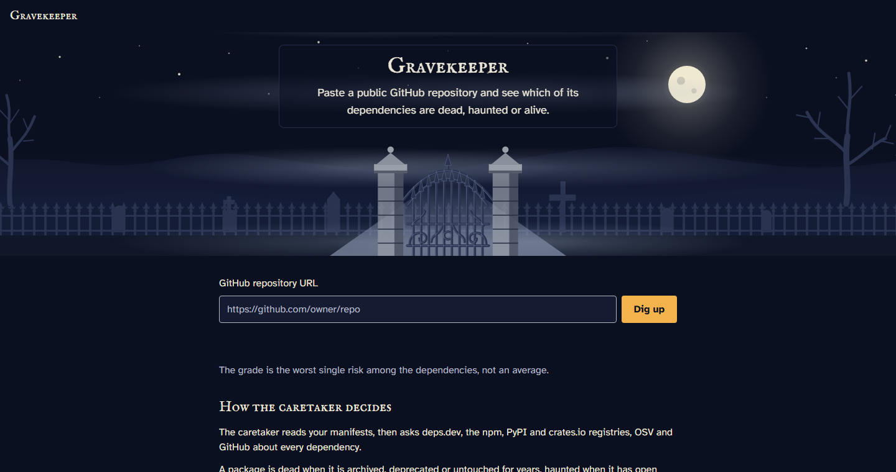
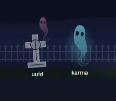

# Gravekeeper

Paste a public GitHub repository and see which of its dependencies are dead, haunted or alive, drawn as a graveyard.

Live: https://gravekeeper-chi.vercel.app

Open a scan directly: [request/request](https://gravekeeper-chi.vercel.app/?repo=https%3A%2F%2Fgithub.com%2Frequest%2Frequest)





## Try it

Each link was opened on production before it was listed here.

| Repository | Ecosystem | Result on production |
| --- | --- | --- |
| [request/request](https://gravekeeper-chi.vercel.app/?repo=https%3A%2F%2Fgithub.com%2Frequest%2Frequest) | npm | 31 of 40 dependencies in the graveyard, grade D |
| [psf/requests](https://gravekeeper-chi.vercel.app/?repo=https%3A%2F%2Fgithub.com%2Fpsf%2Frequests) | Python (PyPI) | 1 of 17 in the graveyard, grade B |
| [ajeetdsouza/zoxide](https://gravekeeper-chi.vercel.app/?repo=https%3A%2F%2Fgithub.com%2Fajeetdsouza%2Fzoxide) | Rust (crates.io) | 4 of 20 in the graveyard, grade B |

Results depend on live registry data and can change over time.

A scheduled GitHub Actions job ([`keep-warm.yml`](.github/workflows/keep-warm.yml)) rescans these repositories every four hours so that the links above answer from cache in well under a second; a first, uncached scan of a heavy project can take several seconds.

## What the states mean

A package is abandoned when it is archived, deprecated, or has had no release for 730 days and no commit for 730 days. It is vulnerable when it has at least one open advisory. Vulnerable wins over abandoned.

- **Dead, buried (tombstone):** abandoned because the repository is archived or the package is deprecated.
- **Dead, forgotten (overgrown grave):** abandoned only because there has been no release and no commit for 730 days.
- **Haunted (ghost):** at least one open advisory.
- **Restless (ghost rising from its stone):** at least one open advisory and also archived or deprecated.
- **Alive (lantern):** not vulnerable and not abandoned.
- **Unassessed (unmarked grave):** not checked. It is a git or path dependency, it was skipped at the scan limit, or no health data was found.

## How the grade works

Each package gets a risk score from 0 to 100. The repository grade is the grade of the single worst package, not an average.

| Grade | Worst package score |
| --- | --- |
| A | 0 to 19 |
| B | 20 to 39 |
| C | 40 to 59 |
| D | 60 to 79 |
| F | 80 to 100 |

## Data sources

- **deps.dev:** package versions, release dates and source repository links.
- **OSV:** open security advisories.
- **GitHub:** the repository tree and manifest files, archived state and recent commits.
- **npm:** package metadata, including deprecation notices.
- **PyPI:** project metadata for the selected version.
- **crates.io:** crate owners.

## How it was built with Kiro

- Every feature started as a spec with requirements, design and tasks: [.kiro/specs](.kiro/specs).
- Project rules for layering, naming, accessibility and UI live in [.kiro/steering](.kiro/steering).
- Agent hooks run the core purity check, the architecture check and related tests on save: [.kiro/hooks](.kiro/hooks).
- Each session is logged in [KIRO_LOG.md](KIRO_LOG.md), and each spec property maps to a test in [docs/property-traceability.md](docs/property-traceability.md).
- How the Kiro features were used: [docs/KIRO_USAGE.md](docs/KIRO_USAGE.md).

## Run locally

Requires Node 22 (the version CI uses).

```bash
npm ci
npm run dev            # http://localhost:3000
npm test               # unit and property tests (vitest)
npm run test:deep      # property tests with 1000 runs each
npx playwright install chromium
npm run test:e2e       # Playwright end-to-end tests
```

Environment variables:

- `GITHUB_TOKEN` (optional, read only on the server). Without it the scan skips the GitHub GraphQL repository queries and shows a note saying so. Put it in `.env.local`; never commit it.

## Architecture

- `core`: pure logic (manifest parsers, scoring, classification, grade). No network, clock or file access.
- `pipeline`: the scan orchestration and the port interfaces. No fetch, clock or timers.
- `adapters`: network sources (deps.dev, OSV, GitHub, npm, PyPI, crates.io), caches and the runtime clock.
- `view-model`: pure functions that turn a scan result into what the screen shows.
- `components` and `app`: React UI and Next.js routes. Only the scan route imports adapters.
- `npm run check:architecture` enforces these rules in CI.

## License

MIT, see [LICENSE](LICENSE).