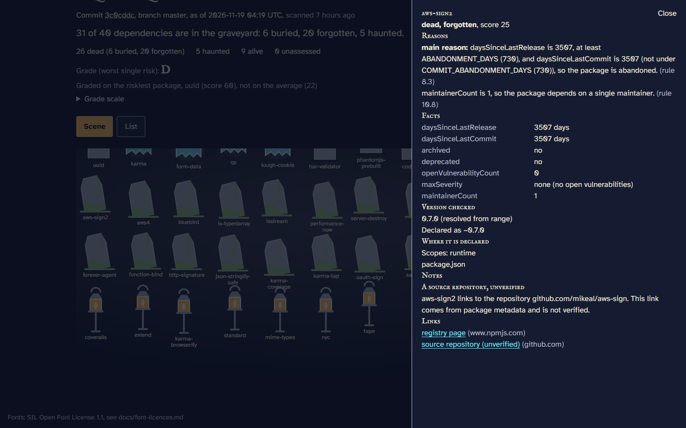
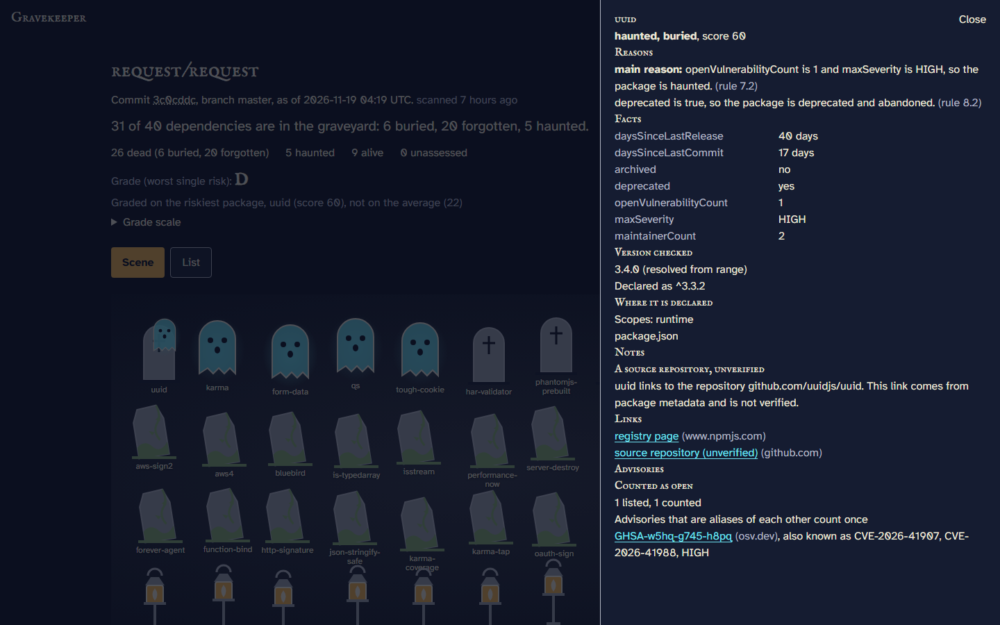
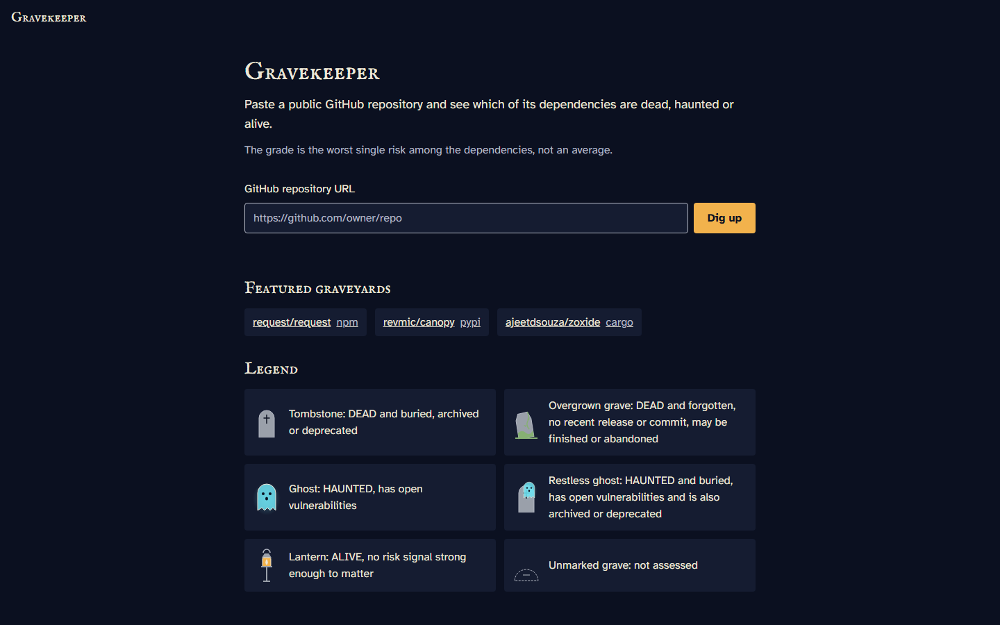
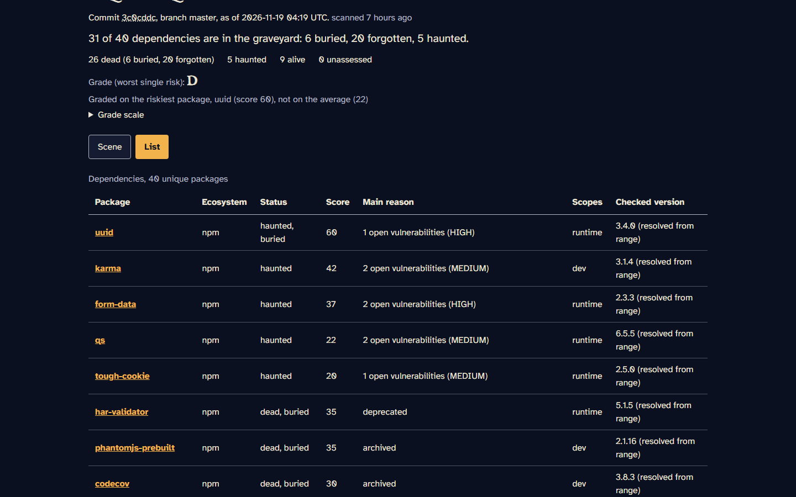
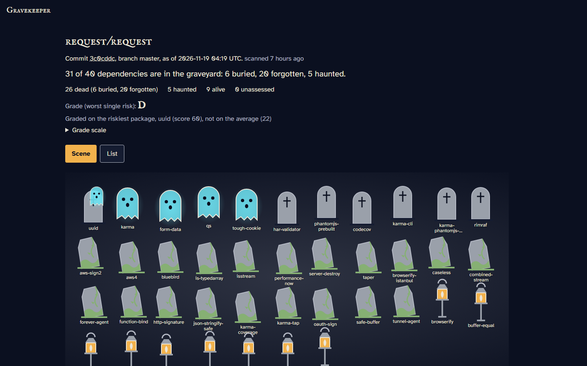
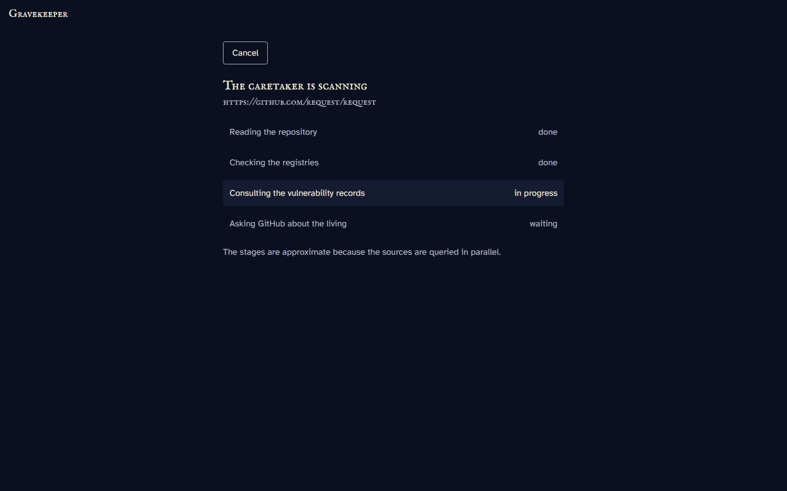

# Milestone 1 report

## Screenshots

## Scene render time

- request/request: median 38.7 ms against 100 ms budget (within budget) (4x CPU throttle; 5 runs: 71.8, 38.7, 37.5, 37.8, 40.8 ms)
- 300 plots (synthetic): median 63.9 ms against 100 ms budget (within budget) (4x CPU throttle; 5 runs: 93.8, 61.1, 60.9, 67.6, 63.9 ms)

## Client JavaScript size

- Total: 156222 bytes gzipped against 256000 bytes budget (within budget)
- Margin: 99778 bytes under budget
- Largest files:
  - `static/chunks/01t2i9pe5vz2-.js`: 71616 bytes
  - `static/chunks/33j1_fwxp3v_3.js`: 44178 bytes
  - `static/chunks/2-4svd-j7uq4o.js`: 11157 bytes
  - `static/chunks/3onkkwyty4v2n.js`: 8401 bytes
  - `static/chunks/2ob5f4-a0z6qv.js`: 6865 bytes

## Accessibility (axe)

| Screen | Result |
| --- | --- |
| Landing | 0 violations |
| Scanning | 0 violations |
| Results scene (request/request) | 0 violations |
| List view (request/request) | 0 violations |
| Detail panel (uuid) | 0 violations |
| Detail panel (forgotten package) | 0 violations |

## Deployed URL check

- URL: https://gravekeeper-chi.vercel.app
- verify:deploy: pass
- Deployed spec: pass
- axe violations on deployment: 0
- Commit: efb55dc
- Vercel status: success
- Checked at: 2026-11-20T03:39:51.027Z

## Changes to the design

- Property 9's DEAD clause relies on core's status precedence (a vulnerable package is always HAUNTED). Reason: without that precedence the clause is not true; a design note was added.
- Scene order gets a final tiebreak on `sourceKind`. Reason: Property 16 found that packages with the same ecosystem and name but different `sourceKind` kept input order.
- The table sort status key is status rank, then status word. Reason: the design said grave type, and the word also separates ghost from restless.
- Scene render contingency (design item 9) applied: the synthetic-300 median at 4x CPU throttle went from 344 ms to 171.6 ms with row bands (`content-visibility: auto`), then to 85.1 ms with windowed rows. Not in the design: bands outside the initial window also mount after a timer (400 ms + 40 ms per row), so every plot ends up in the DOM. The measure covers the first frame.
- The perf spec runs in its own Playwright project after desktop and mobile. Reason: parallel workers distorted the median (one run took 505 ms).
- `<main>` has `min-h-dvh` so the footer starts below the fold. Reason: the footer shift at the scanning to results transition was CLS 0.03 to 0.12, and is now 0.
- Links (`.gk-link`) are underlined. Reason: axe rule `link-in-text-block` in the detail panel.
- Detail panel fact labels use the field names (for example `daysSinceLastRelease`). Reason: Requirement 10.4 names them that way.
- Per-package note headings use a local table in `view-model/detail.ts` until the notes model of group 31 exists. Reason: no notes model is available yet.
- Featured-graveyard ecosystem names are a small map in `components/featured-graveyards.tsx`. Reason: no view-model constant existed.
- `TEXT_CONTRAST_MIN`, `NONTEXT_CONTRAST_MIN`, `SCENE_PERF_CPU_THROTTLE`, `SCENE_PERF_RUNS` and `RESULTS_CLS_MAX` are defined in the tests. Reason: the requirements table assigns them to tests.
- The results page moves focus to the results `h1` when results arrive. Reason: the design states focus handling only for error screens.
- `test:deep` is `scripts/test-deep.ts`. Reason: the tasks text said `.mjs`.
- Scene labels (`.gk-plot-label`) are as wide as the plot box (`var(--w)`), wrap anywhere and clamp at two lines, at 0.75rem with line-height 1.1. Reason: the first M1 screenshots showed long names (`karma-phantomjs-launcher`, `json-stringify-safe`) overlapping their neighbours. Full names stay in the aria-label and tooltip.
- Programmatic-focus targets (`h1`, `h2`, `main` and `[role="dialog"]` with `tabindex="-1"`) show no focus outline, and the explicit `[tabindex]` ring rule is narrowed to `[tabindex]:not([tabindex="-1"])`. Reason: the results `h1` showed a thick focus box after focus moved to it. Interactive elements keep their `:focus-visible` ring.
- The detail panel renders the Advisories section only when there is at least one advisory group or an empty-text sentence. Reason: a package with no advisories (aws-sign2) showed an Advisories heading with nothing under it.

## Known gaps

Not done yet:

- Group 31: Caretaker's notes (Milestone 2)
- Group 32: Checkpoint - Caretaker's notes
- Group 33: Error screens and the manifest picker
- Group 34: Checkpoint - Error screens
- Group 35: Client failure screens
- Group 36: Checkpoint - Client failure screens
- Group 37: Resurrect placeholder
- Group 38: Checkpoint - Resurrect placeholder
- Group 39: Remaining end-to-end and axe coverage
- Group 40: Checkpoint - Remaining end-to-end tests
- Group 41: Remaining screenshots
- Group 42: Checkpoint - Screenshots
- Group 43: Content-Security-Policy
- Group 44: Checkpoint - Content-Security-Policy
- Group 45: Remaining properties and traceability
- Group 46: Checkpoint - Remaining properties
- Group 47: Final checkpoint - Graveyard UI

## Credits

Kiro credit usage can't be seen from inside the session.
