# Milestone 2 report

## Screenshots

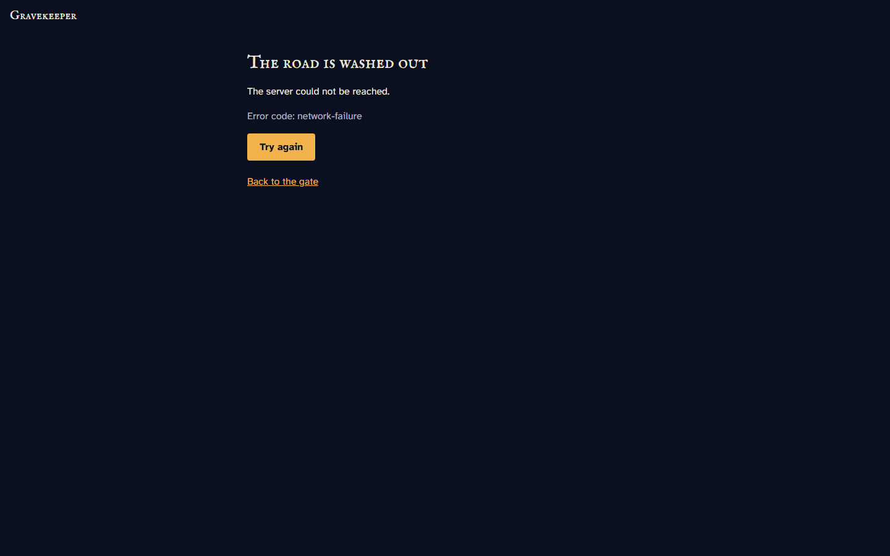

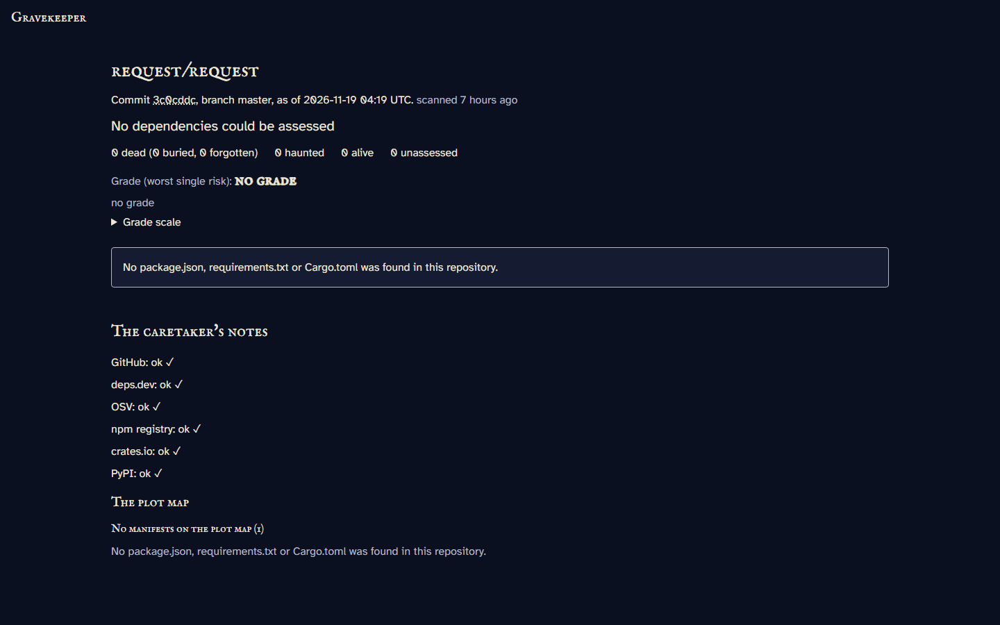

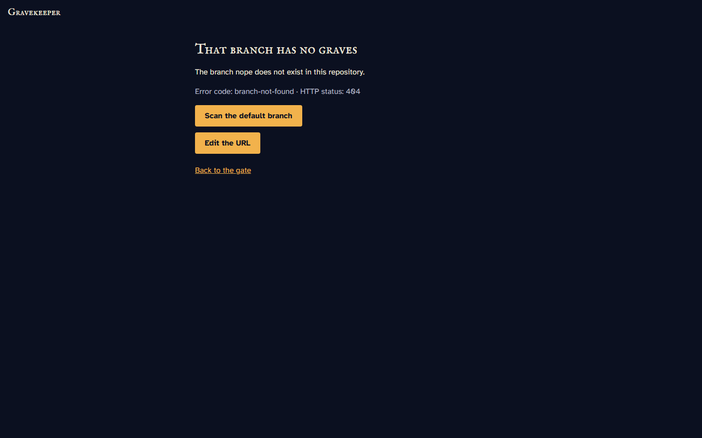

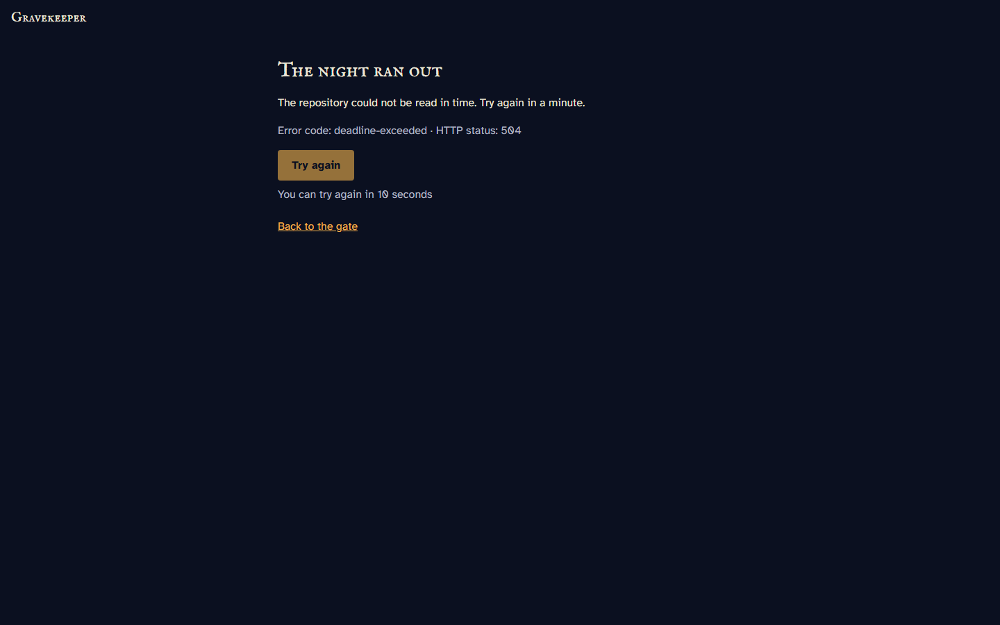

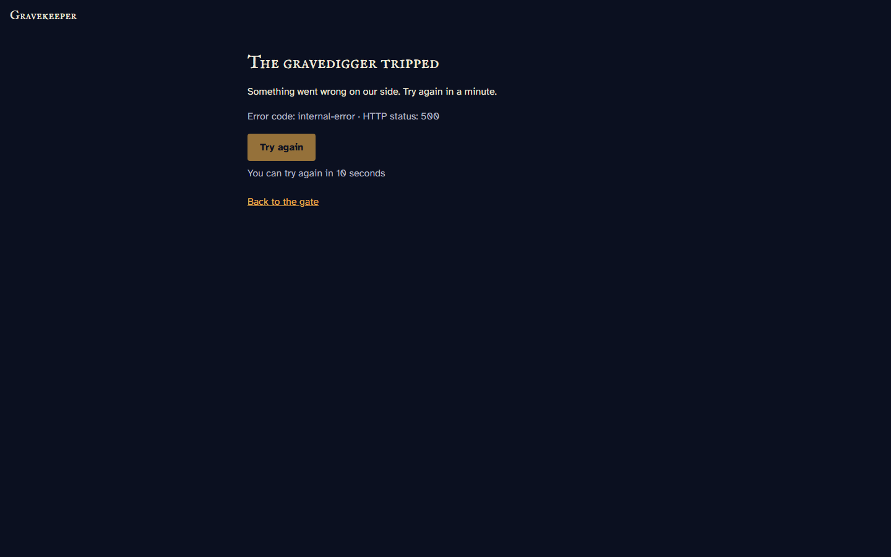

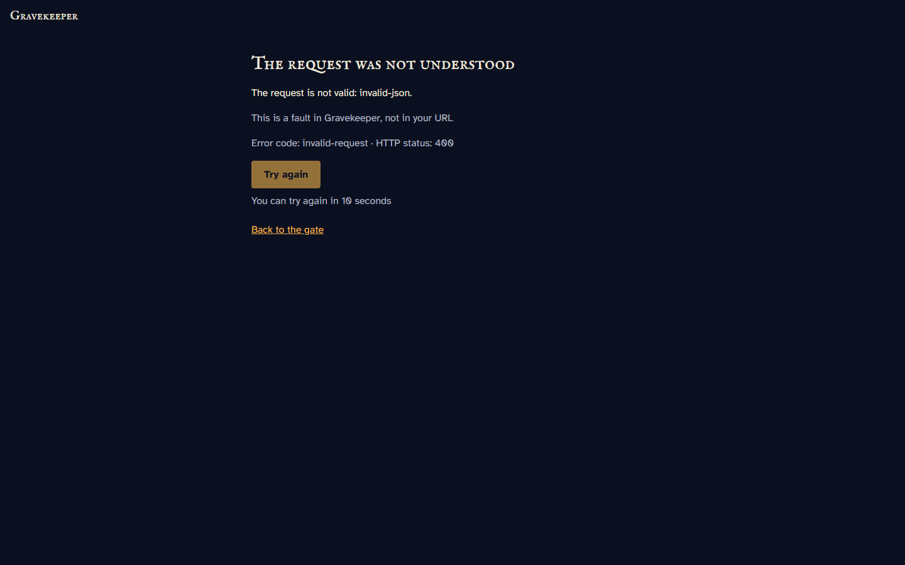

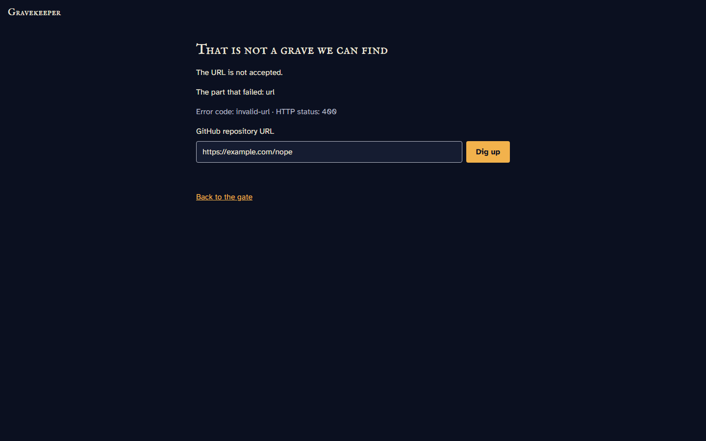

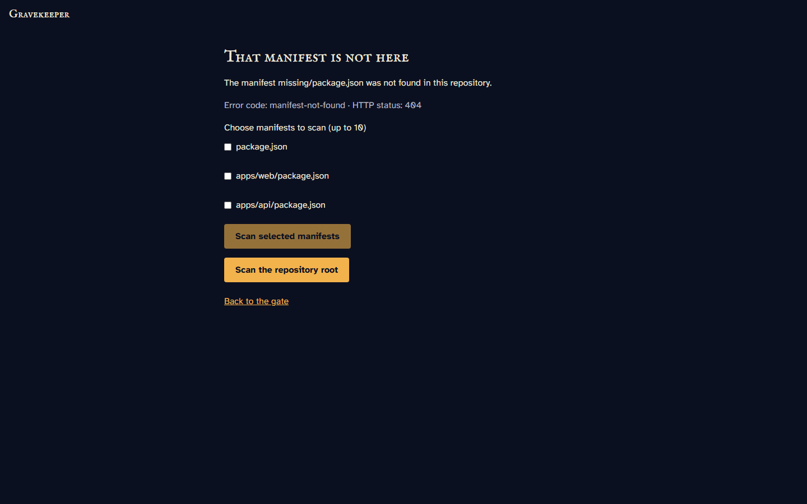

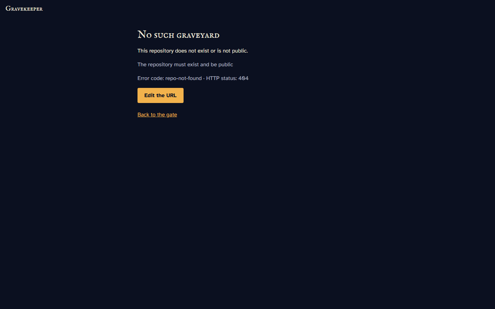

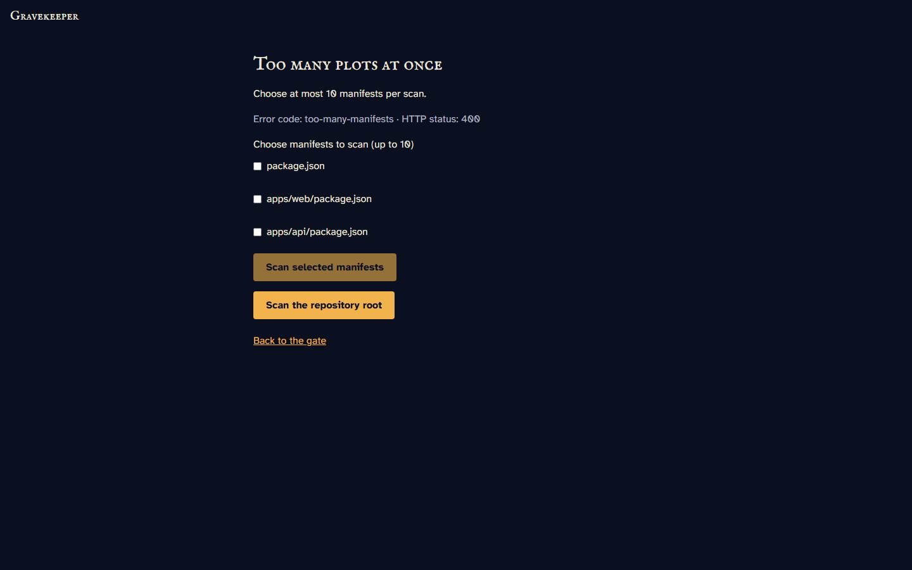

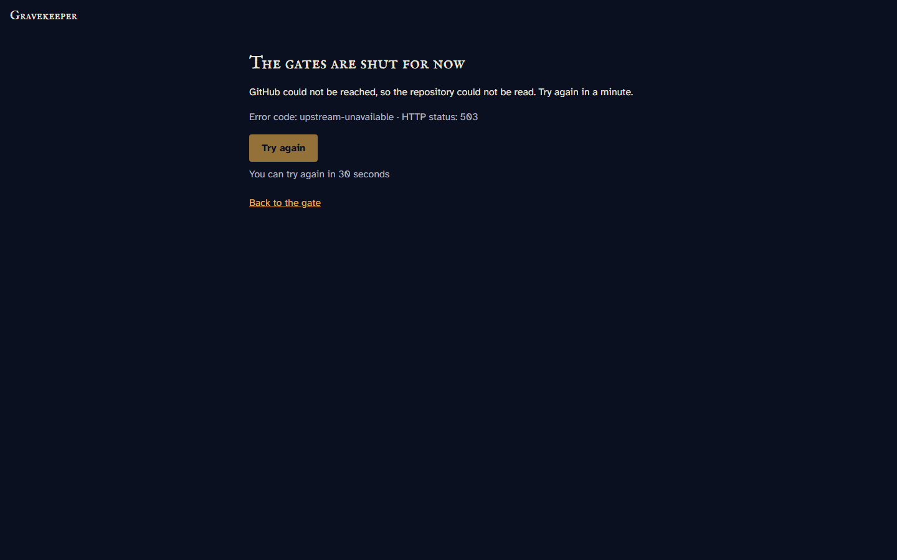

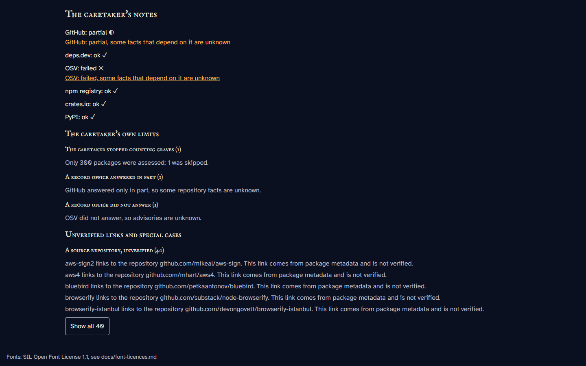

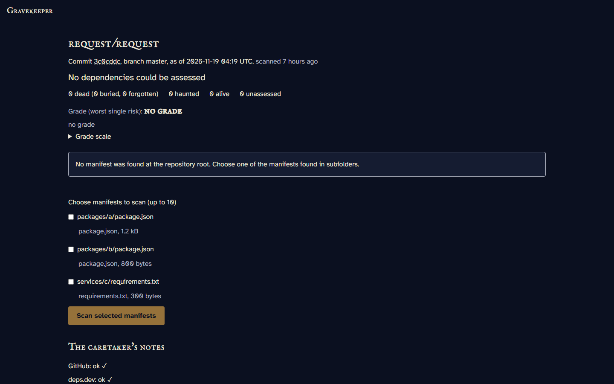

## Accessibility (axe)

| Screen | Result |
| --- | --- |
| Notes section | 0 violations |
| Error: invalid-url | 0 violations |
| Error: invalid-request | 0 violations |
| Error: repo-not-found | 0 violations |
| Error: branch-not-found | 0 violations |
| Error: too-many-manifests | 0 violations |
| Error: manifest-not-found | 0 violations |
| Error: upstream 503 | 0 violations |
| Error: upstream 502 | 0 violations |
| Error: deadline-exceeded | 0 violations |
| Error: internal-error | 0 violations |
| Manifest picker | 0 violations |
| Empty graveyard | 0 violations |
| Client failure: network-failure | 0 violations |

## Deploy check

- URL: https://gravekeeper-chi.vercel.app
- verify:deploy: pass
- Deployed spec: pass
- Live scan status: 200
- Live scan response time (ms): 1513
- Live scan total time (ms): 2593
- Live scan headline: not measured
- axe violations on deployment: 0
- Commit: ada6d19
- Vercel status: success
- Checked at: 2026-11-20T12:04:29.8005396Z

## Design changes

### Group 30 follow-ups

- Detail panel fact labels are human labels (`FACT_LABELS`); the field name is the title attribute.
- Scene row spacing: `PLOT_CELL_HEIGHT_PX` 156, `LABEL_LINE_HEIGHT_PX` 14, `LABEL_BAND_HEIGHT_PX` 28, `LABEL_FONT_SIZE_PX` 12, `LABEL_MAX_LINES` 2. Rule: 156 − 8 − 104 = 44 = 2×14 + 2×8. Properties P14 and P15 now cover the label rectangles too.
- Live production scan spec: runs against the deployed project only, never in CI.

### Milestone 2

- One note-section table is shared by the notes and the detail panel.
- The cap banner renders under the results header (the spec gave no placement).
- The empty graveyard renders under the header in place of the scene.
- For `no-root-manifest` the empty state shows that note's message and the picker sits directly under it, as a single instance.
- The picker shows path, format and size ("97 bytes", "1.2 kB").
- Invented fallback texts: "Some dependencies were not assessed" (cap banner without its note) and "No manifests were found on the plot map" (empty graveyard without a note).
- The invalid-url screen names the failing part as "The part that failed: <part>" (the spec gave no wording).
- Error code and status are shown as "Error code: <code> · HTTP status: <n>".
- Retry countdown text: "You can try again in N seconds" or "You can try again now".
- The Resurrect button is natively disabled plus `aria-disabled`; its visible description is "Not available yet".
- Scene columns are computed from the content width (container − 2×`SCENE_PADDING_PX`), and the scene scrolls in its own region (found by the reflow spec at 320 px).
- The scene renders only after the container width is measured. A 1-column first pass was removed; the 300-plot median went from 65 ms to 50 ms locally (CI 56.9 ms).
- Content-Security-Policy as specified.
- `vite-tsconfig-paths` is kept although Vite reports it as redundant.

## Known gaps

- Scene art and palette are awaiting the user's visual review.
- Resurrect is a placeholder: the button is disabled and does nothing.
- Vite reports `vite-tsconfig-paths` as redundant; the plugin is kept.
- The deployed-project Playwright run can fail with an ENOENT flake when it uses 2 workers. Run it with `--workers=1`.
- Task group 48 not complete: Deploy and report Milestone 2

## Credits

Kiro credit usage can't be seen from inside the session.
