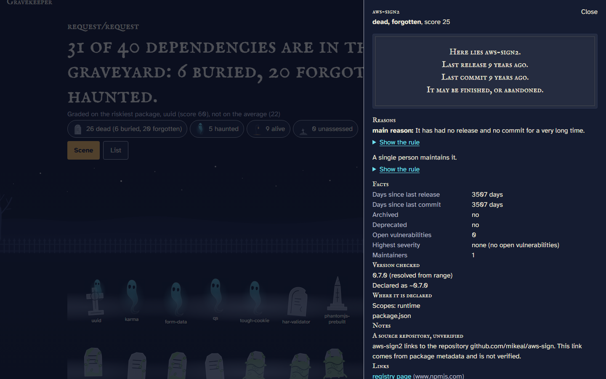
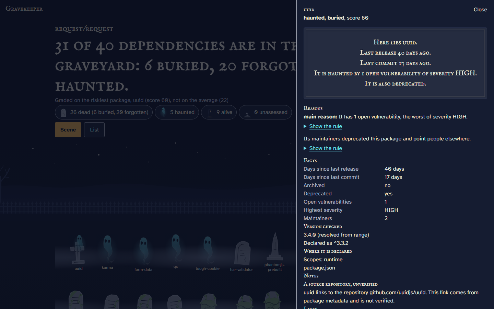
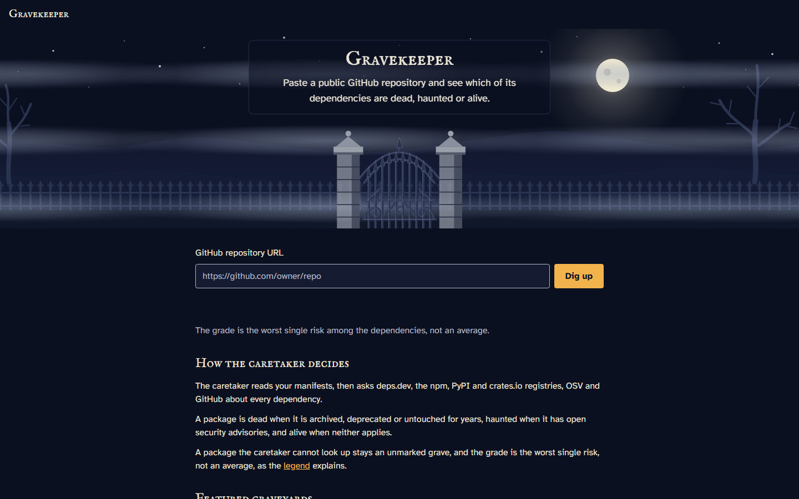
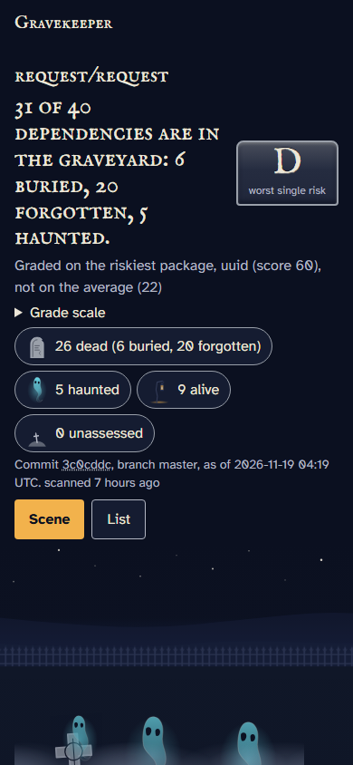
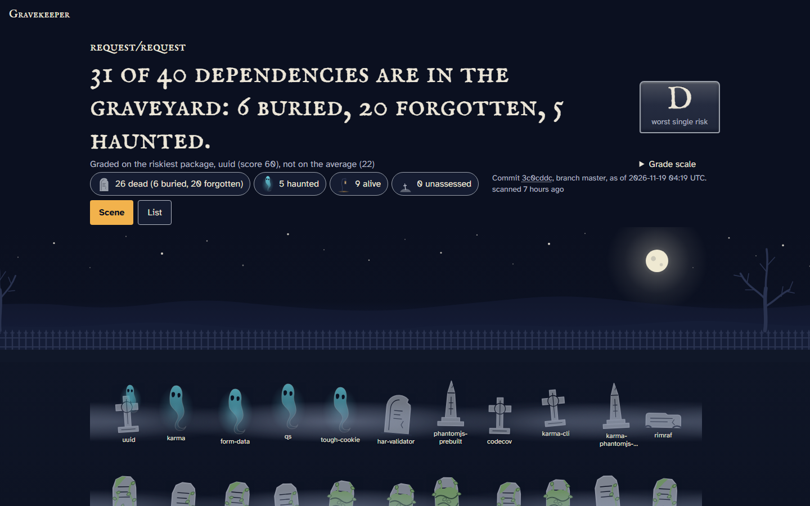
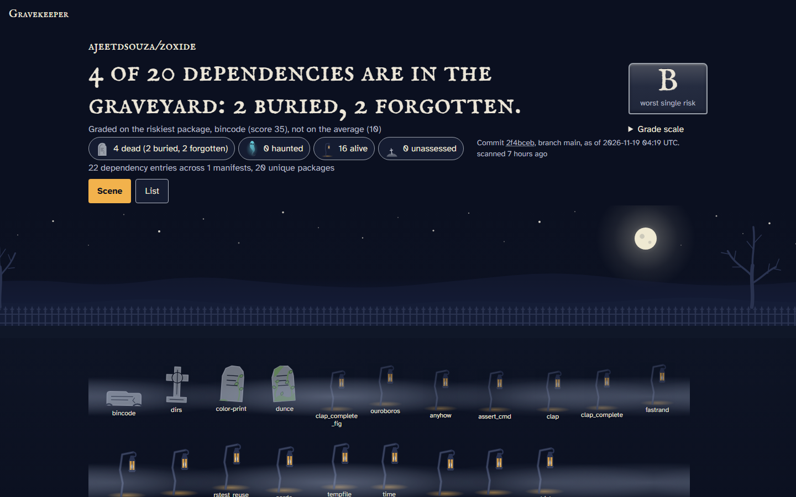
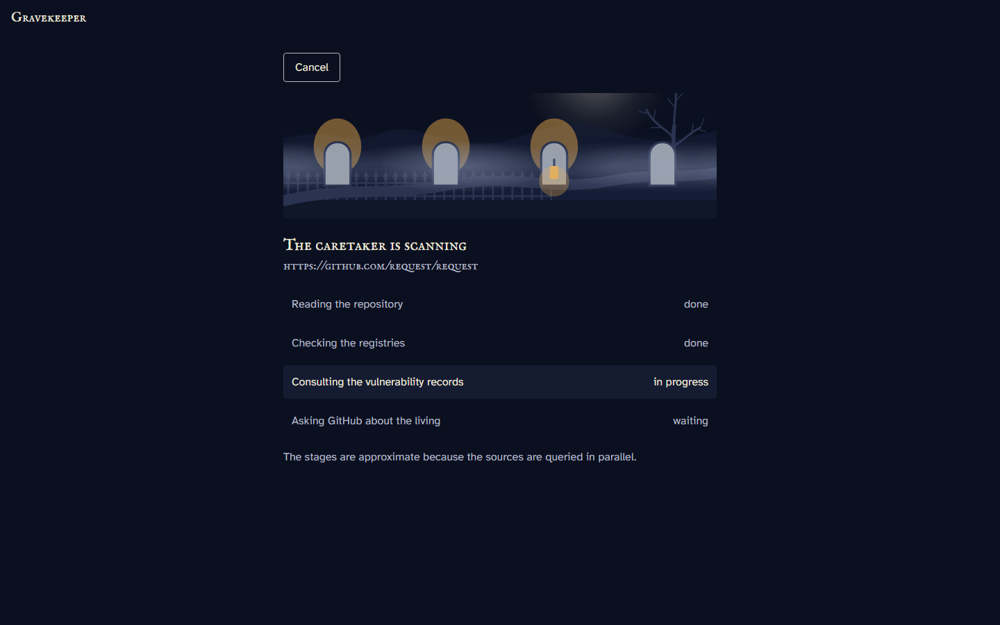

# Milestone 3 report

## Screenshots

## Render time

- Request fixture: median 17.1 ms against 100 ms budget (within budget)
  - Runs (5): 36.9 ms, 17.0 ms, 17.1 ms, 15.6 ms, 23.5 ms
  - CPU throttle: 4x
- Synthetic 300 plots: median 23.3 ms against 100 ms budget (within budget)
  - Runs (5): 40.4 ms, 22.9 ms, 23.3 ms, 24.4 ms, 23.1 ms
  - CPU throttle: 4x
- Milestone 1 baseline: 65.4 ms
- Regression limit: 15 ms

## Client JavaScript

- Total: 168734 bytes gzipped against 256000 bytes budget (within budget)
- Margin: 87266 bytes
- Soft ceiling: 180000 bytes

## Accessibility (axe)

| Screen | Result |
| --- | --- |
| Landing page | 0 violations |
| Scanning screen | 0 violations |
| Results scene, request/request (1440x900) | 0 violations |
| Results scene, ajeetdsouza/zoxide (1440x900) | 0 violations |
| Detail panel, uuid | 0 violations |
| Detail panel, aws-sign2 | 0 violations |
| Results scene, request/request (390x844) | 0 violations |

## Deploy check

- URL: https://gravekeeper-chi.vercel.app
- verify:deploy: pass
- Deployed spec: pass
- Live scan status: not measured
- Live scan time (ms): 2422

## Design changes

### Milestone 3: graveyard art

- Design correction (GA-P5): the duration regex in the design excluded 10 to 24 months. Property GA-P5 found the counterexample 300 days, which is written "10 months". The regex was fixed in design.md.
- The third sentence of "How the caretaker decides" was reworded in the design so the section keeps exactly three sentences (R9.3). The legend link sits inside the third sentence.
- Landing hero: full-bleed, 360 px high (300 px under 640 px). The cemetery gate is 205 px high (150 px under 640 px) so it does not overlap the title plate. The form sits directly under the hero, then the grade sentence. `GateFallback` renders the same `Hero`, so the h1 and the height match before hydration.
- Fog: one radial mist puff per row cell (`background-size` width by `var(--cell-h)`), drawn at the full mist opacity (0.25 and 0.35) that the contrast test checks as the worst case. The first one-large-gradient version was almost invisible, so it was replaced.
- The caretaker's lantern is positioned with a CSS `translateX` in SVG user units (`--lantern-x`), so the position follows the view-model `lanternX` with no pixel measuring.
- Lantern flicker animates the whole `.gk-plot-art` (opacity only), because CSS selectors do not reach into the `<use>` shadow tree of the symbol.
- The caretaker scene also renders under reduced motion, with `data-still="true"` (four lit stones, nothing animated), instead of being hidden (R10.4).
- Empty states: the R11.3 sentence ends "so there is no grade." and is the only place that may say "no grade". The empty sentence uses `.gk-headline-empty` (clamp 1.5 rem to 2.25 rem), smaller than the verdict headline.
- graveyard-ui P22 was refined: notes whose message equals `empty.message` are excluded from the groups (R11.6). The js-budget picker test now looks for the picker inside `EmptyGraveyard`.
- The view-model gained `EpitaphModel` (`view-model/epitaph.ts`); `DetailModel` gained `epitaph` and a `plain` line per reason. `grade-line.tsx` was replaced by `grade-plaque.tsx`, and `status-chip.tsx` was added for the count chips with plot icons.
- Render budget after the art: CI measured 115.6 ms for 300 plots (4x throttle), over the 100 ms budget. Fixes: the sprite sheet is mounted once in `GraveyardAppView` (memo), `SceneBackdrop` is memoised, the unmeasured first pass renders only the measured column (`SceneStage` `ready` prop), heading focus waits one animation frame, and `CaretakersNotes` and the manifest picker mount one frame after the scene. Lowering the budget, the run count or the throttle was rejected. CI medians after the fixes: 40 ms (300 plots) and 25 ms (request); latest local runs 31 to 33 ms and 18 to 23 ms.
- Task 6.12 contingencies from the design (flat symbols for far rows, no `rotate` for hidden bands, simpler ghost wisp) were not applied. The sprite files stayed unchanged; the render fixes above were enough.
- `GA_RENDER_REGRESSION_MAX_MS` (15) and `GA_CLIENT_JS_SOFT_CEILING_BYTES` (180000) are constants in the spec files `scene-perf.spec.ts` and `js-budget.spec.ts` (their owner in the requirements table is "tests"). The Milestone 1 baseline of 65.4 ms applies to the synthetic 300-plot scene only.
- `tests/ui/art-css.test.ts` allows `filter: none`, which the simplified-mode rule uses to switch a filter off. Any other `filter`, `backdrop-filter` or `mask` declaration still fails.
- Playwright wipes `test-results/` at the start of each run, which removes `m3-measurements.json`. The report spec must run after the scene-perf and js-budget specs in the same run (or in one command), or the measurements from the earlier runs are lost.

## Known gaps

- Screenshots use reduced motion, so fog and flicker are not visible in them.
- The render time comes from a local production build, not from the deployed site.
- Tilt and depth need CSS `rotate` and `scale`.
- axe cannot judge contrast through gradients; the token test does.
- On a 390x844 phone the results header still takes most of the first screen, so only the top of the first graves is visible without scrolling (about half a grave for request/request, the top edge for zoxide). R5.11 requires only the art top.

## Credits

Credit usage cannot be seen from here, so the credits spent on Milestone 3 are not reported.
