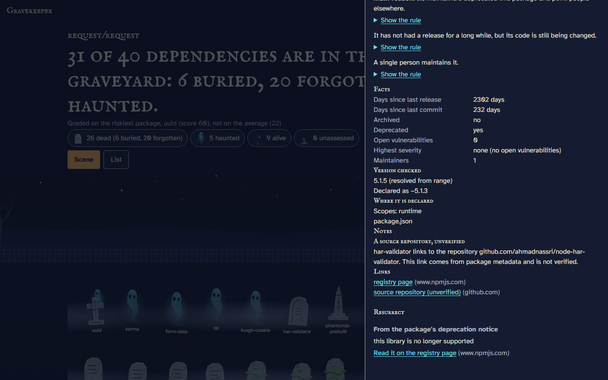
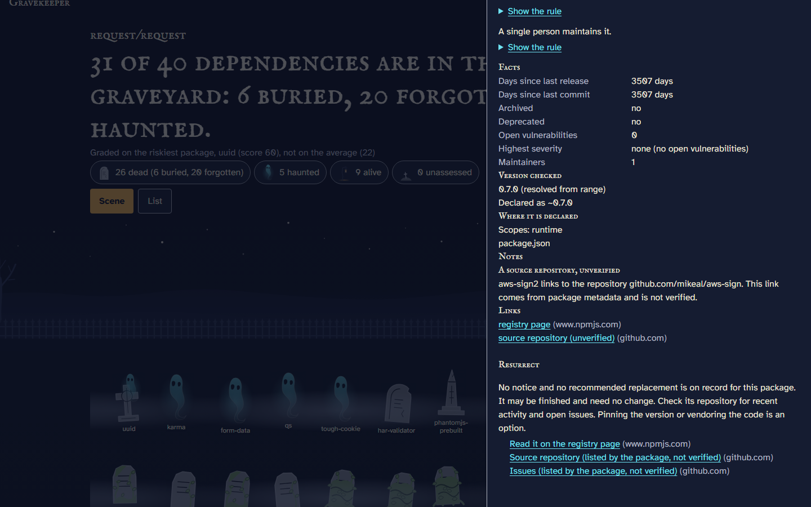
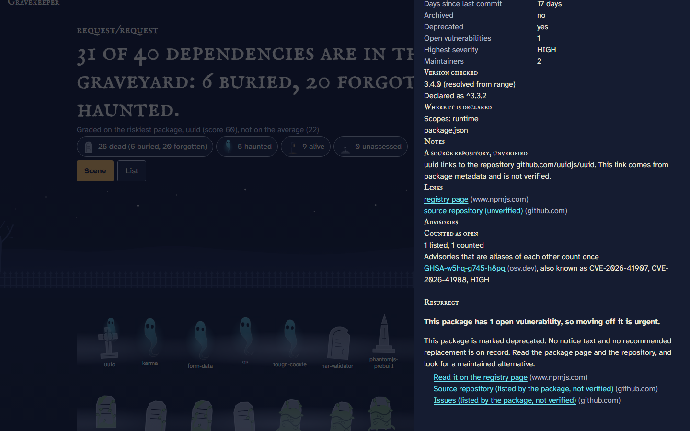

# Resurrect report

Source check date: 2026-11-21

## Curated list

Counts per ecosystem: npm 13, pypi 10, cargo 14 (42 candidates before: npm 18, pypi 10, cargo 14). Pages were fetched with the web fetch tool; GitHub READMEs of `har-validator` and `pycrypto` were also read with `gh api`. Where the npm registry document (`registry.npmjs.org/<name>/latest`) was the page that states the deprecation message, it is the source URL.

| Ecosystem | From | To | Source |
| --- | --- | --- | --- |
| npm | babel-eslint | @babel/eslint-parser | https://github.com/babel/babel-eslint |
| npm | coffee-script | coffeescript | https://registry.npmjs.org/coffee-script/latest |
| npm | gulp-util | fancy-log, plugin-error, vinyl | https://github.com/gulpjs/gulp-util |
| npm | hoek | @hapi/hoek | https://registry.npmjs.org/hoek/latest |
| npm | istanbul | nyc | https://registry.npmjs.org/istanbul/latest |
| npm | jade | pug | https://github.com/pugjs/pug/issues/2184 |
| npm | karma-phantomjs-launcher | puppeteer | https://registry.npmjs.org/karma-phantomjs-launcher/latest |
| npm | moment | luxon, dayjs, date-fns | https://momentjscom.readthedocs.io/en/latest/moment/-project-status/01-recommendations/ |
| npm | node-sass | sass, sass-embedded | https://registry.npmjs.org/node-sass/latest |
| npm | node-uuid | uuid | https://registry.npmjs.org/node-uuid/latest |
| npm | request | got, axios, node-fetch | https://github.com/request/request/issues/3143 |
| npm | tslint | eslint, typescript-eslint | https://github.com/palantir/tslint/issues/4534 |
| npm | uglify-es | uglify-js | https://registry.npmjs.org/uglify-es/latest |
| pypi | beautifulsoup | beautifulsoup4 | https://www.crummy.com/software/BeautifulSoup/ |
| pypi | distribute | setuptools | https://pypi.org/project/distribute/ |
| pypi | mysql-python | mysqlclient | https://pypi.org/project/mysqlclient/1.3.7/ |
| pypi | nose | nose2, pytest | https://nose.readthedocs.io/en/latest/ |
| pypi | oauth2client | google-auth, oauthlib | https://github.com/googleapis/oauth2client |
| pypi | pep8 | pycodestyle | https://github.com/PyCQA/pycodestyle |
| pypi | pil | pillow | https://github.com/python-pillow/Pillow |
| pypi | pycrypto | cryptography, pycryptodome | https://www.pycrypto.org/ |
| pypi | sklearn | scikit-learn | https://pypi.org/project/sklearn/ |
| pypi | tensorflow-gpu | tensorflow | https://pypi.org/project/tensorflow-gpu/ |
| cargo | ansi_term | nu-ansi-term, owo-colors | https://rustsec.org/advisories/RUSTSEC-2021-0139.html |
| cargo | bincode | wincode, postcard, bitcode, rkyv | https://rustsec.org/advisories/RUSTSEC-2025-0141.html |
| cargo | dotenv | dotenvy | https://rustsec.org/advisories/RUSTSEC-2021-0141.html |
| cargo | failure | thiserror, anyhow | https://rustsec.org/advisories/RUSTSEC-2020-0036.html |
| cargo | fxhash | rustc-hash | https://rustsec.org/advisories/RUSTSEC-2025-0057.html |
| cargo | instant | web-time | https://rustsec.org/advisories/RUSTSEC-2024-0384.html |
| cargo | memmap | memmap2 | https://rustsec.org/advisories/RUSTSEC-2020-0077.html |
| cargo | net2 | socket2 | https://rustsec.org/advisories/RUSTSEC-2020-0016.html |
| cargo | proc-macro-error | manyhow, proc-macro2-diagnostics | https://rustsec.org/advisories/RUSTSEC-2024-0370.html |
| cargo | serde_cbor | ciborium, minicbor | https://rustsec.org/advisories/RUSTSEC-2021-0127.html |
| cargo | structopt | clap | https://github.com/TeXitoi/structopt |
| cargo | tempdir | tempfile | https://rustsec.org/advisories/RUSTSEC-2018-0017.html |
| cargo | tui | ratatui | https://rustsec.org/advisories/RUSTSEC-2023-0049.html |
| cargo | yaml-rust | yaml-rust2 | https://rustsec.org/advisories/RUSTSEC-2024-0320.html |

### Changed entries

| Ecosystem | From | Change | Reason |
| --- | --- | --- | --- |
| npm | coffee-script | Source replaced by the npm registry document | The deprecation message names `coffeescript`; the GitHub page never mentions `coffee-script`. |
| npm | gulp-util | Source replaced by the gulp-util README | The Medium post returned HTTP 403; the README names vinyl, fancy-log and plugin-error. |
| npm | hoek | Source replaced by the npm registry document | The deprecation message names `@hapi/hoek`; the GitHub page does not. |
| npm | istanbul | Source replaced by the npm registry document | The repository README only points to "the supported version" and does not name `nyc`; the npm message does. |
| npm | karma-phantomjs-launcher | `to` reduced to `puppeteer`; source replaced by the npm registry document | The npm message says "use puppeteer or similar"; `karma-chrome-launcher` is not named on any page. |
| npm | moment | Source replaced by the Moment recommendations page | The `momentjs.com` page did not return the status text with the names; the official docs mirror lists Luxon, Day.js and date-fns. |
| npm | node-sass | `sass-embedded` added; source replaced by the npm registry document | The deprecation message names `sass` and `sass-embedded`. |
| npm | node-uuid | Source replaced by the npm registry document | The deprecation message says to use the uuid module; the uuid repository page was not the page that states it. |
| npm | request | Source replaced by issue 3143 | Issue 3142 names no alternatives; issue 3143 names node-fetch, got and axios. |
| npm | uglify-es | `to` changed from `terser` to `uglify-js`; source replaced by the npm registry document | The deprecation message says ECMAScript support is superseded by `uglify-js`; `terser` is not named. |
| pypi | mysql-python | Source replaced by the mysqlclient 1.3.7 page on PyPI | The mysqlclient README names only MySQLdb1; that PyPI page says mysqlclient is a fork of MySQL-python. |
| pypi | oauth2client | `to` changed from `google-auth`, `google-auth-oauthlib` to `google-auth`, `oauthlib` | The README says "google-auth and oauthlib". |
| pypi | pil | Source replaced by the Pillow README | `pypi.org/project/PIL/` returned a client challenge page; the README names Pillow as the PIL fork. |
| pypi | pycrypto | `to` changed from `pycryptodome` to `cryptography`, `pycryptodome`; source replaced by pycrypto.org | The PyCryptodome pages say nothing about PyCrypto; the PyCrypto site states it is unmaintained and recommends both packages. |
| cargo | proc-macro-error | `to` changed from `proc-macro-error2` to `manyhow`, `proc-macro2-diagnostics` | The advisory lists these two; `proc-macro-error2` is not named. |

The `why` sentences of all entries were rewritten to state only what the page says.

### Dropped candidates

| Ecosystem | From | Reason | URL tried |
| --- | --- | --- | --- |
| npm | phantomjs | The repository says development is suspended and names no successor; the npm message only says the package was renamed to `phantomjs-prebuilt`, which is itself deprecated. Removed `to`: puppeteer, playwright | https://github.com/ariya/phantomjs, https://registry.npmjs.org/phantomjs/latest |
| npm | phantomjs-prebuilt | The npm message says only "this package is now deprecated" and names no successor. Removed `to`: puppeteer, playwright | https://registry.npmjs.org/phantomjs-prebuilt/latest, https://github.com/Medium/phantomjs |
| npm | protractor | The npm message points to an Angular blog post (HTTP 403 / redirect to Medium) and names no tool; `angular.dev` lists e2e tools but does not state the Protractor deprecation. Removed `to`: playwright, cypress | https://github.com/angular/protractor, https://registry.npmjs.org/protractor/latest, https://blog.angular.dev/protractor-deprecation-update-august-2023-2beac7402ce0 |
| npm | request-promise | The README says the package is deprecated because request is deprecated and names no alternative. Removed `to`: got, axios | https://github.com/request/request-promise |
| npm | request-promise-native | The npm message says it is deprecated because request is deprecated and names no alternative. Removed `to`: got, axios | https://registry.npmjs.org/request-promise-native/latest |

`har-validator`: dropped (not added). The npm message says only "this library is no longer supported" and the GitHub README names no successor (https://registry.npmjs.org/har-validator/latest, https://github.com/ahmadnassri/node-har-validator).

Other checks: the RustSec URLs ending in `.html` all resolve. The Medium post for gulp-util and `pypi.org/project/PIL/` are not reachable by the fetch tool, so they are not used as sources.

### Removed by the live contract test

No target failed the contract test. On 2026-11-21 all 55 distinct replacement targets passed: each exists in its registry, is not deprecated or yanked, has no unmaintained advisory (crates.io), and its GitHub repository, when listed, is not archived (checked with a GitHub token).

## Properties

Each property ran 1000 times with `npm run test:deep` (`FC_NUM_RUNS` not set in the shell).

| Property | Title | Test file | Runs | Result |
| --- | --- | --- | --- | --- |
| RS-P1 | The Resurrect_Model is deterministic | `tests/ui/view-model/resurrect-determinism.property.test.ts` (4 tests) | 1000 | pass, no counterexample found |
| RS-P2 | The slot exists exactly for DEAD packages and restless ghosts | `tests/ui/view-model/resurrect-visibility.property.test.ts` (3 tests) | 1000 | pass, no counterexample found |
| RS-P3 | Every suggested name is validated | `tests/ui/view-model/resurrect-names.property.test.ts` (1 test) | 1000 | pass, no counterexample found |
| RS-P4 | Commands contain only Fixed_Words and Validated_Names, and the copy text equals the lines | `tests/ui/view-model/resurrect-commands.property.test.ts` (2 tests) | 1000 | pass, no counterexample found |
| RS-P5 | A package is never suggested as its own replacement | `tests/ui/view-model/resurrect-self.property.test.ts` (3 tests) | 1000 | pass, no counterexample found |
| RS-P6 | Hint text is bounded, plain and stable | `tests/pipeline/mapping/hint-text.property.test.ts` (6 tests) | 1000 | pass, no counterexample found |
| RS-P7 | Links come only from validated builders, never from hint text | `tests/ui/view-model/resurrect-links.property.test.ts` (2 tests) | 1000 | pass, no counterexample found |
| RS-P8 | Hint extraction is total and well-shaped | `tests/pipeline/mapping/hints.property.test.ts` (6 tests) | 1000 | pass, no counterexample found |
| RS-P9 | Client narrowing of hints is total, valid and idempotent | `tests/ui/view-model/narrow-hints.property.test.ts` (3 tests) | 1000 | pass, no counterexample found |
| RS-P10 | Curated lookup is invariant under equivalent spellings | `tests/ui/view-model/resurrections.property.test.ts` (5 tests) | 1000 | pass, no counterexample found |
| RS-P11 | Section order is fixed and the fallback is exclusive | `tests/ui/view-model/resurrect-order.property.test.ts` (5 tests) | 1000 | pass, no counterexample found |
| RS-P12 | Scan results with hints survive JSON and the validator | `tests/pipeline/scan/scan-cache-hints.property.test.ts` (3 tests) | 1000 | pass, no counterexample found |

### Counterexamples found during development

- **RS-P3 found a real defect.** Names from an injected curated list were not re-validated in `suggestionOf` (`view-model/resurrect.ts`). Counterexamples: an npm buried row `request` with `to: [""]` (seed -726162033), the same with `to: ["a b"]` (deep seed -1346668248), and a cargo row with `to: ["@scope/pkg","got"]`. Fixed in commit d18b79f. A later RS-P3 counterexample (pypi `requirements.txt` path used as a code segment, seed -1445781093) was a test bug: the manifest path is a legitimate code segment, so the test was narrowed to exempt exact origin paths.
- **Scan-pipeline Property 71** (compact L2 OSV entry equals full text) caught that the compact cache entry dropped `summary` and `details` after this spec started reading them. Counterexample `{"summary":"","id":"a"}`, seed 433693239. Fixed in commit 87dd26b (task 1.11, criterion 3.8).
- **RS-P6 test bug:** a U+FEFF trim check failed (seed -1597909426). The code was right and the test was corrected.

## What the slot shows

Text is taken verbatim from `test-results/resurrect-slot-text.json`. Sections are separated by blank lines. All five slots come from the `request/request` fixture except the first, which is synthetic.

### request (synthetic row)

`request` is not a dependency of `request/request`. The row is **synthetic**: a buried `request` npm row was added to the request fixture through a mocked body. Its hint text is the real npm deprecation notice of `request@2.88.2`, fetched from `https://registry.npmjs.org/request/latest` on 2026-11-21. The curated list supplies got, axios and node-fetch, each with commands.

- From the package's deprecation notice: "request has been deprecated, see https://github.com/request/request/issues/3142"
- Link: Read it on the registry page (www.npmjs.com)
- From the caretaker's list: "The request maintainers collected alternative libraries after deprecating request, and the list names node-fetch, got and axios."
- Link: Source for this suggestion (github.com)
- got: `npm uninstall request`, `npm install got`, Copy
- axios: `npm uninstall request`, `npm install axios`, Copy
- node-fetch: `npm uninstall request`, `npm install node-fetch`, Copy

### har-validator

- From the package's deprecation notice: "this library is no longer supported"
- Link: Read it on the registry page (www.npmjs.com)

There is no curated suggestion: its registry page names no successor (see Curated list).

### phantomjs-prebuilt

- From the package's deprecation notice: "this package is now deprecated"
- Link: Read it on the registry page (www.npmjs.com)

There is no curated suggestion: its registry page names no successor (see Curated list).

### aws-sign2

No hint and no curated entry, so the fallback shows:

- "No notice and no recommended replacement is on record for this package. It may be finished and need no change. Check its repository for recent activity and open issues. Pinning the version or vendoring the code is an option."
- Links: Read it on the registry page (www.npmjs.com); Source repository (listed by the package, not verified) (github.com); Issues (listed by the package, not verified) (github.com)

### uuid

- Urgent line: "This package has 1 open vulnerability, so moving off it is urgent."
- Buried paragraph: "This package is marked deprecated. No notice text and no recommended replacement is on record. Read the package page and the repository, and look for a maintained alternative."
- Links: Read it on the registry page (www.npmjs.com); Source repository (listed by the package, not verified) (github.com); Issues (listed by the package, not verified) (github.com)

The deprecation notice of `uuid@3.4.0` is on its own version document, which the scan does not fetch (Decision D3). The slot therefore shows the urgent line and the buried paragraph, not the notice text.

## Screenshots

1440x900, desktop project, detail panel scrolled to the slot.

Axe violations per panel (from `test-results/resurrect-slot-text.json`):

| Panel | Violations |
| --- | --- |
| har-validator | 0 |
| aws-sign2 | 0 |
| uuid | 0 |
| phantomjs-prebuilt | 0 |
| request (synthetic) | 0 |

Total: 0.

## Findings

- Client JS is 173,948 B gzip of the 256,000 B budget. It was 168,829 B before this spec (+5,119 B). The curated JSON sits in the lazy detail-panel chunk.
- Scene render medians: 31.6 ms (300 plots) and 17.0 ms (request).
- Curated list: 37 entries kept (npm 13, pypi 10, cargo 14) of 42 candidates, 5 dropped. The live contract test removed 0 (55 targets checked).
- Hints present per fixture: request/request has them for har-validator, phantomjs-prebuilt, karma-phantomjs-launcher and codecov; zoxide has the bincode advisory; psf/requests and canopy have none.
- Several npm sources are raw registry JSON (`registry.npmjs.org/<name>/latest`). They state the notice but are not friendly pages.
- The 600-code-point cap cuts nothing for bincode (425 characters).
