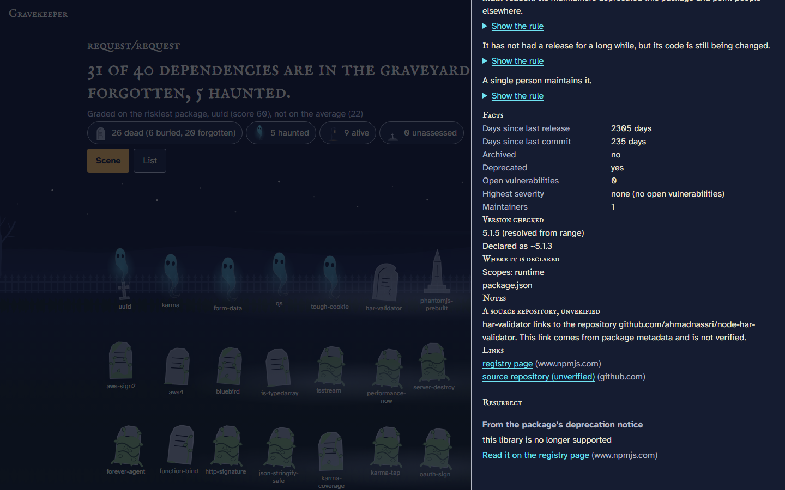
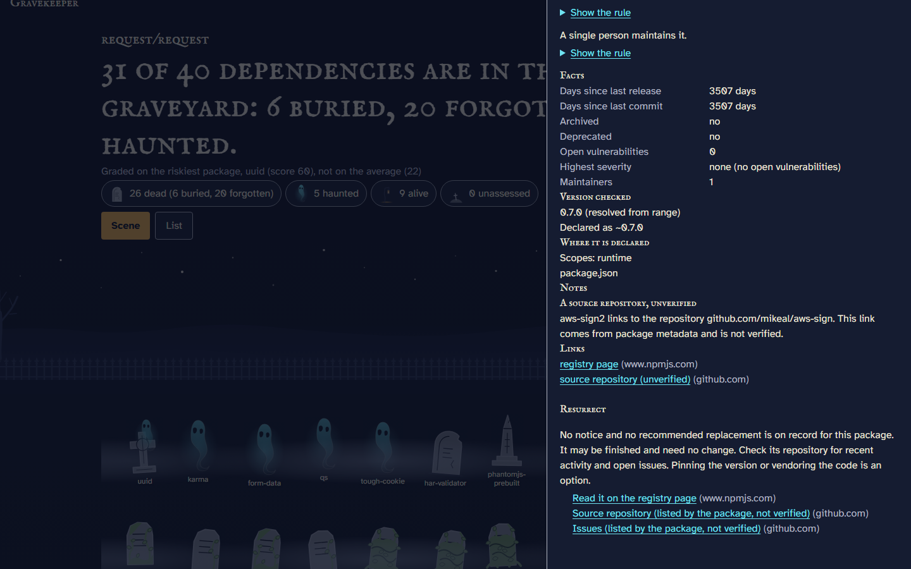
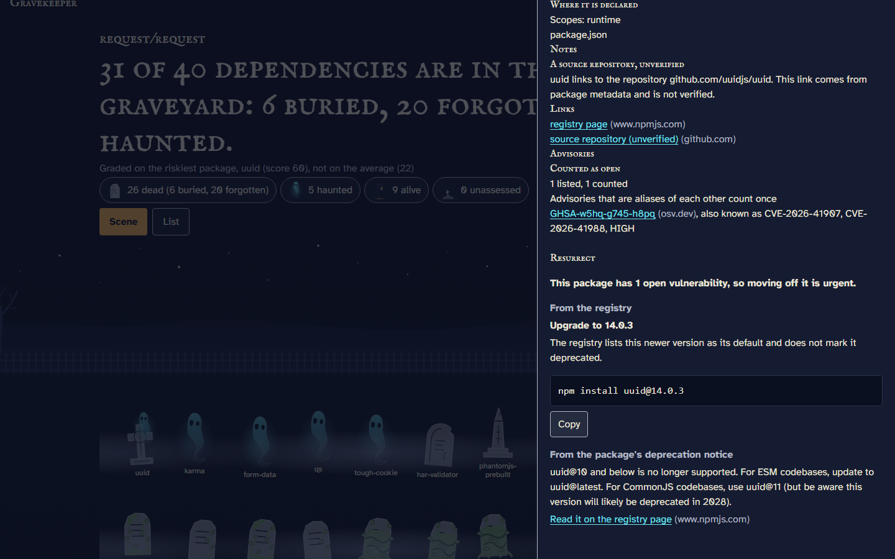

# Resurrect upgrade report

Verified 2026-11-21. Spec: `.kiro/specs/resurrect-upgrade`. Texts below come from `test-results/resurrect-slot-text.json` (the Resurrect slot of the detail panel, `innerText`, verbatim).

## What the slot shows

### uuid

Recorded `request/request` fixture, checked version 3.4.0. The slot holds the urgent line, the Upgrade section with its command, then the deprecation notice of the checked version (uuid@3.4.0). No fallback is shown.

- Urgent line: "This package has 1 open vulnerability, so moving off it is urgent."
- Upgrade section: label "From the registry", title "Upgrade to 14.0.3", command `npm install uuid@14.0.3`
- Hint label: "From the package's deprecation notice"

```
Resurrect

This package has 1 open vulnerability, so moving off it is urgent.

From the registry

Upgrade to 14.0.3

The registry lists this newer version as its default and does not mark it deprecated.

npm install uuid@14.0.3
Copy

From the package's deprecation notice

uuid@10 and below is no longer supported. For ESM codebases, update to uuid@latest. For CommonJS codebases, use uuid@11 (but be aware this version will likely be deprecated in 2028).

Read it on the registry page (www.npmjs.com)
```

### rimraf

Recorded fixture. rimraf is a dev dependency, so the command carries `--save-dev`.

- Upgrade section: label "From the registry", title "Upgrade to 6.1.4", command `npm install --save-dev rimraf@6.1.4`
- Hint label: "From the package's deprecation notice"

```
Resurrect

From the registry

Upgrade to 6.1.4

The registry lists this newer version as its default and does not mark it deprecated.

npm install --save-dev rimraf@6.1.4
Copy

From the package's deprecation notice

Rimraf versions prior to v4 are no longer supported

Read it on the registry page (www.npmjs.com)
```

### har-validator

Recorded fixture. Only the notice of its `/latest` document is shown. There is no upgrade: 5.1.5 is already the latest version and deps.dev has no healthier default. There is no fallback.

```
Resurrect

From the package's deprecation notice

this library is no longer supported

Read it on the registry page (www.npmjs.com)
```

### request (synthetic)

**Synthetic row.** `request` is not a dependency of request/request. A buried `request` npm row was added to the request fixture body (mocked). Its hint is the real npm deprecation notice of request@2.88.2, fetched from `https://registry.npmjs.org/request/latest` on 2026-11-21. It has no upgrade because the synthetic row carries none, so the slot shows the notice plus the caretaker's list (got, axios, node-fetch).

```
Resurrect

From the package's deprecation notice

request has been deprecated, see https://github.com/request/request/issues/3142

Read it on the registry page (www.npmjs.com)

From the caretaker's list

The request maintainers collected alternative libraries after deprecating request, and the list names node-fetch, got and axios.

Source for this suggestion (github.com)

got

npm uninstall request
npm install got
Copy

axios

npm uninstall request
npm install axios
Copy

node-fetch

npm uninstall request
npm install node-fetch
Copy
```

axe-core found 0 violations on all six panels of the report spec (har-validator, aws-sign2, uuid, phantomjs-prebuilt, rimraf, synthetic request).

## Screenshots

All 1440x900, regenerated 2026-11-21. The uuid shot shows the urgent line, the Upgrade section with its command and Copy button, then the hint.







## Properties

RU-P1 to RU-P8 all passed at 1000 runs (`npm run test:deep`) with no counterexample. RS-P5 ("never its own replacement") is unchanged and still passes.

| Property | Title (design.md) | Tests |
| --- | --- | --- |
| RU-P1 | A version document is requested exactly for a deprecated, differing, strict npm version | 2 |
| RU-P2 | Hint combination prefers the version notice and stays bounded | 3 |
| RU-P3 | An upgrade is offered only to an existing, healthy, higher default version of a deprecated checked version | 1 |
| RU-P4 | Strict versions are shell-safe and upgrade commands follow the fixed grammar | 2 |
| RU-P5 | Client narrowing of the upgrade is total, valid and idempotent | 3 |
| RU-P6 | Section order is fixed and an upgrade suppresses the fallback | 3 |
| RU-P7 | Scan results with upgrades survive JSON and the validator | 2 |
| RU-P8 | The curated loader enforces the six-key schema and links only the human page | 1 |

No RU property found a code defect during development. One CI run (a61603b) failed because the e2e test still selected the first text block, which is now the upgrade sentence. It was fixed in 891ed4a (task 15.1).

## Requests

Cold scan of `request/request`, L2 cache off.

| | Before | After |
| --- | --- | --- |
| Total requests | 103 | 105 |
| npm requests | 40 | 42 |
| `GET registry.npmjs.org/{package}/latest` | 40 (labelled `{package}/{version}`) | 40 |
| `GET registry.npmjs.org/{package}/{version}` | none | 2 (uuid@3.4.0, rimraf@2.7.1) |

- Before: `docs/scan-accuracy-live-report.md`, 2026-11-19. That report predates this spec and labelled every npm request `{package}/{version}`.
- After: measured 2026-11-21. Cold duration 4065 ms. Grade D, counts 9/5/26.

## Fixture

- Repository re-recorded: `request/request` (`tests/fixtures/request__request`, 895,832 B, under 1 MiB).
- New recorded documents: `registry.npmjs.org/uuid/3.4.0` and `registry.npmjs.org/rimraf/2.7.1`.
- No other fixture set changed (checked with `git status`).
- Changed assertions, all because the version documents are now recorded and the version notice takes precedence:
  - `tests/pipeline/resurrect-fixtures.test.ts`: "uuid/rimraf carries no hint" became "carries the recorded notice of its checked version".
  - `tests/ui/view-model/resurrect.test.ts`, uuid case: buried fallback became hint, no fallback.
  - `tests/e2e/resurrect.spec.ts`, uuid case: now expects urgent, upgrade, hint.

## Live smoke

Production `https://gravekeeper-chi.vercel.app`, scan of `request/request` without a token header, after `verify:deploy` passed on 891ed4a. HTTP 200 in 5.5 s.

| Package | lookupVersion | basis | hint | upgrade |
| --- | --- | --- | --- | --- |
| uuid | 3.4.0 | resolved | the uuid@10 notice | 14.0.3 (registry-default) |
| rimraf | 2.7.1 | resolved | "Rimraf versions prior to v4 are no longer supported" | 6.1.4 |
| har-validator | 5.1.5 | resolved | its `/latest` notice | none |

## Findings

- Client JavaScript: 174,557 B gzip of the 256,000 B budget (was 173,948 B, +609 B). Scene medians: 34.8 ms (300 plots) and 20.8 ms (request).
- Only npm showed an upgrade in the recorded data. No PyPI or crates.io package in the fixtures has a deprecated checked version per deps.dev.
- HAUNTED-only packages get no upgrade. OSV is queried only for the checked version, which is a design decision.
- Caveat: uuid 14.0.3 is the deps.dev default, but the uuid notice itself suggests uuid@11 for CommonJS codebases. The slot shows the notice verbatim next to the upgrade, so a CommonJS reader sees both.
- Limit of the evidence check: it only confirms that the evidence page is reachable and names a `to` package. It cannot prove the page still reads as a recommendation.
- Curated list: 37 entries. `source` is now the human page (8 npm entries moved from registry JSON to npmjs.com). All 37 evidence URLs and 55 targets passed the live contract test (92 cases). No evidence change was needed.

## Commits and CI

Two runs failed on test assertions that this spec changed, and the next commit fixed each one. 2e850ed: the re-recorded uuid now has a hint, so the old e2e expectation of no hint failed; fixed in 4e6e94e. a61603b: the upgrade section became the first text block in the slot, so the e2e test read the wrong element; fixed in 891ed4a.

| hash | subject | CI |
| --- | --- | --- |
| 8b80843 | spec: resurrect-upgrade (requirements, design, tasks) | success |
| db4fd27 | resurrect-upgrade: strict version, cache key 5, npm getVersion (group 1) | success |
| c033595 | resurrect-upgrade: version-document plan, hint combiner, upgrade chooser (group 3) | success |
| 62446e8 | resurrect-upgrade: stage S6 version documents, upgrade in the scan result (group 5) | no own run (pushed with the next commit) |
| 2e850ed | resurrect-upgrade: re-record request/request fixture set (group 7) | failure |
| 4e6e94e | test(e2e): uuid slot shows its checked version's notice (resurrect-upgrade R2.1) | success |
| 3ea7ceb | resurrect-upgrade: curated source and evidence (group 9) | success |
| a61603b | resurrect-upgrade: upgrade section, commands, narrowing (groups 11, 13) | failure |
| 891ed4a | resurrect-upgrade: end-to-end, report spec, traceability (group 15) | success |
| c4eb43b | resurrect-upgrade: report and screenshots | success |
| (this commit) | resurrect-upgrade: report commits and CI status | pending |
